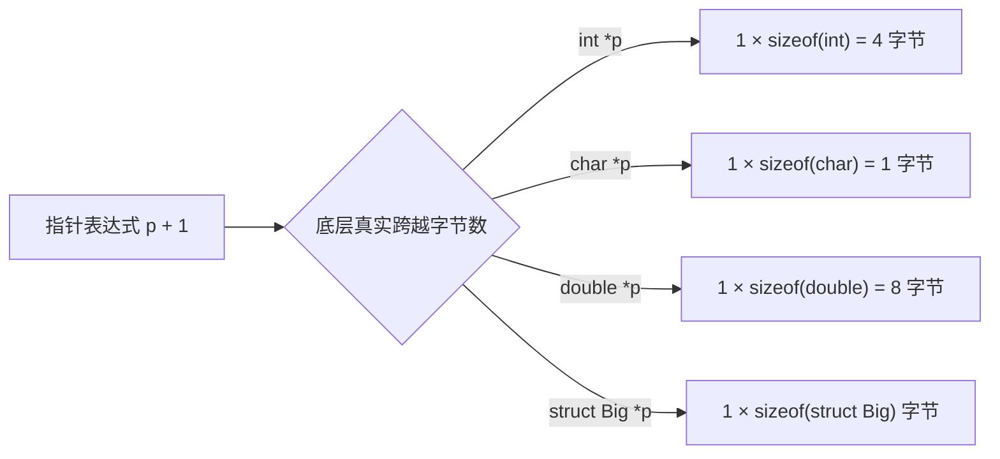
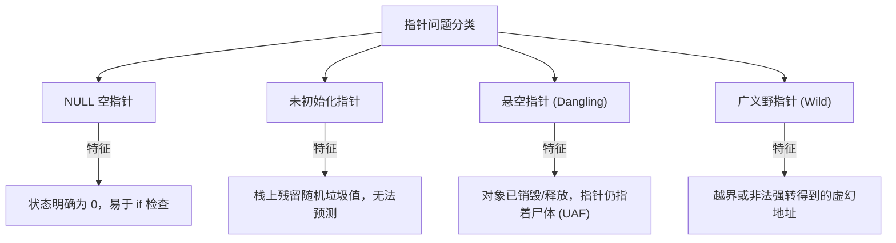
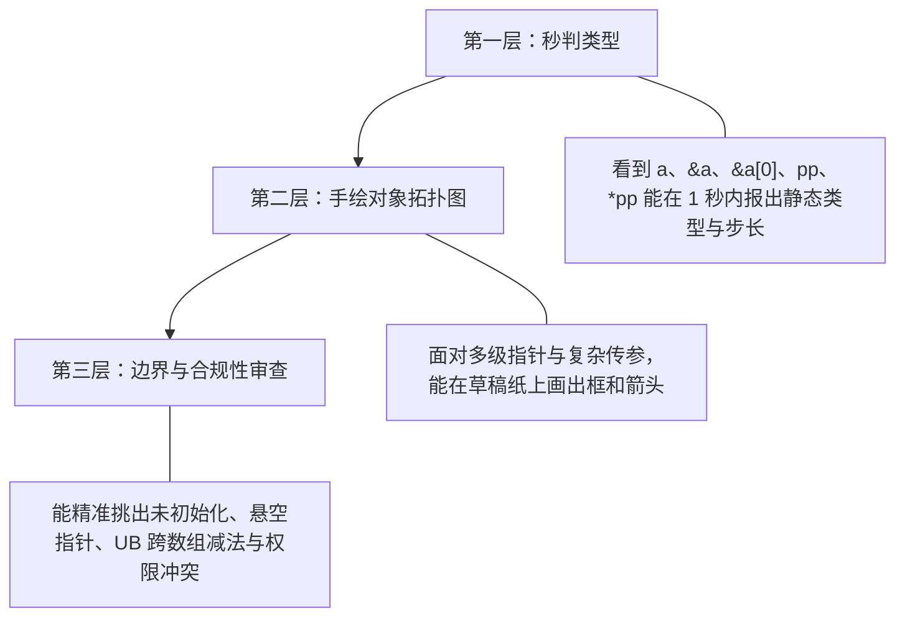

# 第 1 天：C 指针、数组与进程地址空间详细解析

> **学习目标**：今天真正要建立的，不是死记几个指针语法，而是要在脑海中建立一套**立体的计算机底层内存模型**：
> * 程序中有哪些对象？对象里存的是数据还是地址？
> * 对象位于哪一块内存区域？指针究竟指向谁？
> * 每执行一次 `*`，到底在物理/逻辑上穿透了哪一层间接关系？
>
> 只要这套物理心智模型彻底打通，后续的结构体对齐、汇编逆向、函数调用栈帧、虚拟内存页表以及二进制漏洞利用，都会迎刃而解。

---

## 【📌 一句话核心概括】
**指针本身是一个占用独立内存空间（64位系统占 8 字节）的普通变量对象，其内部存储的数值是另一个对象在内存中的起始地址；通过 `*` 解引用操作，CPU 依据指针的基类型步长对该地址处的内存进行直接读写穿透。**

## 【📖 通俗原理解释】
- **变量与指针的物理本质**：内存是一整排带有顺序编号（虚拟地址）的字节仓库。普通变量（如 `int x = 10;`）直接在自己的 4 字节内存里存放纯数字 `10`；而指针变量（如 `int *p = &x;`）也在内存中占有独立的 8 字节，里面存放的是 `x` 的起始地址。
- **取地址（`&`）与解引用（`*`）的对称工作**：`&x` 是提取目标变量在内存里的位置坐标；`*p` 则是让 CPU 顺着 `p` 里面保存的坐标，直接穿透到 `x` 的物理存储单元去读取数值或写入新数据。
- **为什么指针必须声明类型？**：物理地址本质上都是单纯的 64 位整数，但类型（如 `int*`、`char*`）决定了“解释规则”：解引用时该按多少字节读取（`int*` 读 4 字节，`char*` 读 1 字节），以及指针自增 `p+1` 时指针值向前跳跃多少个字节。

---

# 一、变量、对象、值和地址

先看最基础的代码：

```c
int x = 10;
int *p = &x;
```

## 1. `x` 是什么

```c
int x = 10;
```

在严格的 C 语言体系与底层系统视角下，这行代码同时包含了四个截然不同的维度：

| 维度 | 对应内容 | 含义通俗解释 |
| :--- | :--- | :--- |
| **标识符 (Identifier)** | `x` | 程序员给这块内存空间起的名字（编译成汇编后名字就消失了，变成相对地址） |
| **对象 (Object)** | 内存中的具体存储空间 | 内存中专门划出来保存这个 `int` 的 4 字节物理/虚拟区域 |
| **值 (Value)** | `10` | 这个 4 字节存储空间里当前装载的二进制数据 |
| **地址 (Address)** | `&x` | 这个存储空间在内存中的第一个字节的门牌号码 |

假设在某次运行中：
* `x` 的地址为：`0x7ffd12345670`
* `x` 的值为：`10`

内存物理分布如下：

```text
虚拟地址 (门牌号)         内存存储内容 (4字节)
0x7ffd12345670          [ 0000000a ]  <--- 变量名 x 指代这块空间
```

> [!NOTE]
> 常量表达式 `10` 本身只是一个纯粹的整数立即数（通常在编译阶段直接编码到汇编指令中），它本身并不占据独立的变量内存对象。

---

## 2. `p` 是什么

```c
int *p = &x;
```

很多初学者容易误以为 `p` 只是一个“悬浮在代码里的箭头”。**绝对不是！`p` 自己也是一个货真价实的对象**。

* `p` 必须在内存中占据属于它自己的存储空间（在 64 位系统上通常占据 8 字节，32 位系统上占 4 字节）。
* `p` 也有它自己的内存地址。
* `p` 里面保存的数据，恰好是另一个对象 `x` 的地址。

假设内存布局如下：

```text
对象名称         内存地址 (门牌号)        保存的内容 (数据)
p  (指针对象)    0x7ffd12345668        0x7ffd12345670 (8字节指针值) ────┐
                                                                       │ 寻址指向
x  (整型对象)    0x7ffd12345670        10             (4字节整型值) <───┘
```

现在来细剖三个表达式的本质：

* `p`：读取 `p` 自身存储的值，结果是地址 `0x7ffd12345670`。
* `&p`：取得指针对象 `p` **自己的地址**（即 `0x7ffd12345668`）。
* `*p`：通过 `p` 里存的门牌号，穿透访问目标对象 `x`。

```c
printf("%d\n", *p); // 输出 10，读取 x 的内容
*p = 20;            // 把 20 写入 p 所指向的内存空间（也就是 x）
printf("%d\n", x);  // 输出 20，x 已经被成功修改！
```

---

## 3. `*p` 不应简单理解成“p 指向的值”

更精确地说：**`*p` 是一个表达式，它直接指定了 `p` 所指向的对象本身。**

放在不同的语法上下文中，它的含义会自动切换为读取或写入：

* **作为右值（读取）**：
  ```c
  int y = *p;   // 从 p 指向的对象中把数据读出来，赋给 y
  ```
* **作为左值（写入）**：
  ```c
  *p = 100;     // 向 p 指向的对象写入新数据
  ```
* **取地址（还原）**：
  ```c
  &*p;          // 先解引用找到对象，再取地址。在合法指针前提下，结果就是 p 自身
  ```

---

## 4. 为什么不能只说“指针就是地址”？

“指针就是地址”是一句常见的入门黑话，但如果停留在这一层理解，后续学到指针运算和强转时必将产生严重混乱。

> **严格定义**：
> 指针是一个**具有指针类型**的 C 语言对象，它保存一个能够标识另一个对象或函数位置的**地址值**，并且携带了**目标对象的类型信息**。

指针 = **地址数值（去哪儿找） + 类型元数据（找到了怎么解释）**。

例如，在 64 位 Linux 平台上，以下三个指针变量在内存中都占 8 字节：

```c
int *pi;
char *pc;
double *pd;
```

虽然它们存的都是 64 位的地址数字，但编译器看待它们的眼光完全不同：

1. **解引用读取的字节数不同**：`*pi` 读 4 字节，`*pc` 读 1 字节，`*pd` 读 8 字节。
2. **指针步长（加减法）不同**：`pi + 1` 物理地址前进 4 字节，`pc + 1` 前进 1 字节，`pd + 1` 前进 8 字节。
3. **硬件对齐要求不同**：访问 `int` 通常要求地址是 4 的倍数，访问 `double` 要求 8 字节对齐。

---

# 二、指针类型和指针运算



## 1. `int *`

```c
int x = 10;
int *p = &x;
```

当执行 `*p` 时，编译器生成机器代码从目标地址连续读取 `sizeof(int)`（通常是 4）个字节，并按照整型的二进制编码（补码）将其还原为一个整数。

---

## 2. `char *`：底层内存观察探针

```c
char *p;
```

因为 `sizeof(char) == 1`（C 标准严格保证为 1 字节），所以 `p + 1` 在物理内存上严格移动 1 个字节。

基于这个特性，在底层系统逆向和分析中，`char *` 或 `unsigned char *` 常被用作**字节级内存探针**，用来观察任意变量在内存中的真实底层字节序（Endianness）：

```c
int x = 0x12345678;
unsigned char *p = (unsigned char *)&x;

for (size_t i = 0; i < sizeof(x); i++) {
    printf("[%zu]: 0x%02x\n", i, p[i]);
}
```

在常见的 x86-64 和 ARM64 小端序（Little-Endian）机器上，输出为：

```text
[0]: 0x78  <--- 低位字节放在低地址
[1]: 0x56
[2]: 0x34
[3]: 0x12  <--- 高位字节放在高地址
```

> [!WARNING]
> 尽管 `char *` 可以逐字节遍历内存，但这绝不意味着它可以越界访问不受保护的非法地址。一旦触碰没有映射的物理页或无权页面，CPU 会立刻抛出页错误，系统将以 `SIGSEGV` 终止进程。

---

## 3. `void *`：万能指针与纯地址容器

```c
void *p;
```

`void *` 代表“纯粹的内存位置”，它只记录地址，不包含任何目标类型信息：

* **隐式转换**：任何对象指针都可以自动、无损地转换为 `void *`，反之亦然（无需强转）：
  ```c
  int x = 10;
  void *vp = &x;    // 合法
  int *ip = vp;     // 合法
  ```
* **禁止解引用**：编译器不知道 `void` 究竟占几个字节，因此 `*vp` 是编译错误：
  ```c
  *vp;              // 编译报错！无法确定大小
  *(int *)vp = 20;  // 正确：必须先显式强转为具体类型指针
  ```
* **标准 C 禁止指针运算**：
  ```c
  vp + 1;           // ISO C 标准禁止！因为步长 sizeof(void) 无意义
  ```
  > [!NOTE]
  > GCC 将 `void *` 的加减法作为非标准扩展，默认步长为 1 字节。但在工业级高可靠性代码中，若需按字节偏移，必须显式转换为 `unsigned char *`：
  > ```c
  > unsigned char *byte_ptr = vp;
  > byte_ptr += 1;
  > ```

---

# 三、`const int *` 和 `int *const`：彻底理清

这是初学者最容易混淆的语法。我们通过“两扇防盗锁”的心智模型来破解它。

> 💡 **记忆诀窍：以 `*` 为界，就近修饰**
> * `const` 在 `*` **左边**（如 `const int *p` 或 `int const *p`）：修饰的是 `*p`（指向的内容）。**内容只读**。
> * `const` 在 `*` **右边**（如 `int * const p`）：修饰的是 `p` 自身（指针变量）。**指针朝向只读**。

```text
  const int   *   p   ;   ===> const 锁在 * 的左边，锁住目标对象（内容只读）
        int * const p ;   ===> const 锁在 * 的右边，锁住指针变量 p 本身（朝向只读）
```

---

## 1. `const int *p`（指向常量的指针）

```c
int x = 10;
int y = 20;
const int *p = &x;

p = &y;     //  合法：指针变量自身没被锁，可以改变朝向
*p = 30;    // ❌ 编译报错：不能通过 p 修改目标对象的值
```

> [!IMPORTANT]
> “不能通过 `p` 修改目标对象”，并不意味着 `x` 自身真的是硬件级只读的！
> ```c
> x = 30;     //  合法：直接通过 x 原名修改完全被允许
> ```
> `const int *p` 的真实语义是：**“戴上一副只读眼镜来看待目标对象”**。

---

## 2. `int *const p`（指针常量）

```c
int x = 10;
int y = 20;
int *const p = &x;

*p = 30;    //  合法：可以通过 p 修改 x 的内容
p = &y;     // ❌ 编译报错：指针 p 自身被锁死，不能改指别处
```

此时 `p` 与 `x` 的绑定关系终身固定。

---

## 3. `const int *const p`（全锁死）

```c
const int *const p = &x;

p = &y;     // ❌ 报错：朝向不可变
*p = 30;    // ❌ 报错：内容不可改
```

### 四种形态对比速查表

| 声明形式 | 指针自身能否改变朝向 (`p = &y`) | 能否通过指针修改目标 (`*p = 10`) | 一句话大白话直击 |
| :--- | :---: | :---: | :--- |
| `int *p` | **能** | **能** | 纯自由指针 |
| `const int *p` | **能** | **不能** | **只读便签**：便签随时换，但不准用它改柜子 |
| `int *const p` | **不能** | **能** | **锁死便签**：便签贴在柜子上抠不下来，但能开柜改东西 |
| `const int *const p` | **不能** | **不能** | **全防死**：便签抠不下，柜子改不得 |

---

# 四、为什么 `p + 1` 不是地址数值简单加 1？

假设有如下代码：

```c
int a[4] = {10, 20, 30, 40};
int *p = &a[0];
```

假设当前平台 `sizeof(int) == 4`，且 `p` 指向的地址是 `0x1000`：

```text
p + 1  对应的真实硬件地址是： 0x1004 （而不是 0x1001 ！）
```

> **核心定律**：
> 指针运算不是机器纯数字的加减，它是**以元素为单位的步进**：
> $$\text{真实物理地址偏移} = n \times \text{sizeof}(*p)$$

```text
类型         sizeof(*p)   p + 1 实际增加的字节数
char *       1 字节       +1
int *        4 字节       +4
double *     8 字节       +8
```

---

## 1. 指针加法的合法范围与“尾后指针”

C 语言标准严格限制了指针运算的活动范围：指针只能在**同一个数组内部**或者**数组最后一个元素紧挨着的后一个位置**移动。

```c
int a[4];
int *p = &a[0];

p + 0;   // 指向 a[0]
p + 1;   // 指向 a[1]
p + 3;   // 指向 a[3]
p + 4;   // 合法！指向数组末尾之后的紧邻位置（One-Past-The-End）
```

> [!NOTE]
> `p + 4` 被称为**尾后指针 (one-past pointer)**。
> * **允许作为循环哨兵**：`for (int *q = a; q != a + 4; q++)` 是完全标准的写法；
> * **绝对不允许解引用**：`*(a + 4)` 是未定义行为（UB），因为那里已经不存在真实的 `int` 元素。

---

## 2. 两个指针相减：什么时候合法？

```c
int a[10];
int *p = &a[2];
int *q = &a[7];

ptrdiff_t d = q - p;
```

输出结果为：**`5`**。
注意：结果代表的是**相隔了 5 个 `int` 元素**，而不是相差 20 个字节！

* 指针相减的返回类型是 `ptrdiff_t`（定义在 `<stddef.h>` 中，是有符号整型）。
* **合法前提**：两个指针必须**指向同一个数组对象**内的元素（或尾后）。
* **经典非法陷阱**：
  ```c
  int a[10];
  int b[10];
  &a[5] - &b[2]; // ❌ 未定义行为！虽然都在内存里，但跨越了不同对象数组，禁止相减！
  ```

---

## 3. 指针的大小比较 (`<`, `>`) 陷阱

* **判等比较 (`==`, `!=`)**：任何两个同类型指针都可以比较，用来判断它们是否指向同一个物理地址，或者判断是否为 `NULL`。
* **大小比较 (`<`, `<=`, `>`, `>=`)**：
  * 在同一个数组内部：合法且意义明确（后面的元素地址大于前面的元素）。
  * 在两个互不相干的独立变量之间（如 `&x < &y`）：**未定义行为**。不要写依赖两个独立局部变量地址高低的业务逻辑，因为编译器对局部变量的排列顺序有绝对自由裁量权。

---

# 五、NULL、未初始化指针、悬空指针与野指针

这四种指针是 C/C++ 内存安全问题与二进制漏洞的绝对策源地，必须清晰定性：



## 1. 空指针 (`NULL`)
* **本质**：明确约定不指向任何有效对象的特殊状态（常定义为 `(void *)0`）。
* **处理**：状态明确，可通过 `if (p == NULL)` 轻松检测。解引用通常立刻触发硬件段错误（崩溃退出）。

## 2. 未初始化指针
* **本质**：局部变量分配在栈上时，若未赋初值，其内存中残留的是**前一个函数执行留下的随机栈垃圾数据**。
* **危险**：它既不等于 `NULL`，也不指向有效对象。解引用会导致向不可控内存胡乱写入，酿成严重逻辑错误。

## 3. 悬空指针 (Dangling Pointer) —— UAF 漏洞的祖先
* **场景一：动态内存释放后未置空**
  ```c
  int *p = malloc(sizeof(int));
  *p = 100;
  free(p);
  // 此时 p 内部依然存着刚才的堆地址，但该对象已被释放
  *p = 200; // ❌ 致命错误：Use-After-Free (UAF)
  ```
* **场景二：函数返回局部变量地址**
  ```c
  int *bad(void) {
      int x = 10;
      return &x; // ❌ 函数返回后，栈帧弹出，x 物理生命周期已终结！
  }
  ```

## 4. 辨析速查表

| 指针类型 | 曾指向合法对象？ | 当前能否解引用？ | 能否用代码可靠检测？ | 推荐防御手段 |
| :--- | :---: | :---: | :---: | :--- |
| **空指针** | 否 | **不能** | **能** (`p == NULL`) | 使用前判断 `if (p)` |
| **未初始化指针** | 否（垃圾值） | **不能** | **不能** | 声明时强制立即初始化：`int *p = NULL;` |
| **悬空指针** | **曾经是** | **不能** | **不能**（仅凭地址数值无法知晓对象生死） | `free(p)` 后立即执行 `p = NULL;` |

---

# 六、破除最大误区：数组与指针到底是什么关系？

初学者最容易产生的一个致命误解是：**“数组就是指针”**。
**这是完全错误的！数组是数组，指针是指针！**

```c
int a[10];
```

* `a` 是一个真正的**数组对象**，包含了 10 个连续排列的 4 字节整数，占用完整的 40 字节连续内存。
* 指针是一个通常占 8 字节的**标量变量**。

```text
数组 a 在内存中的物理全貌 (整整 40 字节紧凑空间):
┌───────┬───────┬───────┬───────┬───────┬───┬───────┐
│ a[0]  │ a[1]  │ a[2]  │ a[3]  │ a[4]  │...│ a[9]  │
└───────┴───────┴───────┴───────┴───────┴───┴───────┘
```

---

## 1. 核心机制：数组的隐式退化 (Array Decay)

为什么大家总把它们搞混？
因为在 C 语言中，**绝大多数表达式里，数组名 `a` 会自动退化（隐式转换）为指向其首元素的指针**：

```c
int *p = a;      // 这里的 a 自动退化为 &a[0]
```

但请注意：
* `p` 是指针变量，你可以执行 `p++`，因为变量内部的值可以重写；
* `a` 是数组对象的名字，**你绝对不能执行 `a++` 或 `a = p`**！数组名不是左值。

---

## 2. 经典难题：`a`、`&a`、`&a[0]` 的三者大揭秘

如果在代码里打印它们：

```c
printf("%p\n", (void *)a);
printf("%p\n", (void *)&a[0]);
printf("%p\n", (void *)&a);
```

你会惊讶地发现：**三个打印出来的十六进制数字完全一模一样（比如都是 `0x1000`）！**
但它们的**内部类型与指针语义天差地别**：

```text
地址数值 0x1000 处：
 既是 第一个元素 a[0] 开始的地方
 也是 整个数组 a 开始的地方
```

| 表达式 | 静态类型 | 步长规律 (`+ 1` 物理移动字节数) | 含义通俗解析 |
| :--- | :--- | :---: | :--- |
| `a` | `int *` (退化后) | **+4 字节** | 指向数组的**第 1 个元素** |
| `&a[0]` | `int *` | **+4 字节** | 显式取**第 1 个元素的地址** |
| `&a` | **`int (*)[10]`** | **+40 字节**（整整一个数组！） | **取整个数组对象的地址**（指向数组的指针） |

验证步长差别的关键代码：

```c
printf("a + 1  = %p\n", (void *)(a + 1));   // 0x1004 (跨过 1 个 int，4 字节)
printf("&a + 1 = %p\n", (void *)(&a + 1));  // 0x1028 (跨过整个数组，0x28 也就是十进制 40 字节！)
```

---

## 3. 两个绝不发生退化的例外

什么情况下数组名不会退化为指针？
1. **`sizeof(a)`**：计算的是整个数组的物理大小（40 字节），而不是指针大小（8 字节）。
   > 因此经典的求数组长度宏为：
   > ```c
   > size_t len = sizeof(a) / sizeof(a[0]); // 40 / 4 = 10
   > ```
2. **`&a`**：取整个数组对象的地址，类型是 `int (*)[10]`。

---

# 七、数组传入函数为什么不能用 `sizeof` 算长度？

这是每个 C 语言新手都会踩的大坑：

```c
void print_array(int a[10]) {
    printf("%zu\n", sizeof(a)); // 在 64 位机器上打印的是 8！不是 40！
}
```

> **底层规则**：
> 在 C 语言函数形参声明中，**所有的数组声明语法都是障眼法**。
> `int a[10]`、`int a[]`、`int *a` 在编译器眼中**完全等价**！它们统统会被调整为 `int *a`。

当把数组作为实参传入时，数组名立刻退化为首元素地址，函数只收到一个 8 字节的普通指针，原数组的大小信息瞬间丢失。

**工业级标准传递范式**：始终将首地址与长度作为成对参数传递：

```c
void print_array(const int *arr, size_t length) {
    for (size_t i = 0; i < length; i++) {
        printf("%d ", arr[i]);
    }
    printf("\n");
}
```

---

# 八、多级指针：剥洋葱与寻宝线索

## 1. `int **pp` 的三层拓扑

不要机械死记“指向指针的指针”，让我们画出真实的内存透视图：

```c
int x = 10;
int *p = &x;
int **pp = &p;
```

```text
变量名:       pp                 p                  x
物理地址:    0x1000             0x2000             0x3000
存储内容:   [ 0x2000 ]  ─────> [ 0x3000 ]  ─────> [   10   ]
类型:       int **             int *              int
```

* `pp`：读取 `pp` 里的值，得到 `0x2000`（也就是 `p` 的门牌号）。
* `*pp`：解引用一次，打开 `0x2000` 柜子，得到 `0x3000`（也就是 `p` 里面存的门牌号，即 `x` 的地址）。
* `**pp`：连续解引用两次，穿透访问到最底层的 `x`。执行 `**pp = 50;` 直接将 `x` 修改为 50！

---

## 2. 为什么函数修改外部指针必须使用二级指针？

很多新手尝试写一个内存分配函数：

```c
// ❌ 错误写法：无法修改调用者的指针
void bad_alloc(int *p) {
    p = malloc(sizeof(int)); // 修改的仅仅是形参 p 这一份局部拷贝！
}

//  正确写法：利用二级指针传址
void good_alloc(int **p_out) {
    *p_out = malloc(sizeof(int)); // 修改了调用者指针变量里的值
    if (*p_out) {
        **p_out = 999;
    }
}
```

调用演示：

```c
int *my_ptr = NULL;
good_alloc(&my_ptr); // 必须传指针自己的地址 &my_ptr
printf("%d\n", *my_ptr); // 输出 999
free(my_ptr);
```

---

## 3. 经典工业级案例：`char **argv`

主函数的标准声明：

```c
int main(int argc, char **argv)
```

假设我们在终端执行：`./program hello world`：

```text
argv (char **)
 │
 ├──> argv[0] (char *) ───> "./program\0"
 ├──> argv[1] (char *) ───> "hello\0"
 ├──> argv[2] (char *) ───> "world\0"
 └──> argv[3] ────────────> NULL (标准规定以空指针封顶)
```

* `argv[1]` 取得的是指向字符串 `"hello"` 首字符 `'h'` 的指针（`char *`）。
* `argv[1][0]` 取得的就是具体字符 `'h'`。
* `argv[1][1]` 取得的就是字符 `'e'`。

---

# 九、普通 Linux 进程地址空间全景

在用户态程序中通过 `printf("%p")` 打印出来的地址，**全部都是进程的虚拟地址（Virtual Address）**，不是内存芯片上的真实物理针脚地址。

每个进程都独享一套平坦的虚拟地址空间（64 位常见为 48 位寻址空间）。不同进程中哪怕打印出数值一模一样的地址，通过操作系统 MMU 多级页表映射后，也是完全隔离的独立物理页。

从高地址到低地址的经典物理分布如下：

```text
 0x7fffffffffff  ┌──────────────────────────────────────────────┐ 高地址
                 │                内核空间 (Kernel)              │ 用户态不可读写
                 ├──────────────────────────────────────────────┤
                 │                   栈 (Stack)                 │ ↓ 局部变量、调用栈帧 (向下增长)
                 │                      ↓                       │
                 │                                              │
                 │                      ↑                       │
                 │      内存映射区 (Memory Mapping / mmap)       │ 共享库 (libc.so)、动态分配
                 │                                              │
                 │                      ↑                       │
                 │                   堆 (Heap)                  │ ↑ malloc 动态分配 (向上增长)
                 ├──────────────────────────────────────────────┤
                 │            .bss 段 (零初始化全局变量)           │ rw-p
                 ├──────────────────────────────────────────────┤
                 │            .data 段 (已初始化全局变量)          │ rw-p
                 ├──────────────────────────────────────────────┤
                 │            .rodata 段 (只读常量数据)           │ r--p 字符串常量
                 ├──────────────────────────────────────────────┤
                 │            .text 段 (程序机器指令代码)          │ r-xp 函数代码
 0x000000000000  └──────────────────────────────────────────────┘ 低地址
```

### 各区域职责与常见保护权限速查表

| 内存段名 | 全称与中文 | 默认权限 | 存放内容典型例子 |
| :--- | :--- | :---: | :--- |
| **`.text`** | Text Segment (代码段) | `r-xp` | 函数的机器二进制指令、`main` 函数入口 |
| **`.rodata`** | Read-Only Data (只读数据) | `r--p` | 字符串字面量 `"hello"`、`const` 全局常量 |
| **`.data`** | Initialized Data (数据段) | `rw-p` | 初值不为 0 的全局变量与静态局部变量 (`static int c = 1;`) |
| **`.bss`** | Block Started by Symbol | `rw-p` | 未初始化或初值为 0 的全局变量（ELF 文件中不占实际磁盘体积极优） |
| **`heap`** | Heap (堆) | `rw-p` | `malloc` / `calloc` 动态申请的内存 |
| **`mmap`** | Memory Map (映射区) | 多变 | 动态链接库 (`libc.so`)、较大块的堆内存分配、线程栈 |
| **`stack`** | Stack (栈) | `rw-p` | 普通非 static 局部变量、函数参数、返回地址、寄存器保存区 |

---

# 十、实战验证：地址空间探测实验程序

将以下代码保存为 `day1_memory.c`：

```c
#include <stdio.h>
#include <stdlib.h>
#include <unistd.h>

// 全局变量区
int global_initialized = 123;                  // .data 段
int global_uninitialized;                      // .bss 段
static int static_global_initialized = 456;    // .data 段
static int static_global_uninitialized;        // .bss 段

// 代码段
static void example_function(void) {
    puts("Code in .text segment");
}

int main(void) {
    // 局部静态变量（拥有静态生命周期）
    static int static_local = 789;             // .data 段

    // 局部变量（位于栈中）
    int x = 10;
    int *p = &x;

    // 字符串字面量位于只读区，指针变量自身在栈上
    const char *string_pointer = "hello, address space";

    // 堆内存分配
    int *heap_pointer = malloc(sizeof(*heap_pointer));
    if (!heap_pointer) {
        perror("malloc");
        return EXIT_FAILURE;
    }
    *heap_pointer = 100;

    printf("================= 当前进程 PID: %ld =================\n", (long)getpid());

    printf("[1. 代码段 .text]    函数地址:            %p\n", (void *)example_function);
    printf("[2. 只读段 .rodata]  字符串字面量地址:     %p\n", (void *)string_pointer);
    printf("[3. 数据段 .data]    全局已初始化:        %p\n", (void *)&global_initialized);
    printf("                     静态局部变量:        %p\n", (void *)&static_local);
    printf("[4. BSS段  .bss]     全局未初始化:        %p\n", (void *)&global_uninitialized);
    printf("[5. 堆区   [heap]]   malloc 分配地址:     %p\n", (void *)heap_pointer);
    printf("[6. 栈区   [stack]]  局部变量 x 地址:     %p\n", (void *)&x);
    printf("                     局部指针 p 自身地址: %p\n", (void *)&p);
    printf("                     字符串指针自身地址:   %p\n", (void *)&string_pointer);

    printf("\n>>> 程序已挂起。请打开另一终端执行: cat /proc/%ld/maps\n", (long)getpid());
    printf(">>> 按回车键释放堆内存并退出程序...\n");
    fflush(stdout);
    getchar();

    free(heap_pointer);
    heap_pointer = NULL;
    return EXIT_SUCCESS;
}
```

编译并执行命令：

```bash
# 必须带 -O0 关闭编译优化，带 -g 保留调试符号
gcc -std=c17 -Wall -Wextra -O0 -g day1_memory.c -o day1_memory
./day1_memory
```

---

# 十一、查看 `/proc/PID/maps`：透视操作系统底层映射

在程序暂停时，在另一个终端窗口中输入（将 `12345` 替换为你程序打印出的实际 PID）：

```bash
cat /proc/12345/maps
```

你会看到类似如下的真实虚拟内存页映射表：

```text
55a100000000-55a100001000 r--p ... /path/day1_memory  <-- 只读段 (包含 .rodata)
55a100001000-55a100002000 r-xp ... /path/day1_memory  <-- 代码段 (.text)
55a100002000-55a100003000 rw-p ... /path/day1_memory  <-- 数据段 (.data / .bss)
55a110000000-55a110021000 rw-p ... [heap]             <-- 堆区
7f1234000000-7f1234200000 r-xp ... libc.so.6          <-- 动态链接库 libc 代码
7ffd12300000-7ffd12321000 rw-p ... [stack]            <-- 栈区
```

> **每一行的关键四要素解读**：
> 1. **虚拟地址区间**（例如 `55a100001000-55a100002000`）：这是 CPU 页表划分的 4KB 对齐虚存边界。
> 2. **权限标志位**：
>    * `r`：可读
>    * `w`：可写（代码段通常不可写）
>    * `x`：可执行（栈和堆现代系统通常默认不可执行，即启用了 NX/DEP 保护）
>    * `p`：私有写时复制映射 (Private, Copy-on-Write)

---

# 十二、实验核心辨析：指针变量自身 vs 指针指向的目标

实验中一定要深刻区分这两对概念：

```c
const char *string_pointer = "hello";
int *heap_pointer = malloc(sizeof(int));
```

```text
                    指针对象自身 (&p)              指针所指的目标 (p)
string_pointer     位于 [stack] (局部变量)        位于 .rodata (只读代码数据段)
heap_pointer       位于 [stack] (局部变量)        位于 [heap] / mmap (动态堆区)
```

永远记住：**“指针自己住在哪里”与“指针指向谁”是两个完全独立的物理时空。**

---

# 十三、GDB 动态调试：肉眼直接观察内存

启动调试器：

```bash
gdb ./day1_memory
```

在 GDB 交互命令行中输入：

```gdb
(gdb) break main             # 在 main 函数入口打断点
(gdb) run                    # 启动运行
(gdb) next                   # 单步执行数次，跳过指针初始化语句
```

### 1. 查看变量的底层严格类型 (`ptype`)
```gdb
(gdb) ptype x
type = int
(gdb) ptype p
type = int *
```

### 2. 查看变量数值与内存地址 (`print`)
```gdb
(gdb) print &x               # 查看 x 的十六进制地址
$1 = (int *) 0x7fffffffe034
(gdb) print p                # 打印指针 p 的值，必定与 &x 相同
$2 = (int *) 0x7fffffffe034
(gdb) print &p               # 打印 p 自身的地址（栈上的独立位置）
$3 = (int **) 0x7fffffffe038
(gdb) print *p               # 读取解引用的值
$4 = 10
```

### 3. 用 `x` (Examine) 命令直接穿透读取原始内存
GDB 的 `x` 命令格式为：`x /<数量><格式><单位大小> <地址>`

```gdb
(gdb) x/1wd p                # 检查 p 所指的 1 个 4 字节十进制整数 (w: word=4字节, d: 十进制)
0x7fffffffe034: 10

(gdb) x/4bx p                # 以单字节十六进制形式连看 4 个字节 (b: byte=1字节, x: 十六进制)
0x7fffffffe034: 0x0a  0x00  0x00  0x00   # 明确体现小端序 (0x0000000a)

(gdb) x/16gx p               # 以 8 字节长字连续查看 16 组内存 (g: 8字节)
```

> [!WARNING]
> GDB 作为 root 级或特权调试器，可以越权查看附近整块页面的内容。**但这绝不代表 C 语言程序本身可以合法地越界解引用这些地址！** 调试器眼中的内存连续性与 C 语言对象边界规则绝对不是一回事。

---

# 十四、致命盲区：打印出地址 ≠ 可以合法访问

很多初学者容易产生一种盲目自信：“既然我通过 `%p` 把地址打印出来了，我就可以用 `*p` 去读取或写入它。”

**大错特错！打印地址只是打印一个无辜的 64 位数字，它根本不能保证下列 5 大安全性：**

1. **悬空指针 (Dangling Pointer)**：`free(p)` 后的地址依然能打印出老数值，但该内存已退还给操作系统，再写就是非法破坏内存。
2. **尾后指针 (One-Past Pointer)**：`int *p = a + 10;` 可以合法打印，但它只是一个哨兵，解引用必然越界。
3. **臆造地址**：`int *p = (int *)0xdeadbeef;` 是个随手编造的数字，解引用必然遭遇硬件段错误。
4. **权限违背**：字符串常量地址 `0x55a100000000` 可以合法读取，但如果执行写入（`p[0] = 'H'`），会因为写入只读页立即崩溃。
5. **对齐违规 (Alignment Fault)**：在某些强对齐要求的架构（如 ARM 或特定 SIMD 指令）上，把未经对齐的奇数地址强转为 `int *` 解引用，会触发硬件对齐异常。

---

# 十五、第一天通关能力考核模型

学习 C 语言底层，切忌“看懂了感觉自己会了”。你必须在面对任意一段陌生 C 代码时，具备以下三层肌肉反射：



---

# 十六、当天核心验收口试（请合上书本自测）

### 题 1：`a`、`&a`、`&a[0]` 的本质区别是什么？
* **满分回答**：
  `a` 是数组对象的名字，在绝大多数表达式中会隐式退化为指向首元素的 `int *`；`&a[0]` 是显式取得首元素的地址，类型也是 `int *`；而 `&a` 则是取整个数组对象的地址，类型是数组指针 `int (*)[10]`。
  虽然三者打印出来的物理地址首数值相同，但运算步长完全不同：`a + 1` 移动 4 个字节，而 `&a + 1` 直接跳过整整 40 字节（跨过整个数组）。

### 题 2：`int **pp` 到底有几层？每执行一次 `*` 发生了什么？
* **满分回答**：
  `pp` 拥有两层间接访问关系。`pp` 自身是一个指针变量（保存另一个指针的地址），执行 `*pp` 解除第一层间接引用，得到一个 `int *`（获得实际整型变量的门牌号）；执行两次 `**pp` 才能穿透访问到最底层的 `int` 对象。

### 题 3：为什么普通局部变量和 `malloc` 申请的内存地址数值相距非常大？
* **满分回答**：
  因为它们位于进程虚拟地址空间的不同映射区域。普通局部变量由编译器管理，分配在向低地址增长的**栈区（Stack）**（通常在 64 位 Linux 上位于 `0x7ffd...` 高地址段）；而 `malloc` 分配的内存由堆管理器接管，位于向高地址延伸的**堆区（Heap）**（通常位于 `0x55a1...` 低地址段附近）或 `mmap` 匿名映射区。

### 题 4：悬空指针与未初始化指针有什么本质区别？
* **满分回答**：
  未初始化指针保存的是栈上残留的未定义垃圾值，从始至终从未指向过合法对象；悬空指针则**曾经**指向过合法的有效对象，但由于 `free` 或函数调用栈帧弹出，该对象的生命周期已经结束。二者都绝对不能进行解引用。

---

# 十七、通盘复盘黄金法则

面对任何指针与内存问题，在脑海中运行这套黄金自查模板：

1. **这里究竟分配了几个对象？（区分指针变量本身和目标变量）**
2. **每个对象的生命周期有多长？（栈变量自动释放？堆内存手动释放？全局静态永久存在？）**
3. **指针当前指向谁？它有没有权限修改目标？（是否带 `const`？）**
4. **这个地址到底落在进程虚存的哪个区域？（只读？可读写？可执行？）**

掌握了这套思维框架，你便已经跨过了 C 语言最深的一道门槛，为接下来的汇编、栈帧逆向与攻防打下了坚实的地基！