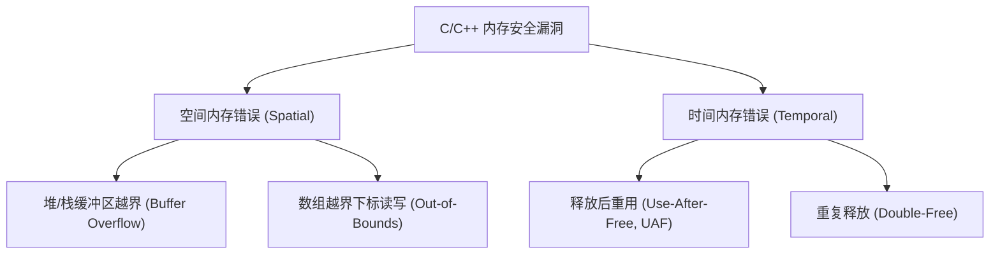
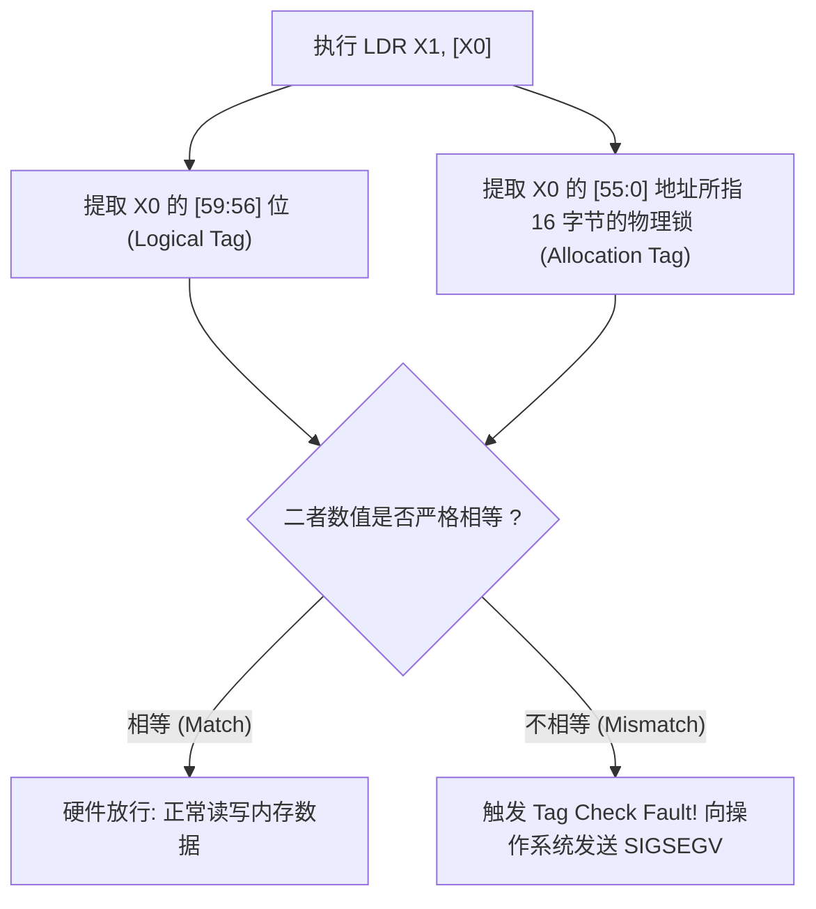

# 第 11 天：AArch64 MTE 原理与实验

> **学习目标**：掌握当今硬件级内存安全的巅峰之作——**ARM64 内存标签扩展 (Memory Tagging Extension, MTE)**。
> 今天你必须掌握的底层核心能力是：
> * 深刻理解空间内存错误（越界溢出）与时间内存错误（UAF）的本质区别；
> * 掌握 MTE 的三大硬件核心实体：16 字节 Granule、4 位 Allocation Tag 与 4 位 Logical Tag；
> * 彻底搞懂 MTE 硬件比对时序与“同 Granule 盲区”成因；
> * 推导 $1/16$ 标签碰撞数学概率与 Linux 内核启用全流程（`PROT_MTE`, `PR_SET_TAGGED_ADDR_CTRL`）；
> * 辨析同步模式 (Sync)、异步模式 (Async) 与非对称模式；
> * 横向对比现代 ARM 芯片防御三剑客（MTE, PAC, BTI）的分工版图。

---

## 【📌 一句话核心概括】
**ARM64 内存标签扩展（MTE）是一项硬件级内存安全技术，它将物理内存以 16 字节（Granule）为粒度赋予 4 位物理标签（Allocation Tag），并在指针高位嵌入 4 位逻辑标签（Logical Tag），在每次 CPU 访存时实施纳秒级硬件匹配以即时阻断空间越界与 UAF 攻击。**

## 【📖 通俗原理解释】
- **两维标签锁控机制**：物理内存每 16 字节被划分为一个基本颗粒（Tag Granule），配备独立存储的 4 位元数据标签（值 0~15）；而 64 位指针利用未使用的第 56~59 位嵌入相同的 4 位逻辑标签。
- **硬件实时无感比对**：当 CPU 执行 `LDR` 或 `STR` 指令时，MMU 与内存控制器硬件电路同步提取指针内的逻辑标签与目标颗粒的物理标签进行比对。若标签不匹配，CPU 硬件在纳秒级引发异常（向操作系统抛出 `SIGSEGV`，错误码 `SEGV_MTESERR`）。
- **防御空间越界与时间 UAF**：
  - **空间溢出防御**：合法对象外围的内存颗粒被预置不同标签，线性越界一旦跨过 16 字节颗粒边界即触发标签失配崩溃。
  - **时间 UAF 防御**：对象被 `free` 释放时，分配器立即重新为该内存颗粒随机生成新物理标签。旧悬空指针（Dangling Pointer）持有的是原标签，再次解引用访问时因标签不符被当场拦截。
- **颗粒盲区与 1/16 概率边界**：因硬件元数据存储开销限制，MTE 最小颗粒为 16 字节，无法捕获单颗粒内部的微小越界（如申请 8 字节访问第 9 字节）；且 4 位标签仅有 16 种取值，释放重新加标签存在 $1/16$（6.25%）的伪碰撞概率。

---

# 一、内存安全的双重天灾：空间错误 vs 时间错误



* **空间错误**：指针在**物理空间**上跨越了所属对象的合法边界；
* **时间错误**：指针在**生命周期（时间轴）**上超越了所属对象的合法存活期。

传统的 ASan 是纯软件编译器插桩，内存膨胀 2 倍、运行变慢 2 倍，无法用于商用手机量产系统；
**ARM64 MTE 是硬件级的杀手锏：零代码插桩开销，直接在芯片硅片层以极低功耗同时封杀这两类天灾！**

---

# 二、MTE 核心架构三大基石

```text
 64 位指针变量内部构造 (利用 TBI - Top Byte Ignore 机制):
 ┌─────────┬──────────────┬──────────────────────────────────────────────┐
 │ 保留 4位│ 4位 Logical  │              56 位真实虚拟物理寻址             │
 │ [63:60] │ Tag [59:56]  │                    [55:0]                    │
 └─────────┴──────┬───────┴──────────────────────────────────────────────┘
                  │ 硬件每次访存自动比对
                  ▼
          [ 4位 Allocation Tag ] ─── 物理存储在专用隐藏 Tag RAM 中
          ┌──────────────────────────────────────────────┐
          │  物理内存每 16 字节一个储物格 (Tag Granule)   │
          └──────────────────────────────────────────────┘
```

1. **Tag Granule (标签粒度 = 16 字节)**：
   * 内存打标签的最小物理单位是 **16 字节**（地址必须以 `0x10` 对齐）。
2. **Allocation Tag (内存物理分配标签)**：
   * 存储在 CPU 内部专门划拨的独立 Tag RAM 中，每个 16 字节块分配一个 4 位的物理标签（取值范围 `0x0` ~ `0xF`）。
3. **Logical Tag (指针逻辑标签)**：
   * 存储在指针最高字节的 **Bits [59:56]** 中。ARM64 的 TBI（高位忽略）特性使得 CPU 寻址时能自动忽略高 8 位，因此加上标签不会影响正常的虚拟地址计算。

---

# 三、一次 MTE 硬件访存全流程

当 CPU 执行指令 `ldr x1, [x0]` 时，微架构内部触发并行流水线判定：



---

# 四、MTE 的检测盲区与 1/16 概率论

## 1. 为什么“同一个 Granule 内的微越界”检测不到？
假设你分配了一个 12 字节的结构体：
* 结构体位于 `0x1000` 到 `0x100B`；
* 操作系统为包含它的 16 字节 Granule（`0x1000 ~ 0x100F`）整体打上标签 `0x3`；
* 你的指针携带标签 `0x3`。
* 如果你越界访问了第 14 个字节（`0x100D`）：
  * 虽然在 C 语言语义上这属于越界违规；
  * 但 `0x100D` 依然位于 `0x1000 ~ 0x100F` 这同一个 Granule 内，锁头依然是 `0x3`；
  * **硬件判定匹配成功，无法报错！**

> **防御事实**：MTE 是**粗粒度（16 字节）**的硬件守卫。只有越界距离跨出了当前 16 字节边界，踩入相邻的下一个 Granule 时，才会被 100% 捕获！

---

## 2. 为什么 UAF 的碰撞漏网率是 1/16？
* 当对象被释放后，堆管理器会为其生成一个全新的随机 4 位标签；
* 4 位二进制能代表的数字总共有 $2^4 = 16$ 种；
* 如果新生成的随机标签恰好与老指针里存的旧标签数字撞车（概率为 $\frac{1}{16} = 6.25\%$）：
  * 老指针依然能成功打开这个新房间，发生 UAF 逃逸；
  * 但对于黑客来说，**连续利用多次漏洞的成功概率呈几何级暴跌**（两次碰撞率仅为 $\frac{1}{256} = 0.39\%$，三次仅为万分之二），使得确定性可靠利用链彻底瓦解！

---

# 五、Linux 用户态激活 MTE 的三大系统调用

在 Linux 下，开启 MTE 需要经历严格的内核配置握手：

```c
#include <sys/prctl.h>
#include <sys/mman.h>
#include <sys/auxv.h>

// 1. 检查 CPU 硬件能力 (HWCAP2_MTE)
unsigned long hwcaps = getauxval(AT_HWCAP2);
if (!(hwcaps & HWCAP2_MTE)) {
    // 处理器不支持 MTE
}

// 2. 配置进程的标签检查模式
// PR_MTE_TCF_SYNC: 同步模式 (出错立即抛出 SIGSEGV)
// PR_MTE_TAG_MASK: 指定分配器可以使用的随机标签掩码
prctl(PR_SET_TAGGED_ADDR_CTRL,
      PR_TAGGED_ADDR_ENABLE | PR_MTE_TCF_SYNC | (0xfffe << PR_MTE_TAG_SHIFT),
      0, 0, 0);

// 3. 申请支持 MTE 标签的内存页
void *ptr = mmap(NULL, 4096,
                 PROT_READ | PROT_WRITE | PROT_MTE, // 必须包含 PROT_MTE!
                 MAP_PRIVATE | MAP_ANONYMOUS, -1, 0);
```

### 三大检测工作模式：

| 模式名称 | 英文 | 运行机制 | 性能开销 | 适用场景 |
| :--- | :--- | :--- | :---: | :--- |
| **同步模式** | **Synchronous (SYNC)** | 标签不匹配时**立刻当场中断**，精确指出崩溃的汇编指令与地址 | 稍高 (~2%) | 实验室排错、研发调试 |
| **异步模式** | **Asynchronous (ASYNC)** | 不匹配时不立刻停机，仅置位状态寄存器，定期统一报告 | **极低 (<1%)** | **生产环境、商用手机全量部署** |
| **非对称模式**| **Asymmetric** | 读操作走严格同步拦截，写操作走轻量异步累积 | 居中 | 兼顾安全性与性能 |

---

# 六、软件纯纯模拟版 MTE 完整实战工程

为了让没有 ARMv8.5+ 实机硬件的开发者也能彻底悟透 MTE，我们编写一套基于软件纯逻辑仿真的完整实验程序 `mte_sim.c`：

```c
#include <stdio.h>
#include <stdint.h>
#include <stdlib.h>
#include <stdbool.h>

#define GRANULE_SIZE 16
#define TAG_MASK     0x0F

// 模拟硬件物理内存：包含数据区与专属 Tag RAM
typedef struct {
    uint8_t data[64];              // 64 字节内存 (共 4 个 Granule)
    uint8_t allocation_tags[4];    // 4 个 Granule 的物理标签 (0~15)
} SimMemory;

// 模拟带标签的指针
typedef struct {
    uintptr_t addr;                // 物理内存相对偏移
    uint8_t   logical_tag;         // 指针自带的 4 位门禁标签
} SimPtr;

// 硬件访存模拟器
bool sim_read_byte(SimMemory *mem, SimPtr ptr, uint8_t *out_val) {
    size_t granule_idx = ptr.addr / GRANULE_SIZE;
    if (granule_idx >= 4) {
        printf("[CRASH] 物理地址 0x%lx 超出内存界限!\n", ptr.addr);
        return false;
    }

    uint8_t alloc_tag = mem->allocation_tags[granule_idx];
    printf("--> 访问地址 0x%02lx (Granule %zu): 指针标签=0x%x, 内存标签=0x%x\n",
           ptr.addr, granule_idx, ptr.logical_tag, alloc_tag);

    // 核心硬件比对逻辑
    if (ptr.logical_tag != alloc_tag) {
        printf("    ❌ [TAG CHECK FAULT] 标签不匹配! 拒绝访问!\n");
        return false;
    }

    *out_val = mem->data[ptr.addr];
    printf("    ✔ [SUCCESS] 标签匹配, 读取成功: 数据=0x%02x\n", *out_val);
    return true;
}

int main(void) {
    SimMemory mem = {0};
    // 1. 模拟堆分配器：为前两个 Granule (0~31 字节) 分配标签 0x3
    mem.allocation_tags[0] = 0x3;
    mem.allocation_tags[1] = 0x3;
    // 相邻的第 3 个 Granule (32~47 字节) 分配不同标签 0x7
    mem.allocation_tags[2] = 0x7;

    SimPtr p = { .addr = 0, .logical_tag = 0x3 };
    uint8_t val;

    printf("=== 1. 正常合法读写 ===\n");
    sim_read_byte(&mem, p, &val);

    printf("\n=== 2. 跨 Granule 越界检测 (访问下标 32) ===\n");
    SimPtr p_overflow = { .addr = 32, .logical_tag = 0x3 }; // 指针依然带 0x3
    sim_read_byte(&mem, p_overflow, &val); // 访问 Granule 2 (标签 0x7)

    printf("\n=== 3. 模拟 UAF 场景 (退房换锁) ===\n");
    // 执行 free: 内存管理器将 Granule 0 的标签由 0x3 翻转为 0x8
    mem.allocation_tags[0] = 0x8;
    printf("[Free] 内存已释放，Granule 0 重新打标签为 0x8\n");
    // 依然使用旧指针 p (带 0x3 标签) 试图访问
    sim_read_byte(&mem, p, &val);

    return 0;
}
```

编译与运行：
```bash
gcc -std=c17 -O2 mte_sim.c -o mte_sim
./mte_sim
```

输出完美复刻真实硬件的阻击全过程：
```text
=== 1. 正常合法读写 ===
--> 访问地址 0x00 (Granule 0): 指针标签=0x3, 内存标签=0x3
    ✔ [SUCCESS] 标签匹配, 读取成功: 数据=0x00

=== 2. 跨 Granule 越界检测 (访问下标 32) ===
--> 访问地址 0x20 (Granule 2): 指针标签=0x3, 内存标签=0x7
    ❌ [TAG CHECK FAULT] 标签不匹配! 拒绝访问!

=== 3. 模拟 UAF 场景 (退房换锁) ===
[Free] 内存已释放，Granule 0 重新打标签为 0x8
--> 访问地址 0x00 (Granule 0): 指针标签=0x3, 内存标签=0x8
    ❌ [TAG CHECK FAULT] 标签不匹配! 拒绝访问!
```

---

# 七、现代 ARM 架构防御三剑客版图横评

| 安全防御机制 | 中文全称 | 保护的目标实体 | 防御的核心漏洞类型 | 硬件特征指令 |
| :--- | :--- | :--- | :--- | :--- |
| **MTE** | 内存标签扩展 | **堆/栈数据内存与指针** | **空间越界 (Buffer Overflow)** 与 **时间越界 (UAF)** | `IRG`, `STG`, `LDG` |
| **PAC** | 指针认证码 | **函数返回地址与函数指针** | **ROP (返回导向编程)**、控制流劫持 | `PACIASP`, `AUTIASP` |
| **BTI** | 分支目标标识 | **间接跳转目标指令** | **JOP (跳转导向编程)**、任意代码段跳转蹦床 | `BTI c`, `BTI j` |

> 💡 **三剑客协同作战图景**：
> * **MTE** 筑起高墙：阻止攻击者利用堆溢出或 UAF 改写内存中的敏感指针；
> * **PAC** 钉死车票：即使指针不幸被篡改，通过加密签名让篡改后的返回地址一验就崩；
> * **BTI** 封锁路口：即使控制流发生失控跳转，一旦降落在没有 BTI 标记的非法位置立刻自爆！

---

# 八、第十一天通关核心口试自测（闭卷大通关）

### 题 1：MTE 的 Tag Granule 是多大？Allocation Tag 和 Logical Tag 分别保存在哪里？
* **满分回答**：
  * MTE 的 Tag Granule（标签粒度）物理固定为 **16 字节**；
  * **Allocation Tag（内存分配标签）**：占用 4 位，保存在系统底层的独立物理 Tag RAM 中，对应每 16 字节内存块；
  * **Logical Tag（逻辑指针标签）**：占用 4 位，保存在 64 位指针变量自身的高位区间 **Bits [59:56]** 中（利用 AArch64 的 TBI 高位忽略特性）。

### 题 2：为什么 MTE 无法检测到同一个 Granule 内的细微数组越界？
* **满分回答**：
  因为 MTE 的硬件检查是以 16 字节为最小粒度绑定的。同一个 Granule 内的全部 16 个字节共享同一个物理 Allocation Tag。如果一个对象只有 8 字节，程序越界读写了第 10 字节，只要该偏移尚未越出所属的这 16 字节空间，指针的 Logical Tag 与该内存块的 Allocation Tag 依然完全一致，硬件判定匹配放行，因此形成检测盲区。

### 题 3：MTE 是如何检测 Use-After-Free (UAF) 漏洞的？
* **满分回答**：
  在动态内存分配时，内存分配器生成一个随机标签（如 `0x5`）同时赋予内存和返回的指针；当程序调用 `free` 释放内存时，分配器会重新生成一个完全不同的随机标签（如 `0xA`）覆盖写入该内存块的 Tag RAM。此后若旧指针（依然带有 `0x5` 标签）再次尝试解引用访问，CPU 硬件在比对时发现 `0x5 != 0xA`，立刻触发 Tag Check Fault，从而秒级捕获 UAF。

### 题 4：简述 MTE 同步模式 (Sync) 与异步模式 (Async) 的区别与应用场景。
* **满分回答**：
  * **同步模式 (SYNC)**：标签不匹配时，CPU 在当前出错指令执行的瞬间立即精准挂起进程抛出 SIGSEGV，能精确定位到案发现场代码行，开销稍高，适用于本地开发测试与严苛调试；
  * **异步模式 (ASYNC)**：标签不匹配时不立即打断流水线，仅在后台硬件状态位记录错误，由内核在后续合适的调度时机统一上报，无法精确定位单条指令，但性能损耗近乎于零（<1%），非常适合商用手机和云端服务器在生产环境全量静默开启。