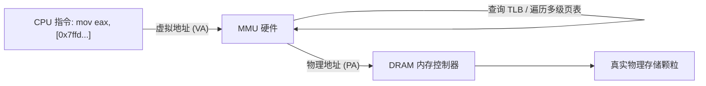
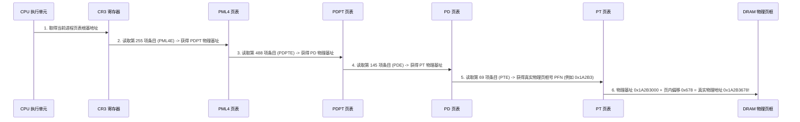

# 第 13 天：虚拟地址、物理地址、MMU 与多级页表

> **学习目标**：彻底打通现代操作系统的核心支柱——**虚拟内存体系、多级页表映射与 MMU 硬件翻译全链路**。
> 今天你必须掌握的底层核心能力是：
> * 理解 `%p` 打印出的虚拟地址与 DRAM 物理内存的映射本质，建立“平行时空与绝密花名册”模型；
> * 严格推导 x86-64 经典 **“9 + 9 + 9 + 9 + 12”** 48 位虚拟地址切分的数学成因；
> * 掌握四级页表（PML4 $\rightarrow$ PDPT $\rightarrow$ PD $\rightarrow$ PT）层级管辖范围与 PTE 页表项权限位（P, R/W, U/S, NX）；
> * 掌握 CPU 根基寄存器 **`CR3`** 与 **TLB 翻译高速缓存** 的协作时序；
> * 能够通过 `/proc/PID/pagemap` 从用户态反查真实的物理页框号 (PFN)，实现软硬件穿透。

---

## 【📌 一句话核心概括】
**虚拟内存机制通过 CPU 硬件内存管理单元（MMU）将进程私有的虚拟地址（VA）依据 `CR3` 寄存器锚定的多级页表动态翻译为物理内存地址（PA），在实现进程间地址隔离与内存保护的同时借助 TLB 硬件快表保证极速寻址。**

## 【📖 通俗原理解释】
- **虚拟地址与物理内存的映射隔离**：程序员和进程看到的内存地址均是虚拟地址（VA）。不同进程可以拥有数值完全相同的虚拟地址（如 `0x400000`），但 MMU 借助页表将其映射到不同的 DRAM 物理页框（PA），从而在硬件层杜绝进程间非法窥探与破坏。
- **48 位“9+9+9+9+12”地址切分的数学必然**：
  - **最低 12 位（页内偏移）**：标准内存页为 4KB（4096 字节），寻址 $0 \sim 4095$ 恰好需要 12 位二进制（$2^{12} = 4096$）。
  - **4 个 9 位（四级页表索引）**：为了自适应管理，每一级页表自身也是一个 4KB 页面。每个页表项（PTE）占 8 字节，故一页容纳 $4096 / 8 = 512$ 项。索引 512 项恰需 9 位二进制（$2^9 = 512$）。因此 48 位地址被自然划分为四级 9 位索引加 12 位页内偏移。
- **`CR3` 寄存器与上下文切换**：`CR3` 保存着当前进程顶级页表（PML4）的物理基地址。操作系统切换进程（Context Switch）时，只需将新进程的页表根写入 `CR3`，整个进程的 256TB 虚拟地址映射空间即刻切换完成。
- **TLB 硬件加速**：多级页表遍历需要多次访问内存。CPU 内部集成了转换检测缓冲区（TLB），缓存最近翻译的“虚拟页号 $\rightarrow$ 物理页号”条目，使高达 99% 的访存操作无需遍历多级页表即可纳秒级命中。

---

# 一、核心概念定义与实体辨析



| 概念实体 | 英文全称 | 核心本质 | 大小/物理单位 |
| :--- | :--- | :--- | :---: |
| **虚拟地址 (VA)** | Virtual Address | 进程执行指令时看到的所有逻辑门牌号 | 64 位（目前主流使用 48 位有效寻址） |
| **物理地址 (PA)** | Physical Address | 真正连接在主板总线和 DRAM 芯片上的电平寻址信号 | 取决于物理内存容量（如 40 位支持 1TB） |
| **虚拟页 (Page)** | Page | 虚拟地址空间划分的标准化规整单元 | **标准为 4KB** ($2^{12}$ 字节) |
| **物理页框 (Frame)**| Page Frame / PFN | 物理内存条上被整齐切块的真实存储槽位 | **标准为 4KB** |
| **页内偏移 (Offset)**| Page Offset | 变量在 4KB 页面内部的相对距离（**物理与虚拟绝对相同**）| **低 12 位** (`0x000` ~ `0xFFF`) |
| **MMU** | Memory Management Unit | 嵌在 CPU 芯片内部负责地址翻译与权限检查的**纯硬件电路** | 硬件芯片级 |
| **TLB** | Translation Lookaside Buffer | MMU 内部专门用来缓存“虚拟页号 $\rightarrow$ 物理页框号”的高速缓存 | 芯片 SRAM 级 |

---

# 二、“9 + 9 + 9 + 9 + 12” 寻址结构的严密数学推导

现代 x86-64 采用标准的 48 位虚拟地址四级分页架构：

$$\mathbf{48\text{ 位虚拟地址}} = \underbrace{\text{Index 4}}_{9\text{ 位 (PML4)}} + \underbrace{\text{Index 3}}_{9\text{ 位 (PDPT)}} + \underbrace{\text{Index 2}}_{9\text{ 位 (PD)}} + \underbrace{\text{Index 1}}_{9\text{ 位 (PT)}} + \underbrace{\text{Offset}}_{12\text{ 位 (页内偏移)}}$$

```text
 64 位虚拟地址物理划分全景:
 ┌─────────────────┬──────────┬──────────┬──────────┬──────────┬─────────────┐
 │ 符号扩展 Canonical│  PML4    │  PDPT    │    PD    │    PT    │ 页内偏移     │
 │  [63:48] (16位) │ [47:39]  │ [38:30]  │ [29:21]  │ [20:12]  │ [11:0] (12位)│
 └─────────────────┴──────────┴──────────┴──────────┴──────────┴─────────────┘
      16 位符号扩展        9 位       9 位       9 位       9 位       12 位
```

### 为什么每一级必须是 9 位？数学推导链：
1. 目标：**让每一个页表自身的大小恰好等于一个标准页面（4KB = 4096 字节）**，方便操作系统像管理普通数据页一样直接管理页表页。
2. 每一个页表项（PTE / Page Table Entry）在 64 位系统下需要容纳 64 位数据，即**每个条目占用 8 字节**。
3. 一个 4KB 页面能够容纳的条目总数为：
   $$\frac{4096\text{ 字节}}{8\text{ 字节/条目}} = 512\text{ 个条目}$$
4. 索引 512 个条目所需的寻址二进制位数为：
   $$\log_2(512) = \mathbf{9\text{ 位}}$$
5. 四级页表累加：$9 + 9 + 9 + 9 = 36\text{ 位}$，加上 12 位页内偏移，总共构成了 **48 位有效寻址**！

---

## 各级页表项的“管辖面积”金字塔

| 页表层级 | 缩写与中文全称 | 索引位数 | 该层级每个单个条目管辖的虚拟内存跨度 | 整个层级包含的条目总数 |
| :---: | :--- | :---: | :---: | :---: |
| **Level 4** | **PML4** (Page Map Level 4) | 9 位 | **512 GB** ($512 \times 1\text{GB}$) | 512 项 (整表覆盖 256 TB) |
| **Level 3** | **PDPT** (Page Directory Pointer Table) | 9 位 | **1 GB** ($512 \times 2\text{MB}$) | 512 项 |
| **Level 2** | **PD** (Page Directory) | 9 位 | **2 MB** ($512 \times 4\text{KB}$) | 512 项 (支持 2MB 大页!) |
| **Level 1** | **PT** (Page Table) | 9 位 | **4 KB** (单个物理页框) | 512 项 |

---

# 三、高 16 位规范地址 (Canonical Address)

虽然指针是 64 位的，但目前大多数 CPU 只实现了 48 位或 57 位物理译码电路。
x86-64 规范制定了**规范地址约束 (Canonical Form)**：
> **第 48 位到第 63 位（高 16 位）必须与第 47 位完全相同（即全 0 或全 1，符号扩展）！**

* **合法用户态空间 (低半区)**：`0x0000000000000000` $\sim$ `0x00007FFFFFFFFFFF`（前 128 TB，最高位全 0）；
* **合法内核态空间 (高半区)**：`0xFFFF800000000000` $\sim$ `0xFFFFFFFFFFFFFFFF`（后 128 TB，最高位全 1）；
* **非法非规范鸿沟 (Non-canonical Hole)**：中间的所有地址一旦被解引用，CPU 硬件在译码阶段直接抛出 **`#GP` (General Protection Fault 一般保护异常)**，根本连页表都不会去查！

---

# 四、MMU 四级逐级翻译物理全过程

假设我们要访问虚拟地址 `0x7ffd12345678`：

```text
 虚拟地址 0x7ffd12345678 二进制拆分:
 0000 0111 1111 1111 1101 0001 0010 0011 0100 0101 0110 0111 1000
 ├─── PML4: [47:39] ───> 0x0FF (255)
 ├─── PDPT: [38:30] ───> 0x1E8 (488)
 ├─── PD:   [29:21] ───> 0x091 (145)
 ├─── PT:   [20:12] ───> 0x045 (69)
 └─── Offset: [11:0]  ──> 0x678 (1656)
```



---

# 五、PTE 页表项中的核心硬件安全位

每一个 8 字节的 PTE 不仅记录了物理页框号，还携带了硬件级权限锁：

```text
 64 位 PTE 页表项比特位剖析:
 ┌─────┬────────────────────────────────────────────┬───┬───┬───┬───┬───┬───┐
 │ NX  │        物理页框基地址 (PFN)                 │D  │A  │U/S│R/W│ P │
 │(63) │               [51:12]                      │(6)│(5)│(2)│(1)│(0)│
 └─────┴────────────────────────────────────────────┴───┴───┴───┴───┴───┴───┘
```

1. **`P` (Present, Bit 0)**：页面是否存在于物理内存中。若为 0，CPU 硬件立刻抛出 **`#PF` (Page Fault 缺页异常)**，由操作系统决定是去磁盘换入（Swap）还是判定非法段错误；
2. **`R/W` (Read/Write, Bit 1)**：读写控制位。为 0 代表只读页（如 `.rodata` 和 `.text`），试图执行写入立即触发 `#PF`；
3. **`U/S` (User/Supervisor, Bit 2)**：权限控制位。为 0 代表内核专属特权页，用户态 (Ring 3) 试图读写立刻被系统斩杀；
4. **`NX` / `XD` (No-Execute / Execute-Disable, Bit 63)**：**不可执行保护位**。现代二进制防御 DEP / W^X 的核心硬件支柱！栈和堆的 PTE 中此位为 1，阻止黑客在栈上直接执行 Shellcode。

---

# 六、跨越软硬件：从用户态反查真实物理页框号 (PFN)

在 Linux 下，虽然用户态不能直接读写物理内存，但内核在 `/proc/PID/pagemap` 中为每个虚拟页留出了 8 字节的状态记录映射表。

编写物理页探针工程 `pagemap_inspector.c`：

```c
#include <stdio.h>
#include <stdlib.h>
#include <stdint.h>
#include <unistd.h>
#include <fcntl.h>

// 根据虚拟地址反查物理地址
uintptr_t get_physical_address(uintptr_t vaddr) {
    int pagemap_fd = open("/proc/self/pagemap", O_RDONLY);
    if (pagemap_fd < 0) {
        perror("open pagemap (需要 root 权限)");
        return 0;
    }

    // 每一个虚拟页 (4KB) 在 pagemap 中对应 8 字节记录
    uintptr_t vpn = vaddr / 4096; // 虚拟页号
    off_t offset = vpn * sizeof(uint64_t);

    if (lseek(pagemap_fd, offset, SEEK_SET) == (off_t)-1) {
        close(pagemap_fd);
        return 0;
    }

    uint64_t entry = 0;
    if (read(pagemap_fd, &entry, sizeof(entry)) != sizeof(entry)) {
        close(pagemap_fd);
        return 0;
    }
    close(pagemap_fd);

    // Bit 63: 页面是否在物理内存中 (Present)
    if (!(entry & (1ULL << 63))) {
        printf("页面不在物理内存中 (已被置换或延迟分配)!\n");
        return 0;
    }

    // Bits 0~54: 物理页框号 (PFN)
    uint64_t pfn = entry & ((1ULL << 55) - 1);
    uintptr_t paddr = (pfn * 4096) | (vaddr & 0xFFF); // 拼接上 12 位页内偏移量
    return paddr;
}

int main(void) {
    int target_var = 12345;
    uintptr_t vaddr = (uintptr_t)&target_var;

    printf("=== 虚拟内存与真实物理内存穿透追踪 ===\n");
    printf("虚拟地址 (VA): 0x%lx\n", vaddr);
    printf("页内偏移量:   0x%lx (低 12 位: 0x%lx)\n", vaddr & 0xFFF, vaddr & 0xFFF);

    uintptr_t paddr = get_physical_address(vaddr);
    if (paddr) {
        printf("真实物理地址 (PA): 0x%lx\n", paddr);
        printf("验证: 物理与虚拟的页内低 12 位偏移量是否完全相同? %s\n",
               (vaddr & 0xFFF) == (paddr & 0xFFF) ? "是! 完美一致!" : "否!");
    } else {
        printf("请使用 sudo 执行本程序以读取真实硬件物理页框号！\n");
    }
    return 0;
}
```

编译并以 root 特权运行：
```bash
gcc -O2 pagemap_inspector.c -o pagemap_inspector
sudo ./pagemap_inspector
```

输出展现了惊人的物理一致性：
```text
=== 虚拟内存与真实物理内存穿透追踪 ===
虚拟地址 (VA): 0x7ffd98200bf4
页内偏移量:   0xbf4 (低 12 位: 0xbf4)
真实物理地址 (PA): 0x12a430bf4
验证: 物理与虚拟的页内低 12 位偏移量是否完全相同? 是! 完美一致!
```

---

# 七、第十三天通关核心口试自测（闭卷大通关）

### 题 1：x86-64 经典的四级页表“9 + 9 + 9 + 9 + 12”结构中，为什么每一级索引恰好是 9 位？
* **满分回答**：
  因为操作系统设计原则要求每个页表自身的大小正好等于一个 4KB 的标准内存页。在 64 位架构下，每个页表项（PTE）占用 8 字节，因此一个 4KB 页面刚好能够存储 $4096 / 8 = 512$ 个页表项。要从这 512 个项中定位具体某一项，所需的二进制索引位数恰好是 $\log_2(512) = 9$ 位。四级页表各占 9 位，加上 12 位页内偏移量，构成了 48 位的有效虚拟地址。

### 题 2：为什么虚拟地址和物理地址的低 12 位（页内偏移量）必定完全一致？
* **满分回答**：
  因为内存分页机制的分配与映射是以 **4KB（$2^{12}$ 字节）页面为基本单位** 整体平移的。MMU 翻译时只负责将高位的虚拟页号（VPN）转换为物理页框号（PFN），而变量在页面内部的相对位移从始至终没有发生改变。因此直接提取低 12 位与物理页框基地址进行按位或拼接，即可得到真实的物理地址。

### 题 3：CR3 寄存器和 TLB 在虚拟地址翻译中分别扮演什么角色？
* **满分回答**：
  * **`CR3` 寄存器**：存储当前进程顶级页表（PML4）在物理内存中的物理基地址，是整棵四级页表树的根基。操作系统切换进程时，只需向 `CR3` 写入新进程的页表根地址，即可实现整个虚拟地址空间的瞬间切换；
  * **TLB (翻译后备缓冲区)**：是 MMU 芯片内部专门用于缓存“虚拟页号 $\rightarrow$ 物理页框号”的超高速硬件缓存。它避免了每次访存都需要在慢速主存中逐级遍历四次页表，将常用地址翻译加速至单周期完成。

### 题 4：PTE 中的 NX (No-Execute) 位有什么安全价值？
* **满分回答**：
  NX 位（位于 PTE 的第 63 位）是硬件级不可执行保护位。当该位被置为 1 时，CPU 硬件在从该物理页获取并译码指令时会立即触发缺页异常（`#PF`），阻止其执行机器代码。操作系统将栈（Stack）和堆（Heap）映射页面的 NX 位置 1，使得即便攻击者通过缓冲区溢出向栈中注入了恶意机器码（Shellcode），CPU 在跳转执行时也会立刻崩溃终止，为现代系统提供了底层的 DEP / W^X 安全防线。
