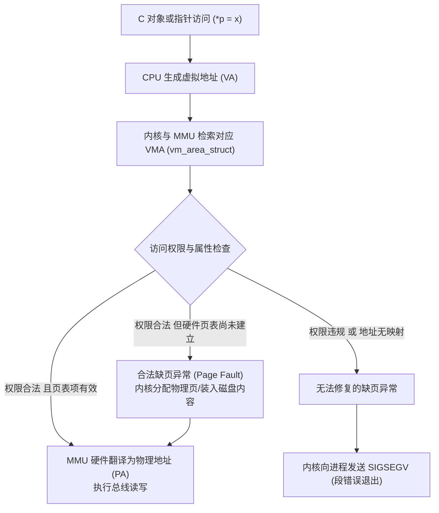
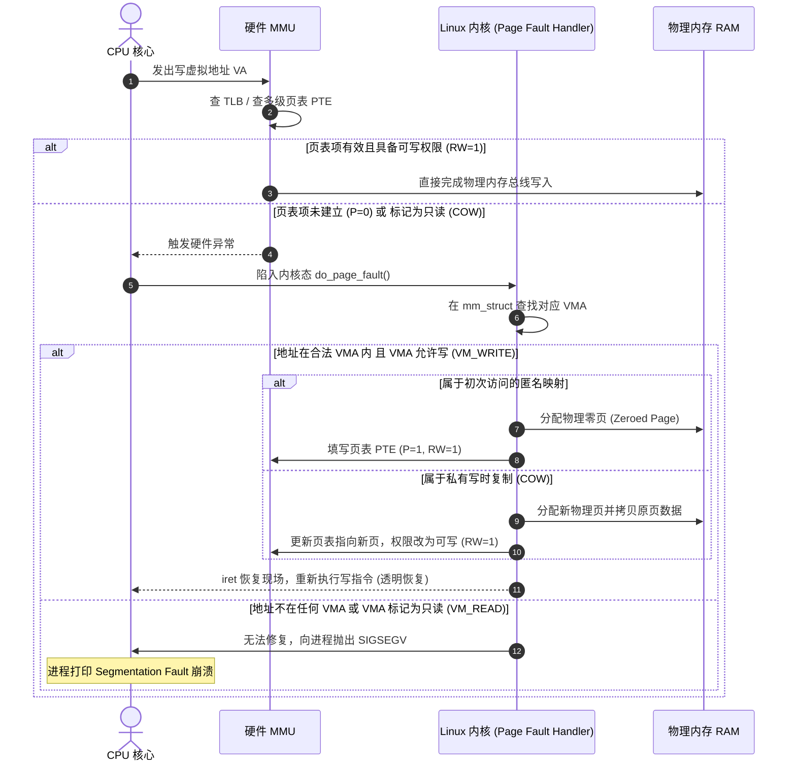

# 第 14 天：Linux 进程地址空间与内存权限

> **核心认知**：学习虚拟内存最忌讳“死记一张从低到高的静态内存布局图”。现代操作系统中，每个进程看到的是一套独立的虚拟地址编号系统。必须建立 **“C 语言对象层 ➔ Linux 内核 VMA 虚拟区域层 ➔ 硬件页表与 MMU 层”** 的三层正交认知链路。

---

## 【📌 一句话核心概括】
**Linux 进程地址空间是由内核以连续虚拟内存区域（VMA，`vm_area_struct`）组织的一套私有地址映射视图，通过 MMU 与页表实现按需分页（Demand Paging）与写时复制（COW），并以硬件页保护位（`r/w/x`）对越界或越权访问触发缺页异常并由内核发送 `SIGSEGV` 信号终止进程。**

## 【📖 通俗原理解释】
- **VMA 虚拟规划 vs 物理页按需分配**：程序申请内存（如 `malloc`、`mmap`）时，内核只在进程结构体中记录一段左闭右开 `[vm_start, vm_end)` 的虚拟区间并赋予权限（如 `rw-p`），并未真正分配物理内存；只有在 CPU 首次发生读写时触发硬件缺页异常（Page Fault），内核才分配真实物理页并填入页表项。
- **私有映射 `p` 与写时复制（COW）**：映射标志 `p`（Private）表示该区域支持写时复制。多个进程可共享映射同一物理内存页（只读），一旦某个进程发起写入，硬件触发只读缺页异常，内核立即拷贝一份独立副本并赋予写权限，原页继续保留给其他进程。
- **缺页异常（Page Fault）的双重性质**：缺页异常是 CPU MMU 的常规硬件机制而非错误。如果是合法访问（存在对应 VMA 且权限符合），内核在异常处理例程中悄悄建立映射后无缝恢复执行；只有当访问地址无对应 VMA（野指针）或违背权限（向 `r--` 段写入、执行不可执行段）时，内核才向进程投递 `SIGSEGV` 信号导致崩溃。

---

## 核心架构链路



### 三层不可替代的关系

| 认知层次 | 职责与关注点 | 典型违规场景与结果 |
| :--- | :--- | :--- |
| **1. C 语言对象层** | 类型、生命周期、对齐、对象有效边界 | `a[100] = 1;` 即使该地址在 `rw-p` 栈内也是 UB（未定义行为） |
| **2. Linux VMA 层** | 虚拟地址段范围 `[start, end)`、读/写/执行权限、私有/共享 | 往只读段写入，或解引用野指针落入无映射空洞，触发非法缺页 |
| **3. 硬件页表与 MMU** | 当前物理页是否存在、PTE 标志位（P/RW/US/NX）、TLB 缓存 | 首次访问合法 VMA 产生硬件异常，由内核缺页处理例程透明分配 |

---

## 一、什么是进程虚拟地址空间

### 1. 本质定义与 VMA 结构
Linux 进程中看到的每个指针数值（如 `0x7f2a10001234`）都是**虚拟地址**。内核通过内存描述符 `struct mm_struct` 管理该进程的整个地址空间，其内部由一串 `struct vm_area_struct`（简称 VMA）链表和红黑树组织：

```text
mm_struct
  └─ mmap 链表 / rb_node (VMA 集合)
       ├─ VMA 1: [0x55b712345000, 0x55b712346000)  r-xp  主程序代码段
       ├─ VMA 2: [0x55b712347000, 0x55b712348000)  r--p  只读常量数据
       ├─ VMA 3: [0x55b712348000, 0x55b712349000)  rw-p  全局可读写数据
       ├─ VMA 4: [0x7f2a10000000, 0x7f2a10021000)  rw-p  匿名 mmap 区域
       └─ VMA 5: [0x7ffd12340000, 0x7ffd12361000)  rw-p  [stack] 用户栈
```

> **数学规则**：所有 VMA 区间均采用**严格左闭右开**记号：`[start, end)`。即 `start <= 合法地址 < end`，`end` 本身绝不属于该映射区域！

### 2. 进程与线程的地址空间关系
* **同一进程内的所有线程**：共享相同的 `mm_struct`（共享相同的页表、全局变量、堆、共享库及 `mmap` 映射）。
* **每个独立线程独占**：独立的寄存器上下文、独立的用户栈（Thread Stack）、栈保护页（Guard Page `---p`）以及线程局部存储（TLS, Thread Local Storage）。
* **重要结论**：“线程有独立的栈”仅表示其栈指针指向专用的内存区域，本质上依然属于同一个进程虚拟地址空间，各线程之间原则上可以通过指针直接互相读取对方栈上的数据（前提是不触碰保护页）。

---

## 二、典型内存区域全景逐个解析

| 区域名称 | 典型权限 | 内部主要内容 | 关键底层细节与限制 |
| :--- | :---: | :--- | :--- |
| **主程序代码** | `r-xp` | `.text`、机器指令、`.plt` 蹦床 | 由 ELF 的 `R E` 类型 `PT_LOAD` 段映射而来 |
| **只读常量** | `r--p` | `.rodata`、虚函数表、ELF 只读元数据 | `const` 对象在 C 语言层面禁止修改，链接器通常放入此区域 |
| **可写数据** | `rw-p` | `.data`（已初始化）、部分 `.bss`、GOT 表 | 一个物理页内可能混合打包多个小型 ELF Section |
| **堆 `[heap]`** | `rw-p` | 传统 `brk()` / `sbrk()` 维护的高地址增长堆 | **并不是所有 `malloc` 都来自这里**，大型分配直接走 `mmap` |
| **共享库映射** | 多行不同 | `libc.so.6`、`ld-linux.so` 等 | 同一个 `.so` 会按权限切分成多行独立的 VMA（代码、只读、数据） |
| **匿名映射** | 常见 `rw-p` | 大块堆分配、线程栈、分配器 Arena | 映射行无文件路径，内核保证初次读取全为零字节 |
| **主线程栈 `[stack]`**| `rw-p` | 函数局部对象、栈帧返回地址、main 参数 | Linux/x86-64 下由高地址向低地址扩展 |
| **vDSO** | `r-xp` | Virtual Dynamic Shared Object，微型 ELF | 内核导出给用户态的只读加速代码（如 `gettimeofday` 无需切内核） |
| **vvar** | `r--p` | vDSO 运行所需内核数据（时钟源计数器） | 纯只读数据，无需陷入内核即可获取高精度时间 |
| **栈保护页** | `---p` | Guard Page（无任何权限） | 阻止栈溢出跨界践踏其他内存，一旦触碰立刻硬件报警崩掉 |
| **内核保留区** | 用户态不可达 | 操作系统内核代码、中断处理、直接物理映射 | x86-64 规范地址的高半区，普通用户态程序 `maps` 中不可见 |

---

## 三、为什么教材中的“固定布局图”只能作为示意？

经典教科书常画一张图：底部 `.text`，中间堆向上长，顶部栈向下长。但在现代操作系统中，这仅仅是逻辑示意：

1. **ASLR（地址空间布局随机化）**：内核为了防御缓冲区溢出攻击，每次程序启动都会随机扰动主程序基址、栈基址、堆基址、mmap 区域和共享库地址。连续运行两次，打印出的同一变量地址绝对不同。
2. **PIE（位置无关可执行文件）**：现代 Linux 默认使用 `-fPIE -pie` 编译，生成 `ET_DYN` 类型的共享目标文件，装载基址不再固定在 `0x400000`，而是由内核动态指定：
   $$\text{运行时绝对地址} = \text{随机加载基址} + \text{ELF 内相对偏移}$$
3. **分配器策略复杂化**：glibc 的 `malloc()` 采用 ptmalloc 架构：小型内存块从堆或线程专用 Arena 申请，大于 `MMAP_THRESHOLD`（默认 128KB）的大块内存直接调用 `mmap()` 创建全新独立的匿名 VMA。
4. **多线程并发扩展**：每个新创建的 `pthread` 都会在 mmap 区域分配数兆字节的独立栈和保护页，地址空间呈现网格化交织。

---

## 四、彻底看懂 `/proc/PID/maps`

官方标准格式由 6 个字段构成：

```text
7f2a10000000-7f2a10021000 rw-p 00000000 00:00 0                         
└──────┬────────────────┘ └─┬┘ └───┬───┘ └─┬─┘ └┬┘ └──────────┬───────────┘
   ① 虚拟地址区间         ②权限   ③偏移量  ④设备号 ⑤节点 ⑥ 映射文件名 / 标记
```

### 1. 字段深度拆解与十六进制跨度计算

* **① 虚拟地址范围**：`7f2a10000000-7f2a10021000`
  * 左闭右开：`[0x7f2a10000000, 0x7f2a10021000)`
  * 最后一个可合法访问的字节是 `0x7f2a10020fff`。
  * **手工换算映射大小**：
    $$0x7f2a10021000 - 0x7f2a10000000 = 0x21000 \text{ 字节}$$
    $$0x21000 = 33 \times 0x1000 = 33 \times 4096 = 135,168 \text{ 字节} = 132 \text{ KiB}$$
    若系统页大小为 4KB，该 VMA 精确跨越 **33 个内存页**。

* **② 权限标记（4 位字符）**：
  * 第 1 位 `r`：允许读取。
  * 第 2 位 `w`：允许写入。
  * 第 3 位 `x`：允许作为 CPU 指令执行（若为 `-` 则受 NX/DEP 位硬件保护，杜绝注入 Shellcode 执行）。
  * 第 4 位 `p` / `s`：
    * `p`（Private）：私有映射，采用写时复制（COW）。对该内存的修改仅对本进程可见，不会回写磁盘文件。
    * `s`（Shared）：共享映射。对该内存的修改多进程即时可见，且会同步刷新至底层文件。

* **③ Offset（文件偏移）**：该 VMA 在原始磁盘文件中的起始字节偏移。对应 ELF 文件中 `readelf -lW` 查看到的 `PT_LOAD` Offset。
* **④ Dev（设备号）**：主设备号:次设备号。匿名映射无设备，显示 `00:00`。
* **⑤ Inode**：磁盘文件系统的 inode 节点编号。匿名映射为 `0`。
* **⑥ Pathname**：关联的文件绝对路径或特殊伪文件标记（如 `[heap]`、`[stack]`、`[vdso]`、`[vvar]`）。若为空则为显式匿名映射。

---

## 五、内存权限生效流程与缺页故障（Page Fault）处理

一次标准的指针写操作（如 `*p = 100;`）在系统底层的完整时序：



> **警惕认知误区**：
> 1. `Page Fault` 是 CPU 硬件异常（Fault），是现代操作系统实现**虚拟内存、惰性加载、按需分页与 COW** 的核心引擎。
> 2. `SIGSEGV` 是内核因**非法内存违规**无法平复时，向用户进程发送的致命信号。**绝不可把缺页与崩溃画等号！**

---

## 六、实战代码：进程空间全景探查器

下面是一份完备、可编译、可观测全部典型内存区域的探查程序：

```c
/* day14_maps.c - 深入探查进程地址空间与 VMA 布局 */
#define _GNU_SOURCE
#include <stdio.h>
#include <stdlib.h>
#include <string.h>
#include <sys/mman.h>
#include <unistd.h>

/* 1. 静态存储期对象：显式非零初始化 -> .data */
int global_value = 100;

/* 2. 静态存储期对象：const 修饰 -> 编译器与链接器倾向放入 .rodata */
const char message[] = "hello";

/* 3. 静态存储期对象：未初始化/零初始化 -> .bss (运行时零填充) */
int zero_global;

int main(void)
{
    /* 4. 自动存储期对象 -> 位于当前线程栈 [stack] */
    int local_value = 200;

    /* 获取系统页大小（严禁写死 4096） */
    long page_size = sysconf(_SC_PAGESIZE);
    if (page_size <= 0) {
        perror("sysconf");
        return EXIT_FAILURE;
    }

    /* 5. 堆动态内存分配 */
    void *heap = malloc((size_t)page_size);
    if (heap == NULL) {
        perror("malloc");
        return EXIT_FAILURE;
    }

    /* 6. 显式系统调用：创建私有匿名内存映射 */
    void *mapping = mmap(NULL,
                         (size_t)page_size,
                         PROT_READ | PROT_WRITE,
                         MAP_PRIVATE | MAP_ANONYMOUS,
                         -1,
                         0);
    if (mapping == MAP_FAILED) {
        perror("mmap");
        free(heap);
        return EXIT_FAILURE;
    }

    /* 触发写入：强迫内核发生缺页并真正分配物理内存页 */
    memset(heap, 0xA5, (size_t)page_size);
    memcpy(mapping, "mmap_data", 10);

    printf("================ 进程空间探查报告 ================\n");
    printf("PID          = %ld\n", (long)getpid());
    printf("Page Size    = %ld 字节\n", page_size);
    printf("---------------- 各对象运行时虚拟地址 ------------\n");
    printf("1. main 代码   : %p (通常位于 r-xp 主程序段)\n", (void *)main);
    printf("2. global_val  : %p (通常位于 rw-p .data)\n", (void *)&global_value);
    printf("3. zero_global : %p (通常位于 rw-p .bss)\n", (void *)&zero_global);
    printf("4. message     : %p (通常位于 r--p .rodata)\n", (void *)message);
    printf("5. heap 动态块 : %p (分配器管理区域)\n", heap);
    printf("6. mmap 匿名区 : %p (显式创建的 rw-p 匿名 VMA)\n", mapping);
    printf("7. local_value : %p (主线程栈 [stack])\n", (void *)&local_value);
    printf("==================================================\n");
    printf("👉 请在另一终端运行: cat /proc/%ld/maps\n", (long)getpid());
    printf("按 Enter 键清理资源并安全退出...\n");

    getchar();

    /* 安全释放 */
    if (munmap(mapping, (size_t)page_size) == -1) {
        perror("munmap");
    }
    mapping = NULL;

    free(heap);
    heap = NULL;

    return EXIT_SUCCESS;
}
```

### 1. 深度解析：`mmap()` 六大参数的工程规约

```c
mmap(NULL, 4096, PROT_READ | PROT_WRITE, MAP_PRIVATE | MAP_ANONYMOUS, -1, 0);
```

1. **`addr = NULL`**：通知内核自动挑选一段合适且未被占用的虚拟地址。若传入固定地址（除非搭配 `MAP_FIXED`），内核仅将其作为对齐建议。
2. **`length = 4096`**：请求的字节长度。内核内部管理以页为基本颗粒度，不足一页会自动向上对齐到页边界。
3. **`prot = PROT_READ | PROT_WRITE`**：按位或组合。配置该 VMA 映射具备读写权限。
4. **`flags = MAP_PRIVATE | MAP_ANONYMOUS`**：
   * `MAP_ANONYMOUS`：脱离物理文件，内容全部初始化为零字节。
   * `MAP_PRIVATE`：私有写时复制。
5. **`fd = -1`**：由于使用了匿名映射，不需要文件描述符，按 POSIX 规范传入 `-1`。
6. **`offset = 0`**：匿名映射无文件偏移，传入 `0`。
7. **返回值严谨性**：`mmap()` 失败时返回 `MAP_FAILED`（本质是 `(void *)-1`），**绝对不能用 `if (p == NULL)` 判断！**

---

## 七、编译、调试与深度验证工具链

### 1. PIE 与非 PIE 的对比实测
```bash
# 1. 现代默认：PIE 模式（观察地址随机化）
gcc -std=gnu17 -Wall -Wextra -O0 -g -fPIE -pie day14_maps.c -o day14_pie

# 2. 传统静态基址模式：非 PIE
gcc -std=gnu17 -Wall -Wextra -O0 -g -fno-pie -no-pie day14_maps.c -o day14_nopie
```
* **观察点**：分别多次运行两者，`day14_nopie` 的 `main` 和 `global_value` 地址固定不变（通常在 `0x400000` 附近），而 `day14_pie` 的代码与数据地址每次都随装载基址整体偏移。

### 2. 查看 ELF 段与装载头（Program Headers）
```bash
readelf -lW ./day14_pie
```
可以看到内核加载器（Loader）真正关心的 `PT_LOAD` 段：
```text
  Type           Offset   VirtAddr           PhysAddr           FileSiz  MemSiz   Flg Align
  LOAD           0x000000 0x0000000000000000 0x0000000000000000 0x000800 0x000800 R   0x1000
  LOAD           0x001000 0x0000000000001000 0x0000000000001000 0x000300 0x000300 R E 0x1000
  LOAD           0x002000 0x0000000000002000 0x0000000000002000 0x000150 0x000150 RW  0x1000
```
> **核心映射定理**：链接器将相同权限属性的 Section（如 `.text` 和 `.plt`）打包进同一个 `R E` 类型的 `PT_LOAD` 段；内核装载时只认 `PT_LOAD`，将其转化为 `maps` 中的一行 `r-xp` VMA。

### 3. 查看系统实际常驻内存：`smaps`
`/proc/PID/maps` 只展示合同虚拟空间，不代表真正占用了物理 RAM。执行：
```bash
cat /proc/<PID>/smaps | grep -A 10 "mmap"
```
可精准观察：
* `Size`：虚拟映射区合同总大小。
* `Rss`（Resident Set Size）：实际驻留在物理 RAM 中的大小。只有真正执行了 `memcpy` 触发缺页写后，Rss 才会变成非零值！

### 4. 跟踪内核系统调用（strace）
```bash
strace -e trace=mmap,munmap,mprotect,brk ./day14_pie
```
你会清晰看到在进入 `main()` 之前，动态链接器 `ld-linux.so` 已经调用了十数次 `mmap` 与 `mprotect` 来装载 `libc.so.6` 并将 RELRO 区域锁定为只读。

---

## 八、工业级八大高频禁忌与避坑指南

### 1. 误区：认为所有缺页异常都会导致崩溃
* **真相**：按需分页（Demand Paging）、写时复制（COW）、换入换出（Swap-in）都是由合法的 Page Fault 驱动的。只有当地址未被任何 VMA 涵盖，或写入操作违背了 VMA 的只读权限时，内核才会发射 `SIGSEGV`。

### 2. 误区：检查 `mmap` 返回值使用 `NULL`
* **灾难代码**：`if (p == NULL) { ... }`
* **真相**：`mmap` 失败返回宏 `MAP_FAILED`（数值即 `(void *)-1`）。若按 `NULL` 判断，错误地址 `0xffffffffffffffff` 会被当作合法地址传递，后续解引用引发灾难性崩盘。

### 3. 误区：认为 `malloc` 分配的内存必然清零
* **真相**：`malloc()` 从分配器拿出的脏内存包含历史垃圾数据。只有 `calloc()` 或未写入过的全新匿名 `mmap`，系统才保证首读为零。

### 4. 误区：跨系统函数混淆释放机制
* **灾难代码**：
  ```c
  void *p = mmap(NULL, 4096, ...);
  free(p); // 致命错误！导致堆分配器内部元数据损毁
  ```
* **黄金准则**：`malloc` 必对 `free`；`mmap` 必对 `munmap`！

### 5. 误区：解除映射后继续解引用指针
* **灾难代码**：
  ```c
  munmap(p, 4096);
  p[0] = 'X'; // 试图向已销毁的 VMA 写入
  ```
* **真相**：虽然指针变量 `p` 依然保存着旧地址，但该段 VMA 在内核中已被注销，MMU 无法翻译，内核立即抛出段错误。解除映射后务必立即置 `p = NULL;`。

### 6. 误区：强行将 `const char[]` 强转去除 const 写入
* **灾难代码**：
  ```c
  const char message[] = "hello";
  ((char *)message)[0] = 'H'; // UB 且触发 SIGSEGV
  ```
* **真相**：在 C 语言规范中修改 const 对象属于未定义行为（UB）；在 Linux 底层，该字符串位于 `r--p` 只读 VMA，物理硬件会直接触发访问违规硬件中断。

### 7. 误区：以为落在 `rw-p` 页面内越界就合法
* **灾难代码**：
  ```c
  int arr[4] = {0};
  arr[100] = 999; // 越界 400 字节
  ```
* **真相**：即使 `arr[100]` 的地址碰巧落在当前栈的 `rw-p` 物理页内，硬件虽然不会拦截，但在 ISO C 语言抽象机层面，这属于极其严重的未定义行为，会踩烂栈上的其他局部变量或函数返回地址。

### 8. 误区：盲目使用 `MAP_FIXED`
* **灾难代码**：`mmap(addr, size, ..., MAP_FIXED, ...)`
* **真相**：`MAP_FIXED` 会强行卸载重叠范围内的已有映射（若目标地址恰好有共享库或主线程栈的一部分，该部分将被瞬间无声切除），导致程序发生极其诡异的崩溃。现代代码应优先考虑 `MAP_FIXED_NOREPLACE`。

---

## 九、课后演练与自我推导验证

### 练习 1：解析指定 maps 记录
分析下列记录并计算大小与页数：
```text
7f93b2000000-7f93b2045000 rw-p 00000000 00:00 0
```
* **推导**：
  1. 范围为 `[0x7f93b2000000, 0x7f93b2045000)`，结束地址 `0x7f93b2045000` 属于下一个区域，不可访问。
  2. 长度计算：$0x7f93b2045000 - 0x7f93b2000000 = 0x45000 \text{ 字节}$。
  3. 换算：$0x45000 = 69 \times 0x1000 = 69 \times 4096 = 282,624 \text{ 字节} = 276 \text{ KiB}$（即 **69 个 4KB 页**）。
  4. 属性：私有、可读写、不可执行的匿名映射。

### 练习 2：地址边界判断
对于练习 1 中的记录，地址 `0x7f93b2045000` 是否属于该 VMA？
* **答案**：**绝不属于！** 因为 VMA 是左闭右开区间 `[start, end)`，该区域最后一个合法字节是 `0x7f93b2044fff`。

### 练习 3：为什么同一 libc.so.6 会在 maps 中显示为多行？
* **答案**：因为 ELF 共享库内部由不同保护属性的代码和数据组成：可执行机器指令（`r-xp`）、只读数据与元数据（`r--p`）、可写全局数据（`rw-p`）。Linux 内核以内存页为单位分配权限，不同权限必须切分为不同的 VMA 分别管理。

---

## 十、口头验收与核心达标标准

- [ ] **三层体系区分**：能否脱口而出 C 对象、内核 VMA、硬件页表 MMU 的核心分工？
- [ ] **maps 字段精通**：能否在 30 秒内完整解释 maps 单行中的地址、权限、偏移、设备、inode、路径全字段？
- [ ] **区间心算能力**：能否熟练进行 `end - start` 十六进制减法，并换算为 KiB 和物理页数？
- [ ] **缺页与崩溃机理**：能否向他人清晰解释为什么首次读写匿名 `mmap` 会触发缺页，但程序绝不会崩溃？
- [ ] **API 规范与防错**：能否准确写出 `mmap` 的 6 个参数，并说明为何失败检查必须是 `MAP_FAILED` 而非 `NULL`？
- [ ] **符号对应验证**：能否通过 `readelf -lW` 与 `pmap` 将 C 程序中的局部变量、全局变量、堆和代码一一精准对齐到对应 VMA？