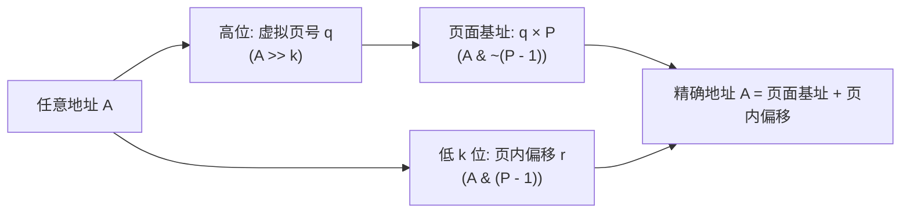
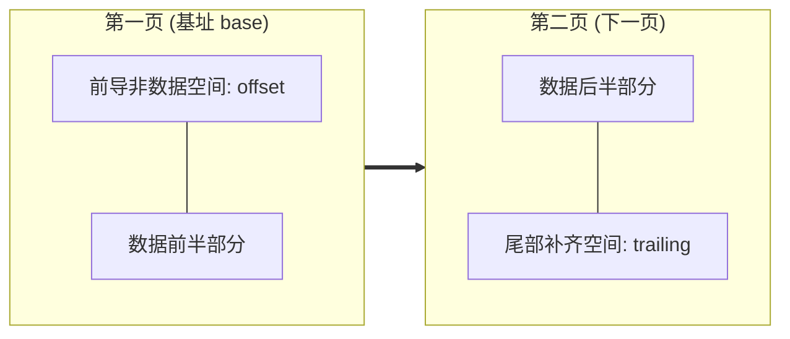

# 第 15 天：4KB、16KB 页面与对齐计算

> **核心认知**：页面是操作系统和 MMU 进行内存管理与权限保护的**基本原子单位**。理解页面大小（$4\text{ KiB}$ 与 $16\text{ KiB}$）与对齐计算，不仅是掌握 `0xfff` 和 `0x3fff` 两个掩码，更是掌握现代系统底层（如 Apple M 芯片、Android 15 16KB 迁移、ELF 装载对齐）地址划分与空间利用的核心数学逻辑。

---

## 【📌 一句话核心概括】
**页面（Page）是 MMU 与操作系统进行虚拟物理映射与权限管控的最小硬件单位，页面大小为 $2^k$（4KB 对应 $k=12$，16KB 对应 $k=14$），其基址向下对齐、向上对齐与跨页跨度计算完全由低 $k$ 位掩码位运算精确决定。**

## 【📖 通俗原理解释】
- **地址切分原理**：任意内存地址低 $k$ 位代表页内偏移（Offset），高位代表虚拟页号（VPN）。因为页大小是 2 的整数次幂，基址向下对齐只需用 `A & ~(P - 1)` 抹掉低 $k$ 位零头，页内偏移就是 `A & (P - 1)`。
- **向上对齐算法**：向上取整公式 `(A + P - 1) & ~(P - 1)` 的数学本质是：只要存在任何非零零头（哪怕仅 1 字节），加上 `P - 1` 都会引发向第 $k$ 位进位，随后按位与抹去零头，便精准进到下一个完整页面的起始边界。
- **跨页计算关键陷阱**：计算一段内存跨越的物理页数，绝不能单纯计算 `ceil(长度 / P)`；如果起始地址不在页边界对齐（例如从页内偏移 4095 处写入 2 字节），虽然长度极小却会跨越两个物理页。跨页计算必须将起始页内偏移合并计算：`((A + Len - 1) >> k) - (A >> k) + 1`。
- **4KB 与 16KB 的工程权衡**：增大页面至 16KB（如 Apple Silicon、Android 16KB 规范）使单条 TLB 硬件缓存条目覆盖的内存范围翻 4 倍，极大降低 TLB 缺失率和缺页异常频率；代价是小型映射会产生更大的内部内存碎片（Internal Fragmentation）。

---

## 一、核心数学模型：统一地址分解定理

对于任意给定的物理或虚拟地址 $A$ 和页面大小 $P = 2^k$ 字节：
* $k$ 是页内偏移所占的二进制位数。
* 任何地址 $A$ 均可在整数域唯一分解为：
  $$A = q \times P + r \quad (0 \le r < P)$$
  * $q = \lfloor A / P \rfloor$：**虚拟/物理页号**（Page Number）。
  * $q \times P$：**页面基址**（Page Base Address，当前页面的第一个字节地址）。
  * $r = A \bmod P$：**页内偏移**（Page Offset，页面内部的相对距离）。



### 4KB 与 16KB 核心参数极速对照表

| 规格属性 | 4 KiB 页面 (Standard) | 16 KiB 页面 (Large / Apple / Android 15) | 通用推导公式 ($P = 2^k$) |
| :--- | :--- | :--- | :--- |
| **字节总数 $P$** | $4096 = 2^{12}$ 字节 | $16384 = 2^{14}$ 字节 | $P = 2^k$ |
| **偏移位数 $k$** | 12 位（地址最低 12 位） | 14 位（地址最低 14 位） | $k = \log_2 P$ |
| **偏移取值范围** | $0 \sim 4095$ (`0x000` $\sim$ `0xfff`) | $0 \sim 16383$ (`0x0000` $\sim$ `0x3fff`) | $0 \sim P - 1$ |
| **页内偏移掩码** | `0xfff` | `0x3fff` | $\text{mask} = P - 1$ |
| **基址对齐反掩码** | `~0xfff` (`...fff000`) | `~0x3fff` (`...ffc000`) | $\sim(P - 1)$ |
| **单页 TLB 覆盖** | 4 KiB | 16 KiB（**4倍吞吐**） | $P$ |

---

## 二、位运算对齐的核心推导与溢出陷阱

### 1. 向下对齐（Align Down / Page Base）
找到不大于当前地址的最大页面边界：
```c
aligned_down = addr & ~(page_size - 1);
```
* **原理**：由于 `page_size - 1` 的低 $k$ 位全是 1，取反 `~(page_size - 1)` 后低 $k$ 位全为 0，高位保持 1。按位与操作无情抹除低 $k$ 位的零头，瞬间回退到页边界。

### 2. 向上对齐（Align Up）
找到不小于当前数值的最近页面边界：
```c
aligned_up = (addr + page_size - 1) & ~(page_size - 1);
```
* **数学归纳**：
  * 若 `addr` 原本就已页面对齐（如 4096），加 4095 得到 8191，抹零低 12 位后仍是 4096（不越位）。
  * 若 `addr` 超出边界 1 字节（如 4097），加 4095 得到 8192，抹零低 12 位后进位至 8192（成功向上跳到下一页）。

### 3. 工业级避坑：向上对齐的加法溢出防护
绝大多数初学者写的向上对齐宏均隐藏着严重的安全漏洞：
```c
/* 危险！当 addr 接近 UINT64_MAX 时产生回绕溢出 */
#define ALIGN_UP_BAD(x, align) (((x) + (align) - 1) & ~((align) - 1))
```
* **工业级安全检查规范**：
  ```c
  static inline bool safe_align_up_u64(uint64_t val, uint64_t align, uint64_t *out) {
      if (align == 0 || (align & (align - 1)) != 0) return false; // 必须是 2 的幂
      uint64_t pad = align - 1;
      if (val > UINT64_MAX - pad) return false; // 溢出拦截！
      *out = (val + pad) & ~pad;
      return true;
  }
  ```

---

## 三、经典手工运算演练：以地址 `0x12345` 为例

### 1. 4 KiB 页面环境演算 ($P = 0x1000$, $\text{mask} = 0x0fff$)
* **页内偏移**：
  $$0x12345 \ \& \ 0x0fff = 0x345 = 837 \text{ 字节}$$
* **页面基址**：
  $$0x12345 \ \& \ \sim 0x0fff = 0x12000$$
* **验证**：$0x12000 + 0x345 = 0x12345$。

### 2. 16 KiB 页面环境演算 ($P = 0x4000$, $\text{mask} = 0x3fff$)
* **页内偏移**：
  $$0x12345 \ \& \ 0x3fff = 0x2345 = 9029 \text{ 字节}$$
* **页面基址**：
  $$0x12345 \ \& \ \sim 0x3fff = 0x10000$$
* **验证**：$0x10000 + 0x2345 = 0x12345$。

---

## 四、跨页范围计算定理：为什么绝不能只算 `ceil(L / P)`？

### 1. 致命误区剖析
很多人误以为跨页数仅取决于数据长度 $L$：
$$\text{pages} = \lceil L / P \rceil \quad (\text{仅在起始地址严格页对齐时成立！})$$

### 2. 严谨通用跨页定理
对于任意起始地址 $A$ 和长度 $L > 0$：
1. 计算起始页内偏移：$O = A \ \& \ (P - 1)$
2. 从起始页基址到数据末尾的总跨度为：$O + L$
3. 实际跨越的物理页面数必然为：
   $$\text{Pages} = \left\lceil \frac{O + L}{P} \right\rceil = \left\lfloor \frac{O + L - 1}{P} \right\rfloor + 1$$



* **反例证明**：
  * 设 $P = 4096$ 字节，数据长度 $L = 4096$，起始地址 $A = 0x1001$（$O = 1$）。
  * 数据区间为 `[0x1001, 0x2001)`。
  * 错误算法：$\lceil 4096 / 4096 \rceil = 1$ 页。
  * 实际情况：`0x1001~0x1fff` 占用第 1 页（4095 字节），`0x2000` 占用第 2 页（1 字节），**整整跨越了 2 个独立页面**！
  * 正确公式：$\lceil (1 + 4096) / 4096 \rceil = \lceil 4097 / 4096 \rceil = 2$ 页。

---

## 五、100,000 字节实测对比：4KB vs 16KB

假设从页面对齐基址（$O = 0$）分配 100,000 字节连续数据：

| 评估维度 | 4 KiB 页面体系 | 16 KiB 页面体系 | 架构对比与工程意义 |
| :--- | :--- | :--- | :--- |
| **整除商与余数** | $100000 = 24 \times 4096 + 1696$ | $100000 = 6 \times 16384 + 1696$ | 均产生 1696 字节尾数 |
| **实际占用页数** | **25 页** | **7 页** | 页表项减少 $(25-7)/25 = \mathbf{72\%}$ |
| **完整覆盖范围** | $25 \times 4096 = 102,400$ 字节 | $7 \times 16384 = 114,688$ 字节 | 16KB 覆盖更宽广 |
| **末尾补齐浪费** | $102400 - 100000 = \mathbf{2,400}$ 字节 | $114688 - 100000 = \mathbf{14,688}$ 字节 | 16KB 内部碎片约为 4KB 的 6 倍 |

---

## 六、16KB 页面演化对系统的深远影响

随着 Apple Silicon（M1/M2/M3 默认 16KB）以及 Android 15 正式要求支持 16KB 页面，系统底层带来重大变革：

1. **TLB 硬件效率暴增**：
   * TLB 表项有限（例如 64 项 L1 DTLB）。
   * 4KB 页面下，64 项只能覆盖 $64 \times 4\text{KB} = 256\text{ KiB}$ 内存。
   * 16KB 页面下，64 项可覆盖 $64 \times 16\text{KB} = 1\text{ MiB}$ 内存。TLB 缓存未命中（TLB Miss）概率大幅下挫。
2. **ELF `PT_LOAD` 段装载对齐约束**：
   * ELF 规范严苛要求：
     $$p\_vaddr \bmod p\_align \equiv p\_offset \bmod p\_align$$
   * 若程序在链接时按 4KB 对齐编译（$p\_align = 0x1000$），将其放在 16KB 页面的 Linux 内核上装载，内核在 `mmap` 文件段时会因为文件偏移与虚拟地址不是 16KB 同余而**直接拒绝执行**！这也是 Android 原生动态库（.so）必须使用 `-z max-page-size=16384` 重新编译的原因。
3. **系统调用粒度不可分割**：
   * `mprotect(addr, len, prot)` 必须整页生效！**绝不可能让前半页只读、后半页可写**。
   * 向下对齐起点、向上对齐终点是安全调用 `mprotect` 的标准范式。

---

## 七、工业级实战源码：全功能高可靠页面计算器

支持任意十六进制/十进制输入、动态检测系统真实页大小、具备严格数学溢出防御：

```c
/* page_calc.c - 严谨的虚拟内存页面与对齐计算器 */
#define _POSIX_C_SOURCE 200809L
#include <errno.h>
#include <inttypes.h>
#include <stdbool.h>
#include <stdint.h>
#include <stdio.h>
#include <stdlib.h>
#include <unistd.h>

/* 安全解析 64 位无符号整数 */
static bool parse_u64(const char *str, uint64_t *out) {
    if (!str || !out || str[0] == '\0' || str[0] == '-') return false;
    char *end = NULL;
    errno = 0;
    unsigned long long val = strtoull(str, &end, 0);
    if (errno != 0 || end == str || *end != '\0') return false;
    *out = (uint64_t)val;
    return true;
}

/* 严格判定 2 的幂 */
static inline bool is_power_of_two(uint64_t v) {
    return (v != 0) && ((v & (v - 1)) == 0);
}

/* 防溢出的向上对齐函数 */
static bool safe_align_up(uint64_t val, uint64_t align, uint64_t *res) {
    if (!is_power_of_two(align)) return false;
    uint64_t mask = align - 1;
    if (val > UINT64_MAX - mask) return false; /* 溢出检查 */
    *res = (val + mask) & ~mask;
    return true;
}

int main(int argc, char *argv[]) {
    if (argc < 3 || argc > 4) {
        fprintf(stderr, "用法: %s <地址> <长度> [页大小]\n", argv[0]);
        fprintf(stderr, "示例: %s 0x12345 4096 4096\n", argv[0]);
        return EXIT_FAILURE;
    }

    uint64_t address, length, page_size;
    if (!parse_u64(argv[1], &address)) {
        fprintf(stderr, "错误: 无效的起始地址 '%s'\n", argv[1]);
        return EXIT_FAILURE;
    }
    if (!parse_u64(argv[2], &length)) {
        fprintf(stderr, "错误: 无效的长度 '%s'\n", argv[2]);
        return EXIT_FAILURE;
    }

    if (argc == 4) {
        if (!parse_u64(argv[3], &page_size) || !is_power_of_two(page_size)) {
            fprintf(stderr, "错误: 页大小必须是 2 的整数次幂\n");
            return EXIT_FAILURE;
        }
    } else {
        long sys_page = sysconf(_SC_PAGESIZE);
        if (sys_page <= 0) { perror("sysconf"); return EXIT_FAILURE; }
        page_size = (uint64_t)sys_page;
    }

    uint64_t page_mask   = page_size - 1;
    uint64_t page_base   = address & ~page_mask;
    uint64_t page_offset = address & page_mask;

    uint64_t len_aligned, covered_span, pages = 0;
    uint64_t leading = 0, trailing = 0, non_data = 0;

    if (!safe_align_up(length, page_size, &len_aligned)) {
        fprintf(stderr, "错误: 长度向上对齐计算溢出\n");
        return EXIT_FAILURE;
    }

    if (length > 0) {
        if (address > UINT64_MAX - length) {
            fprintf(stderr, "错误: 起始地址 + 长度导致 64 位溢出\n");
            return EXIT_FAILURE;
        }
        /* 关键定理: offset + length 必须合并向上对齐 */
        uint64_t unaligned_span = page_offset + length;
        if (!safe_align_up(unaligned_span, page_size, &covered_span)) {
            fprintf(stderr, "错误: 跨页覆盖计算溢出\n");
            return EXIT_FAILURE;
        }
        pages    = covered_span / page_size;
        leading  = page_offset;
        trailing = covered_span - page_offset - length;
        non_data = covered_span - length;
    } else {
        covered_span = 0;
    }

    printf("================ 页面对齐精密分析报告 ================\n");
    printf("系统/指定页大小       : %" PRIu64 " 字节 (掩码 0x%" PRIx64 ")\n", page_size, page_mask);
    printf("输入虚拟地址         : 0x%" PRIx64 "\n", address);
    printf("起始页面基址 (Base)   : 0x%" PRIx64 "\n", page_base);
    printf("页内偏移量 (Offset)  : 0x%" PRIx64 " (十进制 %" PRIu64 " 字节)\n", page_offset, page_offset);
    printf("数据净长度 (Length)  : %" PRIu64 " 字节\n", length);
    printf("---------------- 跨页覆盖与碎片分析 ----------------\n");
    printf("实际跨越物理页面数   : %" PRIu64 " 页\n", pages);
    printf("整体覆盖内存范围     : %" PRIu64 " 字节 [0x%" PRIx64 ", 0x%" PRIx64 ")\n",
           covered_span, page_base, page_base + covered_span);
    printf("前导非数据空间       : %" PRIu64 " 字节\n", leading);
    printf("末尾补齐空间 (尾部)  : %" PRIu64 " 字节\n", trailing);
    printf("总内部碎片/非数据空间: %" PRIu64 " 字节\n", non_data);
    printf("====================================================\n");

    return EXIT_SUCCESS;
}
```

---

## 八、编译与深度实证检验

### 1. 编译并开启全部严格警告
```bash
gcc -std=c17 -Wall -Wextra -Wpedantic -Wconversion -O2 page_calc.c -o page_calc
```

### 2. 验证系统真实环境与未对齐跨页
```bash
# 查询当前系统物理页大小
getconf PAGESIZE

# 验证边界案例: 0x1001 跨 4096 字节
./page_calc 0x1001 4096 4096
```
* **控制台实测输出**：
  ```text
  实际跨越物理页面数   : 2 页
  整体覆盖内存范围     : 8192 字节 [0x1000, 0x3000)
  前导非数据空间       : 1 字节
  末尾补齐空间 (尾部)  : 4095 字节
  总内部碎片/非数据空间: 4096 字节
  ```
  实证彻底砸实：**4096 字节只要偏离了页基准，必须占用 2 个物理页**！

### 3. 查看 ELF 段的 `p_align` 约束
```bash
readelf -lW ./page_calc
```
观察各个 `PT_LOAD` 段：
```text
  LOAD offset 0x000000 vaddr 0x0000000000000000 align 0x1000
  LOAD offset 0x001000 vaddr 0x0000000000001000 align 0x1000
```
手工验证同余法则：$0x1000 \bmod 0x1000 = 0$ 且 $0x1000 \bmod 0x1000 = 0$。

---

## 九、高频易错避坑清单

1. **写死 `0xfff` 掩码**：绝不可在跨平台/嵌入式开发中假定页面永远是 4KB。在 16KB 系统下使用 `0xfff` 会截断高两位偏移，导致基址计算全盘皆错。必须通过 `sysconf(_SC_PAGESIZE)` 动态生成 `page_size - 1`。
2. **浮点数 `ceil((double)len / page_size)`**：大整数转 double 会丢失有效精度，且浮点运算进入内核或高性能路径会产生巨大开销。
3. **忽略零长度处理**：若直接用 `(offset + length - 1) / page_size + 1`，当 `length == 0` 且 `offset == 0` 时，`0 - 1` 会导致无符号整数反转暴涨为 $2^{64}-1$，引发灾难。
4. **混淆“整数运算”与“内存访问”**：`page_base = addr & ~mask;` 只是一个纯粹的 CPU 寄存器算术计算，**绝不代表 CPU 真正去解引用了这个内存地址**。解引用无效地址才会崩，计算数值永远不会崩。

---

## 十、课后演练与自我考核

### 练习 1：手算 16KB 基址与偏移
地址为 `0x7abc`，当页大小为 16 KiB（$0x4000$）时：
* 掩码为：$0x3fff$
* 页面基址：$0x7abc \ \& \ \sim 0x3fff = 0x4000$
* 页内偏移：$0x7abc \ \& \ 0x3fff = 0x3abc$（十进制 15,036 字节）
* 验证：$0x4000 + 0x3abc = 0x7abc$。

### 练习 2：临界边界跨页分析
地址 `0x1ff0`，长度 32 字节，页大小 4096 字节：
* 偏移：$0x1ff0 \ \& \ 0xfff = 0xff0 = 4080$ 字节。
* 第一页剩余空间：$4096 - 4080 = 16$ 字节。
* 数据长度 32 字节 $> 16$ 字节，必然跨入下一页！
* 跨越页数：$\lceil (4080 + 32) / 4096 \rceil = \lceil 4112 / 4096 \rceil = \mathbf{2}$ 页。

---

## 十一、口头验收与核心达标标准

- [ ] **掩码推导**：能否在 10 秒内说出 $4\text{KB}$（12位/`0xfff`）与 $16\text{KB}$（14位/`0x3fff`）的推导由来？
- [ ] **位运算原理**：能否清晰解释为什么 `addr & ~(P - 1)` 能实现向下对齐？为什么向上对齐要先加 `P - 1`？
- [ ] **跨页黄金公式**：能否向他人清晰推导为什么任意地址跨页必须用 $\lceil (\text{offset} + \text{length}) / P \rceil$？
- [ ] **系统级视野**：能否完整陈述 16KB 页面在 TLB 覆盖、内部碎片和 ELF 装载对齐上的双刃剑效应？
- [ ] **代码可靠性**：能否手写无溢出漏洞的 64 位 `align_up` 函数，并指出浮点数 `ceil` 的缺陷？