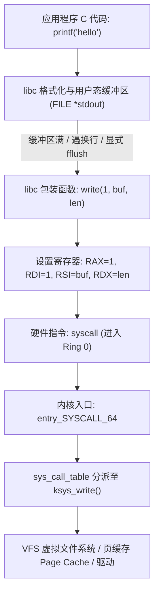

# 第 16 天：系统调用的完整流转

> **核心认知**：系统调用（System Call）是用户态程序跨越 CPU 特权边界、请求内核执行受控硬件或系统级操作的**唯一合法通道**。必须彻底厘清 **“C 库函数 ➔ libc 包装函数 ➔ 体系结构陷阱指令（`syscall`/`svc`）➔ 内核入口分派 ➔ 硬件驱动/子系统”** 的完整流转链条，绝不可把库函数、系统调用与进程切换混为一谈。

---

## 【📌 一句话核心概括】
**系统调用是 CPU 从非特权用户态（Ring 3 / EL0）陷入特权内核态（Ring 0 / EL1）的受控硬件陷阱机制，通过专用指令（x86-64 `syscall` / ARM64 `svc #0`）与特定寄存器传递调用号和参数，经内核系统调用分派表执行目标服务后安全返回用户态。**

## 【📖 通俗原理解释】
- **特权级切换与硬件陷阱**：用户态程序无权直接操作硬件 I/O 或修改控制寄存器（如 CR3）。当执行 `syscall` 时，CPU 硬件原子化保存返回地址并跃迁至内核预设的系统调用入口地址（`MSR_LSTAR`），将特权级切换至 Ring 0，同时切换到进程的内核栈。
- **寄存器传参与 RCX 踩踏陷阱**：在 x86-64 Linux 平台，普通函数调用的第 4 个参数使用 `rcx`，但 `syscall` 指令在硬件执行瞬间会被 CPU 强行征用 `rcx` 暂存用户态返回地址 `rip`（并用 `r11` 暂存 `rflags`）。因此，内核系统调用 ABI 强制改用 `r10` 传递第 4 个参数，避免寄存器覆盖。
- **libc 封装层与错误码转换**：`printf` 等 C 库函数在用户态维护标准 I/O 缓冲区，累积后才触发底层的 `write` 系统调用。内核返回的错误码直接以负数（如 `-EFAULT`、`-EINVAL`）放入返回值寄存器；libc 包装函数捕获到负数时，会将其绝对值存入线程局部变量 `errno`，并对上层应用返回 `-1`。
- **内核内存安全边界**：内核绝不会直接解引用用户态传来的裸指针，必须通过 `copy_from_user` / `copy_to_user` 并配合缺页异常修复机制（Fixup Table），防止恶意的用户态野指针或特权提升攻击摧毁内核。

---

## 一、核心概念：清晰区分四大软件与硬件层次

绝大多数混淆都源于“接口名称重叠”，必须建立清晰的四层正交视图：

| 层次定位 | 代表实例 | 规范制定者 | 职责与本质 |
| :--- | :--- | :--- | :--- |
| **1. C 标准库接口** | `printf()`, `fopen()`, `malloc()` | ISO C 标准 | 面向开发者的高级抽象，具备用户态流缓冲与格式化解析 |
| **2. POSIX 操作系统接口** | `read()`, `write()`, `fork()` | IEEE POSIX | 类 Unix 系统的标准系统编程接口，通常以 libc 包装函数存在 |
| **3. Linux 系统调用 ABI** | `SYS_read (0)`, `SYS_write (1)` | Linux 内核 | 用户态与内核约定的机器级寄存器传参接口规范 |
| **4. CPU 架构陷阱指令** | `syscall` (x86-64), `svc #0` (ARM64) | Intel / ARM | 触发 CPU 硬件状态变迁、提升特权级（Ring 3 ➔ 0）的机器指令 |



---

## 二、为什么普通程序不能直接操控硬件？

1. **特权等级划分（Protection Rings）**：
   * x86-64 支持 CPL 0~3（Linux 仅使用 Ring 0 内核态 与 Ring 3 用户态）。
   * ARM64 对应 Exception Levels（EL0 用户态，EL1 内核态）。
   * **用户态不是一块物理内存，而是 CPU 执行指令时的一种受限硬件工作模式**。
2. **保护页表与寄存器根基**：
   * 若允许用户态执行 `mov cr3, rax` 修改页表基址，恶意程序只需将物理内核页映射为可写，即可随意篡改 root 权限或盗取其他进程内存。因此修改控制寄存器是特权指令，Ring 3 执行立即触发 General Protection Fault (`#GP`)。
3. **保护设备总线与文件系统一致性**：
   * 磁盘操作涉及复杂的 MMIO 寄存器、DMA 描述符及锁机制。若两个进程并发直接向 NVMe/SATA 控制器写扇区，文件系统元数据瞬间粉碎。
4. **警惕致命常识误区**：
   * `write()` 成功返回**绝不代表数据已经安全写入物理磁盘**！绝大多数情况下数据仅仅被复制进内核的**页缓存（Page Cache）**，由内核 pdflush/flusher 线程异步刷盘。需要物理落盘必须显式调用 `fsync()` 或 `fdatasync()`。

---

## 三、`printf()` 与 `write()` 的根本关系：用户态缓冲机制

为什么 `printf("hello\n")` 不等于一次系统调用？因为 libc 在用户态引入了 `FILE` 结构体流缓冲：

| 缓冲模式 | 触发刷新（调用 write）的条件 | 典型应用场景 |
| :--- | :--- | :--- |
| **无缓冲 (`_IONBF`)** | 只要写入立即调用底层 `write` | `stderr`（错误信息必须即时暴风吸入输出） |
| **行缓冲 (`_IOLBF`)** | 缓冲区满，或写入数据中包含 `\n` | `stdout` 连接到交互式终端（Terminal） |
| **全缓冲 (`_IOFBF`)** | 缓冲区彻底填满（通常 4KB/8KB），或显式 `fflush` | `stdout` 重定向到普通磁盘文件（`./app > out.txt`） |

* **实测铁证**：连续执行三次 `printf("A"); printf("B"); printf("C");`，若未遇 `\n` 且输出到终端，libc 内部只发生内存搬运；直到遇到 `\n` 或程序正常退出，才发生**唯一一次** `write(1, "ABC\n", 4)` 系统调用！

---

## 四、双架构 ABI 深度对决：普通函数 vs 系统调用

系统调用不使用普通 `call` 指令，二者在寄存器分配上存在核心差异：

### 1. x86-64 架构调用约定对照矩阵

| 传参通道 | 普通 C 函数调用 (System V AMD64 ABI) | Linux x86-64 系统调用 (Syscall ABI) | 差异原因与底层硬件机理 |
| :---: | :---: | :---: | :--- |
| **调用号 / 返回值** | 返回值存 `RAX`（调用由符号地址指定） | **`RAX` 存系统调用号**，执行后存返回值 | 内核通过 RAX 检索 `sys_call_table` |
| **参数 1** | `RDI` | `RDI` | 保持一致，减少转换成本 |
| **参数 2** | `RSI` | `RSI` | 保持一致 |
| **参数 3** | `RDX` | `RDX` | 保持一致 |
| **参数 4** | **`RCX`** | **`R10` (★ 极其重要)** | **硬件冲突！`syscall` 硬件强占 `RCX` 存返回 RIP！** |
| **参数 5** | `R8` | `R8` | 保持一致 |
| **参数 6** | `R9` | `R9` | 保持一致 |
| **硬件破坏寄存器** | 由被调用者按规则保护 | **`RCX` 与 `R11`** | `RCX` 暂存用户 RIP，`R11` 暂存用户 RFLAGS |

> **🔥 核心考点：为什么系统调用第 4 个参数必须用 `R10`？**
> CPU 在执行 `syscall` 指令时，微码硬件会自动将下一条用户态指令地址塞入 `RCX`，将用户标志寄存器塞入 `R11`。若第 4 参数仍用 `RCX`，用户传进来的参数值会被硬件瞬间无情抹杀！因此 Linux ABI 规约将第 4 参数强制转移至 `R10`。

### 2. ARM64 架构调用约定
* 系统调用号：`w8` / `x8`
* 参数 1~6：`x0` ~ `x5`
* 返回值：`x0`
* 陷入指令：`svc #0`（产生同步异常，进入 EL1，硬件自动将返回地址压入 `ELR_EL1`，原状态压入 `SPSR_EL1`）。

---

## 五、深入内核：`read(fd, buffer, count)` 全流转九大阶段

```mermaid
sequenceDiagram
    autonumber
    actor App as 用户程序
    participant Libc as libc (read wrapper)
    participant HW as CPU 硬件 (Syscall)
    participant Entry as 内核入口 (entry_SYSCALL_64)
    participant VFS as 内核 VFS / Driver

    App->>Libc: read(fd, buffer, count)
    Libc->>HW: 设置 RAX=0, RDI=fd, RSI=buffer, RDX=count; 执行 syscall
    Note over HW: 硬件动作: CPL 3->0; RCX=NextRIP; R11=RFLAGS; 跳至 LSTAR
    HW->>Entry: 陷入内核入口
    Entry->>Entry: 切换至内核栈，将 pt_regs (寄存器现场) 压栈
    Entry->>VFS: 根据 RAX 索引 sys_call_table[0] (sys_read)
    VFS->>VFS: 1. 验证 fd 有效性 (检查 files_struct)<br/>2. 验证 buffer 指针合法性 (access_ok)
    alt 地址非法或未映射
        VFS-->>Entry: 返回负数错误码 (如 -EFAULT)
    else 验证通过
        VFS->>VFS: 从页缓存/驱动读取数据，通过 copy_to_user 拷贝到用户 buffer
        VFS-->>Entry: 返回实际读取字节数 (如 count)
    end
    Entry->>Entry: 处理信号/重新调度，从内核栈恢复寄存器
    Entry->>HW: 执行 SYSRET / IRETQ 恢复用户态
    HW-->>Libc: 返回用户空间，RAX 包含内核处理结果
    alt RAX < 0 且处于错误范围 [-4095, -1]
        Libc->>Libc: 将 (-RAX) 存入 errno，函数返回 -1
    else RAX >= 0
        Libc-->>App: 返回读取字节数
    end
```

### 关键细节剖析：
1. **系统调用不是进程切换**：当前线程依然是同一个执行主体，仅仅是执行特权和堆栈由用户空间换到了当前线程独占的**内核栈（Kernel Stack）**。
2. **指针验证防线（`copy_to_user` / `uaccess`）**：
   * 内核绝不能仅靠 `buffer != NULL` 就断言安全！
   * 用户指针可能指向内核受保护区域、可能落入无权限空洞、可能在传输过程中被并发线程 `munmap` 销毁。内核通过体系结构专用的 `copy_to_user()` 在安全异常表中捕获缺页，遇到越权直接优雅返回 `-EFAULT`，绝不让内核本身崩溃。
3. **数据填充真相**：`read()` 从不对末尾补 `'\0'`！若向大小为 16 字节的缓冲区读取 3 字节，仅 `buffer[0..2]` 被有效写入，剩余字节若未初始化依然是垃圾未定义数据。

---

## 六、内核错误码与用户态 `errno` 的转换奥秘

这是系统编程中最容易踩坑的灰色地带：

* **内核内部约定**：原生系统调用发生错误时，内核直接返回**负的错误码**（范围通常为 `[-4095, -1]`）。例如：
  * 文件描述符非法：返回 `-EBADF`（即 `-9`）。
  * 内存地址非法：返回 `-EFAULT`（即 `-14`）。
* **libc 包装函数的转译**：
  ```c
  /* libc 伪代码逻辑 */
  if (rax < 0 && rax >= -4095) {
      errno = -rax;  /* 剥离负号，把 9 或 14 写入线程局部变量 errno */
      return -1;     /* 统一返回 -1 标识发生错误 */
  }
  return rax;
  ```
* **黄金排错准则**：
  1. `errno` 只有在函数明确返回 `-1` 时才有法律效力！成功调用的函数不保证清空 `errno`，绝不可直接用 `if (errno != 0)` 判断错误。
  2. 若使用 libc 的 `syscall()` 函数，它**已经执行过**错误转换，失败返回 `-1` 并置 `errno`；**严禁**再做 `errno = -result;`，否则会将 `errno` 篡改成荒谬的值！

---

## 七、实战代码：系统调用的三重境界

### 境界 1：使用标准 libc 的 `syscall()` 包装函数（兼顾安全与循环短写）

```c
/* day16_syscall.c - 严密处理 EINTR 与 Partial Write 的系统调用封装 */
#define _DEFAULT_SOURCE
#include <errno.h>
#include <stdio.h>
#include <stdlib.h>
#include <sys/syscall.h>
#include <unistd.h>

/* 工业级稳健的系统调用写入：杜绝数据截断与信号中断退出 */
static int write_all_safe(int fd, const void *buf, size_t count) {
    const unsigned char *p = (const unsigned char *)buf;
    size_t remaining = count;

    while (remaining > 0) {
        /* 调用 libc 的 syscall()，失败自动设置 errno 并返回 -1 */
        long ret = syscall(SYS_write, (long)fd, p, remaining);
        if (ret == -1) {
            if (errno == EINTR) continue; /* 被信号打断，无条件重试 */
            return -1; /* 真实 I/O 错误 */
        }
        if (ret == 0) {
            errno = EIO;
            return -1;
        }
        p += (size_t)ret;
        remaining -= (size_t)ret;
    }
    return 0;
}

int main(void) {
    static const char msg[] = "Hello from libc syscall()!\n";
    if (write_all_safe(STDOUT_FILENO, msg, sizeof(msg) - 1) == -1) {
        perror("write_all_safe");
        return EXIT_FAILURE;
    }
    return EXIT_SUCCESS;
}
```

### 境界 2：内联汇编直捣黄龙（直接触发 x86-64 `syscall`）

```c
/* day16_raw_inline.c - 手写 GCC 扩展内联汇编直发系统调用 */
#include <errno.h>
#include <stddef.h>
#include <stdio.h>
#include <stdlib.h>
#include <sys/syscall.h>
#include <unistd.h>

static long raw_syscall3(long nr, long arg1, long arg2, long arg3) {
    long ret = nr;
    __asm__ volatile (
        "syscall"
        : "+a" (ret)                  /* 入参 RAX=系统调用号，出参 RAX=内核返回值 */
        : "D" (arg1), "S" (arg2), "d" (arg3) /* RDI, RSI, RDX */
        : "rcx", "r11", "memory", "cc" /* 告知编译器硬件破坏与内存变更 */
    );
    return ret;
}

int main(void) {
    static const char msg[] = "Direct x86-64 syscall!\n";
    /* 原生调用: 必须自行处理负数错误码 */
    long ret = raw_syscall3(SYS_write, 1, (long)msg, sizeof(msg) - 1);
    if (ret < 0) {
        errno = (int)(-ret);
        perror("raw_write");
        return EXIT_FAILURE;
    }
    return EXIT_SUCCESS;
}
```

### 境界 3：纯裸汇编零依赖实现（不带 libc 与 crt1.o）

创建 `day16_pure.S`：
```asm
# day16_pure.S - 纯裸汇编系统调用程序
.intel_syntax noprefix
.global _start

.section .rodata
msg:
    .ascii "Pure Assembly Syscall Executed!\n"
    msg_len = . - msg

.section .text
_start:
    # 1. 触发 write(1, msg, msg_len)
    mov eax, 1                  # RAX = SYS_write (1)
    mov edi, 1                  # RDI = STDOUT_FILENO (1)
    lea rsi, [rip + msg]        # RSI = 字符串绝对虚拟地址
    mov edx, msg_len            # RDX = 字节长度
    syscall                     # 跨入 Ring 0

    # 检查写入返回值
    test rax, rax
    js .Lerror                  # 若符号位为 1 (负数)，跳入错误分支

    # 2. 正常退出 exit(0)
    mov eax, 60                 # RAX = SYS_exit (60)
    xor edi, edi                # RDI = 0 (退出码)
    syscall

.Lerror:
    # 3. 异常退出 exit(1)
    mov eax, 60
    mov edi, 1
    syscall
```

编译与静态链接：
```bash
gcc -c -nostdlib day16_pure.S -o day16_pure.o
ld day16_pure.o -o day16_pure
./day16_pure
```

---

## 八、调试、跟踪与动态观测

### 1. `strace` 系统调用全息透视
```bash
# 跟踪 write 和 exit 族系统调用
strace -e trace=write,exit_group ./day16_syscall

# 观测文件描述符详情 (-yy)
strace -yy ./day16_syscall
```

### 2. GDB 抓捕系统调用边界
```gdb
gdb ./day16_raw_inline
(gdb) catch syscall write
(gdb) run
# 命中断点，精确停在执行 syscall 指令前夕！
(gdb) info registers rax rdi rsi rdx rcx r11
(gdb) x/s $rsi
```
> **核心现象**：在 `syscall` 指令刚执行完的一瞬间，查看 `$rcx`，它已被硬件悄悄填入了紧跟在 `syscall` 后面的那条指令的虚拟地址！

---

## 九、高频避坑与经典反例

1. **混淆 `syscall()` 库函数与 `syscall` 指令**：前者是 libc 提供的可移植包装函数，传参遵循普通 System V ABI（C 代码可以传参）；后者是 CPU 硬件指令。
2. **内联汇编遗漏 clobber 声明**：手写 `syscall` 必须声明 `"rcx", "r11", "memory"`。否则 GCC 优化器会误以为 `RCX` 里的数据依然有效，在后续计算中读取脏数据，导致极其隐蔽的 Release 崩溃。
3. **系统调用传参超过 3 个时错用 RCX**：手写 4 个参数以上的系统调用，必须将第 4 参数显式放入 `R10`。
4. **单次 `write` 忽略短写（Partial Write）**：网络 Socket 或管道写操作中，请求写入 1024 字节可能只成功写入 200 字节。工业级代码必须采用 `while (remaining > 0)` 循环稳健推进。
5. **认为 `read` 会保证字符串截断**：
   ```c
   char buf[8];
   ssize_t n = read(fd, buf, 8);
   printf("%s\n", buf); // 致命！若读取 8 字节没有空字符，printf 越界狂奔崩溃！
   ```

---

## 十、课后演练与自我考核

### 练习 1：寄存器传参还原
在 Linux x86-64 下调用 `read(3, buf, 100)`，假设 `buf = 0x7fffffffe000`，请写出执行 `syscall` 前的寄存器状态：
* `RAX = 0` (`SYS_read`)
* `RDI = 3`
* `RSI = 0x7fffffffe000`
* `RDX = 100`

### 练习 2：错误转译推导
汇编执行 `syscall` 后，`RAX` 返回 `-14`（即 `-EFAULT`）。
* libc 包装函数会返回什么值？答：返回 `-1`。
* 此时线程的 `errno` 是什么值？答：`errno = 14`。

---

## 十一、口头验收与核心达标标准

- [ ] **层次清晰**：能否随手画出 `printf ➔ libc write ➔ syscall 指令 ➔ 内核 entry ➔ sys_call_table` 的全流转？
- [ ] **寄存器铁律**：能否准确陈述 x86-64 六个系统调用参数寄存器，并解释第 4 参数为何必须是 `R10`？
- [ ] **硬件细节**：能否说明 `syscall` 执行时对 `RCX` 和 `R11` 的硬件副作用？
- [ ] **错误转译机制**：能否说清内核负错误码到 libc `-1` 与 `errno` 的转换逻辑？
- [ ] **内核安全视野**：能否解释为什么内核不能信任用户指针，必须通过 `copy_from_user` 受控访问？
- [ ] **工具链精通**：能否使用 `strace` 追踪标准 I/O 缓冲合并现象，并用 GDB `catch syscall` 抓捕现场？