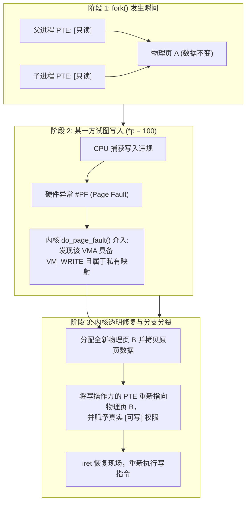

# 第 17 天：`fork`、`execve` 与写时复制 COW

> **核心认知**：进程是操作系统分配资源的独立实体。掌握进程生命周期，必须彻底建立 **“`fork()` 影分身克隆 ➔ COW 硬件页表只读拦截 ➔ `execve()` 进程映像夺舍替换 ➔ `waitpid()` 僵尸回收”** 的完整操作系统模型。绝不可把进程克隆、线程创建与程序替换混为一谈。

---

## 【📌 一句话核心概括】
**`fork` 通过复制父进程的内核任务结构与页表（并将全部可写页表项置为只读）创建新进程，利用硬件缺页异常实现写时复制（COW）；而 `execve` 则彻底释放当前进程的原有用户态地址空间（代码、数据、堆、栈），加载并初始化全新的可执行文件映像后从入口点开始执行。**

## 【📖 通俗原理解释】
- **`fork` 的返回值分流机制**：`fork()` 不是同一个执行流返回两次，而是内核创建了一个拥有独立 PID、独立页表但执行上下文几乎完全一致的子进程。在内核返回用户态时，父进程接收到子进程的 PID，而子进程的架构寄存器返回值（`rax` / `x0`）被内核显式设置为 `0`，从而实现执行逻辑分流。
- **写时复制（COW）的硬件拦截**：`fork` 发生时内核不会实际深拷贝数 GB 的物理内存，而是将父子两套页表中的可写页项全部标记为“只读”（保留 VMA 的可写属性）。任何一方尝试写入时，MMU 硬件触发只读缺页异常，内核捕获该异常后分配新物理页、复制内容并恢复写权限，完成惰性物理分离。
- **`execve` 映像重置与不返回特性**：`execve` 保持进程 PID 和大部分文件描述符不变，但会销毁原进程旧的虚拟内存区域（VMA），重新映射新 ELF 程序的各个段，初始化栈与环境变量，直接将 CPU 的指令指针 `RIP` 指向新程序入口。若执行成功，原程序的代码和栈帧已被彻底销毁，因此永远不会“返回”。
- **Shell 的 `fork` + `execve` 范式**：如果 Shell 直接执行 `execve`，Shell 自身进程会被目标命令完全覆盖，命令执行完后终端就会直接退出。因此必须由 Shell 先 `fork` 出子进程，在子进程中执行 `execve` 替换，父进程通过 `waitpid` 挂起等待子进程退出并回收资源（避免僵尸进程）。

---

## 一、概念辨析：程序、进程、线程与进程映像

| 核心概念 | 本质定义 | 物理存在 | 生命周期与标志 |
| :--- | :--- | :--- | :--- |
| **程序 (Program)** | 磁盘上的 ELF 格式静态二进制文件（指令与元数据） | 磁盘上的 Inode 与数据块 | 静态永久保存，非运行实体 |
| **进程 (Process)** | 操作系统进行资源分配和保护的**独立运行实体** | 内核 `task_struct`、独立页表、FD 表、虚拟空间 | 动态拥有 PID，由 `fork` 诞生、`exit` 销毁 |
| **进程映像 (Image)** | 进程在用户空间展开的虚拟内存段集合（代码/数据/堆/栈） | 运行时的多级页表及物理页映射 | `execve` 专门负责旧映像的摧毁与新映像的建立 |
| **线程 (Thread)** | 进程内部的一个执行调度单位（单条指令流） | 独立寄存器上下文、独立用户栈 | 同一进程内的线程**共享相同页表与地址空间** |

---

## 二、`fork()` 的底层时序与“双返回值”真相

### 1. POSIX 规约与返回值语义
```c
#include <sys/types.h>
#include <unistd.h>

pid_t pid = fork();
```
* **父进程执行流**：`pid > 0`（返回新创建子进程的 PID）。
* **子进程执行流**：`pid == 0`（标志自己为子进程）。
* **错误分支**：`pid == -1`（子进程未创建，设置 `errno`）。

```mermaid
flowchart TD
    A["父进程调用 fork()"] --> B{"内核克隆 task_struct 与页表"}
    B -->|资源不足 (EAGAIN/ENOMEM)| C["只有父进程继续运行<br/>fork() 返回 -1 (设置 errno)"]
    B -->|克隆成功| D["产生两个独立的 CPU 执行上下文"]
    D --> E["父进程上下文中<br/>内核让 RAX = 子进程 PID<br/>继续执行下一条指令"]
    D --> F["子进程上下文中<br/>内核让 RAX = 0<br/>从相同逻辑位置继续执行"]
```

### 2. x86-64 机器指令视角
在 System V AMD64 ABI 下，函数返回值通过 `RAX` 寄存器传递：
```asm
call fork@PLT        # 调用 glibc 包装函数
test eax, eax        # 检查 RAX 中的返回值
je   .L_child_path   # 若 RAX == 0，跳转至子进程执行流
js   .L_error_path   # 若 RAX < 0 (即 -1)，跳转至错误处理
# 此时落入父进程执行流 (RAX > 0)
```
> **核心机理**：`fork()` 不是“同一个函数返回了两次”，而是内核在 `copy_process()` 时克隆了调用者的寄存器状态。随后内核调度器将子进程的内核栈中记录的 `RAX` 强制改写为 `0`，而父进程的 `RAX` 保留为子进程的 PID。

---

## 三、写时复制（COW, Copy-On-Write）硬件机理

### 1. 为什么必须有 COW？
若一个拥有 8 GB 物理内存的数据库进程执行 `fork()` 后紧接着执行 `execve()`，如果无脑进行深拷贝，系统必须立即分配 8 GB 内存并执行数十亿次总线拷贝，耗时数百毫秒，而随后 `execve` 又瞬间将其全部销毁！这是极其荒谬的资源浪费。

### 2. COW 的三步硬件级变身



* **粒度约束**：MMU 硬件是以**页（通常 4KB）**为管理粒度的。**哪怕你只改动了 1 个字节（如 `char c = 'x';`），内核也必须完整拷贝整整一个 4KB 物理页！**

### 3. 破除认知迷思：相同虚拟地址，独立物理世界
在父子进程中同时执行 `printf("&global = %p\n", (void *)&global);`，打印出来的十六进制数字通常**一模一样**（例如 `0x555555558010`）。
* **推演**：虚拟地址相同 $\ne$ 物理地址相同！
* 虚拟地址仅仅是本进程页表内的查询索引。在 COW 分裂后，父进程页表将 `0x555555558010` 映射到物理页框 A，子进程页表将 `0x555555558010` 映射到物理页框 B。**二者如同不同平行宇宙中的相同门牌号，互不干扰！**

---

## 四、`execve()` 的底层重构与映像替换

```c
#include <unistd.h>
int execve(const char *pathname, char *const argv[], char *const envp[]);
```

### 1. 替换与保留清单
* **被彻底摧毁并重建的用户态元素**：
  * 原程序的代码段（`.text`）、只读段（`.rodata`）、数据段（`.data`）、`.bss`。
  * 用户堆（Heap）、所有匿名 `mmap` 映射、动态链接库。
  * 用户栈（原函数的返回地址与局部变量灰飞烟灭）。
* **跨越 execve 依然保留的系统级凭证**：
  * **PID 与 PPID**（进程身份证号完全保持不变！）。
  * 当前工作目录（Current Working Directory）。
  * 进程所属用户 UID、GID 及权限。
  * **未标记 `FD_CLOEXEC` 的打开文件描述符**（管道与重定向的基石！）。

### 2. 为什么 `execve()` 成功后绝不返回？
因为包含调用 `execve()` 的那段机器指令、函数栈帧和返回地址（RIP/RSP）在系统调用成功的瞬间已经被内核彻底注销解除了！新程序的入口从 ELF 指定的 `_start` 开始装载执行。
```c
execve("/bin/ls", args, envp);
/* 只要代码执行到这行，100% 意味着调用失败！ */
perror("execve failed");
_exit(127);
```

---

## 五、完整可运行工业级实战：`fork + COW + execve + waitpid`

下面是一份完备演示“影分身克隆、局部变量隔离、文件缓冲安全、重定向与夺舍重生”的经典范例：

```c
/* day17_fork_exec.c - 深入验证 fork、COW 与 execve 完整生命周期 */
#define _POSIX_C_SOURCE 200809L
#include <errno.h>
#include <stdio.h>
#include <stdlib.h>
#include <string.h>
#include <sys/types.h>
#include <sys/wait.h>
#include <unistd.h>

/* 全局变量：位于数据段 */
static volatile int g_counter = 10;

int main(int argc, char *argv[])
{
    /* 关键防坑：禁用 stdout 用户态缓冲，防止父子进程双重刷新输出 */
    if (setvbuf(stdout, NULL, _IONBF, 0) != 0) {
        perror("setvbuf");
        return EXIT_FAILURE;
    }

    /* 2. 识别由 exec 重新启动的自身映像 */
    if (argc == 2 && strcmp(argv[1], "--reborn") == 0) {
        printf(">>> [夺舍新程序] PID=%ld, g_counter 重新初始化为=%d (位于 %p)\n",
               (long)getpid(), g_counter, (void *)&g_counter);
        return EXIT_SUCCESS;
    }

    volatile int local_val = 20;

    printf("=== [克隆前父进程] PID=%ld, g_counter=%d, local_val=%d ===\n",
           (long)getpid(), g_counter, local_val);

    /* 1. 触发系统调用克隆进程 */
    pid_t pid = fork();

    if (pid == -1) {
        perror("fork 失败");
        return EXIT_FAILURE;
    }

    if (pid == 0) {
        /* ================= 子进程执行空间 ================= */
        printf("--- [子进程诞生] PID=%ld, PPID=%ld, 取得 fork 返回值=0 ---\n",
               (long)getpid(), (long)getppid());

        /* 触发 COW：修改全局变量与局部变量 */
        g_counter = 999;
        local_val = 888;
        printf("--- [子进程写入后] g_counter=%d (%p), local_val=%d (%p) ---\n",
               g_counter, (void *)&g_counter, local_val, (void *)&local_val);

        /* 夺舍重生：用自身程序的 --reborn 模式替换自身映像 */
        printf("--- [子进程准备 execve 夺舍自身] ---\n");
        execl("/proc/self/exe", "my_reborn_app", "--reborn", (char *)NULL);

        /* 若 execl 成功，绝不会到达此处！ */
        perror("execl 失败");
        _exit(127); /* 子进程异常退出严禁使用 exit()，防止污染父进程标准流 */
    }

    /* ================= 父进程执行空间 ================= */
    printf("+++ [父进程继续] 监测到子进程 PID=%ld +++\n", (long)pid);

    int status = 0;
    pid_t waited_pid;

    /* 稳健等待：防止 EINTR 信号打断回收 */
    do {
        waited_pid = waitpid(pid, &status, 0);
    } while (waited_pid == -1 && errno == EINTR);

    if (waited_pid == -1) {
        perror("waitpid 失败");
        return EXIT_FAILURE;
    }

    printf("=== [父进程回收完毕] 子进程 PID=%ld 已退出 ===\n", (long)waited_pid);
    printf("=== [父进程变量复查] g_counter 依然为=%d, local_val 依然为=%d ===\n",
           g_counter, local_val);

    if (WIFEXITED(status)) {
        printf(">>> 子进程正常退出，退出状态码=%d\n", WEXITSTATUS(status));
    } else if (WIFSIGNALED(status)) {
        printf(">>> 子进程被信号异常终止，信号编号=%d\n", WTERMSIG(status));
    }

    return EXIT_SUCCESS;
}
```

---

## 六、编译、运行与多维深度观测

### 1. 编译并执行完整生命周期
```bash
gcc -std=c17 -Wall -Wextra -O0 -g3 day17_fork_exec.c -o day17_fork_exec
./day17_fork_exec
```
* **控制台实测精要输出**：
  ```text
  === [克隆前父进程] PID=5001, g_counter=10, local_val=20 ===
  +++ [父进程继续] 监测到子进程 PID=5002 +++
  --- [子进程诞生] PID=5002, PPID=5001, 取得 fork 返回值=0 ---
  --- [子进程写入后] g_counter=999 (0x555555558014), local_val=888 (0x7fffffffe01c) ---
  --- [子进程准备 execve 夺舍自身] ---
  >>> [夺舍新程序] PID=5002, g_counter 重新初始化为=10 (位于 0x555555558014)
  === [父进程回收完毕] 子进程 PID=5002 已退出 ===
  === [父进程变量复查] g_counter 依然为=10, local_val 依然为=20 ===
  >>> 子进程正常退出，退出状态码=0
  ```
* **核心印证**：
  1. 子进程修改 `g_counter = 999` 丝毫不影响父进程的 `g_counter = 10`（COW 隔离成功）。
  2. `execve` 后的 PID **仍然严格保持为 5002**，但新程序的 `g_counter` 被 ELF Loader 重新载入为初始值 `10`！

### 2. 用 `strace` 追踪进程分叉与替换
```bash
strace -f -e trace=clone,clone3,execve,wait4 ./day17_fork_exec
```
* 可以清晰看到 glibc 的 `fork()` 底层调用了 `clone()` 系统调用；
* 紧接着捕获到 `[pid 5002] execve("/proc/self/exe", ["my_reborn_app", "--reborn"], ...)`；
* 最后父进程通过 `wait4` 捕获到 5002 的销毁事件。

### 3. GDB 多进程调试神技
```gdb
gdb ./day17_fork_exec
(gdb) set follow-fork-mode child   # 追踪分叉后的子进程
(gdb) set detach-on-fork off       # 保持父子两个进程均在调试器掌控之下
(gdb) catch fork
(gdb) catch exec
(gdb) run
(gdb) info inferiors               # 查看当前存活的所有进程上下文
```

---

## 七、工业级九大避坑禁忌指南

1. **分支判断逻辑粗糙漏洞**：
   * 错误代码：`if (fork() == 0) { child(); } else { parent(); }`
   * **灾难隐患**：当进程数达系统上限 `fork()` 失败返回 `-1` 时，逻辑直接滑入 `parent()` 分支调用 `wait()`，导致程序在无子进程的状态下发生不可预测的崩溃。必须显式三路分支校验：`< 0`、`== 0`、`> 0`。
2. **`fork` 复制 stdio 用户态缓冲区导致灵异重显**：
   * 若使用带缓冲的 `printf("Prompt:")`（没有 `\n`），缓冲区留在用户空间；`fork()` 后父子各持一份，进程退出时各刷新一次，导致在终端打印了两次相同提示！
   * **准则**：在 `fork()` 之前务必执行 `fflush(NULL)`，或设置 `_IONBF` 无缓冲。
3. **子进程在 `exec` 失败时滥用 `exit(1)`**：
   * `exit()` 会调用 `atexit()` 注册的回调函数并刷新父进程继承的流。子进程在 exec 失败时应果断调用 `_exit(127)` 直奔内核退出。
4. **多线程环境下调用 `fork` 引发幽灵死锁**：
   * POSIX 明确规定：多线程程序 `fork()` 后，子进程**只保留调用 `fork` 的单个线程**，其他线程瞬间凭空消失！若消失的线程此前正持有某个 `pthread_mutex` 互斥锁，该锁在子进程中将处于**永远被占用、且再无线程能释放的死锁死寂状态**！
   * **黄金铁律**：多线程应用在 `fork()` 后至 `execve()` 之间，只能调用异步信号安全（async-signal-safe）函数！
5. **文件描述符跨 `exec` 意外泄露**：
   * 父进程打开的数据库连接或敏感密钥文件，若未设置 `O_CLOEXEC`（或 `FD_CLOEXEC`），子进程被黑客程序 `exec` 夺舍后，新程序依然持有该描述符，引发严重的信息泄露漏洞。

---

## 八、课后演练与自我推导验证

### 练习 1：父子全局变量隔离分析
```c
int x = 10;
pid_t pid = fork();
if (pid == 0) {
    x = 20;
} else if (pid > 0) {
    waitpid(pid, NULL, 0);
    printf("parent x = %d\n", x);
}
```
* **分析**：父进程最终打印 `parent x = 10`。因为子进程的赋值操作通过 COW 分裂到自己的独立物理页上，对父进程透明隔离。`waitpid` 仅同步进程终止时机，绝不合并内存。

### 练习 2：exec 参数列表终止符推演
```c
execl("/bin/echo", "echo", "hello", (char *)NULL);
```
* **问**：为什么末尾必须强转为 `(char *)NULL`？
* **答**：`execl` 是可变参数函数（`...`），C 语言对可变参数不执行原型隐式提升。若机器架构上 `NULL` 被定义为整数 `0`（32位），而指针为 64 位，直接传入 `NULL` 会导致高 32 位未被清零，内核读取参数列表时无法识别截断标记，引发内存越界。

---

## 九、口头验收与核心达标标准

- [ ] **执行流本质**：能否脱口而出 `fork()` 产生双返回值的底层硬件寄存器机理？
- [ ] **COW 故障全链条**：能否向他人完整画出从 PTE 只读位到 CPU `#PF` 异常、再到内核分配新物理页并恢复执行的时序图？
- [ ] **物理与虚拟分离**：能否讲透为什么父子进程打印的 `&variable` 数值完全相同，但数值彼此独立？
- [ ] **exec 核心属性**：能否说明 `execve` 替换了什么、保留了什么？为什么成功后绝不返回？
- [ ] **Shell 协作模型**：能否讲清 Linux Shell 为何必须组合使用 `fork + execve + waitpid` 才能维持交互？
- [ ] **多线程安全雷区**：能否深刻解释为什么多线程程序中调用 `fork` 会导致锁死锁？