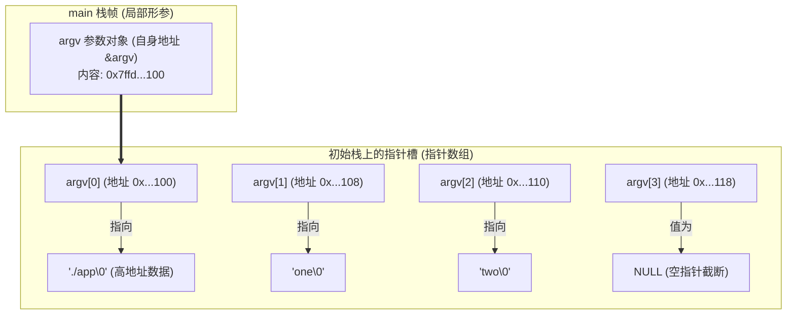

# 第 18 天：`argc`、`argv`、`envp` 与程序初始栈

> **核心认知**：命令行参数和环境变量绝不是编译器凭空生成的，也不是 `main` 函数凭空创造的。它们由父进程（如 Shell）通过 `execve()` 提交给内核，Linux 内核在新进程的**初始用户栈（Initial Stack）**中自顶向下精心排布。ELF 入口 `_start` 与 C 运行时（glibc）接管初始栈并解析，最终按 ABI 规约传参调用 `main(argc, argv, envp)`。

---

## 【📌 一句话核心概括】
**`argc`、`argv`、`envp` 与辅助向量（`auxv`）是由内核在 `execve` 时于进程初始用户栈自顶向下构建的一套内存布局，ELF 汇编入口 `_start` 从栈顶提取参数并初始化 C 运行时环境后，按照 System V ABI 寄存器传参规约调用 `main` 函数。**

## 【📖 通俗原理解释】
- **初始栈内存物理排布**：内核在用户栈高地址存放实际的命令行与环境变量字符串常量，随后向低地址依次压入：辅助向量表（`Elf64_auxv_t`，以 `AT_NULL` 终止）、环境变量指针数组（以 `NULL` 终止）、命令行参数指针数组（以 `NULL` 终止），栈顶（`RSP`）存放的正是参数个数 `argc`。
- **二级指针 `char **argv` 的本质**：`argv` 是一个指向指针数组首元素的指针（即数组首地址）。`argv[i]` 是一个 `char *`（存储高地址中具体参数字符串的虚拟地址），而 `argv` 则是存有这一串连续指针的栈上连续空间首地址。
- **`_start` 到 `main` 的交接桥梁**：内核启动用户空间时直接跳转到 ELF 入口 `_start`（而非 `main`），此时栈指针 `rsp` 正好指向 `argc`。`_start` 通过汇编指令（如 `pop rsi`）取出 `argc`，获取 `argv` 指针并对齐栈帧后，调用 glibc 的 `__libc_start_main`，由后者完成线程初始化、全局构造函数调用，最后将 `argc`（`rdi`）、`argv`（`rsi`）、`envp`（`rdx`）传入用户编写的 `main` 函数。

---

## 一、四大层级正交认知

| 层次体系 | 规范与实现主体 | 法律效力与职责范围 |
| :--- | :--- | :--- |
| **1. ISO C 标准层** | ISO/IEC 9899 | 规定可移植标准形式：`main(void)` 与 `main(int argc, char *argv[])`。**第三个参数 `envp` 不是 ISO C 标准定义**，标准环境变量访问方式是 `getenv()`。 |
| **2. POSIX 标准层** | IEEE Std 1003.1 | 规定 `execve(path, argv, envp)` 契约、全局变量 `extern char **environ` 及环境变量接口。 |
| **3. Linux 内核 / ELF** | Linux Kernel (`fs/binfmt_elf.c`) | 负责在 `execve` 阶段分配用户栈，将字符串逐字节拷贝至高地址，构建 `argc`、指针表及 `auxv` 辅助向量。 |
| **4. x86-64 System V ABI** | System V AMD64 ABI / glibc | 规定 `_start` 入口处的栈指针初始状态，以及进入 `main` 时通过 `RDI` (`argc`)、`RSI` (`argv`)、`RDX` (`envp`) 传参。 |

---

## 二、`argc`、`argv` 与 `envp` 的数据结构解剖

### 1. `argc`（Argument Count）
* 命令行参数总数（`int` 类型）。
* **重要规则**：`argv[0]` 也严格计入 `argc`！例如终端执行 `./app one two`，`argc == 3`。
* ISO C 标准允许极端情况下 `argc == 0`，因此防御性工业代码绝不可无脑假定 `argv[0]` 必非空。

### 2. 二级指针 `char **argv` 的内存拓扑


#### 指针表达式全谱对照表
| 表达式 | 静态 C 类型 | 运行时实际含义 | 指针运算步长 |
| :--- | :--- | :--- | :--- |
| **`argv`** | `char **` | 指向初始栈上 `argv[0]` 指针槽的绝对地址 | 步长为 `sizeof(char *) = 8` 字节 |
| **`argv + i`** | `char **` | 指向第 $i$ 个指针槽（即 `&argv[i]`） | 偏移量为 $i \times 8$ 字节 |
| **`argv[i]`** | `char *` | 第 $i$ 个指针槽中保存的字符串起始物理/虚拟地址 | 步长为 `sizeof(char) = 1` 字节 |
| **`*argv[i]`** | `char` | 对应字符串的第一个字符（即 `argv[i][0]`） | 标量字符 |
| **`&argv`** | `char ***` | `main` 函数局部栈帧中保存 `argv` 变量自身的内存地址 | 栈帧私有变量地址 |

> **🔥 核心铁律：`argv[argc]` 永远为 `NULL`**
> ISO C 标准保证 `argv[argc] == NULL`。
> * **合法做法**：可以用 `for (char **p = argv; *p != NULL; ++p)` 遍历参数。
> * **致命错误**：绝不可执行 `printf("%s", argv[argc]);`！向 `%s` 传入空指针属于典型未定义行为（UB）。
> * **越界禁区**：在 Linux 初始栈中，`argv[argc + 1]` 在物理排布上碰巧是 `envp[0]`，但从 ISO C 视角看这属于严重数组越界 UB，绝不可通过越界 `argv` 去探测环境变量！

### 3. `envp`（Environment Vector）
* 环境变量指针表，结构与 `argv` 几乎完全相同：`char **envp`，每一项指向形如 `"NAME=value\0"` 的字符串，整体以 `NULL` 指针封底。
* **安全警示**：`argv[0]` 仅仅是调用者传递的建议名（可以被恶意伪造为任何字符串），绝不可作为安全校验依据；内核真正执行的文件路径请查询 `/proc/self/exe` 或辅助向量 `AT_EXECFN`。

---

## 三、Linux x86-64 初始栈深度结构推演

当内核完成 ELF 装载并准备跳转至用户态 `_start` 时，CPU 寄存器 `RSP` 指向的初始用户栈布局具有严格的机器规约：

```
高地址 (栈底)
┌───────────────────────────────────────────────────────────────┐
│ 1. 参数与环境变量字符串池 (String Area)                        │
│    "./app\0", "one\0", "two\0", "PATH=/bin\0", "USER=root\0"   │
│    (以字符紧凑排布，对齐要求为 1 字节)                          │
├───────────────────────────────────────────────────────────────┤
│ 2. 辅助向量 (Auxiliary Vector, auxv)                          │
│    { AT_PAGESZ, 4096 }, { AT_RANDOM, 0x7fff... },             │
│    { AT_ENTRY, 0x5555... }, { AT_NULL, 0 } (每个条目 16 字节)   │
├───────────────────────────────────────────────────────────────┤
│ 3. 环境变量指针表 (envp)                                      │
│    envp[0] ──> 指向 "PATH=..."                                │
│    envp[1] ──> 指向 "USER=..."                                │
│    envp[2] = NULL (8 字节空指针)                              │
├───────────────────────────────────────────────────────────────┤
│ 4. 命令行参数向量表 (argv)                                    │
│    argv[0] ──> 指向 "./app"                                   │
│    argv[1] ──> 指向 "one"                                     │
│    argv[2] ──> 指向 "two"                                     │
│    argv[3] = NULL (8 字节空指针)                              │
├───────────────────────────────────────────────────────────────┤
│ 5. 参数计数器 argc (8 字节整数)                                │
│    值为 3                                                     │
└───────────────────────────────────────────────────────────────┘  <─── 进入 _start 时的 RSP (低地址, 栈顶)
```

### 精密手工推演：以 `argc = 4`、环境变量数 = 2 为例
设进入 `_start` 瞬间 $RSP = S$：
1. **$S + 0$**：`argc = 4`（占用 8 字节）。
2. **$S + 8$**：`argv[0]` 槽；一直延伸至 $S + 8 + 4 \times 8 = S + 40$（`argv[4] = NULL`）。`argv` 表共占 $(4 + 1) \times 8 = 40$ 字节。
3. **$S + 48$**：`envp[0]` 槽；延伸至 $S + 48 + 2 \times 8 = S + 64$（`envp[2] = NULL`）。`envp` 表共占 $(2 + 1) \times 8 = 24$ 字节。
4. **$S + 72$**：**第一个辅助向量（`auxv[0]`）的精确起始地址**！
   $$\text{偏移} = 8 (\text{argc}) + 40 (\text{argv}) + 24 (\text{envp}) = 72 \text{ 字节}$$

---

## 四、`_start` 到 `main` 的汇编级接力追踪

进入 ELF 入口点 `_start` 时，系统并未建立 C 函数栈帧。来看 glibc 的 `_start` 汇编（Intel 语法）：

```asm
.global _start
_start:
    xor ebp, ebp            # 1. 清空 RBP (标记最外层调用栈帧基准，GDB backtrace 终止点)
    mov r9, rdx             # 2. R9 = 动态链接器析构函数 (fini)
    pop rsi                 # 3. RSI = [RSP] (弹出 argc！此时 RSP 自增 8，正好指向 argv[0])
    mov rdx, rsp            # 4. RDX = 新 RSP (即 &argv[0] 首地址)
    and rsp, -16            # 5. 栈指针 16 字节对齐 (SysV ABI 规定 call 之前必须 16 字节对齐)
    push rax                # 6. 压栈对齐填充
    push rsp                # 7. 压入栈底信息
    xor r8d, r8d            # 8. R8 = 0 (init 构造函数)
    xor ecx, ecx            # 9. RCX = 0
    lea rdi, [rip + main]   # 10. RDI = main 函数绝对符号地址
    call __libc_start_main  # 11. 调用 glibc 主启动函数
    hlt                     # 12. 永不该返回此处的硬陷阱
```

* **关键微操作解密**：
  * 指令 `pop rsi` 具有双重功效：一方面把栈顶的 `argc` 提取到了 `RSI` 寄存器；另一方面硬件直接让 `RSP += 8`，使得紧随其后的 `mov rdx, rsp` 瞬间将 `RDX` 对准了 `argv` 数组的起点！
  * `__libc_start_main` 接收这些参数后，完成线程初始化、环境解析（构造 `environ`）、调用全局构造函数，最后执行：
    ```text
    EDI = argc, RSI = argv, RDX = envp ➔ call main
    ```

---

## 五、深入辅助向量（Auxiliary Vector, `auxv`）

辅助向量是内核直接注入给用户空间/动态链接器的**高特权只读控制信息**：

| 辅助向量标志 (Key) | 核心语义与工程价值 |
| :--- | :--- |
| **`AT_PAGESZ`** | 系统的真实页面大小（如 4096），无需发系统调用即可获知 |
| **`AT_PHDR`** | ELF 程序头表（Program Header Table）在虚拟内存中的实际装载地址 |
| **`AT_PHNUM`** | ELF 程序头表的条目数量 |
| **`AT_ENTRY`** | 主程序的真实入口虚拟地址（动态链接器加载完毕后由此跳入） |
| **`AT_BASE`** | 动态链接器（`ld-linux.so`）自身的装载基地址 |
| **`AT_RANDOM`** | **指向内核生成的 16 字节真随机数**（glibc 用来初始化 SSP 栈金丝雀 Canary） |
| **`AT_EXECFN`** | 指向内核真正执行的文件名字面量指针 |

### 快速探查手段
```bash
# 环境变量探查法
LD_SHOW_AUXV=1 /bin/true

# C 语言系统接口调用
#include <sys/auxv.h>
unsigned long page_size = getauxval(AT_PAGESZ);
```

---

## 六、`getenv()`、`setenv()` 的底层内存真相

```c
const char *val = getenv("PATH");
```

1. **零拷贝借用指针**：`getenv()` 返回的指针直接指向初始栈（或 libc 堆内存）中 `"PATH=/usr/bin"` 字符串内部 `'='` 后面的首字符。**绝对没有发生 `malloc` 分配！**
2. **黄金禁忌**：
   * 严禁对 `getenv()` 返回值执行 `free(val)`！这会导致非法释放栈内存引发 Crash。
   * 严禁直接通过指针改写：`((char *)val)[0] = 'X';`（UB 且污染环境）。
   * `setenv()` 或 `putenv()` 可能导致 libc 在堆上重新分配 `environ` 扩容，此前保存的 `getenv` 指针可能瞬间失效！

---

## 七、实战代码：初始栈全景拓扑探测器

本程序动态提取当前进程的 `[stack]` 映射区间，深入探查 `argc`、`argv`、`envp`、`auxv` 的物理分布关系：

```c
/* day18_stack_probe.c - 深入初始栈全景探测器 */
#define _GNU_SOURCE
#include <errno.h>
#include <inttypes.h>
#include <stdint.h>
#include <stdio.h>
#include <stdlib.h>
#include <string.h>
#include <sys/auxv.h>
#include <unistd.h>

/* 解析 [stack] 虚拟内存区间 */
static void get_stack_range(uintptr_t *low, uintptr_t *high) {
    FILE *fp = fopen("/proc/self/maps", "r");
    if (!fp) { perror("fopen"); exit(1); }
    char line[512];
    *low = *high = 0;
    while (fgets(line, sizeof(line), fp)) {
        if (strstr(line, "[stack]")) {
            sscanf(line, "%" SCNxPTR "-%" SCNxPTR, low, high);
            break;
        }
    }
    fclose(fp);
}

int main(int argc, char **argv, char **envp) {
    uintptr_t stack_low, stack_high;
    get_stack_range(&stack_low, &stack_high);

    printf("================ 进程初始栈全景探查报告 ================\n");
    printf("PID: %ld | 系统页大小: %lu 字节\n", (long)getpid(), getauxval(AT_PAGESZ));
    printf("主线程 [stack] 范围 : [0x%" PRIxPTR ", 0x%" PRIxPTR ")\n", stack_low, stack_high);
    printf("---------------- 参数拓扑 (argc / argv) ----------------\n");
    printf("argc 值 = %d (形参自身存放在栈: %p)\n", argc, (void *)&argc);
    printf("argv 指针槽首地址   : %p (形参自身存放在栈: %p)\n", (void *)argv, (void *)&argv);

    for (int i = 0; i <= argc; ++i) {
        if (argv[i] != NULL) {
            printf("  argv[%d] 槽地址: %p ──> 字符串地址: %p (\"%s\")\n",
                   i, (void *)&argv[i], (void *)argv[i], argv[i]);
        } else {
            printf("  argv[%d] 槽地址: %p ──> [NULL 截断哨兵]\n", i, (void *)&argv[i]);
        }
    }

    printf("---------------- 环境变量拓扑 (envp) -------------------\n");
    printf("envp 指针槽首地址   : %p (预期紧跟 argv: %p)\n", (void *)envp, (void *)(argv + argc + 1));
    int env_count = 0;
    while (envp[env_count] != NULL) {
        if (env_count < 3) { /* 仅打印前3个避免刷屏 */
            printf("  envp[%d] 槽: %p ──> %p (\"%.20s...\")\n",
                   env_count, (void *)&envp[env_count], (void *)envp[env_count], envp[env_count]);
        }
        env_count++;
    }
    printf("  ... (共监测到 %d 个环境变量条目) ...\n", env_count);
    printf("  envp[%d] 槽: %p ──> [NULL 截断哨兵]\n", env_count, (void *)&envp[env_count]);

    printf("---------------- 辅助向量核心条目 (auxv) ---------------\n");
    printf("AT_ENTRY  (程序真实入口) : 0x%lx\n", getauxval(AT_ENTRY));
    printf("AT_PHDR   (ELF 程序头地址): 0x%lx\n", getauxval(AT_PHDR));
    printf("AT_RANDOM (随机数种子地址): %p\n", (void *)(uintptr_t)getauxval(AT_RANDOM));
    printf("AT_EXECFN (内核执行路径) : %s\n", (const char *)(uintptr_t)getauxval(AT_EXECFN));

    const char *test_val = getenv("USER");
    if (test_val) {
        printf("getenv(\"USER\") 探测: 返回地址 %p (完全借用栈上原始字符串)\n", (const void *)test_val);
    }
    printf("========================================================\n");

    return EXIT_SUCCESS;
}
```

---

## 八、编译与 GDB 深入实证分析

### 1. 编译并清空干扰运行
```bash
gcc -std=gnu17 -Wall -Wextra -O0 -g3 day18_stack_probe.c -o day18_probe
# 使用 env -i 剔除无关环境变量，干净观察
env -i TEST_VAR=123 ./day18_probe alpha beta
```
* **控制台实测精要输出**：
  ```text
  argc 值 = 3
  argv[0] 槽地址: 0x7fffffffe028 ──> 0x7fffffffe315 ("./day18_probe")
  argv[1] 槽地址: 0x7fffffffe030 ──> 0x7fffffffe323 ("alpha")
  argv[2] 槽地址: 0x7fffffffe038 ──> 0x7fffffffe329 ("beta")
  argv[3] 槽地址: 0x7fffffffe040 ──> [NULL 截断哨兵]
  envp 指针槽首地址   : 0x7fffffffe048 (预期紧跟 argv: 0x7fffffffe048)
    envp[0] 槽: 0x7fffffffe048 ──> 0x7fffffffe32e ("TEST_VAR=123")
    envp[1] 槽: 0x7fffffffe050 ──> [NULL 截断哨兵]
  ```
* **实证分析**：
  1. `argv` 每个槽相差严格为 8 字节（`0x028, 0x030, 0x038, 0x040`）。
  2. `envp` 首地址 `0x048` 正好紧随 `argv[3] (0x040 + 8)` 之后！
  3. 字符串实体位于高地址 `0x7fffffffe315` 附近，字符紧密连续存放。

### 2. GDB `starti` 直击内核初始栈原生现场
```gdb
gdb ./day18_probe
(gdb) starti                   # 停在指令第 1 条 (内核刚交接瞬间！)
(gdb) p/x $rsp                 # 查看此时的栈顶
(gdb) x/16gx $rsp              # 以 8 字节十六进制打印栈顶内容
```
* **GDB 视野真相**：
  * `$rsp + 0` 处正是 `0x0000000000000001`（`argc` 值）。
  * `$rsp + 8` 处是 `argv[0]` 指针。
  * `info auxv` 直接列出内核传入的完整键值对清单。

---

## 九、高频避坑禁忌指南

1. **形参误用 `sizeof(argv)` 算数组长度**：
   * 致命代码：`int len = sizeof(argv) / sizeof(argv[0]);`
   * **真相**：作为函数形参的 `argv` 已经退化为 `char **` 指针，64 位系统下 `sizeof(argv)` 恒为 8，除以 8 恒等于 1！参数个数必须且只能读取 `argc`。
2. **越界访问 `argv[argc + 1]` 读取环境变量**：
   * 尽管 Linux 初始栈内存布局紧挨着，但在 ISO C 抽象机中这是未定义行为。标准访问方式是使用 `environ` 或 `getenv()`。
3. **释放 `argv` 或环境变量字符串**：
   * `free(argv[0])` 或 `free(getenv("HOME"))` 属于典型 `Invalid Free`，因为它们根本不是来自 `malloc` 堆，而是位于内核开辟的只读栈区域，一旦释放立即触发 heap-use-after-free 或崩溃。
4. **`putenv()` 传入局部临时数组引发野指针**：
   * `putenv("KEY=VAL")` 不会深拷贝字符串，而是直接将指针并入环境表！若传入的是栈上的局部数组，函数退出栈帧销毁后，环境表中残留悬空指针，后续访问必定崩溃。必须使用 `setenv()`。

---

## 十、课后演练与自我考核

### 练习 1：栈指针槽精密推算
在 64 位 Linux 下运行 `./app a b c`，设初始栈顶 $RSP = S$。
* `argc` 的值是多少？答：`4`（包含程序名）。
* `argv[4]` 的槽地址是多少？内容是什么？
  * 答：`S + 8 + 4 * 8 = S + 40`。内容是 `NULL`（`0x0`）。
* `envp` 的起始槽地址是多少？
  * 答：紧跟在 `argv[4]` 之后，即 `S + 48`。

### 练习 2：深入判断合法性
对于合法启动的程序，下面操作哪些是合法的？
1. `printf("%p\n", (void *)argv[argc]);` ➔ **合法**（按 `%p` 输出 `(nil)`）。
2. `printf("%s\n", argv[argc]);` ➔ **未定义行为 (UB)**（向 `%s` 传入 NULL）。
3. `argv[0][0] = 'X';` ➔ **合法**（C 规范允许原地修改参数字符，但不允许增长越界）。

---

## 十一、口头验收与核心达标标准

- [ ] **启动全链路**：能否随手画出 `Shell ➔ execve ➔ 内核初始栈 ➔ _start (pop rsi) ➔ __libc_start_main ➔ main` 的完整流程？
- [ ] **指针级别精通**：能否在 30 秒内向他人解释清 `argv`、`*argv`、`**argv` 与 `&argv` 的本质差异？
- [ ] **初始栈心算**：能否根据给定的 `argc` 和环境数，精确推算出 `argv`、`envp`、`auxv` 相对 $RSP$ 的字节偏移？
- [ ] **辅助向量价值**：能否准确陈述 `auxv` 中 `AT_RANDOM`、`AT_PAGESZ`、`AT_ENTRY` 的关键用途？
- [ ] **生命周期底线**：能否说明为什么 `getenv()` 的返回值不能被 `free()`，以及为何不能通过 `argv[argc+1]` 读取环境？