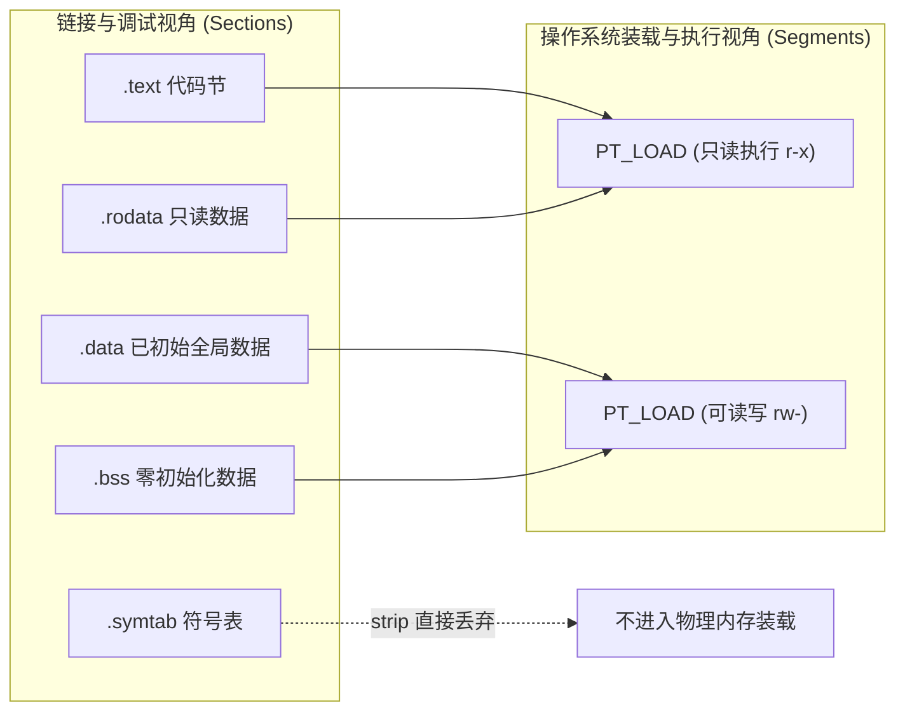
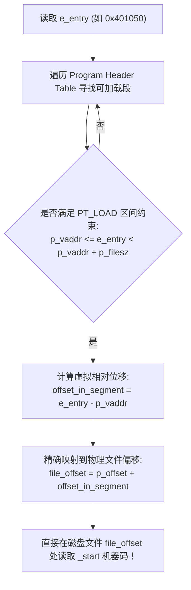

# 第 19 天：ELF 文件头的静态解析

> **核心认知**：ELF（Executable and Linkable Format）是 Linux 环境下最核心的目标文件与可执行文件二进制标准规范。掌握 ELF 静态解析，绝不是死记 `readelf -h` 的命令行输出，而是具备**仅凭文件前 64 字节的原始十六进制字节流，徒手推演其位数、字节序、指令集架构、装载基地址、程序头表与节头表物理偏移**的硬核逆向基本功。

---

## 【📌 一句话核心概括】
**ELF 文件头（`Elf64_Ehdr`，固定 64 字节）是 Linux 二进制文件的元数据索引中枢，记录了架构魔数、字节序、机器指令集、程序入口虚拟地址（`e_entry`）以及指示内核装载的程序头表（`e_phoff`）与链接器重定位使用的节头表（`e_shoff`）的文件物理偏移。**

## 【📖 通俗原理解释】
- **前 16 字节标识符（`e_ident`）**：固定以 4 字节魔数 `7F 45 4C 46`（`\x7fELF`）起步，随后第 4 字节指明 32 位（1）或 64 位（2），第 5 字节指明字节序（1 为小端序，2 为大端序），为解析后续字段的字长与多字节数值提供了机器码解码基准。
- **入口地址 `e_entry` 与文件偏移的本质区别**：`e_entry` 是程序启动时 CPU 执行的第一条指令的**运行时虚拟地址**（VA，通常指向 `_start`），而非文件在磁盘上的物理字节偏移；必须结合承载该虚拟地址的 `PT_LOAD` 程序头，利用 `Offset = e_entry - p_vaddr + p_offset` 换算公式才能定位磁盘上的机器码位置。
- **执行视角（Segment）与链接视角（Section）的双重视图**：程序头表（Program Header Table）面向操作系统内核，将文件聚合为若干大内存段（`PT_LOAD`）用于 `mmap` 装载与设置权限，即便剥离所有节头表（Strip）程序依然能正常执行；而节头表（Section Header Table）面向链接器与调试器，将代码与数据细分为 `.text`、`.data`、`.symtab`、`.strtab` 等，便于符号解析与调试。

---

## 一、双重视角：Segment（段）与 Section（节）的正交分离

ELF 文件设计了一套极其精妙的“双重观察视角（Dual Views）”：



| 维度对比 | 链接与分析视角 (Section Header Table) | 运行装载视角 (Program Header Table) |
| :--- | :--- | :--- |
| **管理主体** | 节头表（由 `e_shoff` 索引，`Elf64_Shdr` 构成） | 程序头表（由 `e_phoff` 索引，`Elf64_Phdr` 构成） |
| **主要使用者** | 编译器、汇编器、静态链接器（`ld`）、调试器（`gdb`） | Linux 内核 ELF 装载器（`binfmt_elf.c`）、动态链接器 |
| **核心单元** | `.text`, `.rodata`, `.data`, `.bss`, `.got`, `.plt` | `PT_LOAD`, `PT_INTERP`, `PT_DYNAMIC`, `PT_GNU_STACK` |
| **剥离影响** | `strip` 抹掉全部节头表后，**程序依然 100% 正常运行**！ | **绝不可破坏**！若损坏或丢失，内核装载器立即返回 `ENOEXEC` |

---

## 二、`Elf64_Ehdr` 结构体二进制绝对排布图（64 字节全谱）

在 Linux `<elf.h>` 中，64 位 ELF 头部严格占用 **64 字节**，字段无任何填充缝隙（Zero-Padding 紧凑排布）：

```
偏移 (Hex)  字段名称       类型大小     核心语义与逆向解析
0x00~0x03  e_ident[0..3]  4B uint8     ELF 固定魔数: 0x7f, 'E', 'L', 'F' (0x7f 0x45 0x4c 0x46)
0x04       e_ident[4]     1B uint8     EI_CLASS: 1 = ELF32, 2 = ELF64
0x05       e_ident[5]     1B uint8     EI_DATA : 1 = 2's LSB (小端序), 2 = 2's MSB (大端序)
0x06       e_ident[6]     1B uint8     EI_VERSION: 固定为 1 (EV_CURRENT)
0x07       e_ident[7]     1B uint8     EI_OSABI: 0x00 = System V / Linux
0x08~0x0F  e_ident[8..15] 8B uint8     ABI 版本与保留补齐填充字节 (全 0)
0x10~0x11  e_type         2B uint16    文件类型: 1=ET_REL (.o), 2=ET_EXEC (静态可执行), 3=ET_DYN (PIE/so)
0x12~0x13  e_machine      2B uint16    目标架构: 0x3e(62)=x86-64, 0xb7(183)=AArch64, 0x03=x86
0x14~0x17  e_version      4B uint32    ELF 版本号: 1
0x18~0x1F  e_entry        8B uint64    程序执行入口虚拟地址 (Entry point virtual address)
0x20~0x27  e_phoff        8B uint64    程序头表 (Program Header Table) 在文件中的绝对偏移量
0x28~0x2F  e_shoff        8B uint64    节头表 (Section Header Table) 在文件中的绝对偏移量
0x30~0x33  e_flags        4B uint32    处理器特定标志 (Processor-specific flags, x86 通常为 0)
0x34~0x35  e_ehsize       2B uint16    ELF 头部自身大小 (ELF64 恒为 0x0040 = 64 字节)
0x36~0x37  e_phentsize    2B uint16    单个程序头表项大小 (Elf64_Phdr 恒为 0x0038 = 56 字节)
0x38~0x39  e_phnum        2B uint16    程序头表项数量 (Program Header entry count)
0x3A~0x3B  e_shentsize    2B uint16    单个节头表项大小 (Elf64_Shdr 恒为 0x0040 = 64 字节)
0x3C~0x3D  e_shnum        2B uint16    节头表项数量 (Section Header entry count)
0x3E~0x3F  e_shstrndx     2B uint16    节名字符串表 (.shstrtab) 所在节头表的索引编号
```

---

## 三、徒手解码：前 64 字节十六进制实例精算

假设收到一份逆向分析脱壳文件的前 64 字节十六进制转储：

```text
00000000: 7f 45 4c 46 02 01 01 00 00 00 00 00 00 00 00 00  .ELF............
00000010: 03 00 3e 00 01 00 00 00 50 10 00 00 00 00 00 00  ..>.....P.......
00000020: 40 00 00 00 00 00 00 00 90 36 00 00 00 00 00 00  @........6......
00000030: 00 00 00 00 40 00 38 00 0d 00 40 00 24 00 23 00  ....@.8...@.$.#.
```

### 1. 字段速查与小端数值复原推导
1. **魔数检验（0x00~0x03）**：`7f 45 4c 46` $\rightarrow$ 校验通过，确认为标准 ELF。
2. **架构与端序（0x04~0x05）**：`02` = ELF64；`01` = Little-Endian（小端序，低字节在前）。
3. **文件类型 `e_type`（0x10~0x11）**：原始字节 `03 00`。
   * 小端还原：$0x0003 = \mathbf{ET\_DYN}$。
   * **推论**：这是一个**位置无关可执行文件（PIE）**或动态共享库（.so），运行时基址将被 ASLR 随机扰动！
4. **指令集架构 `e_machine`（0x12~0x13）**：原始字节 `3e 00`。
   * 小端还原：$0x003e = 62 = \mathbf{EM\_X86\_64}$。
5. **程序入口虚拟地址 `e_entry`（0x18~0x1F）**：
   * 原始字节：`50 10 00 00 00 00 00 00`
   * 小端还原：$0x50 + 0x10 \times 256 = \mathbf{0x1050}$。
   * **推论**：对于 PIE 程序，`0x1050` 是相对加载基址的相对虚拟地址（RVA）。若装载基址为 `0x555555554000`，运行时入口必然为 `0x555555555050`。
6. **程序头表物理文件偏移 `e_phoff`（0x20~0x27）**：
   * 原始字节：`40 00 00 00 00 00 00 00` $\rightarrow$ 数值即为 $0x0040 = \mathbf{64}$。
   * **推论**：程序头表紧贴在 ELF 头部末尾（64 字节处）开始存放。
7. **节头表物理文件偏移 `e_shoff`（0x28~0x2F）**：
   * 原始字节：`90 36 00 00 00 00 00 00` $\rightarrow$ 数值即为 $\mathbf{0x3690}$（十进制 13,968 字节）。
8. **程序头数量与跨度计算**：
   * `e_phentsize`（0x36~0x37）：`38 00` $\rightarrow 0x0038 = \mathbf{56}$ 字节。
   * `e_phnum`（0x38~0x39）：`0d 00` $\rightarrow 0x000d = \mathbf{13}$ 个程序头表项。
   * **推论**：程序头表总跨度为 $13 \times 56 = 728$ 字节，物理范围为 $[64, 792)$。
9. **节头数量与跨度计算**：
   * `e_shentsize`（0x3A~0x3B）：`40 00` $\rightarrow 0x0040 = \mathbf{64}$ 字节。
   * `e_shnum`（0x3C~0x3D）：`24 00` $\rightarrow 0x0024 = \mathbf{36}$ 个节头表项。
   * `e_shstrndx`（0x3E~0x3F）：`23 00` $\rightarrow 0x0023 = \mathbf{35}$（第 35 号节是节名字符串表 `.shstrtab`）。

---

## 四、核心算法推导：虚拟入口地址 `e_entry` ➔ 物理文件偏移转换

在静态逆向或打 Patch 时，如何在二进制文件中精确定位 `e_entry` 处的机器指令？



* **实战数学演练**：
  * 设某个 ELF 的可执行代码段 `PT_LOAD` 具备如下参数：
    $$p\_offset = 0x1000, \quad p\_vaddr = 0x400000, \quad p\_filesz = 0x800$$
  * 文件头声明 `e_entry = 0x400120`。
  * 判定：$0x400000 \le 0x400120 < 0x400000 + 0x800$（完全落在文件有效代码范围内）。
  * 转换计算：
    $$\text{File Offset} = p\_offset + (e\_entry - p\_vaddr) = 0x1000 + (0x400120 - 0x400000) = \mathbf{0x1120}$$
  * 在十六进制编辑器中直接跳转至 `0x1120`，即可直接修改 `_start` 的第一条汇编指令！

---

## 五、工业级实战源码：零依赖高安全性 ELF64 手工解析器

严禁直接使用 `(Elf64_Ehdr *)buffer`（存在结构体对齐 UB、大端崩溃漏洞）。本程序纯手工移位解码并具备完整文件越界安全防御：

```c
/* elf64_parser.c - 纯手工安全解码 ELF64 头部 */
#define _POSIX_C_SOURCE 200809L
#define _FILE_OFFSET_BITS 64
#include <elf.h>
#include <inttypes.h>
#include <stdbool.h>
#include <stdint.h>
#include <stdio.h>
#include <stdlib.h>
#include <string.h>

#define ELF64_HDR_SIZE 64

/* 安全小端解码函数：防御截断与类型提升 UB */
static inline uint16_t peek_le16(const uint8_t *p) {
    return (uint16_t)p[0] | ((uint16_t)p[1] << 8);
}
static inline uint32_t peek_le32(const uint8_t *p) {
    return (uint32_t)p[0] | ((uint32_t)p[1] << 8) |
           ((uint32_t)p[2] << 16) | ((uint32_t)p[3] << 24);
}
static inline uint64_t peek_le64(const uint8_t *p) {
    return (uint64_t)p[0] | ((uint64_t)p[1] << 8) |
           ((uint64_t)p[2] << 16) | ((uint64_t)p[3] << 24) |
           ((uint64_t)p[4] << 32) | ((uint64_t)p[5] << 40) |
           ((uint64_t)p[6] << 48) | ((uint64_t)p[7] << 56);
}

/* 越界与回绕安全防御算法 */
static bool is_table_safe(uint64_t offset, uint16_t entry_size, uint16_t count, uint64_t file_size) {
    if (offset > file_size) return false;
    uint64_t total = (uint64_t)entry_size * count;
    return total <= (file_size - offset);
}

int main(int argc, char *argv[]) {
    if (argc != 2) {
        fprintf(stderr, "用法: %s <ELF文件路径>\n", argv[0]);
        return EXIT_FAILURE;
    }

    FILE *fp = fopen(argv[1], "rb");
    if (!fp) { perror("fopen 失败"); return EXIT_FAILURE; }

    fseeko(fp, 0, SEEK_END);
    uint64_t file_size = (uint64_t)ftello(fp);
    fseeko(fp, 0, SEEK_SET);

    if (file_size < ELF64_HDR_SIZE) {
        fprintf(stderr, "错误: 文件过小 (仅 %" PRIu64 " 字节)，无法容纳 ELF64 头部\n", file_size);
        fclose(fp);
        return EXIT_FAILURE;
    }

    uint8_t hdr[ELF64_HDR_SIZE];
    if (fread(hdr, 1, ELF64_HDR_SIZE, fp) != ELF64_HDR_SIZE) {
        perror("fread 失败");
        fclose(fp);
        return EXIT_FAILURE;
    }
    fclose(fp);

    /* 1. 魔数合法性检验 */
    if (memcmp(hdr, ELFMAG, SELFMAG) != 0) {
        fprintf(stderr, "错误: 非法 ELF 文件 (魔数不匹配: %02x %02x %02x %02x)\n",
                hdr[0], hdr[1], hdr[2], hdr[3]);
        return EXIT_FAILURE;
    }

    /* 2. 架构体系与字节序验证 */
    if (hdr[EI_CLASS] != ELFCLASS64 || hdr[EI_DATA] != ELFDATA2LSB) {
        fprintf(stderr, "错误: 本解析器专门针对 64位小端 ELF (当前: class=%d, data=%d)\n",
                hdr[EI_CLASS], hdr[EI_DATA]);
        return EXIT_FAILURE;
    }

    /* 3. 逐字段纯手工安全提取 */
    uint16_t e_type      = peek_le16(hdr + 16);
    uint16_t e_machine   = peek_le16(hdr + 18);
    uint32_t e_version   = peek_le32(hdr + 20);
    uint64_t e_entry     = peek_le64(hdr + 24);
    uint64_t e_phoff     = peek_le64(hdr + 32);
    uint64_t e_shoff     = peek_le64(hdr + 40);
    uint32_t e_flags     = peek_le32(hdr + 48);
    uint16_t e_ehsize    = peek_le16(hdr + 52);
    uint16_t e_phentsize = peek_le16(hdr + 54);
    uint16_t e_phnum     = peek_le16(hdr + 56);
    uint16_t e_shentsize = peek_le16(hdr + 58);
    uint16_t e_shnum     = peek_le16(hdr + 60);
    uint16_t e_shstrndx  = peek_le16(hdr + 62);

    printf("================ ELF64 头部静态逆向报告 ================\n");
    printf("文件路径            : %s (总大小: %" PRIu64 " 字节)\n", argv[1], file_size);
    printf("魔数校验            : 7f 45 4c 46 (ELF 标准通过)\n");
    printf("ELF 文件类型 (e_type): %u ", e_type);
    switch (e_type) {
        case ET_REL:  printf("(ET_REL: 可重定位目标文件 .o)\n"); break;
        case ET_EXEC: printf("(ET_EXEC: 传统固定基址可执行文件)\n"); break;
        case ET_DYN:  printf("(ET_DYN: 共享对象或 PIE 可执行文件)\n"); break;
        default:      printf("(未知类型)\n"); break;
    }
    printf("目标指令集 (e_machine): %u ", e_machine);
    switch (e_machine) {
        case EM_X86_64:  printf("(x86-64 / AMD64)\n"); break;
        case EM_AARCH64: printf("(ARM64 / AArch64)\n"); break;
        default:         printf("(其他架构)\n"); break;
    }
    printf("程序入口地址 (e_entry): 0x%" PRIx64 " (注意: PIE 下为 RVA 偏移)\n", e_entry);
    printf("---------------- 段表与节表物理排布 --------------------\n");
    printf("程序头表偏移 (e_phoff): 0x%" PRIx64 " (表项大小: %uB, 表项数: %u)\n",
           e_phoff, e_phentsize, e_phnum);
    printf("节头表文件偏移 (e_shoff): 0x%" PRIx64 " (表项大小: %uB, 表项数: %u)\n",
           e_shoff, e_shentsize, e_shnum);
    printf("节名字符串表索引    : %u (.shstrtab 槽位)\n", e_shstrndx);
    printf("---------------- 头部健全性安全审计 --------------------\n");

    if (e_ehsize != 64) {
        printf("⚠️ 异常: e_ehsize (%u) 不是标准 64 字节!\n", e_ehsize);
    }
    if (!is_table_safe(e_phoff, e_phentsize, e_phnum, file_size)) {
        printf("❌ 致命: 程序头表跨越了文件末尾 (疑似畸形 ELF/溢出攻击)!\n");
    } else {
        printf("✅ 校验: 程序头表位于文件有效边界内 [0x%" PRIx64 ", 0x%" PRIx64 ")\n",
               e_phoff, e_phoff + (uint64_t)e_phentsize * e_phnum);
    }
    if (!is_table_safe(e_shoff, e_shentsize, e_shnum, file_size)) {
        printf("⚠️ 警告: 节头表被剥离或跨界 (可能是 stripped 生产文件)\n");
    } else {
        printf("✅ 校验: 节头表位于文件有效边界内 [0x%" PRIx64 ", 0x%" PRIx64 ")\n",
               e_shoff, e_shoff + (uint64_t)e_shentsize * e_shnum);
    }
    printf("========================================================\n");

    return EXIT_SUCCESS;
}
```

---

## 六、编译、实测与逆向工具链交叉验证

### 1. 编译并自测当前系统目标
```bash
gcc -std=c17 -Wall -Wextra -O2 elf64_parser.c -o elf64_parser
./elf64_parser /bin/ls
```
* **与权威工具 `readelf` 结果绝对对齐**：
  ```bash
  readelf -hW /bin/ls
  ```
  你会发现你的手工 C 程序解析出的 `e_entry`、`e_phoff`、`e_shoff`、`e_phnum` 与 `readelf` 打印结果分毫不差！

### 2. 观察 PIE 与非 PIE 的本质差异
```bash
gcc -O0 -fPIE -pie elf64_parser.c -o test_pie
gcc -O0 -no-pie -fno-pie elf64_parser.c -o test_nopie
./elf64_parser test_pie   # 输出 ET_DYN (3), e_entry 通常在 0x1000 附近
./elf64_parser test_nopie # 输出 ET_EXEC (2), e_entry 通常固定在 0x401000
```

---

## 七、工业级逆向避坑指南

1. **结构体强转别名未定义行为（Strict Aliasing UB）**：
   * 危险代码：`Elf64_Ehdr *h = (Elf64_Ehdr *)buffer;`
   * **灾难原因**：`buffer` 若未按 8 字节对齐，强转并在硬件层面解引用 64 位字段会导致部分 RISC/ARM 平台直接抛出对齐硬件异常；且违反 C99 严格别名规则，极易被 GCC 优化器吃掉代码。
2. **用 `strcmp` 比较 ELF 魔数**：
   * `e_ident` 是无空字符截断的 16 字节原始数组，`strcmp` 遭遇缺少 `\0` 的内存会狂奔越界崩溃。必须使用 `memcmp(hdr, ELFMAG, 4)`。
3. **将 `e_entry` 误当成 `main` 函数**：
   * 反编译逆向时，直接把 `e_entry` 当作分析起点常常陷入 `_start` 的 libc 样板代码泥潭。快速定位 `main` 需通过 `__libc_start_main` 的第一参数 `RDI` 顺藤摸瓜。
4. **忽视大表加法溢出漏洞**：
   * 黑客常构造畸形 ELF：`e_phoff = 0xffffffffffff0000`，`count = 10`。若代码写成 `if (e_phoff + size > file_size)`，64 位无符号加法回绕变成小数，绕过校验导致后续内核或分析器发生缓冲区越界溢出。必须使用安全减法 `size > (file_size - e_phoff)`。

---

## 八、课后演练与自我考核

### 练习 1：手算程序头表结尾
已知某 ELF64 文件：`e_phoff = 0x40` (64)，`e_phentsize = 0x38` (56)，`e_phnum = 9`。
* 问：程序头表的最后一个字节位于文件的哪个偏移？
* 推导：总长度 $= 9 \times 56 = 504 = 0x1f8$。区间为 $[0x40, 0x40 + 0x1f8) = [0x40, 0x238)$。
* 答：最后一个字节偏移为 `0x237`。

### 练习 2：ELF64 架构逆向判定
某固件提取二进制的第 18~19 字节为 `b7 00`，第 5 字节为 `01`。
* 答：第 5 字节 `01` 为小端序，`b7 00` 还原为十进制 $183 = \mathbf{EM\_AARCH64}$（ARM 64位架构）。

---

## 九、口头验收与核心达标标准

- [ ] **前 16 字节解构**：能否在白纸上精准默写出 `e_ident` 16 个字节中魔数、Class、Data、Version 的具体偏移与数值？
- [ ] **小端手工心算**：看到 `50 10 00 00` 能否在 3 秒内心算出数值为 `0x1050`？
- [ ] **核心概念甄别**：能否清晰说明 `e_entry`（虚拟地址）与 `e_phoff`（文件物理偏移）的本质鸿沟？
- [ ] **入口定位机理**：能否向他人讲透如何利用 `PT_LOAD` 的段参数将虚拟 `e_entry` 换算为磁盘文件中的机器码物理偏移？
- [ ] **安全代码编写**：能否手写避免整数溢出回绕的 `is_table_safe()` 表项越界防御函数？