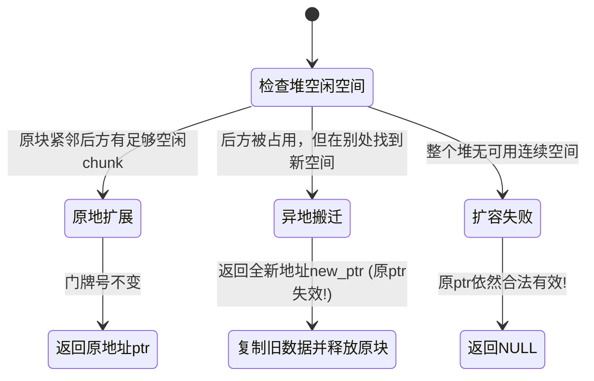

# 第 2 天：结构体布局、动态内存、realloc、销毁函数与 ASan

> **学习目标**：今天不是简单学习“如何调用 `malloc` 和 `free`”，而是要建立一套**严谨的动态对象全生命周期工程模型**：
> * 能闭着眼手算出任何复杂结构体在内存中的精确字节偏移与尾部对齐填充；
> * 彻底掌握 `realloc` 原地扩展、异地搬迁与失败回退的底层状态机，杜绝内存泄漏；
> * 理解包含动态指针的复杂结构体两阶段销毁机制与所有权模型；
> * 掌握内存排错工具 **AddressSanitizer (ASan)**，能够像法医一样从三段式调用栈中还原内存越界、UAF 与 Double-Free 的完整案发时间线。

---

## 【📌 一句话核心概括】
**结构体在内存中按硬件对齐规则插入填充字节（Padding）以保障总线访问效率；动态内存通过 `realloc` 经历原地延展或异地搬迁释放旧地址；带有指针成员的复合对象必须遵循两阶段销毁所有权规范；而 ASan 则通过影子内存与红区插桩在运行时精准捕获越界与 UAF 违规。**

## 【📖 通俗原理解释】
- **结构体内存对齐机制**：CPU 访问内存总是以字长（4/8 字节）为单位从对齐边界读取。若数据跨越边界，CPU 需执行两次总线读取并移位拼接。因此编译器会在成员之间插入填充字节，确保每个成员的偏移量是其自身对齐值的倍数，且结构体总大小是最大成员对齐值的倍数。
- **`realloc` 的三种运行分支**：当申请扩大内存时，若物理相邻后方有空闲则原地延伸；若无连续空闲则在堆中新分配一块大空间、拷贝旧数据、并**无条件释放原内存**（旧指针立即失效成野指针）；若分配失败返回 `NULL`，原内存保持不变（故绝不能直接用原指针接返回值，否则导致内存泄漏）。
- **两阶段销毁与所有权规范**：结构体若包含指向堆内存的指针成员，结构体本身只是容器。销毁时必须自内向外分两步：先 `free` 结构体内部各动态成员，再 `free` 结构体本身，避免产生孤儿内存或双重释放。
- **ASan 实时监控原理**：编译时在堆栈对象周围插入隔离红区（Redzone），并在内存中按 8:1 比例维护影子内存（Shadow Memory）标记每个字节的可读写状态。一旦指令越界踩入红区或访问已释放块，ASan 立即终止程序并输出包含分配、释放与访问点的完整调用栈。

---

# 一、手工计算结构体成员偏移

先看一个经典结构体：

```c
struct Example {
    char  a;
    int   b;
    short c;
};
```

初学者往往下意识把类型大小相加：$1 + 4 + 2 = 7\text{ 字节}$。
**但在 64 位和 32 位系统上，它的真实物理大小通常是 12 字节！**
多出来的 5 个字节就是编译器为了迎合硬件总线对齐要求而插入的**填充字节 (Padding)**。

---

## 1. 基础数据类型的大小与自然对齐值

在常见的 Linux x86-64（LP64 模型）环境下：

| 数据类型 | 占用大小 `sizeof` (字节) | 自然对齐要求 `_Alignof` (字节) | 起始地址必须是几的倍数 |
| :--- | :---: | :---: | :--- |
| `char` | 1 | 1 | 任意地址均可 ($1 \times n$) |
| `short` | 2 | 2 | 2 的倍数 ($0, 2, 4, 6, 8 \dots$) |
| `int`, `float` | 4 | 4 | 4 的倍数 ($0, 4, 8, 12, 16 \dots$) |
| `long`, `double`, 指针 (`void *`) | 8 | 8 | 8 的倍数 ($0, 8, 16, 24 \dots$) |

> [!NOTE]
> 在 C11 标准中，可以使用 `<stdalign.h>` 中的 `alignof` 或原生关键字 `_Alignof(T)` 查询类型的对齐要求。

---

## 2. 硬件为什么要对齐？

1. **总线读取效率**：现代 CPU 内存控制器按 64 位（8 字节）甚至 128 位宽的总线周期读取数据。若一个 4 字节的 `int` 存放在 `0x1003`，它将跨越两个 8 字节总线周期，CPU 必须发起两次物理内存读取，并通过内部算术逻辑单元做掩码拼接，吞吐量减半。
2. **架构硬性约束**：在许多 RISC 架构（如经典 ARM、MIPS、SPARC）上，未经对齐的内存访问会直接触发 CPU 硬件异常（Alignment Fault），由内核发出信号杀死进程。

---

## 3. 结构体对齐两大铁律

```text
 铁律 1（成员对齐）：
 每个成员的起始物理偏移量（Offset），必须能被该成员自身的自然对齐值整除。
 偏移计算公式：Offset = align_up(当前偏移, 成员对齐要求)

 铁律 2（尾部对齐）：
 结构体的整体总大小，必须能被“结构体内部所有成员中最大的那个自然对齐值”整除。
 尾部填充公式：TotalSize = align_up(最后一个成员结束位置, 最大成员对齐要求)
```

> **对齐计算向上取整数学公式**：
> 当对齐数 $A$ 为 2 的幂时：
> $$\text{align\_up}(X, A) = (X + A - 1) \ \& \ \sim(A - 1)$$

---

# 二、完整实战：一步步推导 `struct Example`

```c
struct Example {
    char  a; // 大小 1，对齐 1
    int   b; // 大小 4，对齐 4
    short c; // 大小 2，对齐 2
};
```

```text
槽位索引:  0    1    2    3    4    5    6    7    8    9   10   11   (字节)
内存分布: [a ] [pad pad pad] [       b       ] [   c   ] [pad pad]
          └──┘ └───────────┘ └───────────────┘ └───────┘ └─────────┘
          偏移0    填充3字节        偏移4~7         偏移8~9    尾部填充2字节
```

1. **安置 `char a`**：
   * 起始游标为 `0`；`char` 对齐为 1，`0 % 1 == 0`，满足。
   * `a` 占用 `[0]`。游标推进到 `1`。
2. **安置 `int b`**：
   * 当前游标为 `1`；`int` 对齐为 4。
   * `1` 不能被 4 整除！必须填充空字节直至下一个 4 的倍数，即填充 `[1, 2, 3]`（共 3 字节 padding）。
   * `b` 存放在 `[4, 5, 6, 7]`。游标推进到 `8`。
3. **安置 `short c`**：
   * 当前游标为 `8`；`short` 对齐为 2，`8 % 2 == 0`，正好满足，无需填充。
   * `c` 存放在 `[8, 9]`。游标推进到 `10`。
4. **计算结构体尾部填充 (Tail Padding)**：
   * 结构体内部最大对齐数是 `int` 的 **4**。
   * 当前总长度为 `10`，但 `10` 不能被 4 整除！
   * 必须在尾部追加 2 字节填充 `[10, 11]`，使得总大小变为 **12** 字节。

---

# 三、为什么结构体尾部必须要填充？

很多人困惑：最后一个成员都已经放完了，为什么尾巴后面还要强行垫高 2 个字节？

> **核心答案：为了保证结构体连续组成数组时，后续每一个元素的内部成员依然严格对齐！**

假设没有尾部填充，`sizeof(struct Example)` 强行为 10 字节。当我们定义数组时：

```c
struct Example arr[2];
```

* `arr[0]` 位于地址 `0`，其内部 `int b` 位于偏移 4（地址 4），满足 4 字节对齐；
* `arr[1]` 将紧随其后位于地址 **10**！
* 此时 `arr[1].b` 的物理地址将是 $10 + 4 = \mathbf{14}$！
* **14 根本不能被 4 整除！第二只结构体里的 `b` 彻底发生了非对齐破防！**

因此，尾部填充的本质，是**为下一个连续实例铺平道路**。

---

# 四、成员顺序的艺术：调整顺序节省 33% 内存

调整成员的书写顺序，可以极大地压缩结构体占用的内存空间：

```c
// ❌ 差劲布局：大小 12 字节
struct BadOrder {
    char  a; // 1 字节
             // 填充 3 字节
    int   b; // 4 字节
    short c; // 2 字节
             // 填充 2 字节
};

//  优秀布局：大小仅 8 字节！
struct GoodOrder {
    int   b; // 4 字节 (偏移 0~3)
    short c; // 2 字节 (偏移 4~5)
    char  a; // 1 字节 (偏移 6)
             // 仅尾部填充 1 字节！总长 8 字节！
};
```

> 💡 **工业级设计口诀**：**“大对齐成员排前面，小对齐成员紧相随”**。尽可能将尺寸相似的变量挤压在一起，消除中间碎片。

---

# 五、用 C 代码与 `offsetof` 宏程序验证

在 `<stddef.h>` 中提供了宏 `offsetof(type, member)`，可在运行时精确取得成员偏移：

```c
#include <stdio.h>
#include <stddef.h>

struct Example {
    char  a;
    int   b;
    short c;
};

int main(void) {
    printf("结构体总大小: %zu 字节\n", sizeof(struct Example));
    printf("成员 a 偏移:   %zu\n", offsetof(struct Example, a));
    printf("成员 b 偏移:   %zu\n", offsetof(struct Example, b));
    printf("成员 c 偏移:   %zu\n", offsetof(struct Example, c));
    return 0;
}
```

编译输出结果与手算完全一致：
```text
结构体总大小: 12 字节
成员 a 偏移:   0
成员 b 偏移:   4
成员 c 偏移:   8
```

---

# 六、为什么不要随意滥用 `#pragma pack`？

有些开发者为了省内存，喜欢在头文件里加一行：

```c
#pragma pack(push, 1) // 强制 1 字节紧凑对齐，不留任何 padding
struct PackedData {
    char  a;
    int   b;
    short c;
};
#pragma pack(pop)
```

此时 `sizeof(struct PackedData)` 确实缩小成了 7 字节。
**但这在通用业务代码中是极度危险的禁忌！**
1. **性能断崖**：每次读取 `b`，CPU 内部都要做双重加载与拼接；
2. **指针破防崩溃**：若执行 `int *p = &packed.b;`，你把一个非对齐地址交给了普通指针。后续对 `*p` 的指令如果被优化为 SSE/AVX 向量指令（要求 16 字节对齐），程序会立刻遭遇 `SIGBUS` 硬件崩溃！

> [!IMPORTANT]
> `#pragma pack` 或 `__attribute__((packed))` **仅允许**用于解析物理硬件寄存器、网络报文协议头（如 IP/TCP 包头）、以及硬盘文件格式（如 ELF/PE 头部）！通用数据结构绝不应开启。

---

# 七、安全使用 `realloc`：底层状态机深度拆解

```c
void *realloc(void *ptr, size_t new_size);
```

当程序调用 `realloc` 时，堆内存管理器内部将经历如下状态机流转：



---

## 1. 致命错误范式：自杀式覆盖原指针

```c
// ❌ 极度危险的写法！各大 C 语言教材的反面教材
p = realloc(p, new_size);
```

* **案发场景**：当操作系统内存吃紧，`realloc` 失败返回 `NULL`。
* **致命后果**：`p` 被赋予了 `NULL`！原本指向的有效内存块的地址被硬生生覆盖弄丢了，再也没有任何指针能指向那块旧内存，导致**彻底且不可逆的内存泄漏 (Memory Leak)**。

---

## 2. 工业级安全扩容范式（临时指针双重守护）

```c
//  黄金标准写法
void *tmp = realloc(p, new_size);
if (tmp == NULL) {
    // 扩容失败！原 p 依然稳固有效
    fprintf(stderr, "realloc 扩容失败，保留原数据并安全退出\n");
    free(p); // 根据业务策略决定是否清理原内存
    p = NULL;
    return -1;
}
// 扩容成功，才安全交接
p = tmp;
```

---

## 3. 防范计算溢出：`SIZE_MAX` 乘法溢出检查

在为数组扩容时，常见代码形如：`new_count * sizeof(int)`。
如果 `new_count` 来自外部不可控输入，极易遭遇**整数乘法溢出漏洞**：

```c
size_t new_count = 0x40000001; // 极大值
// 在 32 位机器上：0x40000001 * 4 字节 = 0x00000004 字节！
int *p = realloc(old_p, new_count * sizeof(int));
```

系统以为你要 4 个字节，结果你分配成功后当作海量数组去写入，立刻引发毁灭性的堆缓冲区溢出！

**工业级防溢出防线**：

```c
#include <stdint.h>

if (new_count > SIZE_MAX / sizeof(*data)) {
    // 乘法必然溢出，断然拒绝！
    fprintf(stderr, "请求的元素数量过大，发生整数溢出！\n");
    return -1;
}
```

---

## 4. 异地搬家陷阱：别名指针与内部指针全部悬空

```c
int *p = malloc(100 * sizeof(int));
int *alias = p;         // 别名指针
int *middle = &p[50];    // 内部偏移指针

int *new_p = realloc(p, 1000 * sizeof(int));
if (new_p != NULL) {
    p = new_p;
}
```

如果 `realloc` 触发了**异地搬迁**：
* 旧内存已经被系统就地销毁并回收；
* `alias` 和 `middle` **瞬间退化为悬空指针 (Dangling Pointer)**！
* 后续如果有人执行 `*alias = 10;` 或 `*middle = 20;`，将触发严重的安全漏洞：**Use-After-Free (UAF)**。

> [!CAUTION]
> 永远不要在全局或局部持久保存一个可动态扩容容器的内部裸指针！扩容发生后，内部所有指针必须基于新基址全部重新计算。

---

# 八、包含指针成员的结构体与深浅拷贝

看如下结构体定义：

```c
typedef struct {
    int   id;
    char *name; // 指向堆上独立分配的字符串
} Student;
```

```text
栈或堆上的 Student 结构体实体:
┌──────────────┬────────────────────────┐
│ id (4 字节)  │ name 指针 (8 字节)      │
└──────────────┴───────────┬────────────┘
                           │ 真实指向
                           ▼
              堆上独立的字符串数据: "Alice\0"
```

## 1. 浅拷贝（Shallow Copy）灾难

如果直接用赋值操作：

```c
Student s1;
s1.id = 1;
s1.name = strdup("Alice"); // 堆上分配内存

Student s2 = s1; // 默认浅拷贝！仅复制了指针数值
```

此时 `s1.name` 和 `s2.name` 存着一模一样的地址！
当程序试图清理他们时：
```c
free(s1.name);
free(s2.name); // ❌ 致命崩溃：Double-Free（重复释放同一块堆内存）！
```

---

## 2. 工业级深拷贝与两阶段销毁体系

包含指针资源的结构体，生命周期必须执行**“两阶段严格管理”**：

```c
#include <stdio.h>
#include <stdlib.h>
#include <string.h>

typedef struct {
    int   id;
    char *name;
} Student;

// 1. 构造函数
Student *student_create(int id, const char *name) {
    Student *s = malloc(sizeof(*s));
    if (!s) return NULL;

    s->id = id;
    s->name = strdup(name); // 深拷贝内部数据
    if (!s->name) {
        free(s); // 回滚：内部资源申请失败，释放容器
        return NULL;
    }
    return s;
}

// 2. 析构销毁函数 (严格执行两阶段)
void student_destroy(Student *s) {
    if (!s) return;
    // 第一阶段：先拆内层动态资源
    if (s->name) {
        free(s->name);
        s->name = NULL;
    }
    // 第二阶段：再拆外层结构体容器
    free(s);
}

// 3. 针对栈上分配的结构体的清理函数
void student_deinit(Student *s) {
    if (!s) return;
    if (s->name) {
        free(s->name);
        s->name = NULL; // 仅清理内层，容器自身在栈上自动销毁
    }
}
```

---

# 九、为什么 `free(p); p = NULL;` 防不住所有别名指针？

很多教程推崇在 `free` 后立刻置空指针：

```c
free(p);
p = NULL;
```

这确实能防止通过变量 `p` 再次发生误用。**但这完全防不住别名（Aliases）！**

```c
int *p = malloc(sizeof(int));
int *q = p; // q 是 p 的别名

free(p);
p = NULL; // p 变成了 NULL，非常安全

*q = 123; // ❌ 依然崩了！q 依旧指着那个死去的地址！UAF 发生！
```

> **底层悟道**：
> C 语言的指针赋值是**纯粹的值拷贝**。指针变量自身并不知道世界上还有谁保存了这个地址。
> 要想彻底消灭悬空指针，必须在架构设计层面引入明确的**所有权模型 (Ownership Pattern)**：
> * 明确规定谁是对象的**唯一所有者 (Owner)**，只有所有者有权释放该对象；
> * 其它地方持有的只能是**短期借用指针 (Borrower)**，借用者的生命周期绝不能超过所有者。

---

# 十、AddressSanitizer (ASan)：现代 C 语言的照妖镜

AddressSanitizer（简称 ASan）是 Google 开发并集成进 GCC/Clang 的强大内存检测框架。它通过编译期插桩 + 运行时影子内存（Shadow Memory）映射，能以极小开销（约 2 倍性能损耗）实时抓出 99% 的底层内存违规。

## 1. 开启 ASan 的工业级编译命令

```bash
gcc -std=c17 -Wall -Wextra -O1 -g \
    -fsanitize=address \
    -fno-omit-frame-pointer \
    program.c -o program
```

* `-fsanitize=address`：激活 ASan 核心插桩；
* `-g`：保留完整调试符号，确保报告能精准指出文件名和代码行号；
* `-fno-omit-frame-pointer`：强制保留 RBP 帧指针，确保崩溃时调用栈回溯（Backtrace）绝对完整准确；
* `-O1`：开启基础优化，既能展现真实代码布局，又不会过度内联导致调试混乱。

---

## 2. 实战法医报告剖析：Heap-Use-After-Free

看如下测试程序 `uaf_test.c`：

```c
#include <stdio.h>
#include <stdlib.h>

int main(void) {
    int *p = malloc(sizeof(int));
    *p = 100;
    free(p); // 第 7 行：对象已死

    printf("%d\n", *p); // 第 9 行：违规读取尸体！
    return 0;
}
```

运行编译后的程序，ASan 会以血红色的格式抛出报告。**阅读报告必须按“法医三步法”反向还原案发全过程**：

```text
=================================================================
==12345==ERROR: AddressSanitizer: heap-use-after-free on address 0x602000000010 at pc 0x...
READ of size 4 at 0x602000000010 thread T0

【第一案发现场：哪一行代码非法行凶】
#0 0x55a123 in main uaf_test.c:9

【第二现场：受害内存在何时被释放死掉的】
freed by thread T0 here:
#0 0x7f1234 in free ...
#1 0x55a120 in main uaf_test.c:7

【第三现场：受害内存在何时诞生被分配的】
previously allocated by thread T0 here:
#0 0x7f1238 in malloc ...
#1 0x55a110 in main uaf_test.c:5
=================================================================
```

> **法医链条重构**：
> 1. `main` 在第 5 行调用 `malloc` 生下这块 4 字节内存；
> 2. `main` 在第 7 行调用 `free` 将其正式销毁；
> 3. `main` 在第 9 行试图执行 4 字节读取 (`READ of size 4`)，真相大白！

---

## 3. ASan 常见错误类型字典速查

| ASan 报告关键词 | 中文名称 | 底层成因 | 常见代码失误 |
| :--- | :--- | :--- | :--- |
| **`heap-use-after-free`** | 堆释放后使用 (UAF) | 访问已 `free` 的堆内存 | 别名指针未清理、异步回调对象提前释放 |
| **`heap-buffer-overflow`** | 堆缓冲区溢出 | 读写跨出 `malloc` 分配边界 | 数组下标越界 (`arr[n]`)、`memcpy` 越界 |
| **`stack-buffer-overflow`** | 栈缓冲区溢出 | 局部数组读写越界 | 栈上 `char buf[16]` 塞入了 32 字节输入 |
| **`global-buffer-overflow`** | 全局缓冲区越界 | 全局或静态变量越界 | 遍历静态数组时超过了边界 |
| **`double-free`** | 重复释放 | 对同一地址连续执行 `free` | 浅拷贝结构体析构、缺乏所有权管理 |
| **`attempting free on address not malloced`** | 释放无效指针 | `free` 接收了一个不是堆首的地址 | 释放了栈变量地址、释放了 `p + 1` 内部偏移 |

---

# 十一、第 2 天综合实战工程源码

将以下代码保存为 `day2_lab.c`，完整验证结构体内存布局、动态深拷贝安全销毁与 ASan：

```c
#include <stdio.h>
#include <stdlib.h>
#include <string.h>
#include <stddef.h>

// 1. 结构体对齐演练
struct Packet {
    char  flag;      // 1 字节
    int   seq;       // 4 字节 (偏移 4)
    short length;    // 2 字节 (偏移 8)
};                   // 总计 12 字节 (最大成员对齐为 4)

// 2. 动态结构体与深拷贝
typedef struct {
    size_t count;
    size_t capacity;
    int   *items;
} DynamicArray;

DynamicArray *array_create(size_t initial_cap) {
    DynamicArray *arr = malloc(sizeof(*arr));
    if (!arr) return NULL;

    arr->count = 0;
    arr->capacity = initial_cap;
    arr->items = malloc(initial_cap * sizeof(int));
    if (!arr->items) {
        free(arr);
        return NULL;
    }
    return arr;
}

int array_push(DynamicArray *arr, int value) {
    if (arr->count >= arr->capacity) {
        size_t new_cap = arr->capacity * 2;
        // 防溢出检查
        if (new_cap > SIZE_MAX / sizeof(int)) return -1;

        // 安全扩容模板
        int *new_items = realloc(arr->items, new_cap * sizeof(int));
        if (!new_items) return -1; // 原数据完好无损

        arr->items = new_items;
        arr->capacity = new_cap;
    }
    arr->items[arr->count++] = value;
    return 0;
}

void array_destroy(DynamicArray *arr) {
    if (!arr) return;
    free(arr->items); // 阶段 1：释放内层动态数组
    arr->items = NULL;
    free(arr);        // 阶段 2：释放外层控制块
}

int main(void) {
    printf("=== 1. 结构体对齐验证 ===\n");
    printf("sizeof(struct Packet) = %zu (预期 12)\n", sizeof(struct Packet));
    printf("flag 偏移: %zu\n", offsetof(struct Packet, flag));
    printf("seq  偏移: %zu\n", offsetof(struct Packet, seq));
    printf("len  偏移: %zu\n", offsetof(struct Packet, length));

    printf("\n=== 2. 动态安全数组验证 ===\n");
    DynamicArray *arr = array_create(2);
    for (int i = 1; i <= 5; i++) {
        array_push(arr, i * 10);
    }
    printf("数组装载完毕: count=%zu, capacity=%zu\n", arr->count, arr->capacity);
    for (size_t i = 0; i < arr->count; i++) {
        printf("items[%zu] = %d\n", i, arr->items[i]);
    }

    array_destroy(arr);
    arr = NULL;
    printf("\n动态数组已两阶段完全销毁，无内存泄漏！\n");
    return 0;
}
```

编译验证命令：
```bash
gcc -std=c17 -Wall -Wextra -O1 -g -fsanitize=address -fno-omit-frame-pointer day2_lab.c -o day2_lab
./day2_lab
```

---

# 十二、第二天核心通关口答自测（无死角验收）

### 题 1：结构体尾部为什么必须对齐？
* **满分回答**：
  尾部对齐是为了保证当该结构体被用作**连续数组元素**时，后序每一个元素的起始地址和内部各成员依然满足各自的自然对齐要求。否则数组第二个元素的成员必然出现偏移对齐破防。

### 题 2：为什么绝对不能写 `p = realloc(p, new_size);`？
* **满分回答**：
  因为当 `realloc` 遇到内存不足扩容失败时，它会返回 `NULL`，此时原有的旧内存块其实并未被操作系统回收，但这一赋值操作直接把唯一的基址指针覆盖成了 `NULL`，导致原动态内存地址彻底丢失，造成永久性内存泄漏。必须使用临时指针做承接判断。

### 题 3：`realloc` 成功返回后，原来的指针还能安全使用吗？
* **满分回答**：
  不一定。如果是原地扩展（In-place），原指针依然有效；但如果是异地搬迁（Relocation），系统会在新地址开辟空间、拷贝数据并**立即释放旧内存**。此时原基址指针、所有别名指针以及指向其内部元素的局部指针全部变为**悬空指针**，再次访问即触发 Use-After-Free。

### 题 4：为什么 `free(p); p = NULL;` 不能解决所有的悬空指针问题？
* **满分回答**：
  因为 C 语言的指针赋值是纯粹的数值拷贝。如果此前存在指针别名（如 `int *q = p;`），将 `p` 置为 `NULL` 仅仅改变了变量 `p` 自身的寄存器或栈内存值，变量 `q` 中依然保留着已被释放的旧对象地址，通过 `q` 依然会发生 UAF。必须通过严格的所有权架构来规避别名残留。

### 题 5：拿到一份 ASan 的 heap-use-after-free 报告，应该看哪三个部分？
* **满分回答**：
  1. **第一部分（案发现场）**：看顶部第一段调用栈，确定是哪一行代码在执行非法读写（READ/WRITE of size X）；
  2. **第二部分（死亡现场）**：看 `freed by thread Tx here:` 调用栈，找出是谁、在哪一行把这块内存提前释放了；
  3. **第三部分（出生现场）**：看 `previously allocated by thread Tx here:` 调用栈，确认这块内存最初是由哪一次 `malloc` 申请的，从而将整条生命周期时序完整串联起来。