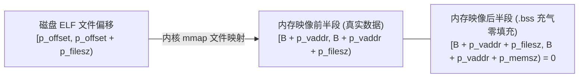

# 第 20 天：PT_LOAD、文件偏移与虚拟内存映射

> **核心认知**：操作系统装载 ELF 二进制文件，内核真正关心的绝不是 `.text` 或 `.data` 这些节（Sections），而是程序头表中的 **`PT_LOAD` 可加载段（Segments）**。必须彻底掌握 **“文件偏移 ➔ 链接虚拟地址 ➔ 运行时虚拟地址（Load Bias 偏移）”** 的三大坐标变换，以及为什么 `.bss` 占内存却不占磁盘空间的数学本质。

---

## 【📌 一句话核心概括】
**`PT_LOAD` 段是 ELF 程序头表中指示操作系统将磁盘文件区间通过 `mmap` 映射至虚拟内存的唯一可执行/可写载体，其文件大小与内存大小的差额由内核自动零填充（`.bss` 段），且其文件偏移与虚拟地址必须满足页对齐同余定理（`p_offset % Page_Size == p_vaddr % Page_Size`）。**

## 【📖 通俗原理解释】
- **文件体积（`p_filesz`）与内存体积（`p_memsz`）的本质**：`p_filesz` 是段在磁盘 ELF 文件中实际占用的真实字节数（如机器指令与已初始化的全局变量 `.data`）；`p_memsz` 是映射到虚拟内存后所占的完整虚拟空间。当 `p_memsz > p_filesz` 时，差额部分对应未初始化全局变量（`.bss` 段），内核在映射时仅分配匿名零页而不需要在磁盘上存储海量无意义的 0 字节。
- **页对齐同余定理的物理意义**：Linux 通过按需分页的 `mmap` 机制映射文件，MMU 只能以页（4KB 或 16KB）为原子单位映射虚拟页与物理页。因此，文件内部的偏移零头必须与映射到的虚拟地址页内偏移严格一致（同余），硬件页表才能保证文件内的数据直接投射到期望的虚拟地址上。
- **不同段权限隔离与页面粒度冲突**：代码段通常为可读可执行（`r-x`），数据段为可读可写（`rw-`）。由于硬件权限由页表项（PTE）控制，不同权限的 `PT_LOAD` 段必须在虚拟地址和文件边界上按页面大小隔开；如果段边界对齐粒度（如 4KB）小于当前操作系统的页面大小（如 16KB），就会导致只读代码与可写数据落入同一物理页，造成致命的权限冲突与装载崩溃。

---

## 一、三大独立坐标系与其映射关系

在 ELF 装载过程中，必须严格区分三套坐标：

| 坐标系名称 | 符号表示 | 物理载体与本质含义 |
| :--- | :--- | :--- |
| **1. 物理文件偏移** | `p_offset` | 字节在磁盘 ELF 文件中从文件头（Byte 0）算起的物理位置 |
| **2. 链接虚拟地址** | `p_vaddr` | 链接器在生成 ELF 时规划的段虚拟起始地址（静态参考系） |
| **3. 运行时实际虚拟地址** | $B + p\_vaddr$ | 程序真正被内核装载入内存后的绝对虚拟地址（$B = \text{load\_bias}$） |



> **核心定理**：
> 1. 传统静态固定地址程序（`ET_EXEC`）：加载偏移 $B = 0$，运行时地址 $\equiv p\_vaddr$。
> 2. 位置无关程序（PIE / `ET_DYN`）：加载偏移 $B$ 由内核 ASLR 随机挑选基址，实际地址 $= B + p\_vaddr$。

---

## 二、`Elf64_Phdr` 结构体布局与字段精析

ELF64 程序头结构体占用 **56 字节**，字段无任何填充（Zero Padding）：

```c
typedef struct {
    Elf64_Word  p_type;    /* [0~3]   段类型: 1 = PT_LOAD (可加载段) */
    Elf64_Word  p_flags;   /* [4~7]   段权限位掩码: 1=X, 2=W, 4=R (如 PF_R|PF_X = 5) */
    Elf64_Off   p_offset;  /* [8~15]  文件起始物理偏移量 */
    Elf64_Addr  p_vaddr;   /* [16~23] 段起始虚拟地址 */
    Elf64_Addr  p_paddr;   /* [24~31] 物理地址 (用户态 Linux 无意义，通常等于 p_vaddr) */
    Elf64_Xword p_filesz;  /* [32~39] 文件中真实有效数据字节数 */
    Elf64_Xword p_memsz;   /* [40~47] 内存中实际占用的总空间大小 (必须 >= p_filesz) */
    Elf64_Xword p_align;   /* [48~55] 段在文件与内存中的对齐粒度 (通常为 0x1000 或 0x4000) */
} Elf64_Phdr;
```

---

## 三、装载黄金律：同余对齐定理（Congruence Theorem）

### 1. 数学约束公式
ELF 规范强制要求：
$$p\_vaddr \bmod p\_align \equiv p\_offset \bmod p\_align$$

### 2. 为什么硬件强制要求同余？
内核装载可执行文件是通过虚拟内存管理系统的 `mmap()` 建立映射的。
* **物理机制**：`mmap` 只能将文件的**某个页边界**映射到内存的**某个页边界**。
* **反证推导**：
  * 设页大小 $P = 0x1000$（4KB）。若文件偏移 $p\_offset = 0x1234$（页内偏移 $0x234$），而 $p\_vaddr = 0x401100$（页内偏移 $0x100$）。
  * 内核若将文件 $0x1000$ 映射到内存 $0x401000$，那么文件中的第 $0x1234$ 字节必然落入内存的 $0x401000 + 0x234 = \mathbf{0x401234}$！
  * **结果**：数据根本落不到程序期望的 $0x401100$！整段指令和变量全部错位。因此，**页内偏移相同是保证分页映射正常工作的数学必然**！

---

## 四、实战剖析：标准三段式 `PT_LOAD` 全流程推演

某标准 ELF 程序包含如下三个经典装载段（假设 $B = 0$）：

```text
LOAD[0] offset=0x0000 vaddr=0x400000 filesz=0x600 memsz=0x600 Flg=R-- (只读段: ELF头/只读元数据)
LOAD[1] offset=0x1000 vaddr=0x401000 filesz=0x200 memsz=0x200 Flg=R-X (代码段: .text/.plt 机器指令)
LOAD[2] offset=0x2000 vaddr=0x402000 filesz=0x100 memsz=0x300 Flg=RW- (数据段: .data 已初始化 + .bss)
```

### 1. 段 2（数据段）深入逆向解析
* **文件有效载荷范围**：
  $$[p\_offset, p\_offset + p\_filesz) = [0x2000, 0x2000 + 0x100) = \mathbf{[0x2000, 0x2100)}$$
* **内存文件映射区间**：
  $$[p\_vaddr, p\_vaddr + p\_filesz) = [0x402000, 0x402100)$$
* **`.bss` 充气零填充区间（Zero-Fill）**：
  $$[p\_vaddr + p\_filesz, p\_vaddr + p\_memsz) = [0x402100, 0x402000 + 0x300) = \mathbf{[0x402100, 0x402300)}$$
* **零填充净大小**：
  $$p\_memsz - p\_filesz = 0x300 - 0x100 = \mathbf{0x200 \text{ (512 字节)}}$$

> **内核底层实现小秘密**：
> 在装载段 2 时，文件只有 $0x100$ 字节，落入最后一页的前部。内核装载器（`fs/binfmt_elf.c` 中的 `padzero()`）会首先将该物理页未用完的尾部（$[0x402100, 0x403000)$）在 RAM 中**刷入全零**；若 $p\_memsz$ 跨越了更多页，后续完整页直接通过匿名页表（Zeroed Page）绑定挂载！

---

## 五、16KB 页面下的架构冲突（Android 15 / Apple M 系列暴毙真相）

如果把上述针对 4KB 页对齐编译的 ELF 扔到 16KB 页面的 Linux 内核上运行：

```text
4KB 视图下各段独立跨度:
[0x400000, 0x401000) ──> R-- (只读)
[0x401000, 0x402000) ──> R-X (代码只读执行)
[0x402000, 0x403000) ──> RW- (数据可读写)
```

* **16KB 硬件下的致命灾难**：
  * 系统单页为 16KB（$0x4000$）。
  * 整个地址范围 $[0x400000, 0x404000)$ 必须归属于**唯一的一个硬件页表项（PTE）**！
  * **权限冲突**：MMU 绝不可能对同一个 16KB 物理页既设为只读执行、又设为可读写！
  * **结局**：内核装载器检测到同一页面内存在重叠冲突的段权限，**直接抛出 `SIGSEGV` 或拒绝执行**！这也是现代编译器编译时必须指定 `-z max-page-size=16384` 强制让各个段在物理文件与虚拟内存中拉开 16KB 缓冲区的根本原因。

---

## 六、安全黄金律：W^X 机制（Write XOR Execute）

* **法则**：`p_flags` 中**绝不可同时出现 `PF_W`（可写）与 `PF_X`（可执行）**！
* **黑客利用场景**：如果一个段具有 `RWX` 权限，攻击者一旦发现缓冲区溢出漏洞，只需将 Shellcode 机器码直接写入该内存并跳转执行，即可无视 DEP/NX 保护光速攻陷系统。
* **安全替代范式**：JIT（即时编译器，如 V8 引擎）的做法是：生成代码时标记为 `RW-`；写入完成后通过 `mprotect()` 切换为 `R-X`；或者利用双虚拟地址映射同一块物理内存。

---

## 七、实战代码：工业级高可靠 `PT_LOAD` 装载分析器

本程序采用严密的 `uint64_t` 防溢出数学推导，自动化解析并核验 4KB 与 16KB 兼容性：

```c
/* elf_loads.c - 深入解析 ELF PT_LOAD 段与多级页表映射关系 */
#define _POSIX_C_SOURCE 200809L
#define _FILE_OFFSET_BITS 64
#include <elf.h>
#include <errno.h>
#include <fcntl.h>
#include <inttypes.h>
#include <stdbool.h>
#include <stdint.h>
#include <stdio.h>
#include <stdlib.h>
#include <string.h>
#include <sys/stat.h>
#include <unistd.h>

/* 防溢出加法与对齐计算 */
static inline bool safe_add(uint64_t a, uint64_t b, uint64_t *out) {
    if (UINT64_MAX - a < b) return false;
    *out = a + b;
    return true;
}

static inline uint64_t align_down(uint64_t v, uint64_t a) {
    return v & ~(a - 1);
}

static inline bool safe_align_up(uint64_t v, uint64_t a, uint64_t *out) {
    uint64_t tmp;
    if (!safe_add(v, a - 1, &tmp)) return false;
    *out = tmp & ~(a - 1);
    return true;
}

/* 打印不同页面大小下的同余与覆盖 */
static void inspect_page_compatibility(const Elf64_Phdr *ph, uint64_t page_sz) {
    bool congruent = (ph->p_offset % page_sz) == (ph->p_vaddr % page_sz);
    uint64_t f_end, f_page_end, mem_end, mem_page_end;

    bool ok = safe_add(ph->p_offset, ph->p_filesz, &f_end) &&
              safe_align_up(f_end, page_sz, &f_page_end) &&
              safe_add(ph->p_vaddr, ph->p_memsz, &mem_end) &&
              safe_align_up(mem_end, page_sz, &mem_page_end);

    printf("    [%5" PRIu64 " 页面评估] 同余性: %s | ",
           page_sz, congruent ? "✅ 完美同余" : "❌ 致命冲突!");
    if (!ok) {
        printf("计算溢出!\n");
        return;
    }
    printf("覆盖物理页: [0x%" PRIx64 ", 0x%" PRIx64 ") 跨度 %" PRIu64 " 页\n",
           align_down(ph->p_vaddr, page_sz), mem_page_end,
           (mem_page_end - align_down(ph->p_vaddr, page_sz)) / page_sz);
}

int main(int argc, char *argv[]) {
    if (argc != 2) {
        fprintf(stderr, "用法: %s <ELF文件>\n", argv[0]);
        return EXIT_FAILURE;
    }

    int fd = open(argv[1], O_RDONLY | O_CLOEXEC);
    if (fd < 0) { perror("open"); return EXIT_FAILURE; }

    struct stat st;
    fstat(fd, &st);

    Elf64_Ehdr eh;
    if (pread(fd, &eh, sizeof(eh), 0) != sizeof(eh) ||
        memcmp(eh.e_ident, ELFMAG, 4) != 0 || eh.e_ident[EI_CLASS] != ELFCLASS64) {
        fprintf(stderr, "错误: 非 64 位标准 ELF\n");
        close(fd);
        return EXIT_FAILURE;
    }

    printf("================ PT_LOAD 装载段深入推演报告 ================\n");
    printf("目标程序: %s (总大小: %" PRIu64 " 字节)\n", argv[1], (uint64_t)st.st_size);
    printf("程序头表起始偏移: 0x%" PRIx64 " (条目数: %u)\n", (uint64_t)eh.e_phoff, eh.e_phnum);
    printf("------------------------------------------------------------\n");

    for (int i = 0; i < eh.e_phnum; i++) {
        Elf64_Phdr ph;
        pread(fd, &ph, sizeof(ph), eh.e_phoff + (uint64_t)i * eh.e_phentsize);

        if (ph.p_type != PT_LOAD) continue;

        char flg[4] = {
            (ph.p_flags & PF_R) ? 'R' : '-',
            (ph.p_flags & PF_W) ? 'W' : '-',
            (ph.p_flags & PF_X) ? 'X' : '-',
            '\0'
        };

        printf("段 [%2d] PT_LOAD 权限 [%s] 对齐规约: 0x%" PRIx64 "\n", i, flg, ph.p_align);
        printf("  文件实体范围 : [0x%08" PRIx64 ", 0x%08" PRIx64 ") 大小: 0x%" PRIx64 " 字节\n",
               ph.p_offset, ph.p_offset + ph.p_filesz, ph.p_filesz);
        printf("  虚拟内存范围 : [0x%08" PRIx64 ", 0x%08" PRIx64 ") 大小: 0x%" PRIx64 " 字节\n",
               ph.p_vaddr, ph.p_vaddr + ph.p_memsz, ph.p_memsz);

        if (ph.p_memsz > ph.p_filesz) {
            printf("  .bss 零填充  : 0x%" PRIx64 " 字节 (位于内存尾部 [0x%" PRIx64 ", 0x%" PRIx64 "))\n",
                   ph.p_memsz - ph.p_filesz, ph.p_vaddr + ph.p_filesz, ph.p_vaddr + ph.p_memsz);
        } else if (ph.p_memsz < ph.p_filesz) {
            printf("  ⚠️ 警告: 畸形段 (p_filesz > p_memsz)!\n");
        }

        /* 检验 W^X 安全原则 */
        if ((ph.p_flags & PF_W) && (ph.p_flags & PF_X)) {
            printf("  🚨 严重安全警报: 违背 W^X 原则 (同时具备 RWX 权限)!\n");
        }

        /* 跨页评估 */
        inspect_page_compatibility(&ph, 4096);
        inspect_page_compatibility(&ph, 16384);
        printf("------------------------------------------------------------\n");
    }

    close(fd);
    return EXIT_SUCCESS;
}
```

---

## 八、编译与深度验证

### 1. 编译并自测当前目标
```bash
gcc -std=c17 -Wall -Wextra -O2 elf_loads.c -o elf_loads
./elf_loads /bin/ls
```
* **观察重点**：
  * 输出中 `p_memsz > p_filesz` 的那个段必然是包含 `.data` 和 `.bss` 的可读写段；
  * `4096` 与 `16384` 页面评估下的同余判定全部为 `✅ 完美同余`；
  * 与权威工具 `readelf -lW /bin/ls` 对照，`Offset`、`VirtAddr`、`FileSiz`、`MemSiz` 分毫不差！

---

## 九、高频避坑禁忌指南

1. **直接计算 `p_memsz - p_filesz` 引发下溢**：
   * 危险代码：`uint64_t bss = ph.p_memsz - ph.p_filesz;`
   * **灾难原因**：遭遇恶意构造的畸形 ELF 时，若 `p_filesz > p_memsz`，64 位无符号减法瞬间回绕暴涨至 $18446744073709551615$，导致内存分配器直接崩盘。
2. **把 `p_vaddr` 误当成最终运行时地址**：
   * 必须时刻铭记：现代 PIE 程序的 `p_vaddr` 只是一个从 `0x0` 开始规划的相对虚拟偏移，实际运行时地址必须加上内核 ASLR 随机赋予的 `load_bias`！
3. **误以为 `.bss` 在磁盘上占用几兆字节空间**：
   * 许多初学者误以为定义 `int arr[1000000];` 会让可执行文件暴涨 4MB，实际上只要未显式非零初始化，它全由 `p_memsz - p_filesz` 的零填充机制由内核在内存中展开，磁盘文件体积几近不变。

---

## 十、课后演练与自我考核

### 练习 1：手算装载区间与零填充
已知某 `PT_LOAD` 段：`p_offset = 0x2800`, `p_vaddr = 0x402800`, `p_filesz = 0x600`, `p_memsz = 0xa00`。
1. 文件有效范围是多少？答：`[0x2800, 0x2800 + 0x600) = [0x2800, 0x2e00)`。
2. 零填充大小是多少？答：`0xa00 - 0x600 = 0x400`（1024 字节）。
3. 零填充在虚拟内存中的范围是多少？答：`[0x402800 + 0x600, 0x402800 + 0xa00) = [0x402e00, 0x403200)`。

### 练习 2：同余性判定
某段 `p_offset = 0x1234`，`p_vaddr = 0x501334`，在 4KB（$0x1000$）页面系统下是否合法？
* 答：$0x1234 \bmod 0x1000 = 0x234$，而 $0x501334 \bmod 0x1000 = 0x334$。二者余数不同，**不满足同余法则，系统拒绝装载**！

---

## 十一、口头验收与核心达标标准

- [ ] **坐标系厘清**：能否随手画出物理文件偏移、链接虚拟地址、运行时虚拟地址的三大坐标映射图？
- [ ] **充气机制讲透**：能否向他人通俗讲清为什么 `p_memsz > p_filesz` 能实现 `.bss` 不占磁盘空间的原理？
- [ ] **同余对齐底理**：能否彻底推导出为什么 `p_offset` 与 `p_vaddr` 必须具备相同的页内偏移？
- [ ] **大页冲突机理**：能否讲清为什么 4KB 对齐的 ELF 扔到 16KB 系统上会因同一页面内的权限冲突而暴毙？
- [ ] **W^X 安全原则**：能否说明段权限中为什么绝不能同时开启可写与可执行？