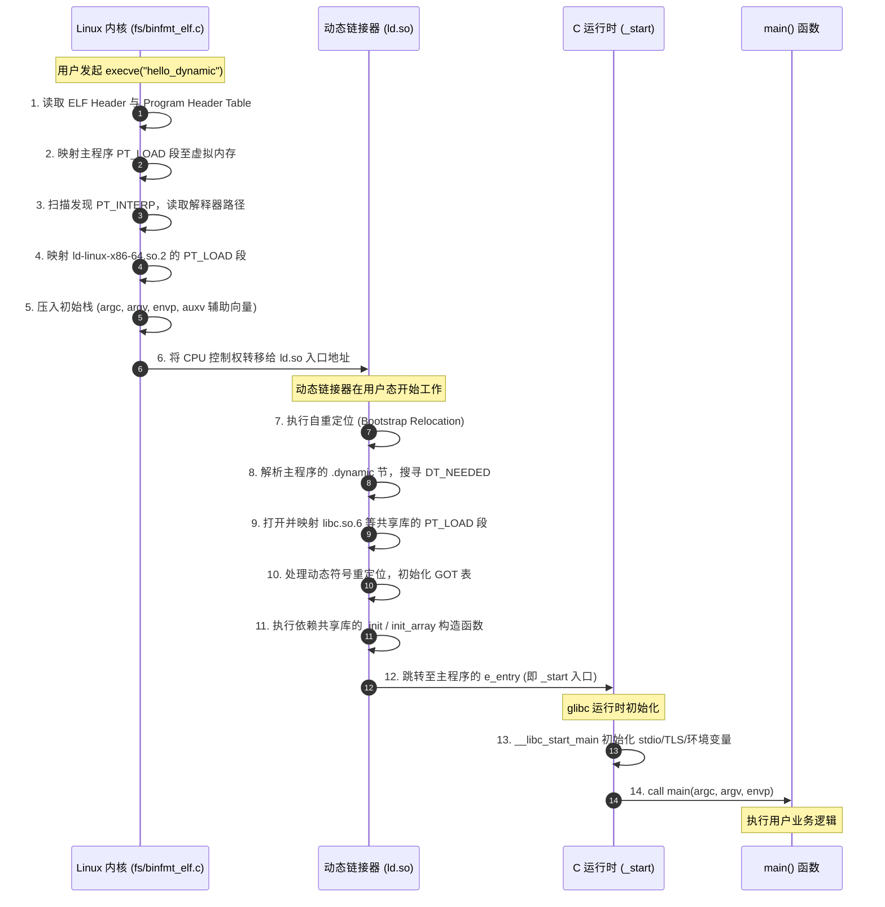

# 第 21 天：编译、链接、静态链接与动态链接

---

## 【📌 一句话核心概括】
**编译过程将高级语言逐步转换为包含未决符号与重定位表的目标文件（`.o`），静态链接在构建期直接将所有依赖库的目标模块物理合并并固定符号虚拟地址，而动态链接则在构建期仅保留依赖声明（`DT_NEEDED`）与解释器路径（`PT_INTERP`），由运行期动态链接器（`ld.so`）按需加载共享库并通过 PLT/GOT 完成符号运行时解析。**

## 【📖 通俗原理解释】
- **目标文件（`.o`）的未决符号与重定位表**：编译单个源文件时，编译器遇到外部函数（如 `puts`）仅检查函数原型声明，并在生成的汇编机器码处填入 `0x00000000` 占位符，同时在重定位段（如 `.rela.text`）记录一条未决重定位条目，声明该符号的真实内存偏移交由后续链接器结算。
- **静态链接（Static Linking）的机制与代价**：使用 `-static` 时，链接器（`ld`）扫描静态库归档文件（`libc.a`），提取包含未决符号的全部 `.o` 文件，与程序自身的目标文件进行段合并，当场计算出确定的虚拟地址并修改机器指令的操作数。其生成的二进制文件完全自包含、无需外部依赖，但文件体积庞大且无法跨进程共享只读代码物理页。
- **动态链接（Dynamic Linking）的解耦架构**：默认动态链接时，链接器并不复制代码，而是在 ELF 中写入解释器段（`PT_INTERP`，指向 `ld-linux.so`）与共享库依赖列表（`DT_NEEDED`），并将符号调用重定向到过程链接表（PLT）。
- **运行期装载与执行交接**：内核在 `execve` 启动动态链接程序时，首先将控制权交给动态链接器 `ld.so`，由 `ld.so` 递归映射所有依赖的 `.so` 共享库，完成全局符号解析与 GOT 表重定位后，再正式将 CPU 控制权转交给主程序的 `_start` 入口。

---

```
源码编译到执行的全景分流图：

 hello.c ──────> 预处理 (cpp) ──────> hello.i (宏展开/头文件替换)
                                          │
                                       编译 (cc1)
                                          │
                                          ▼
                                     hello.s (目标架构汇编代码)
                                          │
                                       汇编 (as)
                                          │
                                          ▼
                                     hello.o (可重定位目标文件 ET_REL，含 UND puts 欠条)
                                          │
                   ┌──────────────────────┴──────────────────────┐
                   │ 静态链接 (ld -static)                        │ 动态链接 (ld -dynamic)
                   ▼                                             ▼
       从 libc.a 提取所需 .o 合并                       记录 DT_NEEDED / PT_INTERP / 动态重定位项
                   │                                             │
                   ▼                                             ▼
       静态可执行文件 (hello_static)                    动态可执行文件 (hello_dynamic)
                   │                                             │
      execve 内核加载 PT_LOAD                        execve 内核加载 PT_LOAD 与 PT_INTERP
                   │                                             │
          直接跳入主程序 _start                            先跳入动态链接器 ld.so
                   │                                             │
                   │                                  ld.so 映射 libc.so.6，处理动态绑定
                   │                                             │
                   └──────────────────┬──────────────────────────┘
                                      ▼
                             C 运行时启动 (crt)
                                      ▼
                                 进入 main()
                                      ▼
                             puts("hello") 输出
```

---

## 一、生命周期的五大阶段：边界与术语

很多初学者容易将“编译”、“链接”和“装载”混为一谈。在系统安全与底层逆向中，混淆这些边界会导致完全无法理解 PLT/GOT 劫持、符号混淆与注入攻击。

| 阶段 | 核心工具 (GNU) | 输入文件 | 输出文件 | 阶段核心使命与底层动作 |
| :--- | :--- | :--- | :--- | :--- |
| **1. 预处理 (Preprocessing)** | `gcc -E` / `cpp` | `*.c`、`*.h` | `*.i` (文本) | 文本替换：展开所有 `#include`、宏展开 (`#define`)、处理条件编译 (`#ifdef`)、剔除注释，保留行号供调试报错。 |
| **2. 编译 (Compilation)** | `gcc -S` / `cc1` | `*.i` | `*.s` (文本) | 狭义编译：词法、语法、语义分析，生成中间表示 (IR)，执行编译器优化，输出目标架构汇编指令。只关心函数接口原型，不关心实现位置。 |
| **3. 汇编 (Assembling)** | `gcc -c` / `as` | `*.s` | `*.o` (二进制) | 将汇编文本逐条翻译为 CPU 机器码二进制，建立节区结构（`.text`、`.data`、`.rodata`），输出符号表（`.symtab`）与重定位表（`.rela.text`）。生成 `ET_REL` 目标文件。 |
| **4. 链接 (Linking)** | `gcc` / `ld` | `*.o`、`*.a`、`*.so` | 可执行文件 / `.so` | **符号解析**（检查谁定义谁引用，处理强弱符号）+ **空间与地址分配**（同类节区合并并分配虚拟地址）+ **代码重定位**（填补机器码中的占位符）。 |
| **5. 装载 (Loading)** | Linux 内核 + `ld.so` | ELF 文件 | 内存进程映像 | **内核动作**：解析 `PT_LOAD` 创建 VMA 页表，分配用户栈；**动态链接器动作**：解析 `PT_INTERP` 载入 `ld.so`，由 `ld.so` 加载依赖共享库并完成运行时重定位。 |

> [!IMPORTANT]
> **装载（Loading）不是静态链接！**
> 链接（Linking）解决的是“不同文件模块之间如何对接与拼接”；装载（Loading）解决的是“磁盘上的 ELF 文件如何映射进 Linux 虚拟内存空间并交给 CPU 运转”。

---

## 二、解剖 `puts("hello")`：从 C 源码到底层对象

考察最简程序：

```c
#include <stdio.h>

int main(void)
{
    if (puts("hello") == EOF) {
        perror("puts");
        return 1;
    }
    return 0;
}
```

### 2.1 `#include <stdio.h>` 提供了什么？

它**绝不是**把 `puts` 的源码或机器码复制进来，它仅仅向编译器注入了符合 ISO C 标准的函数声明：

```c
int puts(const char *s);
void perror(const char *s);
```

声明的本质作用是**签订 ABI 调用契约**：
1. 告诉编译器该函数名为 `puts`；
2. 明确调用规范（Calling Convention）：参数是指向 `const char` 的指针。在 Linux x86-64 System V ABI 下，首个参数必须放入 `RDI`（在 ARM64 AAPCS64 下放入 `X0`）；
3. 明确返回值类型为 32 位整型（存放于 `EAX` 或 `W0`）。

### 2.2 `"hello"` 字符串字面量的物理实质

代码中的 `"hello"` 在编译后是具有**静态存储期（Static Storage Duration）**的连续内存数组对象：
* **数据类型**：严格对应 `char[6]`（含尾部不可见的空字符 `\0`）。
* **内存大小**：`sizeof("hello") == 6` 字节（步长为 1，无 padding）。
* **所处节区**：在目标文件中分配于 `.rodata`（只读数据节），最终映射到具有只读（`R--`）权限的 `PT_LOAD` 段。
* **退化传参**：传给 `puts` 时发生数组到指针退化（Array-to-pointer decay），将数组首元素的虚拟地址传入 `RDI`。

> [!WARNING]
> 尽管 C 语言中字符串字面量的类型历史上是 `char[]` 而非 `const char[]`，但试图写入字符串字面量（如 `char *p = "hello"; p[0] = 'H';`）在 ISO C 标准中属于**未定义行为（Undefined Behavior）**。在现代操作系统上，由于其映射到只读内存页，该写操作将立刻触发 CPU 缺页异常，内核向进程发送 `SIGSEGV`（段错误）。

### 2.3 `puts` 与 `write` 系统调用的本质区别

* `puts` 是 **C 标准库用户态函数**，内建缓冲机制（Line-buffered 或 Block-buffered），并不意味着每一次 `puts` 都会产生一次系统调用。
* `write(1, ...)` 是 **POSIX/Linux 内核系统调用接口**。
* `puts` 在完成内部缓冲整合后，在触发换行刷新或缓冲区满时，底层最终才会调用 `SYS_write` (系统调用号 1) 陷入内核。

---

## 三、目标文件与重定位：汇编器留下的“欠条”

执行 `gcc -c hello.c -o hello.o` 生成可重定位文件（`ET_REL`）。

使用 `file hello.o` 查看：
```text
hello.o: ELF 64-bit LSB relocatable, x86-64, version 1 (SYSV), not stripped
```
核心关键词是 **relocatable（可重定位）**。

### 3.1 为什么汇编器无法直接填入地址？

在 x86-64 汇编中，直接调用指令 `call target` 采用的是相对偏移寻址（RIP-relative displacement）：
$$\text{Displacement} = \text{Target\_Addr} - \text{Next\_Instruction\_Addr}$$

汇编器在编译 `hello.o` 时处于“信息孤岛”：
1. 它不知道 `hello.o` 最终会被合并到哪个基地址；
2. 它不知道 `puts` 究竟是在某个静态库 `.a` 还是在动态库 `.so` 中；
3. 它根本无法计算出目标函数的运行时虚拟地址。

### 3.2 机器码占位与重定位项（Relocation Entry）

汇编器的做法是：在 `call` 指令中填入 4 字节的伪指令占位（通常是 `e8 00 00 00 00`），并在 `.rela.text` 重定位表中为这一处写入一条重定位记录。

使用 `objdump -dr -Mintel hello.o` 检查：
```asm
0000000000000000 <main>:
   ...
   13:   48 8d 3d 00 00 00 00    lea    rdi, [rip+0x0]        # 1a <main+0x1a>
                         16: R_X86_64_PC32    .rodata-0x4
   1a:   e8 00 00 00 00          call   1f <main+0x1f>
                         1b: R_X86_64_PLT32   puts-0x4
```

* `1b: R_X86_64_PLT32 puts-0x4`：这就是汇编器给链接器打的“欠条”！
  * **偏移量 (Offset)**：`0x1b`（对应 `call` 指令后面的 4 字节位移字段）。
  * **重定位类型**：`R_X86_64_PLT32`（指示链接器：请寻找 `puts` 的地址，若是动态库则计算其 PLT 项相对于下一条指令的 32 位相对位移并填回此处）。

使用 `readelf -Ws hello.o | grep puts` 检查符号表：
```text
Num:    Value          Size Type    Bind   Vis      Ndx Name
  9: 0000000000000000     0 NOTYPE  GLOBAL DEFAULT  UND puts
```
* **`Ndx: UND`**：即 `SHN_UNDEF`（未定义）。表示该模块引用了 `puts`，但本地不提供定义。
* **`Value: 0`**：并不代表 `puts` 的地址是 `0x0`，只是表示当前文件未赋予其值。

> [!NOTE]
> **概念辨析：未定义符号（Undefined Symbol） vs 函数不存在（Symbol Not Found）**
> * **声明（Declaration）**：仅在源码语法层通知编译器参数与返回规格。
> * **未定义符号（UND）**：目标文件（`.o`）的符号属性，表明“我需要它，请链接器帮我找到定义”。
> * **未定义引用错误（undefined reference to 'xxx'）**：链接阶段报错，说明链接器扫描完所有输入的 `.o` 和库文件后，**没有任何地方**提供了该符号的强定义。

---

## 四、静态链接 vs 动态链接：架构全景解密

链接器（`ld`）面临两项最基本任务：
1. **符号解析（Symbol Resolution）**：建立符号与定义的关联，判定强弱符号，检测重定义冲突；
2. **重定位（Relocation）**：将各 `.o` 文件的同名节合并（`.text` 与 `.text` 合并，`.data` 与 `.data` 合并），计算每个节和符号在进程中的绝对虚拟地址，修改代码指令中的占位符。

```
节区合并过程 (Section Merging)：

    hello.o                                     最终可执行文件
┌─────────────┐                               ┌─────────────────┐
│   .text     │ ────────┐                     │   .text (代码段) │
├─────────────┤         │                     ├─────────────────┤
│   .rodata   │ ────┐   └───────────────────> │   .rodata (只读) │
└─────────────┘     │                         ├─────────────────┤
    helper.o        │   ┌───────────────────> │   .data (数据段) │
┌─────────────┐     │   │                     ├─────────────────┤
│   .text     │ ────┼───┘                     │   .bss (未初始化)│
├─────────────┤     └───┼───────────────────> └─────────────────┘
│   .data     │ ────────┘
└─────────────┘
```

### 4.1 静态链接（Static Linking）深度推演

命令：`gcc -static hello.c -o hello_static`

#### 1. 静态库的本质
静态库（如 `libc.a`）本质上只是利用 UNIX 归档工具 `ar` 打包的一堆 `.o` 目标文件的**未解压集合归档**，并附带了一张符号索引表（`__.SYMDEF`）：
```text
libc.a
 ├── puts.o          (提供 puts, _IO_puts)
 ├── printf.o        (提供 printf, vfprintf)
 ├── malloc.o        (提供 malloc, free)
 └── exit.o          (提供 exit)
```

#### 2. 按需提取机制（Extraction Granularity）
静态链接器提取代码的粒度是**目标文件成员（Member .o）或独立节区**，绝非“按行”复制：
1. 链接器维护一个“未解决符号集”（Undefined Set）。初始时只有 `main.o` 抛出的 `puts`、`perror` 以及 C 运行时的启动符号。
2. 扫描 `libc.a` 时，链接器查找提供 `puts` 的成员（例如 `puts.o`）。
3. 链接器将**整个 `puts.o`** 提取出来合并进可执行文件。
4. 如果 `puts.o` 自身又引用了其他未定义符号（如底层 I/O 锁、缓冲刷新函数），这些符号被加入未解决集合，继续递归从 `libc.a` 中提取其他 `.o`。
5. 没有被任何模块引用的 `.o`（如 `sin.o`）则完全被忽略。

#### 3. 静态链接的顺序陷阱
静态链接器从命令行**从左向右**线性扫描输入文件：
```bash
# 错误示范：链接器扫描 libfoo.a 时未解决集合为空，因此忽略 libfoo.a；
# 随后扫描 main.o 产生对 foo 的需求，但链接器不会回头重新扫描！
gcc -lfoo main.o -o app      # 报错：undefined reference to `foo`

# 正确写法：需求方在前，提供方在后
gcc main.o -lfoo -o app      # 成功
```

### 4.2 动态链接（Dynamic Linking）深度推演

命令：`gcc hello.c -o hello_dynamic`（现代 Linux 默认生成 PIE 位置无关可执行文件）。

#### 1. 动态 ELF 中保留了什么关键结构？
动态链接不在编译期提取共享库代码，而是在 ELF 中植入动态加载所需的基础设施：
* **`PT_INTERP` 程序头**：写入解释器绝对路径字符串（如 `/lib64/ld-linux-x86-64.so.2`）。内核在 `execve` 时读取该段并启动动态链接器。
* **`.dynamic` 节与 `DT_NEEDED` 标记**：记录程序依赖的所有共享库名（如 `libc.so.6`）。注意这里通常记录的是 SONAME，而不是固定的绝对路径。
* **`.dynsym`（动态符号表）与 `.dynstr`（动态字符串表）**：仅包含运行时与外部共享库交互所需的导入/导出符号子集（如 `puts`、`__libc_start_main`）。即使使用 `strip` 命令清空调试符号，`.dynsym` 依然被强制保留。
* **PLT（过程链接表）与 GOT（全局偏移表）**：实现位置无关动态调用与延迟绑定（Lazy Binding）的核心间接跳板。

#### 2. 两大维度的彻底澄清：PIE 与动态链接
在安全分析中，必须清晰区分这两个独立概念：

```
                      动态链接 (Dynamic)               静态链接 (Static)
              ┌──────────────────────────────┬──────────────────────────────┐
              │ 现代默认 Linux 可执行文件      │ 静态 PIE (-static-pie)        │
 PIE 开启     │ (ET_DYN, 有 PT_INTERP,       │ (ET_DYN, 无 PT_INTERP,       │
              │  完全支持 ASLR 全随机化)       │  自带自重定位代码，完全随机化) │
              ├──────────────────────────────┼──────────────────────────────┤
              │ 传统动态程序 (-no-pie)        │ 传统静态程序 (-static)        │
 PIE 关闭     │ (ET_EXEC, 有 PT_INTERP,      │ (ET_EXEC, 无 PT_INTERP,      │
              │  代码段基址固定为 0x400000)   │  代码段基址固定为 0x400000)   │
              └──────────────────────────────┴──────────────────────────────┘
```

---

## 五、内核与动态链接器协同：从 `execve` 到 `main` 的时序全景

静态可执行文件与动态可执行文件在进入用户 `main` 之前的生命周期有着根本性的区别。



> [!CAUTION]
> **关键边界法则**：
> 内核**只负责**映射主程序和动态链接器（`PT_INTERP`）两个镜像，并准备好初始栈。**内核绝不会去搜索和加载 `libc.so.6`！**
> 所有的 `DT_NEEDED` 依赖搜索、库文件加载、动态符号查找、版本绑定以及 GOT 表填写，全部由**用户态的动态链接器（`ld.so`）**独立完成！

---

## 六、装载基址与运行时地址手工换算

在开启 PIE（Position Independent Executable）后，可执行文件本身是一个 `ET_DYN` 共享对象。链接器生成的地址全部为**相对虚拟地址（RVA, Relative Virtual Address）**。

### 6.1 绝对地址换算公式
设内核或 `ld.so` 随机分配的装载基址为 $B$（通常页面对齐，例如 $4\text{KB}$ 对齐的 `0x555555554000`）：
$$\text{Runtime\_Addr} = B + \text{ELF\_VAddr}$$

假设在 ELF 中静态解析得到：
* `main` 函数偏移：`0x1169`
* `"hello"` 字符串偏移：`0x2004`
* 引用字符串指令的下一条指令地址：`0x1178`

则运行时：
* `main` 真实地址：`0x555555554000 + 0x1169 = 0x555555555169`
* `"hello"` 真实地址：`0x555555554000 + 0x2004 = 0x555555556004`

### 6.2 RIP 相对寻址消除基址依赖
观察汇编中的计算过程：
$$\text{Offset} = \text{Target} - \text{Next\_RIP} = (B + 0x2004) - (B + 0x1178) = 0x2004 - 0x1178 = 0x\text{E8C}$$
基址 $B$ 在减法中被彻底抵消！
因此编译器直接生成：
```asm
lea rax, [rip + 0xe8c]
```
无论 ASLR 将基址 $B$ 随机漂移到何处，该指令无需任何修改都能百分之百精准命中 `"hello"` 字符串！

---

## 七、x86-64 汇编指令级逐条微操作跟踪

以下为 GCC `-O0` 编译生成的 `main` 函数核心反汇编代码（Intel 格式，`目标操作数, 源操作数`）：

```asm
main:
    endbr64
    push   rbp
    mov    rbp, rsp
    lea    rax, [rip + 0xe8c]        # 计算 "hello" 字符串地址
    mov    rdi, rax                  # 按照 System V ABI 将首参放入 RDI
    call   puts@plt                  # 经由 PLT 蹦床调用 libc 的 puts
    cmp    eax, -1                   # 比较返回值与 EOF (-1)
    jne    .L_SUCCESS                # 若不等于 -1 则跳转到成功分支
    lea    rax, [rip + 0xea0]        # 计算 "puts" 错误提示字符串地址
    mov    rdi, rax                  # 传参给 perror
    call   perror@plt                # 经由 PLT 蹦床调用 perror
    mov    eax, 1                    # return 1;
    jmp    .L_QUIT
.L_SUCCESS:
    mov    eax, 0                    # return 0;
.L_QUIT:
    pop    rbp                       # 恢复调用者帧指针
    ret                              # 弹栈返回 C 运行时
```

### 指令微操作追踪矩阵

进入 `main` 时假设初始状态：`RSP = S`（按 System V ABI 满足 $S \pmod{16} = 8$），栈顶 `[S]` 存放着调用者的返回地址。

| 汇编指令 | 机器语义操作 | 内存访问 | RFLAGS 标志位 | 寄存器与栈状态变化 | C 语言对应语意 |
| :--- | :--- | :---: | :---: | :--- | :--- |
| `endbr64` | Intel CET 间接分支终结点标记 | 无 | 不影响 | 告知 CPU 硬件间接跳转合法 | 安全防护标记 |
| `push rbp` | `RSP <- RSP - 8; [RSP] <- RBP` | 写 8 字节 | 不影响 | `RSP = S-8`, 栈顶保存旧 RBP | 保存旧栈基址 |
| `mov rbp, rsp` | `RBP <- RSP` | 无 | 不影响 | `RBP = S-8` | 建立当前函数栈帧 |
| `lea rax, [rip+0xe8c]` | `RAX <- RIP + 0xe8c` | **无内存读取** | 不影响 | `RAX = &"hello"` | 计算字符串指针（不读内容） |
| `mov rdi, rax` | `RDI <- RAX` | 无 | 不影响 | `RDI = &"hello"` | 传递第一个入参 |
| `call puts@plt` | `RSP <- RSP - 8; [RSP] <- Next_RIP; RIP <- puts@plt` | 写 8 字节 | 不影响算术标志 | 进入 PLT；返回后 `EAX = 返回值`，Caller-saved 寄存器破坏 | 执行标准库函数调用 |
| `cmp eax, -1` | 内部计算 `EAX - (-1)` | 无 | **更新 ZF/SF/OF/CF** | 寄存器本身值不变 | `if (res == EOF)` |
| `jne .L_SUCCESS` | 若 `ZF == 0`，则 `RIP <- .L_SUCCESS` | 无 | 不影响 | 若成功输出则跳转 | 条件分支分流 |
| `lea rax, [rip+0xea0]` | `RAX <- RIP + 0xea0` | 无 | 不影响 | `RAX = &"puts"` | 准备错误提示串 |
| `mov rdi, rax` | `RDI <- RAX` | 无 | 不影响 | `RDI = &"puts"` | 传参给 `perror` |
| `call perror@plt` | 压入返回地址并跳转至 `perror` | 写 8 字节 | 不影响算术标志 | 进入标准错误打印 | `perror("puts")` |
| `mov eax, 1` | `EAX <- 1` (高 32 位清零) | 无 | 不影响 | `RAX = 1` | `return 1` |
| `jmp .L_QUIT` | `RIP <- .L_QUIT` | 无 | 不影响 | 无条件转移 | 退出分支 |
| `mov eax, 0` | `EAX <- 0` (高 32 位清零) | 无 | 不影响 | `RAX = 0` | `return 0` |
| `pop rbp` | `RBP <- [RSP]; RSP <- RSP + 8` | 读 8 字节 | 不影响 | `RBP` 恢复，`RSP = S` | 销毁当前栈帧 |
| `ret` | `RIP <- [RSP]; RSP <- RSP + 8` | 读 8 字节 | 不影响 | `RSP = S+8`，控制权返还调用者 | 函数返回 |

> [!TIP]
> **底层核心细节警示**：
> 1. **`lea` 绝不读取内存**：`lea rax, [rip+0xe8c]` 仅仅是一条**算术加法指令**，它计算指针数值本身，绝对不会访问该地址所指向的内存字节！真正读取该内存的是随后进入的 `puts` 实现。
> 2. **`call` 的双重动作**：`call` 不单改变 `RIP`，硬件上必须将紧随其后的下一条指令地址强制推入栈顶（`RSP - 8`），这正是缓冲区溢出攻击中篡改返回地址的物理依托。
> 3. **Caller-Saved 寄存器粉碎**：在执行 `call puts@plt` 后，根据 System V ABI 规范，寄存器 `RAX`, `RCX`, `RDX`, `RSI`, `RDI`, `R8`-`R11` 属于调用者保存寄存器，函数返回后它们的内容处于未定义状态，严禁假设它们保持原值！

---

## 八、静态链接与动态链接深度对比矩阵

| 评估维度 | 静态链接 (`gcc -static`) | 动态链接 (`gcc` 默认) | 逆向与安全影响分析 |
| :--- | :--- | :--- | :--- |
| **可执行文件体积** | 极大（典型约 $800\text{KB} \sim 1\text{MB}+$） | 极小（典型约 $15\text{KB} \sim 20\text{KB}$） | 静态程序将 libc 众多基础逻辑内嵌，逆向时符号繁杂；动态程序依赖外部导出。 |
| **`PT_INTERP` 段** | **无**（内核直接跳入 `_start`） | **有**（包含 `/lib64/ld-linux-...`） | 逆向时若发现无 `PT_INTERP`，通常可直接判定为纯静态二进制或内核加载裸模块。 |
| **共享库依赖 (`ldd`)** | `not a dynamic executable` | 依赖 `libc.so.6`, `ld-linux...` | 静态程序更易于在无依赖容器运行；动态程序强依赖宿主环境库版本。 |
| **库漏洞修复机制** | **无自动修复**。必须重新编译链接。 | **动态受益**。宿主升级 `libc.so` 即刻生效。 | 动态链接在操作系统补丁分发体系中具备决定性安全维护优势。 |
| **物理内存代码共享** | 多个进程拥有各自的物理副本，浪费内存。 | 多个进程共享宿主 page cache 中的同一只读物理代码页。 | 动态链接大幅节省系统总物理内存与 CPU L2/L3 缓存行。 |
| **逆向分析特征** | 直接通过相对偏移 `call 0x405aa0` 调用代码。 | 经由 `call puts@plt` 间接寻址。 | 静态反编译能直接内联查看库函数细节；动态分析则易于下断点在 PLT 观察参数。 |
| **操作系统独立性** | **并非绝对独立**！仍强依赖内核系统调用 ABI。 | 不独立，既依赖内核 ABI，又依赖用户态库 ABI。 | 即使静态链接，遇到内核系统调用号或语义不匹配依然会直接崩溃。 |

---

## 九、工业级命令行验证与逆向实战

### 9.1 四阶段生成与文件指纹对比
```bash
# 1. 预处理
gcc -E hello.c -o hello.i
# 2. 编译为汇编
gcc -S -O0 hello.i -o hello.s
# 3. 汇编为目标文件
gcc -c hello.s -o hello.o
# 4. 生成动态与静态可执行文件
gcc hello.o -o hello_dynamic
gcc -static hello.o -o hello_static

# 观察文件类型与体积巨大差异
ls -lh hello.o hello_dynamic hello_static
file hello.o hello_dynamic hello_static
```

### 9.2 检查符号与重定位“欠条”
```bash
# 检查目标文件中的未定义符号
readelf -Ws hello.o | grep -E 'puts|perror'
# 输出: NOTYPE GLOBAL DEFAULT UND puts

# 检查目标文件中的重定位欠条
readelf -Wr hello.o | grep -E 'puts|perror'
# 输出: R_X86_64_PLT32   puts - 4

# 检查动态可执行文件中的动态符号表
readelf --dyn-syms hello_dynamic | grep puts
# 输出: FUNC GLOBAL DEFAULT UND puts@GLIBC_2.2.5
```

### 9.3 检查程序头与动态链接器路径
```bash
# 检查动态程序中的解释器段 (PT_INTERP)
readelf -l hello_dynamic | grep -A 1 INTERP
# 检查动态依赖 (DT_NEEDED)
readelf -d hello_dynamic | grep NEEDED

# 静态程序确认无动态段
readelf -l hello_static | grep INTERP    # 无输出
readelf -d hello_static                 # 提示: There is no dynamic section in this file
```

### 9.4 监控动态链接器的全套装载过程
动态链接器自带强大的调试追踪环境变量 `LD_DEBUG`：
```bash
# 实时跟踪动态链接器加载哪些库以及何时解析重定位
LD_DEBUG=libs,reloc ./hello_dynamic
```
你将亲眼见证：
1. `ld.so` 搜索并打开 `libc.so.6` 的完整物理路径；
2. 映射 `libc.so.6` 的只读与可读写段；
3. 处理主程序与 libc 之间的动态符号匹配。

> [!CAUTION]
> **安全红线警告：切勿随意对不可信 ELF 文件执行 `ldd`！**
> `ldd` 并不是纯静态分析工具！它本质上是一个 Shell 脚本，其核心工作原理之一是设置环境变量后直接调用该程序指定的 `PT_INTERP` 解释器。若恶意文件特制了恶意的 `PT_INTERP`，运行 `ldd` 将直接导致恶意代码以你的权限在系统中执行！
> **安全替代方案**：统一使用 `readelf -d target | grep NEEDED` 或 `objdump -p target` 进行无风险静态静态剖析。

---

## 十、硬核课后推演与考核题

### 练习 1：声明与定义的符号状态
现有源码 `main.c`：
```c
int calculate_hash(const char *data);
int main(void) { return calculate_hash("test"); }
```
1. 执行 `gcc -c main.c -o main.o` 是否会报错？
2. 此时 `calculate_hash` 在 `main.o` 符号表中处于什么状态？
3. 执行 `gcc main.o -o main` 会发生什么？

> **推导解析**：
> 1. 不会报错。函数声明为编译器提供了入参规格（指针）与返回值（`int`），编译和汇编阶段足以生成完整的调用指令和重定位项。
> 2. 在 `main.o` 符号表中标记为 `GLOBAL UND calculate_hash`（全局未定义符号）。
> 3. 报错 `undefined reference to 'calculate_hash'`。链接器在符号解析阶段遍历所有输入模块，找不到 `calculate_hash` 的实现代码，无法完成重定位修正。

### 练习 2：动态可执行文件中的 `UND` 符号
在执行 `readelf --dyn-syms app` 时，发现包含 `UND printf`，这是否证明该程序链接损坏无法运行？

> **推导解析**：
> 并不说明损坏。动态链接程序（`ET_DYN` / `ET_EXEC`）本身就不包含标准库代码，其 `.dynsym` 表中必须保留 `UND printf` 符号记录，作为凭证交给运行时动态链接器（`ld.so`），由 `ld.so` 从映射的 `libc.so.6` 中查询真实地址并填充 GOT。只有在运行时系统找不到兼容的 libc 时才会触发加载失败。

### 练习 3：静态链接归档文件顺序
为什么命令 `gcc -lcalc main.o -o app` 极易报错，而 `gcc main.o -lcalc -o app` 能顺利链接？

> **推导解析**：
> 传统链接器从左至右单向扫描。处理 `-lcalc` 时，“当前未解决符号集”尚为空，链接器判定该静态库中的所有 `.o` 均未被使用，故直接跳过；接着扫描 `main.o` 时才发现对 `calc` 符号的未满足需求，但此时链接器默认已不再回溯重新扫描之前的库，最终导致未定义引用错误。需求方（`main.o`）必须置于提供方（`-lcalc`）左侧。

### 练习 4：`lea` 与 `movzx` 汇编行为辨析
分析以下两条汇编指令的内存访问本质：
```asm
lea   rax, [rip + 0x2000]
movzx eax, byte ptr [rax]
```

> **推导解析**：
> * `lea`（Load Effective Address）：**纯算术指令，不访问内存**。仅将 `RIP + 0x2000` 的线性地址数值存入 `RAX`。
> * `movzx`（Move with Zero-Extend）：**真实物理内存读取**。向 MMU 发起总线读事务，访问 `RAX` 所指向的虚拟地址单元，读取 1 字节数据并将其零扩展填充进 32 位寄存器 `EAX`。

---

## 十一、口头答辩验收标准（Checklist）

在进入 Day 22 探究 PLT 底层跳转细节前，必须能脱稿无死角回答以下 8 个核心问题：

- [ ] **1. 头文件与库的区别**：为什么包含 `<stdio.h>` 没有引入任何一行机器码？
- [ ] **2. 声明的机器级意义**：编译器在仅有函数原型声明时，如何决定寄存器传参与返回值获取？
- [ ] **3. 未定义符号本质**：`hello.o` 中的 `UND puts` 是什么含义？它与代码编写错误的本质区别？
- [ ] **4. 链接器的两大核心职能**：什么是符号解析？什么是代码重定位？
- [ ] **5. 静态库的解包粒度**：`libc.a` 是如何被提取的？为什么静态链接不是拷贝整个 `.a` 文件？
- [ ] **6. 装载阶段的权责划分**：Linux 内核与动态链接器 `ld.so` 在进程启动时各自负责什么？内核会帮程序寻找 `libc.so` 吗？
- [ ] **7. 动态调用的中间凭证**：可执行文件中的 `PT_INTERP` 与 `DT_NEEDED` 分别记录什么关键信息？
- [ ] **8. ASLR 下的相对偏移稳定性**：为什么 PIE 模式下 `lea rax, [rip+offset]` 可以不依赖装载基址正确寻址？