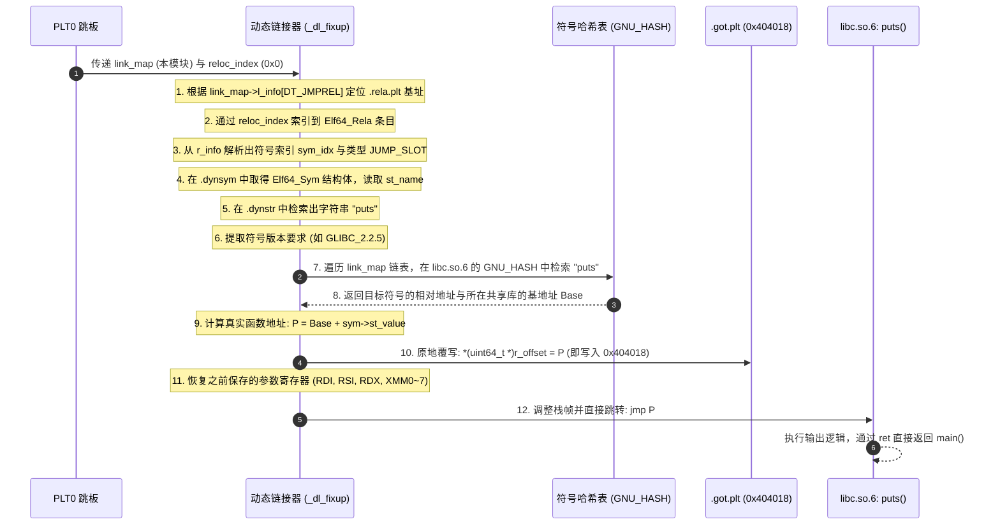

# 第 23 天：GOT、重定位与延迟绑定

---

## 【📌 一句话核心概括】
**全局偏移表（GOT）与重定位表（`Elf64_Rela`）协同工作，重定位项提供目标槽位偏移（`r_offset`）与符号类型（`r_info`），由动态链接器（`_dl_fixup`）在延迟绑定触发时将外部真实函数地址回填入 `.got.plt`，而 RELRO 机制则决定该可写槽位是否在启动时被立即固化为只读以防御 GOT 覆写劫持。**

## 【📖 通俗原理解释】
- **重定位条目（`Elf64_Rela`）的契约结构**：重定位结构体包含三大要素：待修改的内存槽位虚拟地址（`r_offset`，即目标 GOT 表项地址）、待解析的符号表下标及重定位类型（`r_info`，如 `R_X86_64_JUMP_SLOT`）、以及常量加数（`r_addend`）。动态链接器完全依据此契约执行运行期符号绑定。
- **`.got` 与 `.got.plt` 的正交划分**：`.got` 负责外部全局变量（如 `stdout`、`environ`），变量访问无法走 PLT 跳板，必须在程序启动加载期由动态链接器立即全量重定位；`.got.plt` 则服务于外部函数调用，支持运行期按需的延迟绑定。
- **延迟绑定（Lazy Binding）的核心状态迁移**：未解析时，`.got.plt` 项中存放的是对应 PLT 条目内部推入重定位索引的指令地址；一旦首调触发，`_dl_fixup` 查询目标动态库的符号表，将解析得到的绝对函数指针覆写进 `.got.plt` 对应槽位。
- **Partial RELRO 与 Full RELRO 的安全边界**：在 Partial RELRO 下，为允许运行时动态回写，`.got.plt` 所在物理页在整个生命周期中保持可写（`rw-`），导致攻击者可通过任意写漏洞篡改函数指针实现执行流劫持（GOT Overwrite）；而 Full RELRO（编译选项 `-Wl,-z,relro,-z,now`）要求程序启动时立即全量解析所有外部函数符号，随后立即调用 `mprotect` 将整个 GOT 区域降权为只读（`r--`），从根源上杜绝 GOT 覆写攻击。

---

```
动态链接重定位与 GOT 劫持攻防全景图：

           Elf64_Rela (重定位单据)
     ┌──────────────────────────────────┐
     │ r_offset: 0x404018 (GOT 目标槽位) │
     │ r_info  : sym=puts, type=JUMP_SLOT│
     └─────────────────┬────────────────┘
                       │
                       ▼ 动态链接器 _dl_fixup 查找并写入
                       │
       .got.plt 内存表 (0x404018)
┌──────────────────────────────────────────────┐
│ 初始状态 (未解析): 0x401036 (指向 PLT 内部)    │ ──── 首次调用走慢速解析
├──────────────────────────────────────────────┤
│ 运行时回填 (已解析): 0x7ffff7e12340 (libc puts)│ ──── 后续调用走快速直达
└──────────────────────┬───────────────────────┘
                       │
       ┌───────────────┴───────────────┐
       ▼                               ▼
【Partial RELRO (默认)】       【Full RELRO (-z relro -z now)】
内存权限: RW- (可读可写)        内存权限: R-- (只读已加固)
黑客利用任意写漏洞覆盖 GOT:     进入 main 前完成解析并通过 mprotect 锁死:
GOT[puts] = &system            任何写入尝试直接崩溃 (SIGSEGV)
下一次 puts("/bin/sh") 沦陷     彻底防御 GOT Overwrite 攻击！
```

---

## 一、为什么需要两层重定位？

系统开发中存在两类截然不同的重定位动作，很多初学者极易混淆：

| 维度 | 编译/静态链接期重定位 | 运行时/动态重定位 |
| :--- | :--- | :--- |
| **发生时机** | 执行 `gcc -c` 及最终静态合并生成 ELF 时 | 程序执行 `execve` 装载及后续运行期 |
| **处理主体** | 静态链接器（`ld` / `gold` / `lld`） | 用户态动态链接器（`/lib64/ld-linux-x86-64.so.2`） |
| **典型重定位项** | `R_X86_64_PLT32`、`R_X86_64_PC32`、`R_X86_64_32S` | `R_X86_64_JUMP_SLOT`、`R_X86_64_GLOB_DAT`、`R_X86_64_RELATIVE` |
| **处理手段** | 将目标代码中的 4 字节占位符修改为针对本模块 `.plt` 或局部节区的相对偏移。 | 根据共享库加载基址与符号哈希表，向 `.got` 或 `.got.plt` 数据单元填写真实地址。 |
| **修改区域** | 直接修改可执行文件的代码段（`.text`）。 | **绝不修改代码段**，只修改数据段中的全局偏移表（`.got` / `.got.plt`）。 |

> [!IMPORTANT]
> **代码段与数据段的隔离法则**：
> 静态链接可以放心地直接修改 `.text` 代码段中的跳转偏移；但动态链接**严禁在运行时修改代码段**（违背 $W \oplus X$ 安全法则，且会破坏跨进程物理页共享）。因此，所有运行时的动态重定位必须收拢到**数据段的 GOT 表**中完成！

---

## 二、ELF64 重定位表结构：`Elf64_Rela` 源码与位运算

在 Linux `<elf.h>` 规范中，64 位带有显式加数的重定位结构体为 `Elf64_Rela`：

```c
typedef struct {
    Elf64_Addr   r_offset; // 8 字节: 待修补的内存虚拟地址 (目标 GOT 槽位)
    Elf64_Xword  r_info;   // 8 字节: 复合字段 (高 32 位为符号索引，低 32 位为重定位类型)
    Elf64_Sxword r_addend; // 8 字节: 符号偏移加数 (有符号整数)
} Elf64_Rela;
```

### 2.1 内存空间与对齐计算
* **成员大小与偏移**：
  * `offsetof(Elf64_Rela, r_offset) == 0`（8 字节，对齐为 8）
  * `offsetof(Elf64_Rela, r_info)   == 8`（8 字节，对齐为 8）
  * `offsetof(Elf64_Rela, r_addend) == 16`（8 字节，对齐为 8）
* **总尺寸**：$8 + 8 + 8 = 24$ 字节（满足 $24 \pmod{8} == 0$，无任何内部或尾部填充 padding）。
* **数组步长**：在 `.rela.plt` 中，第 $n$ 个重定位条目的物理地址公式为：
  $$\text{Entry\_Addr} = \text{Section\_Base} + n \times 24$$

### 2.2 核心宏与位运算解码
`r_info` 字段将符号表下标与重定位类型打包为一个 64 位整数，解析公式为：
```c
#define ELF64_R_SYM(info)  ((info) >> 32)
#define ELF64_R_TYPE(info) ((Elf64_Word)(info))
```

假设用 `readelf -rW` 查到某项：
```text
Offset          Info              Type                 Symbol's Name + Addend
000000404018  0000000300000007 R_X86_64_JUMP_SLOT  puts@GLIBC_2.2.5 + 0
```
* `r_offset = 0x404018`：明确指出需要动态链接器填写的**就是位于 `0x404018` 的那个 GOT 表项**；
* `r_info = 0x0000000300000007`：
  * 符号索引：`0x0000000300000007 >> 32 = 3`（指向 `.dynsym` 中的第 3 个符号 `puts`）；
  * 类型编码：`(uint32_t)0x0000000300000007 = 7`（对应标准常量 `R_X86_64_JUMP_SLOT`）。

---

## 三、`.got` 与 `.got.plt` 的架构分工

现代 ELF 将全局偏移表拆分成两个专门的节区，其设计蕴含深刻的系统权衡：

```
ELF 进程数据段中的 GOT 双子星：

 内存低地址 ──────> ┌─────────────────────────┐ <─── 启动期处理 (R_X86_64_GLOB_DAT)
                   │ .got                    │      存放外部全局变量 (如 stdout)
                   │ (通常归入 PT_GNU_RELRO) │      无法延迟解析，进入 main 前必须填完
                   ├─────────────────────────┤
                   │ .got.plt                │ <─── 运行期处理 (R_X86_64_JUMP_SLOT)
                   │  GOT[0]: .dynamic 指针  │      存放外部函数跳转指针
                   │  GOT[1]: link_map 指针  │      支持延迟绑定 (Lazy Binding)
                   │  GOT[2]: dl_resolve 入口│      默认必须保持可写 (RW-)
 内存高地址 ──────> │  GOT[3]...: 函数跳转槽   │
                   └─────────────────────────┘
```

| 节区名称 | 默认内存权限 | 容纳的重定位类型 | 典型包含内容与工作机制 |
| :--- | :---: | :--- | :--- |
| **`.got`** | `R--` (重定位后只读) | `R_X86_64_GLOB_DAT`、`R_X86_64_RELATIVE` | **数据符号专区**。存放全局变量（如 `stderr`、`optind`）。程序刚加载时，动态链接器必须在进入 `main` 前把地址填妥，随后被 Full/Partial RELRO 保护为只读。 |
| **`.got.plt`** | `RW-` (Partial) / `R--` (Full) | `R_X86_64_JUMP_SLOT` | **函数跳转专区**。专门配合 `.plt` 实现函数延迟解析。前 3 个表项固定为动态链接器保留结构，后续每个槽位对应一个外部函数。 |

---

## 四、延迟绑定核心引擎：`_dl_fixup` 内部 12 步时序

动态链接器用户态解析函数（通常为 glibc 中的 `_dl_fixup`）是如何仅凭 `link_map` 和 `reloc_index` 找到真实物理地址的？



> [!TIP]
> **参数保全之谜**：
> 很多工程师疑惑：`main` 在调用前把 `"first call"` 传给了 `RDI`，经过了 `puts@plt`、`PLT0`、`_dl_fixup` 这么漫长的调用链，`RDI` 为什么没有被覆盖？
> **答案**：`_dl_runtime_resolve` 必须严格遵循 System V ABI。它一进入就执行一系列微操作（如 `push rax; push rcx; push rdx; push rsi; push rdi; push r8-r11; sub rsp, ...; fxsave/xsave ...`），将所有传参通用寄存器与浮点向量寄存器全部原封不动备份在私有栈帧中，解析完毕后再逐一恢复，确保真实 `puts` 启动时接收到的入参绝对纯净无误！

---

## 五、安全对抗实战：GOT Overwrite 漏洞与 RELRO 防御

### 5.1 Partial RELRO 环境下的 GOT 覆写劫持（原理演练）
在默认的 Partial RELRO 模式下，`.got.plt` 具有可写权限（`RW-`）。假设程序存在一个任意内存写漏洞（如格式化字符串漏洞或堆堆块越界写）：

```c
// 概念攻击模型：黑客利用任意地址写原语
void exploit(void) {
    // 假设黑客获取了 puts 的 GOT 槽位地址 0x404018
    unsigned long long *puts_got = (unsigned long long *)0x404018;

    // 获取黑客注入的 shellcode 地址或 libc 中 system() 地址
    unsigned long long target = (unsigned long long)&win_or_system;

    // 致命一击：篡改 GOT 表项
    *puts_got = target;
}
```

* **攻击后果**：当主程序后续再次执行任何 `puts("anything")` 时，`call puts@plt` 内部的 `jmp QWORD PTR [0x404018]` 将直接跳转到黑客植入的 `win_or_system` 地址！黑客彻底夺取 CPU 指令控制权！

---

### 5.2 Full RELRO：硬件级的绝对只读封死

为了根除这一整类攻击面，现代二进制安全防御规范强制要求启用 **Full RELRO**：
```bash
gcc -std=c17 -O0 -g \
    -fno-pie -no-pie \
    -Wl,-z,relro -Wl,-z,now \
    -o plt_demo_now plt_demo.c
```

#### Full RELRO 的三大质变：
1. **禁用延迟绑定**：链接参数 `-z now`（`DT_FLAGS: BIND_NOW`）强制要求动态链接器在程序启动映射完成后、正式执行 `main` 之前，立即把所有的外部符号（包括 `puts`）全部解析到位并填妥 `.got.plt`；
2. **只读保护提权**：在启动阶段把所有动态重定位完成之后，动态链接器调用底层内核系统调用：
   $$\text{sys\_mprotect}(\text{RELRO\_Page\_Start}, \text{Len}, \text{PROT\_READ})$$
   将包含 `.got` 和 `.got.plt` 的整个 `PT_GNU_RELRO` 内存页**强行收回可写权限，降级为永久只读（`R--`）**！
3. **硬件级拦截**：黑客若再次尝试执行 `*puts_got = target;`，MMU 硬件检测到针对只读页面的非法写入，立刻向 CPU 抛出缺页异常中断，Linux 内核介入并直接对该进程下达死刑判决——发送 `SIGSEGV` 信号终止进程，攻击彻底失效！

---

## 六、三维度辨析：立即绑定 vs Partial RELRO vs Full RELRO

工程师最容易陷入的认知误区：以为加了环境变量 `LD_BIND_NOW=1` 就等于具备了 Full RELRO 安全防护。

| 评估维度 | 默认状态 (Partial RELRO + Lazy) | 仅运行时注入 `LD_BIND_NOW=1` | 编译期启用 Full RELRO (`-z relro -z now`) |
| :--- | :--- | :--- | :--- |
| **外部函数解析时机** | 首次调用时延迟解析（Lazy） | 程序启动时一次性解析（Immediate） | 程序启动时一次性解析（Immediate） |
| **首次调用开销** | 存在慢速解析链路 | 消除，首次即快速直达 | 消除，首次即快速直达 |
| **`.got.plt` 内存页权限** | **`RW-`（可读可写）** | **`RW-`（仍旧可写！）** | **`R--`（只读已锁死！）** |
| **能否防御 GOT Overwrite** | **完全无法防御** | **完全无法防御**（黑客仍可覆写） | **100% 绝对防御**（写入触发崩溃） |
| **二进制 ELF 标志** | 无 `BIND_NOW` | 无 `BIND_NOW` | `FLAGS: BIND_NOW`，段 `GNU_RELRO` 覆盖完整 GOT |

> [!CAUTION]
> **绝对认知准则**：
> `LD_BIND_NOW=1` **只能改变动态链接器解析符号的时序（从运行时提前到启动期），但绝不能改变二进制编译期固化的段分布（Segment Layout）与内存保护范围！**
> 要想使 GOT 真正获得只读保护，必须在**编译链接阶段**使用 `-Wl,-z,relro -Wl,-z,now` 组合参数生成二进制文件！

---

## 七、GDB 硬件断点实证：捕获 `_dl_fixup` 覆写瞬间

为了亲眼观察 GOT 从初始跳板地址被篡改为 libc 真实地址的物理瞬间，我们利用 GDB 硬件数据断点（Watchpoint）进行实验。

### 7.1 准备经典源码与编译
```c
// plt_demo.c
#include <stdio.h>
#include <stdlib.h>

__attribute__((noinline)) static void checkpoint(int stage) {
    volatile int s = stage; (void)s;
}

int main(void) {
    checkpoint(0);
    puts("first call");
    checkpoint(1);
    puts("second call");
    checkpoint(2);
    return EXIT_SUCCESS;
}
```

编译延迟绑定版本：
```bash
gcc -std=c17 -O0 -g -fno-pie -no-pie -fno-builtin-puts -fcf-protection=none \
    -Wl,-z,relro -Wl,-z,lazy -o plt_demo plt_demo.c
```

### 7.2 动态追踪命令流与输出记录
```bash
gdb -q ./plt_demo
```

在 GDB 终端中依次键入：

```gdb
(gdb) set disassembly-flavor intel
(gdb) break checkpoint
(gdb) run
# 命中 checkpoint(0) 阶段

# 1. 查询 puts 对应的 GOT 槽位地址 (假设通过 readelf 得到 0x404018)
(gdb) x/gx 0x404018
0x404018 <puts@got.plt>:    0x0000000000401036
# 初始确认: 此时 GOT 内部确实存放着 puts@plt+6 (即 push 0x0)

# 2. 对该 8 字节内存槽下达硬件写监视点 (Hardware Watchpoint)
(gdb) watch -location *(unsigned long long *)0x404018
Hardware watchpoint 2: *(unsigned long long *)0x404018

# 3. 放行程序，静候内存被写
(gdb) continue
Continuing.

# 4. 硬件监视点瞬间被触发！动态链接器被抓现行！
Hardware watchpoint 2: *(unsigned long long *)0x404018

Old value = 4198454 (0x401036)
New value = 140737351984448 (0x7ffff7e12340)
_dl_fixup (l=0x7ffff7ffe2e0, reloc_arg=0) at dl-runtime.c:168
168     return *valuep = value;

# 5. 查看当场调用栈，彻底确证解析链路
(gdb) backtrace
#0  _dl_fixup (l=0x7ffff7ffe2e0, reloc_arg=0) at dl-runtime.c:168
#1  0x00007ffff7fe7e65 in _dl_runtime_resolve_xsavec () at ../sysdeps/x86_64/dl-trampoline.h:126
#2  0x0000000000401150 in main () at plt_demo.c:11

# 6. 继续运行进入 checkpoint(1)
(gdb) continue
first call
Breakpoint 1, checkpoint (stage=1) at plt_demo.c:4

# 7. 查看第二次调用前的 GOT 表
(gdb) x/gx 0x404018
0x404018 <puts@got.plt>:    0x00007ffff7e12340
# 结论: 已经永久化为 libc 地址，随后的 puts("second call") 将直接执行 jmp 0x7ffff7e12340！
```

---

## 八、硬核课后推演与考核题

### 练习 1：手算 `Elf64_Rela` 索引偏移
若某二进制文件的 `.rela.plt` 节起始虚拟地址为 `0x4002e0`，请问该表中第 4 个条目（下标从 0 开始算，即 Index = 4）的起始虚拟内存地址是多少？其 `r_offset` 成员位于哪个绝对地址？

> **推导解析**：
> 1. 每个 `Elf64_Rela` 大小恒定为 24 字节（`0x18` 字节）；
> 2. Index = 4 的条目相对偏移：$\text{Offset} = 4 \times 24 = 96 = 0\text{x60}$；
> 3. 该条目起始地址：$0\text{x4002e0} + 0\text{x60} = 0\text{x400340}$；
> 4. `r_offset` 是该结构体的第一个成员，偏移量为 0，因此 `r_offset` 的绝对地址即为 `0x400340`。

### 练习 2：动态可执行文件中 `.got` 与 `.got.plt` 的合并现象
使用 GCC 编译某些开启 Full RELRO 的二进制文件时，用 `readelf -S` 可能会发现 `.got.plt` 节消失了，只剩下 `.got`，这是为什么？

> **推导解析**：
> 在 Full RELRO 模式下，所有的函数跳转槽（原位于 `.got.plt`）和全局变量槽（原位于 `.got`）都在进入 `main` 之前由动态链接器统一完成绑定。既然全部表项都不再需要在运行时被修改，且全部需要被 `mprotect` 加锁保护，链接器就会将它们直接合并收拢到同一个只读段 `.got` 中，彻底消除对独立可写 `.got.plt` 节区的需求。

### 练习 3：只读保护的页对齐溢出风险
若某程序的 `.got.plt` 大小仅为 32 字节，而系统内存页大小为 4096 字节（4KB）。链接器在设置 `PT_GNU_RELRO` 段保护时，能否只将这 32 字节设为只读？

> **推导解析**：
> 绝对不能。CPU MMU 硬件层面的内存读写执行权限控制是以**完整物理页（Page，典型 4KB）为最小粒度**实施的。如果这 32 字节与某个需要保持可写的数据（如 `.data` 中的全局变量）混在同一个 4KB 物理页中，系统就无法在保护 GOT 的同时允许正常变量写入。因此，链接器必须对段进行重排与页对齐补齐（Alignment Padding），将 RELRO 保护的数据单独隔离在独立的物理页中。

---

## 九、口头答辩验收标准（Checklist）

在结束 Stage 2 并迈向综合复盘（Day 24）前，必须能脱稿无死角回答以下 8 个核心问题：

- [ ] **1. 重定位项物理构成**：`Elf64_Rela` 占用多少字节？`r_info` 高 32 位与低 32 位各有什么物理用途？
- [ ] **2. 两类重定位时空划分**：`R_X86_64_PLT32` 与 `R_X86_64_JUMP_SLOT` 分别发生在什么阶段？由谁负责处理？
- [ ] **3. GOT 双子星定位**：`.got` 与 `.got.plt` 存放的对象有什么根本区别？为什么全局变量不能延迟绑定？
- [ ] **4. 延迟绑定的覆写时机**：`_dl_fixup` 覆写 `GOT[puts]` 到底发生在哪一刻？它写入的是相对偏移还是绝对运行时地址？
- [ ] **5. GOT Overwrite 攻击机理**：为什么黑客利用内存写漏洞最喜欢改写 GOT？篡改后是如何触发执行的？
- [ ] **6. Full RELRO 防御的物理底层**：为什么 Full RELRO 必须配合 `-z now`？动态链接器最终调用哪个系统调用将内存封死？
- [ ] **7. 环境变量的局限性**：为什么 `LD_BIND_NOW=1` 无法将 Partial RELRO 程序升级为 Full RELRO？
- [ ] **8. GDB 调试实证手段**：如何用 GDB 硬件数据断点捕获动态链接器对 GOT 的写入操作？