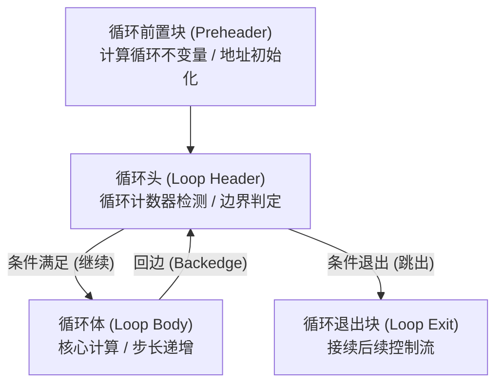
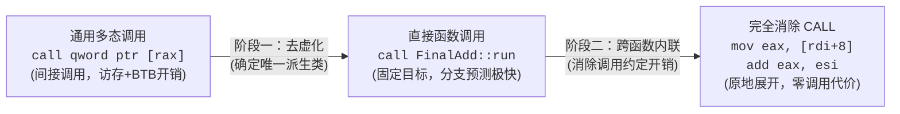

# 第 27 天：`-O3`、循环优化与去虚化

> **核心目标**：深入理解现代工业级编译器在 `-O3` 激进优化等级下的核心行为。从硬件流水线与向量寄存器视角掌握**循环展开（Loop Unrolling）**、**SIMD 自动向量化（Auto-vectorization）**与**循环不变量外提（LICM）**的底层汇编表征；从 Itanium C++ ABI 规范切入，剖析多态对象内存布局、虚表指针（vptr）与虚表（vtable）的间接调用机制；追踪编译器如何利用类型传播、`final` 约束与 LTO（链接时优化）实现**去虚化（Devirtualization）**直至彻底内联。

---

## 【📌 一句话核心概括】
**`-O3` 优化等级以牺牲二进制代码体积为代价追求极致运行吞吐，通过激进循环展开减少分支跳转、利用 SIMD 向量寄存器（如 AVX2 YMM）实现单指令多数据并行处理，并通过静态类型推导与去虚化（Devirtualization）消除多态虚表间接寻址并触发深度内联。**

## 【📖 通俗原理解释】
- **循环展开（Loop Unrolling）的利弊权衡**：标量循环每次迭代都伴随自增、边界比较与条件跳转。循环展开将多次迭代的运算在单次循环体内顺序铺开，大幅削减跳转与分支预测开销；但过度铺开会导致指令体积剧增，超出 CPU 的 L1 指令缓存（I-Cache）容量引发缺失，降低执行速度。
- **SIMD 自动向量化（Auto-vectorization）**：利用宽位宽硬件向量寄存器（如 256 位 AVX2 `ymm` 寄存器），一条向量指令（如 `vpaddd`）可并行计算 8 个 32 位整数。编译器在进入向量主循环前生成运行时别名与对齐检查，在无法被整除时生成标量收尾循环（Epilogue Loop）处理零头元素。
- **C++ 虚函数机制与间接跳转开销**：在 Itanium C++ ABI 下，多态对象的首个 8 字节为虚表指针（`vptr`），调用虚函数需要先加载 `vptr`，索引到虚函数表（`vtable`），再执行间接调用（`call [rax]`）。该机制需要多轮内存解引用且难以被 CPU 分支预测器完全预测。
- **去虚化（Devirtualization）与完全内联**：当编译器结合类型推导、`final` 关键字或全程序链接时优化（LTO）确定目标具体派生类型时，会将间接调用降级为直接函数调用（`call Derived::func`）；若函数体简短，进一步将其代码直接在调用处内联展开，使运行期的虚表寻址开销与函数调用开销完全归零。

---

## 一、`-O3` 的工程定位与优化全景

现代 GCC / Clang 优化体系是一套严格分级的管线。许多初学者常误以为“`-O3` 一定比 `-O2` 跑得快”，这是严重的工程误区：

```text
优化等级梯队定位：
[-O0] 调试基准   --> 禁用优化，严格按源码指令逐行映射，方便单步调试与设断点
  │
[-O1] 基础优化   --> 开启死代码消除、常数折叠，保证编译速度与调试可用性平衡
  │
[-O2] 工业生产基石 --> 开启跨基本块分析、寄存器分配、函数内联、指令调度，追求极佳性能且严格控制体积
  │
[-O3] 激进吞吐优先 --> 允许以显著膨胀二进制体积（Code Bloat）为代价，换取最大执行吞吐量
                    * 激进循环展开 (Loop Unrolling)
                    * 自动向量化 (Tree-Loop & SLP Auto-Vectorization)
                    * 激进跨过程去虚化 (Aggressive Devirtualization)
                    * 循环切分、预测性条件外提 (Loop Splitting & Unswitching)
```

### 为什么 `-O3` 不保证一定更快？
1. **指令缓存污染（I-Cache Thrashing）**：过于激进的循环展开与函数内联会导致机器码体积爆炸，超出 L1 指令缓存容量（通常仅 32KB/64KB），引发严重的 Cache Miss。
2. **寄存器溢出（Register Spilling）**：向量化与展开暴露出大量并行活跃变量，当架构通用寄存器（x86-64 为 16 个）耗尽时，编译器被迫将中间值压入栈内存，访存延迟反而抵消了计算收益。
3. **向量化前置与尾部惩罚**：当数组长度极短或数据未对齐时，执行运行期对齐探测、别名检查及收尾标量循环的开销甚至超过了纯标量循环。

---

## 二、循环结构与控制流图（CFG）解剖

在深入汇编之前，必须建立编译器眼中循环的基本块（Basic Block, BB）拓扑模型：



- **循环前置块（Preheader）**：紧邻循环头之前的基本块，用于放置**循环不变量外提（LICM）**的代码。
- **循环头（Loop Header）**：循环的唯一主入口，通常包含循环终结条件分支指令。
- **循环体（Loop Body）**：实际执行计算工作的指令序列。
- **回边（Backedge）**：从循环体内跳回循环头的无条件或条件跳转指令（例如 `jmp`、`jne`）。
- **循环退出块（Exit Block）**：当边界条件不满足时，控制流脱离循环的汇编出口。

---

## 三、三大经典循环优化机制深入剖析

### 1. 循环不变量外提（LICM - Loop-Invariant Code Motion）
若循环体内某表达式的值在整个循环生命周期内保持恒定，编译器会将其提升至循环前置块中仅执行一次：

```c
// 源代码
for (size_t i = 0; i < n; ++i) {
    a[i] = (x * y) + b[i];  // (x * y) 每次循环计算完全相同
}

// 编译器经过 LICM 变换后的等价语义
int temp = x * y;           // 提入 Preheader，仅计算 1 次
for (size_t i = 0; i < n; ++i) {
    a[i] = temp + b[i];
}
```
**阻止 LICM 的工业级陷阱**：
- **指针别名（Pointer Aliasing）**：如果写操作 `a[i] = ...` 可能覆盖 `x` 或 `y` 所在的内存空间，编译器无法保证 `x * y` 不变，被迫在循环内每次重新乘算。使用 C99 的 `restrict` 关键字可向编译器承诺指针不重叠。
- **隐式副作用与 `volatile`**：若表达式包含外部非纯函数调用或读取 `volatile` 变量，外提将被完全阻断。

### 2. 循环展开（Loop Unrolling）
循环控制包含维护索引、自增、边界比较、条件跳转。展开通过增加每次迭代中的计算量，摊薄循环控制开销：

```c
// 未展开 (8 次分支预测与跳转)
for (int i = 0; i < 8; ++i) sum += a[i];

// 展开因子 4 (仅需 2 次循环控制判定，并激活 CPU 指令级并行 ILP)
for (int i = 0; i < 8; i += 4) {
    sum += a[i];
    sum += a[i+1];
    sum += a[i+2];
    sum += a[i+3];
}
```

### 3. SIMD 自动向量化（Auto-Vectorization）
利用现代 CPU 的 SIMD 扩展（如 x86 的 SSE/AVX/AVX2/AVX-512，ARM 的 NEON/SVE），一条指令并行处理多个数据通道：

| 架构 / 向量扩展 | 核心寄存器 | 寄存器宽度 | 容纳 32 位整型/浮点数个数 | 典型加法指令 |
| :--- | :--- | :--- | :--- | :--- |
| **x86 SSE2 ~ SSE4** | `xmm0` ~ `xmm15` | 128 位 (16 字节) | 4 个 | `paddd`, `addps` |
| **x86 AVX / AVX2** | `ymm0` ~ `ymm15` | 256 位 (32 字节) | 8 个 | `vpaddd`, `vaddps` |
| **x86 AVX-512** | `zmm0` ~ `zmm31` | 512 位 (64 字节) | 16 个 | `vpaddd`, `vaddps` |
| **ARM64 NEON** | `v0` ~ `v31` | 128 位 (16 字节) | 4 个 | `add.4s` |

> [!WARNING] **关键汇编辨析：标量 vs 向量指令**
> - `vaddss xmm0, xmm0, xmm1`：注意末尾是 `ss`（Scalar Single），**这是标量运算**，仅计算 XMM 寄存器最低 32 位浮点数！
> - `vaddps ymm0, ymm0, ymm1`：末尾是 `ps`（Packed Single），**这才是向量运算**，同时对 8 个单精度浮点数做加法！
> - `vpaddd ymm0, ymm0, ymm1`：`p` 代表 Packed，`d` 代表 Doubleword（32位整数），对 8 个 32 位整型并行求和。

---

## 四、标量与向量汇编实战对比跟踪

以经典数组求和函数为例：

```c
#include <stdint.h>
#include <stddef.h>

uint32_t sum_u32(const uint32_t *a, size_t n) {
    uint32_t sum = 0;
    for (size_t i = 0; i < n; ++i) {
        sum += a[i];
    }
    return sum;
}
```

### 1. `-O2` 标量优化（循环展开，展开因子 4）
```asm
.LBB0_3: # 循环体 (地址每次自增 16 字节，计算 4 个 32位元素)
    add     eax, dword ptr [rdi + 4*rcx]
    add     eax, dword ptr [rdi + 4*rcx + 4]
    add     eax, dword ptr [rdi + 4*rcx + 8]
    add     eax, dword ptr [rdi + 4*rcx + 12]
    add     rcx, 4
    cmp     rcx, rsi
    jb      .LBB0_3
```
- `eax` 维持标量累加和，每次循环步长为 4（索引递增 4，字节偏移步进 16）。
- 依旧依赖标量 ALU 进行串行累加。

### 2. `-O3 -mavx2` 向量化汇编（向量主循环 + 标量收尾循环）
```asm
    vpxor   xmm0, xmm0, xmm0        # 清零 ymm0 累加器
.L_vector_loop:
    vpaddd  ymm0, ymm0, ymmword ptr [rdi + rcx*4]  # 一次性读入 8 个 uint32_t 并行累加！
    add     rcx, 8                                  # 循环步长递增 8 (32 字节)
    cmp     rdx, rcx                                # 与向量迭代上限比较
    ja      .L_vector_loop

# 向量水平归约 (Horizontal Reduction)：将 ymm0 中 8 个通道的和折叠为一个标量
    vextracti128 xmm1, ymm0, 1
    vpaddd  xmm0, xmm0, xmm1
    vpshufd xmm1, xmm0, 78
    vpaddd  xmm0, xmm0, xmm1
    vpshufd xmm1, xmm0, 229
    vpaddd  xmm0, xmm0, xmm1
    vmovd   eax, xmm0               # 归约结果提取至标量寄存器 eax

# 标量收尾循环 (Epilogue / Tail Loop) 处理 n % 8 剩余元素
.L_scalar_tail:
    add     eax, dword ptr [rdi + rcx*4]
    inc     rcx
    cmp     rcx, rsi
    jb      .L_scalar_tail
```
- **核心步长**：每次迭代读取 `ymmword ptr`（32 字节），步长为 8 个元素。
- **水平归约**：SIMD 寄存器内部数据是并行的，循环结束后需通过置换与折叠（Shuffle & Reduction）汇入标量返回寄存器 `eax`。
- **收尾循环**：由于输入长度 `n` 不一定是 8 的倍数，编译器必须在末尾补充处理标量余数的循环，保证逻辑绝对正确。

---

## 五、Itanium C++ ABI 多态模型与虚表机制

在深入去虚化之前，必须掌握 Linux x86-64 下 Itanium C++ ABI 规范中多态对象的物理内存布局：

```cpp
class Base {
public:
    virtual int run(int x) const = 0;
    virtual ~Base() = default;
};

class FinalAdd final : public Base {
private:
    int delta_;
public:
    explicit FinalAdd(int delta) : delta_(delta) {}
    int run(int x) const override { return x + delta_; }
};
```

### 1. 单继承对象的内存布局与对齐计算
`FinalAdd` 对象包含虚指针 `vptr` 和成员变量 `delta_`：

```text
FinalAdd 实例内存拓扑 (共 16 字节，8 字节对齐):
┌────────────────────────┬───────────────────┬───────────────────┐
│ [0..7 字节]            │ [8..11 字节]      │ [12..15 字节]     │
│ vptr (指向虚表入口点)  │ int delta_        │ 结构体尾部填充字节│
│ 8 字节指针             │ 4 字节数据        │ (Tail Padding, 4B)│
└────────────────────────┴───────────────────┴───────────────────┘
```
- **推导公式**：`align_up(8 + 4, 8) = 16 字节`。
- `vptr` 存放在对象首地址（偏移 0），指向只读数据段（`.rodata`）中属于该类的虚函数表（`vtable`）。

### 2. 标准虚调用（间接调用）汇编执行链
对于通用多态调用：
```cpp
int dispatch_unknown(const Base &object, int x) {
    return object.run(x) + 1;
}
```
其未经去虚化的标准汇编调用序列（System V AMD64 ABI）：
```asm
dispatch_unknown:
    sub     rsp, 8                  # 调整栈顶保持 16 字节对齐
    mov     rax, qword ptr [rdi]    # 1. 解引用对象首地址，加载 vptr 到 rax (rax = &vtable)
    call    qword ptr [rax]         # 2. 间接调用：读取 vtable[0] 中的函数指针并跳转
    add     rsp, 8
    add     eax, 1                  # 返回值 + 1
    ret
```
> **间接调用的性能代价**：
> 1. **双重访存解引用**：`*this` -> `vptr` -> `vtable[slot]` -> 指令目标。
> 2. **流水线停顿（Pipeline Stall）**：CPU 分支目标缓冲器（BTB）必须预测间接跳转目标，预测失败将引发整个流水线深度冲刷（Flush）。

---

## 六、去虚化（Devirtualization）的两阶段演进

**去虚化**是编译器通过静态类型推导，证明在某个多态调用点实际调用的函数是唯一确定的，从而将昂贵的间接调用优化为廉价的直接调用，乃至完全内联的过程。



### 1. 阶段一：间接调用变为直接调用
当编译器能够证明变量的具体派生类型（例如在同一作用域内刚构造的对象，或通过静态传播推导出指针归属）：
```cpp
int test(int x) {
    FinalAdd object(7);
    Base *p = &object;
    return p->run(x);
}
```
汇编直接锁定 mangled 函数名：
```asm
    call    _ZNK8FinalAdd3runEi     # 直接调用 FinalAdd::run(int) const
```

### 2. 阶段二：直接调用融合并彻底内联
在 `-O2` 或 `-O3` 下，去虚化通常伴随着内联展开。由于 `FinalAdd::run` 的实现已知（仅是一句 `return x + delta_`），编译器直接消除函数调用帧与跳转：
```asm
test:
    mov     eax, esi                # eax = 参数 x
    add     eax, 7                  # 直接折叠 delta_ = 7
    ret                             # 整个 vptr 读取、虚表查找、call 彻底蒸发！
```

---

## 七、促进与阻碍去虚化的工程关键

| 促进去虚化的条件 | 底层编译机理与效果 |
| :--- | :--- |
| **`final` 关键字标记类** (`class C final`) | 编译器在语义上确定该类无法再被继承，杜绝了下游派生类覆盖虚函数的可能性。 |
| **`final` 关键字标记方法** (`virtual void f() final`) | 即使类可继承，该方法也不可被重写，任何持有该类及派生类的指针均可安全去虚化。 |
| **对象局部栈构造且未逃逸** | 对象的生命周期完全处于编译器当前控制流图可见范围内，动态类型确定无疑。 |
| **链接时优化（LTO / `-flto`）** | 突破单个编译单元（`.cpp`）的边界视野，全程序（Whole-program）扫描是否存在其他派生实现。 |
| **内部链接 / 隐藏符号（`-fvisibility=hidden`）** | 保证动态链接库外部无法派生新类注入虚表，赋予编译器封闭世界假说（Closed-world Assumption）。 |

> [!CAUTION] **阻止去虚化的典型场景**
> 1. **指针来自动态库导出接口或未知插件（`load_plugin()`）**：编译器必须为运行期加载的外部派生类保留兜底的虚表间接分派机制。
> 2. **指针发生内存逃逸（Escape Analysis 失败）**：当指针被传递给不可见的外部函数并被修改时，编译器无法继续跟踪实际动态类型。
> 3. **析构函数未标记为虚函数**：通过基类指针 `delete p` 会引发未定义行为（UB），可能破坏编译器对生命周期的假定。

---

## 八、编译器优化 vs CPU 运行时推测执行

| 维度 | 编译器优化（Compiler Optimization） | CPU 推测执行（Speculative Execution） |
| :--- | :--- | :--- |
| **发生时机** | **编译期 / 链接期（静态）** | **程序运行期（动态硬件流水线）** |
| **操作对象** | AST、GIMPLE / LLVM IR、机器汇编指令 | 微指令（$\mu$ops）、物理寄存器、流水线执行端口 |
| **优化举措** | 循环展开、向量化、常量折叠、去虚化、内联 | 分支预测（BTB/BPU）、间接调用预测、乱序执行、内存预取 |
| **失误处理** | 遵循 As-if 规则，静态证明必须 100% 严谨，失误即编译 Bug | 预测失败自动回滚体系结构状态（冲刷流水线），带来延迟惩罚 |

---

## 九、实验验证与逆向实战手册

### 1. 验证编译指令集
```bash
# 1. 观察标量循环与展开 (-O2)
gcc -std=c17 -O2 -S -masm=intel loop.c -o loop_O2.s

# 2. 观察激进向量化 (-O3 + AVX2) 并输出向量化诊断报告
gcc -std=c17 -O3 -mavx2 -fopt-info-vec-all -S -masm=intel loop.c -o loop_O3_avx2.s

# 3. 观察 C++ 虚调用汇编 (-O0 vs -O3)
g++ -std=c++20 -O0 -S -masm=intel virtual.cpp -o virtual_O0.s
g++ -std=c++20 -O3 -S -masm=intel virtual.cpp -o virtual_O3.s

# 4. 隔离观察：仅启用去虚化，暂时禁止内联
g++ -std=c++20 -O3 -fno-inline -S -masm=intel virtual.cpp -o virtual_noinline.s

# 5. 全程序链接时优化 (LTO) 验证
g++ -std=c++20 -O3 -flto virtual.cpp -o virtual_lto
objdump -d -Mintel -C virtual_lto | grep -A 10 "dispatch_unknown"
```

### 2. GDB 动态检查虚表与 vptr 证据
```gdb
(gdb) set disassembly-flavor intel
(gdb) break main
(gdb) run
(gdb) ptype /o FinalAdd              # 打印 FinalAdd 成员物理内存偏移与对齐
(gdb) print object                   # 打印多态对象的动态真实类型
(gdb) info vtbl object               # 打印对象关联的虚表地址与槽位函数映射
(gdb) x/2gx &object                  # 打印对象首部 16 字节，验证前 8 字节是否为 vptr
(gdb) x/3gx *(void**)&object         # 顺藤摸瓜：打印虚表内部存储的虚函数物理入口地址
```

---

## 十、口头验收与面试高频题

1. **循环展开与自动向量化的本质区别是什么？**
   - *展开*改变的是控制流结构，通过复制循环体消除跳转与比较指令，提升 ILP，属于标量域。
   - *向量化*改变的是执行数据流，使用 SIMD 向量寄存器（如 YMM），单条指令并行计算多个独立数据元素。
2. **在汇编中看到 `vaddss xmm0, xmm0, xmm1` 是否意味着循环已被向量化？为什么？**
   - 否！`vaddss` 末尾的 `ss` 代表 Scalar Single（标量单精度），仅计算最低 32 位数据。只有看到 `vaddps`（Packed Single）或 `vpaddd`（Packed Doubleword）且伴随步长大于 1 时才是真正的向量化。
3. **为什么多态基类的析构函数必须声明为 `virtual`？**
   - 当通过基类指针 `delete p` 释放派生类对象时，如果析构函数非虚，编译器将执行静态绑定仅调用基类析构函数，导致派生类特有资源泄漏且属于未定义行为（UB）。
4. **C++ 中的去虚化为什么常常导致汇编中连 `call` 指令都彻底消失？**
   - 去虚化第一步将动态间接调用转化为目标确定的直接函数调用；随后编译器的内联管线（Inlining Pass）介入，将小函数体直接在调用点原地平铺展开，从而消除了 `call` 与栈帧开销。
5. **为什么 `-O3` 编译出来的二进制运行速度有时反而不如 `-O2`？**
   - 激进的展开和内联造成机器码体积剧烈膨胀，击穿 CPU 的 L1 指令缓存（I-Cache Miss）；活跃变量增多导致通用寄存器耗尽产生内存溢出（Spill）；且小规模短数组无法摊薄向量化前置与收尾开销。