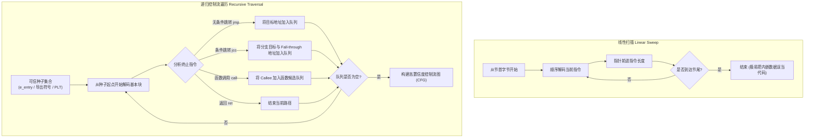
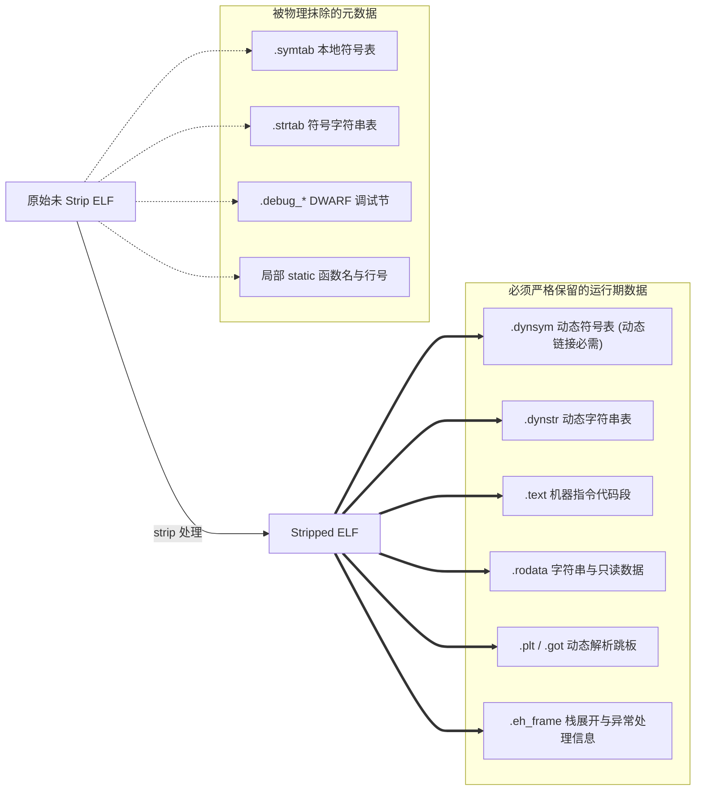

# 第 28 天：`objdump` 静态分析进阶

> **核心目标**：掌握在没有源代码、符号表被完全剥离（Stripped）的逆向工程场景下，使用 GNU Binutils 工具链（特别是 `objdump` 与 `readelf`）系统化恢复 ELF 二进制控制流与函数边界的工业级方法论。透彻理解 x86-64 变长指令集的反汇编脆弱性，掌握 Intel 与 AT&T 语法对照、`call rel32` 与 RIP 相对寻址的手工数学推导，构建基于入口点、直接调用集合、`.rodata` 字符串交叉引用及 `.eh_frame` 展开帧的置信度分级分析体系。

---

## 【📌 一句话核心概括】
**`objdump` 是基于线性扫描或符号表的静态反汇编与段解析利器，在处理符号剥离（Stripped）ELF 时，必须结合递归遍历思维、`call rel32` 与 RIP 相对寻址计算公式（`Target = Next_RIP + Disp32`）、以及 `.dynsym` 和 `.rodata` 交叉引用来重构函数边界与控制流。**

## 【📖 通俗原理解释】
- **线性扫描（Linear Sweep）与假反汇编陷阱**：x86-64 是变长指令集（1~15 字节），若反汇编器直接从任意字节流起始线性解码（如使用 `-D` 强行反汇编数据段），内嵌的字符串或跳转表数据会被荒谬地解码为合法指令。高质量分析必须依赖确定种子（入口点 `e_entry`、导出符号、PLT 条目）进行递归控制流遍历。
- **符号剥离（Strip）的真实影响范围**：`strip --strip-all` 仅剥离供开发调试使用的静态符号表（`.symtab`）和字符串表（`.strtab`），但绝不能删除动态符号表（`.dynsym`）和动态重定位表，否则运行时动态链接器将无法解析共享库函数。可执行机器码与常量字符串完好无损。
- **`call rel32` 寻址的基准点与小端解码**：指令操作码 `E8 [disp32]` 是相对于**下一条指令的起始地址（Next RIP）**的有符号偏移量。解码时，必须按小端序将 4 字节偏移拼接为有符号 32 位整数（补码），通过公式 `Target = Address_of_Call + 5 + disp32` 精准计算目标跳转地址。
- **无符号函数边界恢复方法**：在没有符号表的情况下，通过识别经典的函数序言（`push rbp; mov rbp, rsp` 或 `endbr64`）、尾声指令（`leave; ret`）、以及结合 `.eh_frame`（C++ 异常展开元数据）中记录的 FDE（帧描述项）精确起止范围，即可在剥离符号的二进制中完整圈定各私有函数边界。

---

## 一、反汇编原理：线性扫描 vs 递归遍历



### 1. 变长指令集的反汇编偏离危险
在 x86-64 体系下，机器码字节序列高度稠密。假设有以下机器码字节：
```text
48 89 e5
```
- 若从偏移 0 解码：`48 89 e5` 对应 `mov rbp, rsp`（64 位寄存器传送，典型栈帧序言）。
- 若从偏移 1 解码：`89 e5` 对应 `mov ebp, esp`（32 位寄存器传送，操作完全不同）。

> [!CAUTION] **`-d` 与 `-D` 的工程红线**
> - `objdump -d`：仅反汇编 ELF 头中被标记为包含可执行代码的节（如 `.text`, `.plt`, `.init`）。
> - `objdump -D`：**盲目反汇编所有节**（包括数据节 `.rodata`, `.data`）。`.rodata` 里的文本字符串、浮点常量、跳转表都会被强制翻译成看似合理的伪造指令，产生极其严重的误导。绝不能把 `-D` 当作“更强力的反汇编”！

---

## 二、Intel 与 AT&T 汇编语法深度对照

逆向分析必须在第一时间锁定反汇编语法，避免方向性倒置：

| 语法特征 | Intel 语法（逆向工业标准 / `-M intel`） | AT&T 语法（GNU 传统默认标准） | 语义与核心注意点 |
| :--- | :--- | :--- | :--- |
| **操作数顺序** | **`目标, 源`**（Dest, Src） | **`源, 目标`**（Src, Dest） | **致命反转**：`mov eax, ebx` 在两边语义相反！ |
| **寄存器前缀** | 无前缀：`rax`, `ebx` | 带 `%` 前缀：`%rax`, `%ebx` | AT&T 必须加 `%` |
| **立即数前缀** | 无前缀：`10`, `0x20` | 带 `$` 前缀：`$10`, `$0x20` | 无 `$` 的数字在 AT&T 中表示绝对内存地址！ |
| **内存寻址格式** | `[base + index*scale + disp]` | `disp(base, index, scale)` | 括号与位移位置相反 |
| **操作数宽度指明** | 显式修饰符：`DWORD PTR [rax]` | 指令助记符后缀：`movl`, `movq` | `b`(8B), `w`(16B), `l`(32B), `q`(64B) |

### 复杂寻址转换推演
C 语言数组下标访问：`int value = array[i + 2];`（假设 `sizeof(int) = 4`）
- **Intel 语法**：
  ```asm
  mov eax, DWORD PTR [rdi + rsi*4 + 8]
  ```
  - `rdi` 是基址（`array`），`rsi` 是索引（`i`），比例因子为 4，位移量为 $2 \times 4 = 8$ 字节。从该内存地址读取 4 字节注入 `eax`。
- **AT&T 语法**：
  ```asm
  movl 8(%rdi, %rsi, 4), %eax
  ```

---

## 三、`objdump` 核心参数工程实践矩阵

```bash
# 工业级反汇编黄金组合命令
objdump -drwC -M intel <target_elf>
```

| 参数选项 | 全称与功能 | 逆向实战场景意义 |
| :--- | :--- | :--- |
| **`-d`** | `--disassemble` | 仅反汇编可执行指令节，杜绝数据误解码。 |
| **`-r`** | `--reloc` | 显示**静态重定位记录**。在分析未链接的 `.o` 目标文件时，查看外部符号调用留下的重定位孔洞。 |
| **`-R`** | `--dynamic-reloc` | 显示**动态重定位记录**。分析已链接可执行文件或 `.so` 时，查看 PLT/GOT 导入的动态符号地址绑定项。 |
| **`-w`** | `--wide` | 宽屏输出，不自动换行折叠过长的指令和操作数，保证脚本处理和排版整齐。 |
| **`-C`** | `--demangle` | 自动还原 C++ 符号修饰（Mangling），将 `_ZNK8FinalAdd3runEi` 还原为人类可读的 `FinalAdd::run(int) const`。 |
| **`-M intel`** | `--disassembler-options=intel` | 强制使用 Intel 汇编格式输出。 |
| **`-s -j .rodata`** | `--full-contents -j <section>` | 以十六进制和 ASCII 打印指定只读数据段的内容，排查未混淆的常量字符串。 |

---

## 四、Strip 机制与动态符号保留法则

当使用 `strip --strip-all target` 处理 ELF 文件时：



> [!NOTE] **为什么 Stripped 程序还能看到 `printf` 和 `strtol`？**
> 这是动态链接的根本机制所决定的。程序如果想在运行期由 `ld-linux-x86-64.so` 将标准 C 库装载并解析函数地址，就必须将待解析符号保留在 `.dynsym` 中。
> **结论**：在 Stripped ELF 中，所有私有函数名字全部丢失（显示为 `00000000004011e0 <.text+0xf0>`），但动态库接口名依然完整可见！

---

## 五、两类关键相对寻址的底层数学推导

### 1. `call rel32` 相对函数调用目标计算
一条直接函数调用机器指令：
```text
0x4011e4: e8 f1 ff ff ff    call 0x4011da
```
- **操作码**：`0xE8` 代表相对 32 位有符号近调用（`call rel32`）。
- **立即数编码**：`f1 ff ff ff`。按照 x86 小端序解码为 `0xfffffff1`。
- **补码计算**：`0xfffffff1` 最高位为 1，是有符号负数：
  $$\text{Offset} = 0xfffffff1 - 2^{32} = -15 = -0x0F$$
- **基准地址**：当前指令长度为 5 字节，下一条指令地址为：
  $$\text{RIP}_{\text{next}} = 0x4011e4 + 5 = 0x4011e9$$
- **跳转目标计算黄金法则**：
  $$\text{Target} = \text{RIP}_{\text{next}} + \text{Offset} = 0x4011e9 + (-0x0F) = 0x4011da$$

### 2. RIP 相对数据寻址（加载 `.rodata` 字符串）
在 64 位位置无关代码中，访问常量字符串通常采用 RIP 相对寻址：
```text
0x401218: 48 8d 05 e5 0d 00 00    lea rax, [rip + 0xde5]
```
- 当前指令地址 `0x401218`，指令长度 7 字节，下一条指令地址：
  $$\text{RIP}_{\text{next}} = 0x401218 + 7 = 0x40121f$$
- 目标物理虚拟地址：
  $$\text{Address} = 0x40121f + 0x0de5 = 0x402004$$
- **交叉验证**：查看 `.rodata` 节在 `0x402004` 偏移处的内容，恰好是 ASCII 字符串 `"negative\0"`！
- **重要辨析**：`lea` 仅执行地址算术计算，**绝不读取目标内存**！

---

## 六、Stripped ELF 控制流恢复十步作战流程

```text
[阶段 1: 确定架构与基址]
  ① file target                   --> 确认架构 (x86-64)、端序 (LSB)、动态/静态、PIE/Non-PIE
  ② readelf -hW target            --> 锁定 ELF 入口点 Entry point (e_entry)
  ③ objdump -h target             --> 绘制节物理地图 (.text, .rodata, .plt, .got, .eh_frame)

[阶段 2: 锚定外部世界接口]
  ④ objdump -T / readelf --dyn-syms --> 提取 UND 导入函数清单 (strtol, printf, perror)
  ⑤ objdump -d -j .plt target    --> 建立 PLT 调用跳板物理地址映射表
  ⑥ strings -a -tx / objdump -s   --> 提取全部只读字符串及其所在节物理偏移

[阶段 3: 追踪程序真实主线]
  ⑦ 分析 e_entry 启动代码         --> 定位 _start，追踪传入 __libc_start_main 的 RDI 参数 (真实 main 地址！)
  ⑧ 提取直接 call 目标全集        --> 以 main 为起点，扫描所有 call rel32，构建初始 Callee 地址池

[阶段 4: 划分函数与逆向恢复]
  ⑨ 融合 .eh_frame FDE 范围       --> 利用栈展开边界精准校准函数起止，结合 ret/nop 确定函数边界
  ⑩ 标注结论置信度分级            --> 将证据链分类，形成确定、高概率或推测的逆向报告
```

---

## 七、函数边界判断证据链与置信度分级体系

在面对无符号二进制时，严谨的逆向工程师绝不能把猜测写成事实，必须采用置信度分级标注：

| 置信度等级 | 判别标准与核心证据链 | 典型汇编模式与应用示例 |
| :---: | :--- | :--- |
| **【确定】**<br/>(Certain) | **ELF 规范或动态链接机制明确担保的硬性元数据** | 1. ELF Header 声明的 `e_entry` 入口地址。<br/>2. `.dynsym` 与 `.plt` 共同绑定的动态跳板入口。 |
| **【高概率】**<br/>(High Probability) | **多条正交证据链相互支撑咬合** | 1. 存在直接 `call 0x4011e0` 调用，且该地址前紧邻对齐填充（`nop`）。<br/>2. `.eh_frame` 中存在与 `0x4011e0..0x4011f2` 完全匹配的 FDE 作用域。<br/>3. 控制流从该地址开始，末尾具有合法 `ret` 指令且无跨函数非正常跳转。 |
| **【猜测】**<br/>(Speculative) | **仅具有局部汇编特征，缺乏上下文支撑** | 1. 仅观察到 `push rbp; mov rbp, rsp`（优化代码常省略，且数据可能碰巧解码出该字节）。<br/>2. 仅观察到单一 `ret`（函数内可有多处提前 `ret`，尾调用更直接用 `jmp` 代替 `ret`）。 |

---

## 八、口头验收与面试高频题

1. **`objdump -d` 和 `objdump -D` 有什么根本区别？为什么逆向分析时滥用 `-D` 会带来灾难？**
   - `-d` 仅反汇编合法的代码节（`.text`），而 `-D` 盲目将所有节（包括数据节 `.rodata`、`.data`）强制翻译为指令。因为 x86-64 是变长指令集，数据字节极其容易被误解码为合法的跳转或运算指令，伪造出不存在的函数与控制流，导致严重误判。
2. **在 stripped ELF 中，为什么普通函数名不见了，却依然能看到 `printf`、`strtol` 等符号？**
   - 普通函数名存放在 `.symtab` 中，编译时仅用于静态链接与调试，会被 `strip` 彻底抹除；而 `printf` 等外部动态库函数名存放在 `.dynsym` 中，这是 Linux 运行时动态链接器 `ld.so` 进行符号解析所必需的元数据，无法被常规 strip 剔除。
3. **在 x86-64 汇编中，`call rel32` 指令计算目标函数地址时，为什么必须以“下一条指令的地址”为基准？**
   - 因为在 CPU 执行指令的硬件流水线中，取指（Fetch）阶段完成后，程序计数器（RIP）就已经自动递增指向了下一条指令的起始地址。因此指令编码中的相对偏移量（Displacement）是以递增后的新 RIP 为基准进行加法运算的。
4. **ELF 文件的 `e_entry` 入口点是 C 语言的 `main` 函数吗？逆向时如何从入口点快速定位 `main`？**
   - 不是！`e_entry` 指向的是 C 运行库提供的 `_start` 汇编入口。在 Linux x86-64 下，`_start` 会初始化栈和运行环境，并将 `main` 函数的真实物理地址装入 `RDI` 寄存器，作为第一个参数传递给 `__libc_start_main`。因此追踪传入 `__libc_start_main` 的 `RDI` 寄存器值即可锁定真实的 `main`。
5. **为什么仅仅依靠 `push rbp; mov rbp, rsp` 和 `ret` 无法准确界定函数边界？**
   - 现代编译器在 `-O1`/`-O2` 优化下会开启 `-fomit-frame-pointer`，绝大多数叶子函数完全没有上述栈帧序言；同时一个函数可能因为多分支具有多个提前返回的 `ret`，或因为尾调用优化（TCO）直接用 `jmp` 转移控制流而完全不含 `ret`。必须结合调用关系、控制流图与 `.eh_frame` 综合判定。