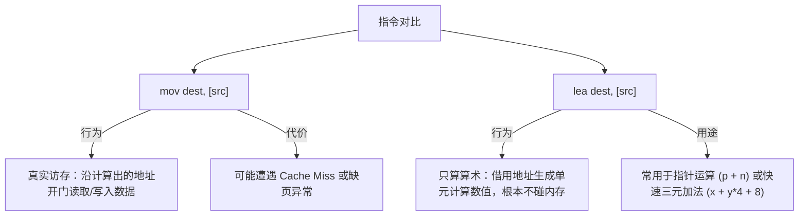

# 第 3 天：x86-64 汇编基础与寄存器手工跟踪

> **学习目标**：汇编语言不是一门脱离硬件的高级语言，而是**CPU 物理状态机运转的文字投影**。
> 今天你必须建立的核心能力是：
> * 彻底掌握 16 个通用寄存器及其 64/32/16/8 位的套娃分身与“32位写入高位清零”的硬件铁律；
> * 深刻辨析 `lea`（算地址/搞算术）与 `mov`（真访存）的本质鸿沟；
> * 理解 SIB 寻址模式（`[Base + Index*Scale + Disp]`）如何完美映射 C 语言的数组与结构体；
> * 掌握 RFLAGS 标志位（ZF, SF, CF, OF）的触发机理；
> * 能够像硬件模拟器一样，手工单步跟踪推导 18 条连续汇编指令的寄存器与标志位演进！

---

## 【📌 一句话核心概括】
**x86-64 汇编是 CPU 硬件指令流水线的符号化呈现，其计算围绕 16 个 64 位通用寄存器展开，受“32位操作自动清零高32位”硬件规则约束；通过 `mov` 实现物理访存，通过 `lea` 执行纯算术寻址，并依据运算产生的 RFLAGS 标志位驱动条件控制流。**

## 【📖 通俗原理解释】
- **寄存器与内存的分工**：寄存器是 CPU 内部纳秒级直接读写的 16 个超高速存储单元；内存则是外部大容量存储。计算本质是“从内存取数到寄存器 -> 在寄存器内执行算术逻辑 -> 将结果写回内存”。
- **32 位写入的高位截断铁律**：向 64 位寄存器的低 32 位子寄存器（如 `EAX`）写入数据时，CPU 硬件线路会**自动将对应寄存器的高 32 位清零**；但写入 16 位（`AX`）或 8 位（`AL`）时则保留高位不变。
- **`mov` 与 `lea` 的本质区别**：`mov dest, [addr]` 是**真访存**，CPU 必须真正寻址物理内存并读取该地址的内容；而 `lea dest, [base + idx*scale + disp]` 是**纯算数**，它仅复用地址生成单元（AGU）的硬件加乘电路，计算出坐标数值并赋予目标寄存器，**全程不触碰物理内存**。
- **RFLAGS 状态标志位的指示作用**：算术与比较指令在执行后，硬件自动更新标志位：`ZF`（结果是否为0）、`SF`（结果符号位是否为负）、`CF`（无符号加法进位/减法借位）、`OF`（有符号数溢出）。条件跳转指令（`je`/`jne`/`jg`/`ja`）即依据这些标志位判定是否转移。

---

# 一、CPU 运行的四个事实层级

在学习汇编时，切忌把不同层级的规则混为一谈：

```text
┌─────────────────────────────────────────────────────────────┐
│ 1. 硬件层 (Intel/AMD CPU 架构) : 指令编码、寄存器行为、高32位清零 │
├─────────────────────────────────────────────────────────────┤
│ 2. ABI 规范层 (System V AMD64) : 哪几个寄存器传参、调用约定     │
├─────────────────────────────────────────────────────────────┤
│ 3. 编译器策略层 (GCC/Clang -O) : 寄存器分配算法、内联优化、去冗余 │
├─────────────────────────────────────────────────────────────┤
│ 4. 操作系统运行时 (Linux Kernel): 虚存映射、ASLR 随机基址、信号   │
└─────────────────────────────────────────────────────────────┘
```

---

# 二、Intel 语法 vs AT&T 语法对照

Linux 下存在两种主流汇编语法：

* **Intel 语法（推荐，逆向工程行业标准，IDA / Ghidra / 本教程默认）**：
  * **目的操作数在前，源操作数在后**（形如 `Op Destination, Source`，类似 `Dest = Source`）。
  * 内存用中括号 `[...]`，无需 `%` 和 `$` 符号。
* **AT&T 语法（GUN 传统默认）**：
  * 源操作数在前，目的在后；寄存器带 `%`，立即数带 `$`。

```text
操作               Intel 语法 (直观清晰)             AT&T 语法 (古老繁琐)
寄存器赋值         mov eax, ebx                     movl %ebx, %eax
加载立即数         mov rax, 10                      movq $10, %rax
内存寻址           mov eax, [rbx + rcx*4 + 8]       movl 8(%rbx, %rcx, 4), %eax
```

---

# 三、x86-64 的 16 个通用寄存器及其嵌套分身

x86-64 拥有 16 个 64 位通用寄存器（General-Purpose Registers）。它们不是彼此割裂的，而是**俄罗斯套娃式向下兼容嵌套**：

```text
64 位寄存器: RAX (完整 64 位, 0~63)
┌───────────────────────────────┬───────────────────────────────┐
│          高 32 位              │        低 32 位: EAX          │
└───────────────────────────────┴───────────────┬───────────────┘
                                                │ 低 16 位: AX  │
                                                └───────┬───────┘
                                                │AH (8) │AL (8) │
                                                └───────┴───────┘
```

### 16 个通用寄存器完整分身对照矩阵

| 64 位完整寄存器 | 低 32 位分身 | 低 16 位分身 | 最低 8 位分身 | System V ABI 约定常见工业用途 |
| :--- | :--- | :--- | :--- | :--- |
| **`RAX`** | `EAX` | `AX` | `AL` (含 `AH`) | **函数返回值**、算术累加器 |
| **`RBX`** | `EBX` | `BX` | `BL` (含 `BH`) | 被调用者保存寄存器 (Callee-saved) |
| **`RCX`** | `ECX` | `CX` | `CL` (含 `CH`) | **第 4 个函数参数**、循环计数器、移位量 |
| **`RDX`** | `EDX` | `DX` | `DL` (含 `DH`) | **第 3 个函数参数**、除法高位扩展 |
| **`RSI`** | `ESI` | `SI` | `SIL` | **第 2 个函数参数**、字符串源地址 |
| **`RDI`** | `EDI` | `DI` | `DIL` | **第 1 个函数参数**、字符串目的地址 |
| **`RBP`** | `EBP` | `BP` | `BPL` | 栈帧基指针 (Frame Pointer) 或被调用者保存 |
| **`RSP`** | `ESP` | `SP` | `SPL` | **栈顶指针 (Stack Pointer)**，硬件绑定 push/pop |
| **`R8`** | `R8D` | `R8W` | `R8B` | **第 5 个函数参数** |
| **`R9`** | `R9D` | `R9W` | `R9B` | **第 6 个函数参数** |
| **`R10`** | `R10D` | `R10W` | `R10B` | 调用者保存寄存器、系统调用传递静态参数 |
| **`R11`** | `R11D` | `R11W` | `R11B` | 调用者保存寄存器、syscall 临时破坏 |
| **`R12` ~ `R15`** | `R12D`~`R15D` | `R12W`~`R15W` | `R12B`~`R15B` | 被调用者保存寄存器 |

> 💡 **System V AMD64 前 6 个整型传参口诀**：
> **`RDI` $\rightarrow$ `RSI` $\rightarrow$ `RDX` $\rightarrow$ `RCX` $\rightarrow$ `R8` $\rightarrow$ `R9`**
> *(谐音速记：Di, Si, Dx, Cx, 8, 9)*

---

# 四、极其致命的硬件铁律：32位写入高位清零

这是逆向分析与安全攻防中**最高频的考点与踩坑点**：

```text
 规则 A：写 32 位子寄存器（如 EAX, EBX, R8D）
 ───> 硬件强制将该寄存器的高 32 位自动全部抹零！(Zero-Extend)

 规则 B：写 16 位或 8 位子寄存器（如 AX, AL, R8W, R8B）
 ───> 仅覆盖最低的对应位，寄存器的其余所有高位完好保留不变！
```

### 实战演示推导：

```asm
mov rax, 0x1122334455667788   ; RAX = 0x1122334455667788
mov eax, 0xAABBCCDD           ; 写入 32 位子寄存器！高 32 位触发硬闸刀清零！
                              ; RAX 变成了：0x00000000AABBCCDD (而不是保留 11223344)！

mov ax, 0x1234                ; 写入 16 位！高位不动！
                              ; RAX 变成了：0x00000000AABB1234

mov al, 0xFE                  ; 写入 8 位！其余位不动！
                              ; RAX 变成了：0x00000000AABB12FE
```

> [!WARNING]
> 为什么硬件要设计“写 32 位自动清零”？
> x86-64 架构设计师为了**消除假数据依赖 (False Register Dependency)**。早期处理器在写低 32 位时若保留高 32 位，流水线就必须等待高位运算结束；设计成写入清零后，乱序执行引擎就可以立刻重命名该寄存器，大幅提升指令吞吐量！

---

# 五、内存寻址核心：SIB 格式与寻址宽度

## 1. SIB 寻址万能公式

x86 架构拥有非常强大的硬件寻址解码电路：

$$\text{有效物理地址} = \text{Base} + (\text{Index} \times \text{Scale}) + \text{Displacement}$$

* **`Base`（基址寄存器）**：任何 64 位通用寄存器（如 `RDI`, `RBP`, `RSP` 等）。
* **`Index`（索引寄存器）**：任何通用寄存器（除 `RSP` 不能当 Index 外）。
* **`Scale`（比例因子）**：只能是 **`1, 2, 4, 8`** 四个固定硬件常数（分别对应 `char`, `short`, `int`, `long/指针` 的宽度）。
* **`Displacement`（位移偏移量）**：固定立即数（正负数均可）。

```asm
mov eax, [rdi + rsi*4 + 8]
```
> **大白话语义**：
> 假设 `RDI` 是一个包含 `struct { int header; int arr[10]; }` 的结构体指针，`RSI` 是索引 $i$：
> 上述指令就是直接一步到位读取：`struct->arr[i]`！

---

## 2. 内存宽度限定词（修饰语）

当源操作数和目的操作数无法推断大小时，必须加宽度修饰词：

* **`byte ptr`**：1 字节（对应 C 的 `char` / `uint8_t`）
* **`word ptr`**：2 字节（对应 C 的 `short` / `uint16_t`）
* **`dword ptr`**：4 字节（Double Word，对应 C 的 `int` / `float`）
* **`qword ptr`**：8 字节（Quad Word，对应 C 的 `long` / 指针 / `uint64_t`）

```asm
mov byte ptr [rax], 0x11      ; 往内存写 1 个字节
mov dword ptr [rax], 0x112233 ; 往内存写 4 个字节 (小端序存储)
```

---

# 六、`lea` 与 `mov`：本质区别彻底厘清



### 实战对比：
假设：`RBX = 0x1000`，物理内存 `0x1008` 处存放着数据 `0x55`。

1. **执行 `mov rax, [rbx + 8]`**：
   * 计算地址：$0x1000 + 8 = 0x1008$；
   * 发起总线读操作，去地址 `0x1008` 处捞出内容；
   * **结果：`RAX = 0x55`**。
2. **执行 `lea rax, [rbx + 8]`**：
   * 计算地址：$0x1000 + 8 = 0x1008$；
   * 停止！**不访问物理内存**，直接将数字 `0x1008` 写进 `RAX`；
   * **结果：`RAX = 0x1008`**。

> 💡 **编译器骚操作**：
> 编译器极度喜欢用 `lea` 做普通四则运算，因为一条指令就能完成乘加法且**不污染标志位**：
> ```asm
> lea eax, [rdi + rdi*2] ; 极其高效地计算 EAX = RDI * 3
> ```

---

# 七、常用运算、扩展与分支控制指令

## 1. 扩展指令：零扩展 vs 符号扩展

当要把一个短数据（如 8 位 `char`）搬运到一个大寄存器（如 64 位 `RAX`）时：

* **`movzx` (Move with Zero-Extend 零扩展)**：
  用于**无符号数**。多出来的全部高位直接补 `0`。
  ```asm
  movzx eax, byte ptr [rdi] ; 读入 1 字节无符号数，高位全补 0 填充为 32 位
  ```
* **`movsx` / `movsxd` (Move with Sign-Extend 符号扩展)**：
  用于**有符号数**。根据短数据的最高符号位（正数补 0，负数全补 1）扩展。
  ```asm
  ; 假设 [rdi] 存放的是 0xFE (-2)
  movsx rcx, byte ptr [rdi] ; RCX 变为 0xFFFFFFFFFFFFFFFE (-2 的 64 位补码)
  ```

---

## 2. 算术与位运算指令

| 指令 | 语法 | 行为 | 标志位影响 |
| :--- | :--- | :--- | :--- |
| **`add / sub`** | `add dst, src` | `dst = dst + src` / `dst - src` | 刷新 ZF, SF, CF, OF |
| **`inc / dec`** | `inc dst` | `dst = dst + 1` / `dst - 1` | 刷新 ZF, SF, OF，**但保持 CF 不变！** |
| **`xor`** | `xor dst, src` | 按位异或。`xor eax, eax` 为**最快清零习惯用法** | 强制清零 CF=0, OF=0，刷新 ZF |
| **`shl / shr`** | `shl dst, n` | 逻辑左移/逻辑右移（高位或低位补 0） | 移出的最后一位送入 CF |
| **`sar`** | `sar dst, n` | **算术右移**（右移时高位复制符号位，维持正负） | 有符号除以 $2^n$ 时使用 |

---

## 3. 条件判断与 RFLAGS 标志位

* **`cmp a, b`**：底层等价于计算 `a - b`，**丢弃计算结果，只刷新 RFLAGS 标志位**。
* **`test a, b`**：底层等价于计算 `a & b`，**丢弃结果，只刷新 ZF 和 SF**。
  > 经典用法：`test rax, rax` 用来检查 `RAX` 是否为 0 或负数（比 `cmp rax, 0` 编码更短、速度更快）。

### 条件跳转指令根据标志位决策表

| 条件跳转指令 | 含义 | 触发标志位条件 | 适用场景 |
| :--- | :--- | :--- | :--- |
| **`je / jz`** | 等于 / 为零则跳 | `ZF == 1` | 判等、判断为 NULL |
| **`jne / jnz`** | 不等于 / 非零则跳 | `ZF == 0` | 循环判断、非空校验 |
| **`jl / jg`** | 小于 / 大于则跳 | 依赖 `SF` 和 `OF` | **有符号整数比较** |
| **`jb / ja`** | 低于 / 高于则跳 | 依赖 `CF` | **无符号整数 / 地址大小比较** |

---

# 八、手工单步推导实战：18 条核心指令状态机

以下是逆向工程中极具代表性的 18 条连续指令。
**初始已知状态**：
* `RSP = 0x2000`
* `RDI = 0x1000`
* `RSI = 2`
* 物理内存 `0x1010` 处连续 4 字节为：`0xFE, 0xFF, 0xFF, 0xFF`

```asm
1:  mov rax, 0x1122334455667788
2:  mov eax, 0xAABBCCDD
3:  mov ax, 0x1234
4:  mov al, 0xFE
5:  mov ebx, dword ptr [rdi + rsi*4 + 8]
6:  movsx rcx, bl
7:  lea rdx, [rdi + rsi*8 + 16]
8:  add rcx, 3
9:  shl rcx, 1
10: xor r8d, r8d
11: mov r8b, cl
12: and r8d, 0xFF
13: sub r8d, 4
14: inc r8d
15: mov qword ptr [rsp - 8], rax
16: lea rsp, [rsp - 8]
17: mov r9, qword ptr [rsp]
18: lea rsp, [rsp + 8]
```

### 逐条推导全记录与状态转移表：

| 指令行号与汇编代码 | 涉及目标寄存器 | 运算过程深度推导 | 最终该寄存器 64 位完整值 | 标志位状态 |
| :--- | :--- | :--- | :--- | :--- |
| **1: `mov rax, 0x11...`** | `RAX` | 直接装载 64 位立即数 | `0x1122334455667788` | 标志位不受 mov 影响 |
| **2: `mov eax, 0xAABBCCDD`** | `RAX` | **32 位写入铁律生效！高 32 位强制抹零！** | `0x00000000AABBCCDD` | 保持 |
| **3: `mov ax, 0x1234`** | `RAX` | 写入低 16 位，其余位保持不变 | `0x00000000AABB1234` | 保持 |
| **4: `mov al, 0xFE`** | `RAX` | 写入最低 8 位，其余位保持不变 | `0x00000000AABB12FE` | 保持 |
| **5: `mov ebx, [rdi+rsi*4+8]`**| `RBX` | 地址=$0x1000+2\times 4+8=0x1010$。小端读入 `0xFFFFFFFE`，写 32 位清高位 | `0x00000000FFFFFFFE` | 保持 |
| **6: `movsx rcx, bl`** | `RCX` | `BL=0xFE`（有符号-2），符号扩展到 64 位（高位全填 1） | `0xFFFFFFFFFFFFFFFE` | 保持 |
| **7: `lea rdx, [rdi+rsi*8+16]`**| `RDX` | **只做算术，不碰内存**：$0x1000 + 2\times 8 + 16 = 0x1020$ | `0x0000000000001020` | 保持 |
| **8: `add rcx, 3`** | `RCX` | $-2 + 3 = 1$。产生无符号第 65 位进位 | `0x0000000000000001` | ZF=0, SF=0, **CF=1**, OF=0 |
| **9: `shl rcx, 1`** | `RCX` | 逻辑左移 1 位：$1 \times 2 = 2$ | `0x0000000000000002` | ZF=0, SF=0, CF=0, OF=0 |
| **10: `xor r8d, r8d`** | `R8` | 自身异或清零，同时清空 R8 高 32 位 | `0x0000000000000000` | **ZF=1**, SF=0, CF=0, OF=0 |
| **11: `mov r8b, cl`** | `R8` | 将 `CL`（2）写入 `R8B`，mov 不改标志 | `0x0000000000000002` | 保持上一条的 ZF=1 |
| **12: `and r8d, 0xFF`** | `R8` | $2\ \&\ 0xFF = 2$，刷新标志位 | `0x0000000000000002` | **ZF=0**, SF=0, CF=0, OF=0 |
| **13: `sub r8d, 4`** | `R8` | 32 位无符号计算：$2 - 4 = -2$，清零高位 | `0x00000000FFFFFFFE` | ZF=0, **SF=1, CF=1**, OF=0 |
| **14: `inc r8d`** | `R8` | $-2 + 1 = -1$。**注意：inc 绝对不改动 CF！** | `0x00000000FFFFFFFF` | ZF=0, **SF=1, CF=1 (保持)** |
| **15: `mov [rsp-8], rax`** | 内存 | 向 `0x1FF8` 写入 8 字节 `RAX` 的值（RSP 此时不变） | 内存变更 | 保持 |
| **16: `lea rsp, [rsp-8]`** | `RSP` | 等价于手动调整栈顶指针向低地址推进 8 字节 | `0x0000000000001FF8` | 保持 |
| **17: `mov r9, [rsp]`** | `R9` | 从 `0x1FF8` 捞出刚写入的 8 字节装入 `R9` | `0x00000000AABB12FE` | 保持 |
| **18: `lea rsp, [rsp+8]`** | `RSP` | 恢复栈顶指针（等价于手动 pop 退栈） | `0x0000000000002000` | 保持 |

> [!NOTE]
> 指令 15~18 实际上就是手工模拟了：
> `push rax`（指令 15+16）后紧跟 `pop r9`（指令 17+18）！

---

# 九、实验实战：C 语言与汇编的映射工程

将以下代码保存为 `day3_lab.c`：

```c
#include <stdio.h>
#include <stdint.h>

struct Sample {
    char tag;
    int  left;
    long right;
};

// 1. 简单算术：观察传参寄存器 RDI, RSI 与返回值 RAX
int64_t add_two(int64_t a, int64_t b) {
    return a + b;
}

// 2. 数组累加：观察基址与索引乘法寻址
int32_t array_sum(const int32_t *arr, size_t n) {
    int32_t sum = 0;
    for (size_t i = 0; i < n; i++) {
        sum += arr[i]; // 会被编译为 [rdi + rdx*4]
    }
    return sum;
}

// 3. 结构体访问：观察固定 offset 偏移
int64_t struct_field_sum(const struct Sample *s) {
    return s->tag + s->left + s->right;
}

int main(void) {
    printf("add_two(10, 20) = %ld\n", add_two(10, 20));

    int32_t vals[4] = {1, 2, 3, 4};
    printf("array_sum = %d\n", array_sum(vals, 4));

    struct Sample s = {'A', 100, 2000};
    printf("struct_sum = %ld\n", struct_field_sum(&s));
    return 0;
}
```

### 编译与反汇编对比指令：

```bash
# 生成 Intel 格式清晰汇编文本
gcc -std=c17 -O2 -S -masm=intel day3_lab.c -o day3_lab.s

# 查看结构体访问函数 struct_field_sum 的汇编
objdump -d -M intel --no-show-raw-insn day3_lab | grep -A 10 "<struct_field_sum>:"
```

观察编译器 `-O2` 优化生成的精巧代码：
```asm
<struct_field_sum>:
    movsx   rax, byte ptr [rdi]        ; 读 tag (偏移 0)，符号扩展为 64 位
    movsxd  rdx, dword ptr [rdi + 4]    ; 读 left (偏移 4)，符号扩展为 64 位
    add     rax, rdx                   ; rax = tag + left
    add     rax, qword ptr [rdi + 8]   ; rax += right (偏移 8)
    ret                                ; 返回 RAX
```

---

# 十、第三天核心通关自测（闭卷口答）

### 题 1：执行 `mov eax, 0x12345678` 之后，`RAX` 的完整值是什么？为什么？
* **满分回答**：
  `0x0000000012345678`。因为 x86-64 架构硬件强制规定，对任意 32 位子寄存器的写入操作都会自动触发高 32 位清零（Zero-Extension），以切断流水线的数据伪依赖；而写入 16 位或 8 位寄存器时则不会清零高位。

### 题 2：`lea rax, [rbx + rcx*4 + 8]` 与 `mov rax, [rbx + rcx*4 + 8]` 有何本质区别？
* **满分回答**：
  `lea`（加载有效地址）仅仅借用 CPU 寻址单元计算出地址的纯算术数值，直接存入 `RAX`，全程**不发起任何物理内存读取**，也不影响标志位；而 `mov` 则是真正的访存指令，它把计算出的值作为物理/虚拟地址开门访问内存，读取对应内存中的数据写入 `RAX`。

### 题 3：`inc eax` 与 `add eax, 1` 在对标志位的影响上有什么微妙区别？
* **满分回答**：
  `add eax, 1` 会全面更新包括进位标志 `CF` 在内的所有主要标志位；而 `inc eax` 虽然更新 ZF, SF, OF 等，但**严格保持 CF 进位标志不变**。在多精度大数加法循环（ADC 链）中，编译器常利用 `inc` 推进循环计数器而不破坏之前的进位链。

### 题 4：为什么 `xor eax, eax` 比 `mov eax, 0` 更受编译器青睐？
* **满分回答**：
  1. `xor eax, eax` 的机器码仅有 2 个字节，而 `mov eax, 0` 需要 5 个字节（含 4 字节立即数 0）；
  2. 现代 CPU 乱序执行引擎在译码阶段就能识别 `xor` 自异或依赖断开（Dependency Breaking），不占用执行单元 ALU 即可直接将重命名寄存器归零，速度更快、更省电。
