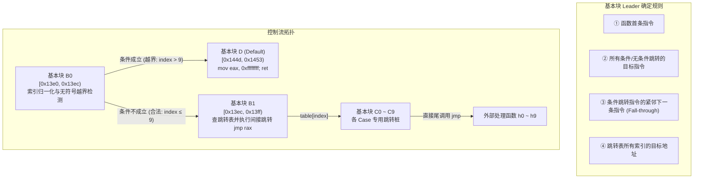
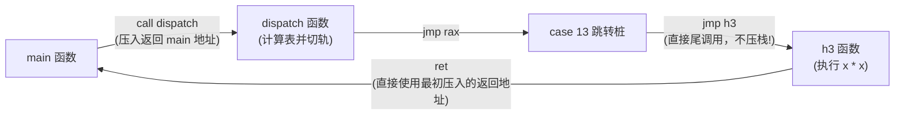

# 第 30 天：控制流图与 `switch` 跳转表

> **核心目标**：建立从机器指令流逆向重构控制流图（CFG）与基本块（Basic Block）的系统化方法。深入掌握编译器针对 `switch` 语句的三大分派策略（线性比较链、二分决策树、跳转表）的选择法则；深刻理解“减基数 + 无符号比较（`ja`）”单指令实现上下界防护的底层数学机理；精准剖析 Non-PIE 绝对地址表与 PIE 32 位相对偏移表的物理排布，掌握小端序还原与 `movsxd` 符号扩展的寻址数学推演，彻底厘清跳转表与查值表的本质边界。

---

## 【📌 一句话核心概括】
**控制流图（CFG）以单入单出的基本块为节点重构执行拓扑，而 `switch` 跳转表是编译器在分支密集时生成的 $O(1)$ 间接寻址数组，利用基数归一化与无符号比较（`lea + ja`）实现单指令上下界边界保护，并在 PIE 下借助基址加 32 位符号扩展偏移（`movsxd`）计算绝对跳转目标。**

## 【📖 通俗原理解释】
- **基本块（Basic Block）与控制流图重构**：基本块是仅允许从第一条指令进入、从最后一条指令退出的直线代码序列。控制流图以函数入口、跳转目标与跳转紧邻下一条指令作为基本块切分点（Leaders），通过有向边刻画分支、循环与函数返回。
- **`switch` 分派的三大底层策略**：编译器依据分支数量与值分布密度进行权衡：分支极少（$\le 3$ 个）时生成顺序 `cmp/je` 比较链；分支稀疏跨度极大时生成平衡二分查找树；分支密集连续时生成只读数据段跳转表（Jumptable），以输入值作为索引实现 $O(1)$ 时间复杂度直达。
- **`lea + ja` 上下界防护的数学机理**：为了检验输入 $x \in [min, max]$，编译器执行 `sub reg, min`（或等价的 `lea reg, [reg - min]`）将区间归一化为 $[0, max - min]$。随后执行 `cmp reg, (max - min)` 配合无符号大于跳转 `ja`。当 $x < min$ 时，减法产生下溢回绕为巨大的正数（补码），被 `ja` 一同视作越界，单次比较即可拦截双向越界并分流至 `default` 分支。
- **PIE 跳转表与 `movsxd` 符号扩展**：在位置无关可执行文件（PIE）中，跳转表若存储 64 位绝对地址将需要大量运行期重定位；因此编译器在只读数据段存储各分支相对于表基址的 32 位相对偏移。当目标代码位于表基址之前时该偏移为负数，CPU 必须使用 `movsxd`（带符号扩展）将其扩展至 64 位后再与基址相加，若错误使用零扩展将导致目标地址计算溢出触发 `SIGSEGV`。

---

## 一、基本块（Basic Block）与控制流图（CFG）



### 1. 基本块的严格定义与反汇编辨析
- **严格定义**：基本块是**最大化**的连续指令序列。控制流只能从第一条指令进入，除最后一条指令外绝无跳转离开。
- **反汇编关键边界**：
  - 基本块**不等于** C 语言的花括号 `{}`。一个复杂的复合语句可能包含十几个基本块。
  - 函数间的 **`nop` 对齐填充不属于有效基本块**！如果某段 `nop` 前面是无条件跳转且没有任何入口指向它，它仅是编译器为了指令缓存对齐插入的死填充。

---

## 二、`switch` 语句的三大分派策略与代价模型

编译器在将 C 语言 `switch` 降级为汇编控制流时，依据分支数量与数值密度进行成本权衡：

| 分派机制 | 汇编控制流特征 | 时间复杂度 | 空间开销 | 适用场景与判别准则 |
| :--- | :--- | :---: | :---: | :--- |
| **连续比较链**<br/>(Linear Chain) | 连续的 `cmp reg, val` 加 `je/jne` 分支，按顺序逐个探测。 | $O(n)$ | 零额外数据表 | 分支极少（通常 $\le 3$ 个），或各分支执行概率极度不均（热点分支置于最前）。 |
| **二分决策树**<br/>(Binary Tree) | 类似于二分查找，通过 `cmp` 结合 `jl/jg` 不断折半切分数值空间。 | $O(\log n)$ | 零额外数据表 | 分支较多但数值高度离散（如 `case 1, 100, 10000`），密度极低。 |
| **跳转表**<br/>(Jump Table) | 数组索引间接跳转（`jmp [rdx + rax*4]`），将值映射为表偏移。 | **$O(1)$** | 占用 `.rodata`<br/>表项空间 | 分支数量较多（通常 $\ge 4$）且数值高度稠密，追求最大吞吐。 |

> [!NOTE] **跳转表 vs 查值表（Lookup Table）的根本边界**
> - **跳转表（Jump Table）**：表中存放的是**代码地址**或**指令相对偏移量**，最终必须加载入寄存器并执行**间接控制转移**（`jmp reg`），直接修改 CPU 的程序计数器（RIP）。
> - **查值表（Value Table）**：表中存放的是纯业务数据或常量值。CPU 读取后仅装入数据寄存器（如 `mov eax, [table + index*4]`）用于返回或后续数学运算，**绝不改变指令执行流**！

---

## 三、跳转表范围防护神技：无符号减法与单分支拦截

对于密集分支 `case 10: ... case 19:`，标准工业实现如下：

```asm
13e4:   lea    eax, [rdi - 0xa]     # 1. 归一化: eax = (uint32_t)op - 10
13e7:   cmp    eax, 0x9             # 2. 边界判定: 与 (max_case - min_case) 比较
13ea:   ja     144d <default_block> # 3. 单分支同时拦截下溢与上溢！
```

### 底层数学证明
`ja`（Jump if Above）依赖 CPU 的无符号标志位（要求 $\text{CF}=0 \land \text{ZF}=0$）：
1. **正常合法范围（$10 \le op \le 19$）**：
   - $op = 10 \rightarrow \text{eax} = 0 \le 9$，不跳。
   - $op = 19 \rightarrow \text{eax} = 9 \le 9$（$\text{ZF}=1$），不跳，进入跳转表。
2. **上界越界（$op \ge 20$）**：
   - $op = 20 \rightarrow \text{eax} = 10 > 9$，`ja` 成立，跳入 default。
3. **下界越界（$op \le 9$）——精妙的无符号回绕**：
   - 假设输入非法小数字 $op = 9$：
     $$\text{eax} = 9 - 10 = -1 \equiv \text{0xFFFFFFFF} \ (\text{mod } 2^{32})$$
   - 在 32 位无符号解释下，`0xFFFFFFFF` 等于 $4,294,967,295$。
   - 比较 $4,294,967,295 > 9$ 必然成立（$\text{CF}=0 \land \text{ZF}=0$），**`ja` 瞬间跳入 default 分支！**

> [!CAUTION] **致命混淆：`ja` vs `jg`**
> 绝不能将 `ja` 理解为有符号大于 `jg`（Jump if Greater）！若写成 `jg`，当输入 $op = 9$ 时得到有符号数 $-1$，比较 $-1 > 9$ 为假，会导致非法负索引直接穿透范围检测，去内存中读取非法地址引发灾难！

---

## 四、Non-PIE 与 PIE 跳转表底层架构对比

```text
[Non-PIE 模式: 绝对地址直接分派]
  .text: jmp QWORD PTR [rax*8 + 0x402008] ──> 直接从 .rodata 读出 8 字节绝对物理地址跳入
  .rodata: [0x00401410, 0x00401418, 0x00401420 ...] (每项 8 字节，ASLR 下需要动态重定位)

[PIE 模式: 相对偏移与位置无关分派 (现代工业标准)]
  .text: lea rdx, [rip + 0xc11]              --> 动态计算当前跳转表绝对基址 RDX (0x2004)
         movsxd rax, DWORD PTR [rdx + rax*4] --> 读出 4 字节有符号相对偏移，并符号扩展为 64 位
         add rax, rdx                        --> 绝对目标 = 表基址 RDX + 相对偏移 RAX
         jmp rax                             --> 间接跳转
```

| 维度对比 | Non-PIE 绝对地址跳转表 | PIE 相对偏移跳转表（现代 Linux 标准） |
| :--- | :--- | :--- |
| **表项宽度与格式** | 8 字节绝对虚拟内存地址（`QWORD PTR`） | **4 字节有符号相对偏移量**（`DWORD PTR`） |
| **表空间体积占用** | 10 个分支占用 80 字节 | **10 个分支仅占 40 字节（体积缩减 50%）** |
| **寻址汇编序列** | 单指令：`jmp [rax*8 + 0x402008]` | 四指令复合链：`lea` + `movsxd` + `add` + `jmp` |
| **ASLR 兼容性** | 需要动态重定位表修补，启动开销大 | **天然位置无关（PIC）**，加载到任何基址差值恒定 |

---

## 五、手工逆向解码实战：从十六进制到跳转目标

在 PIE 二进制文件的 `.rodata` 段中观察到跳转表原始字节（表基址 `RDX = 0x2004`）：
```text
.rodata 内容:
0x2000: 01 00 02 00  0c f4 ff ff  14 f4 ff ff  1c f4 ff ff
0x2010: 24 f4 ff ff  2c f4 ff ff  34 f4 ff ff  3c f4 ff ff
0x2020: 44 f4 ff ff  fc f3 ff ff  04 f4 ff ff
```

### 1. 手工数学还原步骤（以第 0 项与第 8 项为例）
- **解析第 0 项（对应 `case 10`, 索引 0）**：
  - 物理地址：`0x2004`。字节序列：`0c f4 ff ff`。
  - 小端序组装：`0xfffff40c`。
  - 符号扩展（由于最高位是 `F`，为负数）：
    $$\text{Offset} = 0xfffff40c - 2^{32} = -3060 = -0x0BF4$$
  - 最终目标代码计算：
    $$\text{Target} = \text{Table\_Base} + \text{Offset} = 0x2004 + (-0x0BF4) = 0x1410 \ (\text{进入 } h0 \text{ 跳转桩})$$

- **解析第 8 项（对应 `case 18`, 索引 8）**：
  - 物理地址：$0x2004 + 8 \times 4 = 0x2024$。字节序列：`fc f3 ff ff`。
  - 小端序组装：`0xfffff3fc`。
  - 符号扩展为有符号负数：
    $$\text{Offset} = 0xfffff3fc - 2^{32} = -3076 = -0x0C04$$
  - 最终目标代码计算：
    $$\text{Target} = 0x2004 + (-0x0C04) = 0x1400 \ (\text{进入 } h8 \text{ 跳转桩})$$

> [!TIP] **代码乱序排列陷阱**
> 观察上面计算出的目标地址：索引 8 跳转到 `0x1400`，而索引 0 跳转到 `0x1410`！
> **结论**：编译器在排布各个 case 的目标基本块时，可以任意打乱物理内存先后顺序（根据冷热分支或对齐需求）。绝不能认为“case 序号大，目标内存地址就必然靠后”！

---

## 六、尾调用优化（TCO）与控制流真伪循环辨析

在 `-O2` 优化下的 `dispatch` 函数中，各 case 分支并不包含 `call` 指令，而是统一呈现为直接跳转：
```asm
1428:   jmp    1380 <h3>
```



### 关键辨析：为什么跳向低地址不是循环？
- `0x1428` 处的指令跳向地址更低的 `0x1380`（`h3` 入口）。
- **辨析要点**：控制流从 `h3` 执行完 `ret` 后，**直接返回到了调用 `dispatch` 的外层 `main` 函数**，再也没有任何边跳回 `0x1428`！控制流图没有形成闭环回路。
- **结论**：**绝不能仅凭“跳转目标地址小于当前指令地址”就断定代码存在循环**！这是尾调用优化消除多余栈帧的标准行为。

---

## 七、逆向恢复跳转表标准实战流程（Checklist）

```text
[阶段 1: 定位核心分派指令]
  ① 静态搜索所有间接控制转移: jmp rax, jmp [table+reg*4]
  ② 逆向溯源该寄存器 (RAX) 的前序数据依赖链

[阶段 2: 提取索引与范围约束]
  ③ 寻找 lea reg, [rdi - Base] 确定最小 case 基数
  ④ 寻找 cmp reg, Limit 加 ja/jae 确定分支范围宽度与 default 出口地址

[阶段 3: 提取跳转表并解密目标]
  ⑤ 定位 lea rdx, [rip + offset] 锁定 .rodata 中跳转表的绝对物理地址
  ⑥ 确定步长 (乘 4 还是乘 8)，提取对应十六进制字节流
  ⑦ 小端序解码并执行符号扩展 (movsxd)，逐项推导 Target = Base + Offset

[阶段 4: 构建等价控制流伪代码]
  ⑧ 绘制无歧义 CFG 图，标明各 case 与代码块映射关系，整理为高级语言 switch 逻辑
```

---

## 八、口头验收与面试高频题

1. **编译器在什么情况下倾向于将 `switch` 编译成跳转表，而在什么情况下会退化为二分查找或线性比较链？**
   - 编译器主要依据分支数量与数值密集度（Density）评估。当 case 分支数量较多且取值密集（$\frac{\text{分支数}}{\text{最大值}-\text{最小值}+1}$ 接近 1）时，跳转表以 $O(1)$ 吞吐换取极高执行效率；当 case 数量稀疏且跨度巨大（如 `1, 100, 10000`）时，强行建表会导致绝大多数槽位填入 default 浪费巨量空间，编译器会退化为 $O(\log n)$ 的二分决策树或 $O(n)$ 线性比较链。
2. **在跳转表的范围检测汇编中，为什么使用 `lea eax, [rdi - 10]` 配合 `cmp eax, 9` 和 `ja default` 就能同时防护上下界？**
   - 这是利用了 32 位无符号数运算的溢出回绕特性。若输入 $op < 10$（如 $op = 9$），相减得到有符号数 $-1$，在无符号下表示为极大值 `0xFFFFFFFF`；而 `ja` 判定的是无符号大于，因此无论是输入大于 19 的大数还是小于 10 的小数，在无符号维度其差值均大于 9，一条无符号分支指令同时拦截了上溢与下溢。
3. **在 PIE（位置无关可执行文件）中，跳转表为什么采用 32 位相对偏移而不是 64 位绝对地址？汇编中为什么必须用 `movsxd` 读取？**
   - 采用 32 位相对偏移能将表体积缩减 50%，且使得跳转表在 ASLR 动态随机加载时无需任何动态重定位修补；必须使用 `movsxd` 是因为代码段通常位于数据段的前方，相对位移是负数（最高位为 1），必须进行带符号扩展。若使用普通的零扩展（`mov eax`），负数将被解析为 4GB 之外的天文数字，导致间接跳转飞向未映射内存崩溃。
4. **跳转表（Jump Table）与查值表（Lookup Table）在汇编与控制流上有何本质区别？**
   - 跳转表中存放的是指令地址或代码偏移，其读取结果最终被装载入程序计数器（RIP）引发间接控制转移（`jmp rax`），在 CFG 上呈现为多条后继控制边；而查值表中存放的是业务数据常量，读取后仅作为数据输入进入通用寄存器，控制流保持原样顺序执行。
5. **在反汇编中看到一条向较低内存地址跳转的指令（如 `jmp 0x1380`），能否直接认定此处存在循环？为什么？**
   - 绝对不能！这可能是尾调用优化（TCO）生成的直接跳转。当当前函数在末尾直接调用另一个位于低地址的函数时，为了复用当前栈帧直接生成 `jmp`，被调用函数执行完毕直接返回外层调用者，控制流并未构成回边回路，因此不是循环。