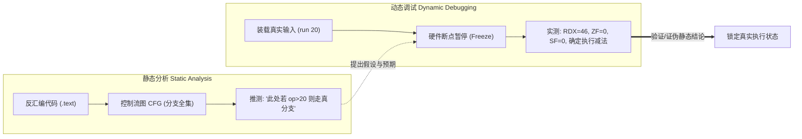
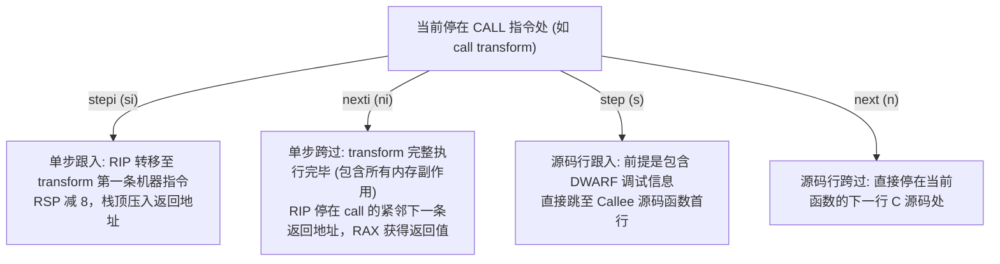

# 第 31 天：GDB 动态调试基础

> **核心目标**：从底层硬件执行视角掌握 GNU 调试器（GDB）在 Linux x86-64 架构下的核心运行机理。彻底建立静态控制流推演（CFG）与动态真实状态验证之间的正交认知；掌握 `-O0`、`-O2`、`-g`、`-no-pie` 与 `strip` 对调试行为的本质影响；熟练运用 `step`、`next`、`stepi`、`nexti`、`finish` 等执行控制命令；精通 `x/nfu` 内存检查语法、寄存器与 RFLAGS 标志位深度观测；掌握在符号完全剥离（Stripped）及 PIE/ASLR 随机化环境下计算加载基址并施加地址断点的实战技能。

---

## 【📌 一句话核心概括】
**GDB 是通过操作系统调试接口（`ptrace`）接管目标进程执行流并冻结微观硬件状态的动态调试工具，通过单步控制命令（`stepi`/`nexti`）、`x/nfu` 内存检查规格与寄存器观测，为静态逆向分析提供确定性的运行时事实检验。**

## 【📖 通俗原理解释】
- **动态验证与静态推测的互补**：静态分析（如反汇编、CFG）描绘的是代码所有的潜在分支与执行路径；GDB 动态调试则能够在指定断点处完全冻结进程上下文，实时观测通用寄存器（如 `rax`、`rdi`）、标志位（RFLAGS 的 `ZF`、`SF`、`CF`）以及调用栈，以单次运行的精确事实检验静态推断。
- **步进控制四命令的微观差异**：
  - `step` / `next`：基于 DWARF 源码行调试信息的单步推进。`step` 会进入内部函数，`next` 则跳过内部函数执行。
  - `stepi` / `nexti`：基于单条 CPU 机器指令的微观推进。遇到 `call` 指令时，`stepi` 迈入被调函数的首条指令，而 `nexti` 则让目标函数整体执行完毕，在紧邻下一条返回地址处自动暂停。
- **内存透视规格尺 `x/nfu`**：`x` 命令由数量（`n`，如 16）、格式（`f`，如 `x` 十六进制、`i` 指令反汇编、`s` 字符串）与单位大小（`u`：`b` 字节、`h` 半字 2 字节、`w` 字 4 字节、`g` 巨字 8 字节）三元组严格定义，是透视栈帧与堆块内存排布的标准手段。
- **PIE/ASLR 下的动态断点施加法**：在开启 PIE 与 ASLR 的被剥离程序中，函数没有符号名且加载基址随机。调试时先在入口点（`starti` 或 `entry-point`）拦截，读取 `/proc/$pid/maps` 获取可执行代码段的运行时加载基址（Load Bias），再加上静态反汇编中的相对文件偏移，即可利用 `b *0x[Base+Offset]` 精准命中无符号私有函数。

---

## 一、动态调试与静态分析的本质互补



- **静态分析的局限**：只能提供所有可能执行路径的超集。面对间接跳转（`jmp rax`）、动态虚表指针（`vptr`）、位置无关重定位与混淆代码时，无法单凭文字断定确切走向。
- **动态调试的铁律**：**单次动态跟踪只能验证本次输入、本次环境下的单条路径**！对于包含分支的程序，必须设计多组边界输入（如 $x=7$ 与 $x=8$）才能覆盖不同控制流。

---

## 二、编译选项对调试维度的深远影响

| 编译参数组合 | 产生 ELF 类型 | 符号表与调试节 | 汇编生成特征 | 动态调试核心体验与现象 |
| :--- | :---: | :--- | :--- | :--- |
| **`-O0 -g -no-pie`**<br/>(经典教学基准) | `EXEC`<br/>(固定基址) | 完整 `.symtab`<br/>完整 DWARF 信息 | 保留帧指针 `RBP`，栈槽逐行严格映射，叶函数利用 Red Zone。 | 支持行号断点（`b 15`），变量值实时精确可见，单步执行严格对应源码行。 |
| **`-O2 -g`**<br/>(工业生产优化) | `DYN` (PIE)<br/>(随机化基址) | 包含 DWARF<br/>行号映射复杂 | 激进内联、TCO 尾调用、指令重排、`cmov` 条件传送替代分支。 | 频现 `<optimized out>`（变量被寄存器复用或常量折叠），单步跳跃错乱。 |
| **`-O2` + `strip`**<br/>(黑盒逆向场景) | `DYN` (PIE)<br/>(随机化基址) | **`.symtab` 彻底抹除**<br/>**DWARF 彻底抹除** | 仅保留机器代码与运行期动态符号（`.dynsym`，如 `printf`、`strtol`）。 | 无法按函数名或行号下断，**必须计算加载基址进行物理地址断点（`b *addr`）**。 |

> [!WARNING] **关键误区辨析：`-g` 与优化的关系**
> 开启 `-g` 仅命令编译器生成 DWARF 调试元数据，**绝对不会关闭任何优化**！若执行 `gcc -O2 -g`，生成的机器代码依然被深度重排与内联，绝不能将 `-g` 当作开发调试安全锁。

---

## 三、GDB 执行控制指令精确辨析



### 1. `start` vs `starti`（逆向必知）
- **`start [args]`**：GDB 内部在 `main` 函数入口设置临时断点（`tbreak main`）并开始运行。**对于完全 Stripped 的无符号二进制，`main` 符号已丢失，`start` 将直接失败！**
- **`starti [args]`**：在进程执行的**第一条机器指令（ELF 入口点 `e_entry` 或动态链接器首地址）**处立刻暂停。不依赖任何符号，是逆向 Stripped 文件的绝对黄金起点！

### 2. `finish` vs `until`
- **`finish`**：继续执行当前函数直到自然返回（执行完 `ret`），并自动打印函数返回值（装入 RAX 的内容）。
- **`until`**：常用于跳出当前循环体，执行控制流直到程序计数器超过后向跳转分支或当前栈帧退出。

---

## 四、寄存器、状态标志与内存透视（`x/nfu`）

### 1. RFLAGS 标志位与条件跳转判定
在 x86-64 中，条件分支由比较指令设置的标志位驱动：
```gdb
(gdb) info registers eflags
(gdb) p/d ($eflags >> 6) & 1    # 提取零标志位 ZF (Zero Flag)
(gdb) p/d ($eflags >> 7) & 1    # 提取符号标志位 SF (Sign Flag)
(gdb) p/d ($eflags >> 11) & 1   # 提取溢出标志位 OF (Overflow Flag)
(gdb) p/d ($eflags >> 0) & 1    # 提取进位标志位 CF (Carry Flag)
```
- **`jle`（有符号小于等于）**：跳转判定公式为 **`ZF == 1 || SF != OF`**。必须同时检查符号位与溢出位，绝非单纯检查 `ZF`。

### 2. `x/nfu` 内存检查全要素语法
$$\text{Syntax: } \mathbf{x} \ / \ [n][f][u] \ \ \text{Address}$$

| 参数位 | 字段名称 | 核心选项取值与物理含义 | 实战应用范例 |
| :---: | :--- | :--- | :--- |
| **`n`** | **显示单位数量** | 正整数（注意：**表示检查 $n$ 个单位，绝非 $n$ 字节或 $n$ 行**！） | `x/16...`（连续透视 16 个槽位） |
| **`f`** | **数据解析格式** | `x` (十六进制), `d` (有符号数), `u` (无符号数), `i` (反汇编指令), `s` (ASCII字符串) | `x/8i $rip`（打印接下来的 8 条指令） |
| **`u`** | **单格物理尺寸** | `b` (Byte, 1B), `h` (Halfword, 2B), `w` (Word, 4B), `g` (Giant Word, 8B) | `x/16gx $rsp`（按 8 字节打印 16 个巨字） |

> [!CAUTION] **数据格式灾难：严禁对整数使用 `x/s`**
> 若寄存器存放的是纯整数（如 `RDI = 20`），执行 `x/s $rdi` 将导致 GDB 将数值 `20`（`0x14`）误当成内存虚拟地址去解引用，直接引发：
> `Cannot access memory at address 0x14`。查看数值必须使用 `p/d $rdi`！

---

## 五、函数调用前后硬件栈帧与微操作追踪

以 `main` 调用 `transform(20)` 为例，拆解 System V AMD64 ABI 下的物理演进：

```text
调用前 (停在 call transform 处):
  RDI = 20 (第一参数到位), RSP = S0, RIP = 0x4012cf

执行 si (进入 transform 首指令):
  硬件微操作: ① 将返回地址 0x4012d4 压入栈顶: [S0-8] = 0x4012d4
              ② 栈顶指针递减 8 字节: RSP = S0 - 8
              ③ RIP 更新为函数物理入口: RIP = 0x4011b6

transform 序言执行完毕 (push rbp; mov rbp, rsp):
  RSP = S0 - 16, RBP = S0 - 16 (建立标准基准锚点)

函数内存拓扑分布:
  高地址  [S0]      ──> 返回 main 的地址 (0x4012d4)
          [S0 - 8]  ──> 调用者 main 保存的旧 RBP 值
          [S0 - 16] ──> 局部变量 y 的栈槽 (8 字节)
  低地址  [S0 - 32] ──> 形参 x 的栈槽 (8 字节)
```

> [!IMPORTANT] **对象生命周期与残留物理字节**
> 当函数执行 `ret` 退出后，在原栈地址 `[S0 - 16]` 处依然可以通过 `x/gx` 看到数值 `41`。
> **底层核心原理**：CPU 退出函数绝不会主动把栈内存刷零！物理字节残留并不代表 C 语言对象依然存活。该内存已经退出了当前生命周期，随时会被下一个调用的栈帧无情覆盖，解引用该旧指针属于未定义行为（悬空指针）。

---

## 六、`-O2` 优化深水区：控制流向数据流的质变（`cmovge`）

在 `-O2` 优化下，原 C 代码的分支判断被编译器彻底消除：
```c
// 源码逻辑
long y = (x + 3) * 2;
if (y > 20) y -= 5;
else        y += 5;
return y;
```

### 优化后汇编实录（完全不含任何跳转分支！）
```asm
12c0:   lea     rdx, [rdi + rdi + 0x6]   # 1. 神技合并: 2*x + 6，一步到位完成 (x+3)*2，不改标志位
12c5:   lea     rcx, [rdx - 0x5]         # 2. 预测计算: 预先算出真分支结果 (y - 5 = 41)
12c9:   lea     rax, [rdx + 0x5]         # 3. 预测计算: 预先算出假分支结果 (y + 5 = 51)
12cd:   cmp     rdx, 0x15                # 4. 边界比较: 与 21 比较 (y > 20 等价于整数 y >= 21)
12d1:   cmovge  rax, rcx                 # 5. 条件传送: 若 RDX >= 21，则把 RCX 传给 RAX，否则保持 RAX 原值！
12d5:   ret                              # 6. 直接返回！
```
- **核心洞察**：编译器将原本在 CFG 上产生分叉的**控制流转移**，转化为了**基于寄存器的数据流选择（Conditional Move）**！消除了分支预测失败引发的流水线深度冲刷，这在逆向工程中是极其常见的优化模式。

---

## 七、Stripped + PIE 二进制实战动态断点全流程

当面对既被 `strip` 抹除符号、又开启了 PIE/ASLR 随机化基址的二进制文件时：

```text
[第 1 步: 静态锁定函数内部偏移]
  objdump -d -Mintel target.stripped
  --> 锁定核心逻辑起始偏移 (例如偏移量 Offset = 0x12c0)

[第 2 步: 无符号安全挂起]
  gdb ./target.stripped
  (gdb) starti 20   <-- 坚决使用 starti! 停在第一条物理指令，杜绝符号缺失错误

[第 3 步: 提取进程真实装载基址]
  (gdb) info proc mappings
  --> 检索对应 ELF 模块的代码段基址 (或提取映射基址 M 与偏移 O, B = M - O)
  --> 锁定当前运行期基址: B = 0x555555555000

[第 4 步: 计算物理地址并设断]
  (gdb) set $base = 0x555555555000
  (gdb) break *($base + 0x12c0)   <-- 必须加星号 *! 明确表示物理指令地址
  (gdb) continue

[第 5 步: 动态解密状态]
  (gdb) x/10i $rip               <-- 恢复当前物理执行上下文
  (gdb) info registers rax rdi rsp eflags
```

---

## 八、口头验收与面试高频题

1. **在 GDB 暂停执行时，程序计数器 `RIP` 指向的是刚刚执行完的指令，还是下一条准备执行的指令？**
   - 严格指向**下一条即将执行的机器指令**！当前停下的指令尚未对体系结构产生任何寄存器或内存修改。
2. **在单步调试遇到 `call` 函数调用指令时，`stepi` 与 `nexti` 的底层行为有何根本区别？**
   - `stepi` 会忠实地单步跟入被调函数的首条指令，栈顶压入返回地址，`RSP` 递减 8；而 `nexti` 同样会命令 CPU 完整执行完整个函数，并在该函数的紧邻下一条返回地址处暂停，此时函数已经产生所有内存副作用并将返回值写入了 `RAX`。
3. **解释命令 `x/16gx $rsp` 中每个字符的精确含义与检查范围。**
   - `x` 表示 inspect memory（检查内存）；`16` 表示连续检查 16 个单位；`g` 表示单位大小为 Giant Word（8 字节）；`x` 表示按十六进制格式显示；`$rsp` 表示从当前栈顶地址开始。总计检查 $16 \times 8 = 128$ 字节的物理内存。
4. **为什么在 Stripped 剥离符号的 ELF 文件上使用 `start` 命令经常报错，而 `starti` 却能稳定挂起？**
   - `start` 命令的底层机理是在 `main` 函数设置临时断点后执行，它严重依赖 `.symtab` 中的 `main` 符号信息；而 `strip` 抹除了该符号导致 GDB 无法定位。`starti` 则直接在 ELF 头声明的入口指令（`e_entry`）处施加断点，完全不依赖任何高层符号名。
5. **在没有调试信息（`-O2` 优化）的程序中，为什么查看局部变量经常出现 `<optimized out>`？**
   - 现代编译器在优化时会将生命周期短的局部变量直接分配在物理寄存器中，或通过常量折叠、代数化简直接消除变量实体；变量不再具有专属性的栈内存槽位，离开活跃周期后寄存器被其他计算复用，导致调试器无法在内存中持久读取。