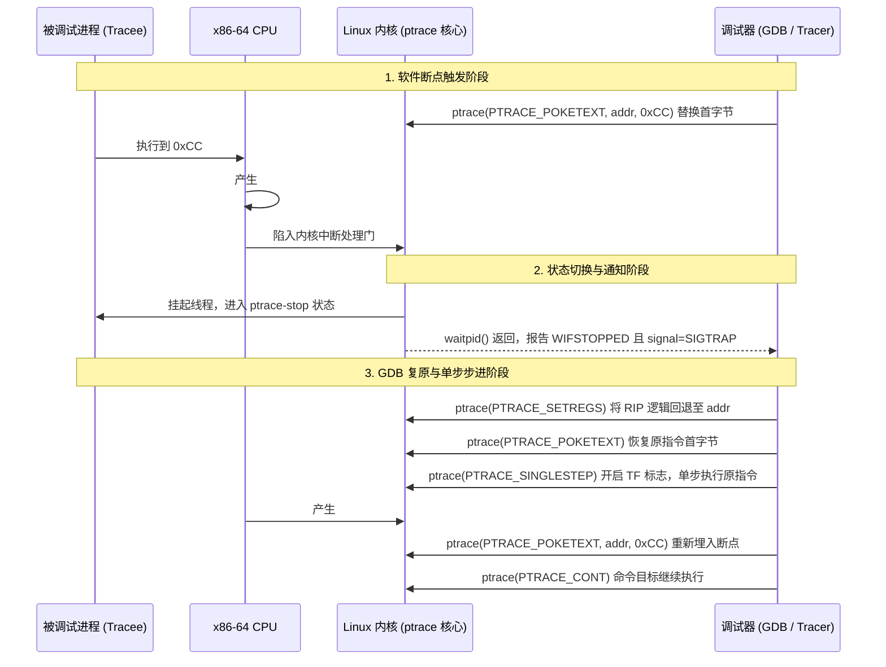

# 第 32 天：软件断点、硬件断点与 `ptrace`

> **核心目标**：从硬件中断、Linux 内核调度与用户态调试器三层交互模型，深度解密动态断点与进程跟踪的底层本质。掌握**软件断点（`0xCC / INT 3`）**的单字节内存覆写、`#BP` 异常触发、`RIP` 硬件回退与单步复原机制；剖析基于 CPU 调试寄存器（`DR0 ~ DR7`）的**硬件执行断点与数据观察点（Watchpoint）**的物理约束；透彻掌握 Linux `ptrace` 系统调用的工作链路与线程生命周期；掌握基于 `PTRACE_TRACEME` 的基础反调试机理，并在 GDB 中通过覆写返回值（`RAX`）与标志位实现控制流劫持与逆向绕过。

---

## 【📌 一句话核心概括】
**软件断点利用单字节操作码 `0xCC`（`INT 3`）内存替换触发硬件 `#BP` 异常并由 GDB 修正 `RIP` 恢复原指令，硬件断点利用 CPU 专有调试寄存器（`DR0~DR7`）在总线地址匹配时触发 `#DB` 异常，而 `ptrace` 是内核允许 Tracer 全权拦截信号、检查与修改 Tracee 寄存器及内存的底层系统调用支撑。**

## 【📖 通俗原理解释】
- **软件断点（`INT 3 / 0xCC`）的微观运作**：GDB 借助 `ptrace(PTRACE_POKETEXT)` 将目标地址的首字节机器码备份后替换为 `0xCC`。CPU 执行到该字节时触发 3 号中断（断点异常 `#BP`），指令指针自动步进到 `addr + 1`；内核挂起进程并向 GDB 发送 `SIGTRAP` 信号；GDB 在继续运行前将原字节写回内存、将 `RIP` 硬件回退 1 字节并执行单步，随后再次插回 `0xCC`。
- **硬件断点与观察点（Watchpoint）的物理边界**：基于 CPU 硅片内的 4 个调试地址寄存器（`DR0 ~ DR3`）及控制寄存器 `DR7`。当指令执行或内存读写（1/2/4/8 字节）命中设定地址时，CPU 直接抛出调试异常 `#DB`。其核心优势是不修改内存字节（绕过代码段自校验与只读限制），但数量受硬件严格限制（全局最多 4 处）。
- **`PTRACE_TRACEME` 反调试机制**：Linux 规定一个进程同一时刻只能被唯一的 Tracer 附加。目标程序启动时主动调用 `ptrace(PTRACE_TRACEME, 0, NULL, NULL)`；若程序已运行在 GDB 之下，内核将返回 `-1`（`EPERM`），程序据此即可判定被调试并执行自毁逻辑。
- **动态现场劫持绕过反调试**：在 GDB 中拦截反调试系统调用后，逆向工程师可直接通过 `set $rax = 0` 强制修改系统调用返回值，将检测失败伪装为成功，使得后续基于检测结果的条件跳转流向正常执行分支。

---

## 一、软硬件断点与内核通信全时序拓扑



---

## 二、四大技术层面的严谨正交划分

在底层安全领域，绝不能将各层机制张冠李戴：

| 技术层面 | 规范与所属实体 | 核心机制与典型代表 | 常见挂科混淆点 |
| :--- | :--- | :--- | :--- |
| **CPU 硬件层** | Intel/AMD 架构手册 | 指令 `0xCC`（`INT 3`）、`#BP`（Vector 3）、`#DB`（Vector 1）、`DR0 ~ DR7` 调试寄存器。 | 硬件只有 `#BP`/`#DB` 异常，**绝对没有 `SIGTRAP` 信号概念**！ |
| **Linux 内核层** | Linux 内核子系统 | `ptrace(2)` 接口、`ptrace-stop` 调度挂起、写时复制（COW）、信号转译。 | 内核将硬件异常转换为发送给跟踪进程的 **`SIGTRAP` 信号**。 |
| **ABI 规范层** | System V AMD64 ABI | 普通函数调用约定（`RDI/RSI/RDX/RCX`）、整数返回值存放于 **`RAX`**。 | C 标准从未规定返回值必须放 `RAX`，这是特定架构 ABI 的规定！ |
| **调试工具层** | GNU GDB / LLDB | 用户交互、断点管理、影子字节还原、`break` / `watch` / `finish` 指令。 | 调试器呈现给用户的断点界面是对底层繁琐时序的高度封装。 |

---

## 三、软件断点深度解密：为什么单字节 `0xCC` 不可替代？

### 1. 为什么不用两字节的 `int 3`（`0xCD 0x03`）？
x86-64 是变长指令集，一条指令长度可从 1 字节到 15 字节不等。
- 若目标是一条 1 字节指令（例如 `push rax` 为 `0x50`，或 `ret` 为 `0xC3`）：
  - 强制写入 2 字节的 `0xCD 0x03`，不仅覆盖了当前指令，**还会物理破坏紧随其后的下一条合法指令的首字节**！
  - 一旦控制流跳转到下一条指令，程序将因机器码损坏产生不可预测的崩溃。
- 单字节 `0xCC` 确保：**无论目标指令多么短小，均能 100% 独立替换其首字节，绝不溢出侵占邻居空间！**

### 2. 只读代码段（`r-x`）为何能被 GDB 强行写入？
在 Linux 进程虚拟内存映射中，代码段属于私有文件映射（`MAP_PRIVATE`），权限通常被 MMU 设置为 `r-x`（只读可执行）。
- GDB 并不是通过普通进程内部的 `mov [addr], val` 指令去写内存（这会引发页错误 `SIGSEGV`）。
- GDB 是调用系统调用 `ptrace(PTRACE_POKETEXT, pid, addr, data)`。
- **内核机制**：内核接收到合法 tracer 的请求后，代表调试器调用底层虚拟内存管理子系统，绕过普通写保护，**触发该物理页的写时复制（Copy-On-Write, COW）**！
  - 操作系统物理分配一页全新的内存页，填入 `0xCC`，并将该 tracee 进程的页表项重新指向该私有物理页。
  - **磁盘上的 ELF 文件保持原封不动，其他并发运行的相同程序亦完全不受影响！**

---

## 四、硬件执行断点 vs 硬件数据观察点（Watchpoint）

CPU 硅片内部集成了 8 个专用调试寄存器：

```text
DR0: [ 64位线性断点地址 0 ]  ──┐
DR1: [ 64位线性断点地址 1 ]  ──┼─> 最多支持同时设置 4 个硬件断点/观察点
DR2: [ 64位线性断点地址 2 ]  ──┤
DR3: [ 64位线性断点地址 3 ]  ──┘
DR6: [ 调试状态寄存器 ]        ──> 硬件置位标记，报告具体是哪一个 DR0~DR3 触发了异常
DR7: [ 调试控制寄存器 ]        ──> 控制各槽位: 读/写/执行监测、监控宽度 (1B, 2B, 4B, 8B)
```

| 调试类别 | GDB 命令 | 底层硬件监控类型 | 触发断点时的执行时序 | 核心应用场景与局限 |
| :--- | :--- | :--- | :--- | :--- |
| **硬件执行断点** | `hbreak *addr` | `DR7` 标记为指令执行（Instruction Execution） | **指令执行前触发**<br/>（Fault 类别） | 用于监测不可修改的代码区（如 ROM/固件）或对抗代码自校验。**上限 4 个**。 |
| **数据写入观察点** | `watch expr` | `DR7` 标记为数据写入（Data Write） | **指令执行完毕后触发**<br/>（Trap 类别） | **排查野指针内存覆写、全局变量恶意篡改的绝世神器**！新值已写入内存。 |
| **数据读取观察点** | `rwatch expr` | `DR7` 标记为数据读取（Data Read） | 指令访存时触发 | 监测机密内存（如密钥、密码）何时被哪个函数读取。 |
| **读写双向观察点** | `awatch expr` | `DR7` 标记为数据访问（Access: Read/Write） | 任何读或写发生时触发 | 跟踪内存变量全生命周期的任何交互。 |

> [!CAUTION] **`watch` 语义陷阱：写了但不报告**
> 普通 `watch x` 的语义是**“被监视变量的值发生物理变化”**！
> 若程序执行了 `x = 10`，而 `x` 原本的值恰好就是 `10`：CPU 硬件确实产生了一次写访存中断，但 GDB 捕获后比对旧值与新值完全相同，**会自动静默放行，绝不向用户弹窗报告**！若需无条件捕获每一次写动作，必须使用 `awatch`。

---

## 五、`ptrace` 反调试实战与控制流劫持

以工业级反调试探测代码为例：

```c
#include <sys/ptrace.h>
#include <errno.h>

int anti_debug_probe(void) {
    errno = 0;
    long rc = ptrace(PTRACE_TRACEME, 0, NULL, NULL);
    if (rc == -1) {
        // 发现被追踪，进入防护或自毁分支
        return 1; 
    }
    return 0; // 正常运行分支
}
```

### 1. 为什么 `PTRACE_TRACEME` 能够探测调试器？
- 进程发起 `ptrace(PTRACE_TRACEME)`，请求将父进程注册为自身的 tracer。
- **内核铁律**：Linux 规定单个线程**同一时刻绝不能存在两个独立的 tracer**！
- 若程序已在 GDB 环境中启动运行，GDB 已经建立了跟踪关系。内核探测到冲突，立刻拒绝并返回 $-1$，同时设置 `errno = EPERM`（Operation not permitted）。

> [!NOTE] **反调试启发式本质辨析**
> `PTRACE_TRACEME` 失败**绝不等于 100% 存在 GDB**！
> 在开启了 Linux 安全增强模块 Yama（`ptrace_scope = 2/3`）、Docker 容器禁用 ptrace、或者通过 seccomp 沙箱过滤系统调用的生产环境下，即便没有任何调试器，该调用同样返回 `-1 / EPERM`。

### 2. GDB 现场动态劫持四步法（绕过反调试）
面对上述反调试检测，在 GDB 中可通过操控寄存器直接颠倒黑白：

```gdb
(gdb) break ptrace             # 1. 在 ptrace 包装函数入口下断点
(gdb) run
(gdb) finish                   # 2. 让 ptrace 正常执行完并退出，停在紧随其后的返回点
                               #    此时真实返回值装在 RAX 中 (失败为 -1，即 0xFFFFFFFFFFFFFFFF)
(gdb) set $rax = 0             # 3. 核心手术: 强行将返回值装入寄存器 RAX 篡改为 0 (伪造调用成功!)
(gdb) stepi                    # 4. 执行后续 mov [rbp-8], rax，局部变量 rc 被写入 0
(gdb) continue                 # 5. if (rc == -1) 判定为假，成功劫持控制流进入 normal_path!
```

---

## 六、结构体内存布局与 Intra-Object 越界防御

在逆向分析中，经常需要配合观察点排查结构体内部成员破坏：

```c
struct Lab {
    uint8_t  data[8];   // 8 字节数组，偏移 0 ~ 7
    uint32_t sentinel;  // 4 字节哨兵，偏移 8 ~ 11
};                      // 总大小 12 字节，4 字节对齐
```

```text
Lab 结构体物理内存拓扑:
┌────────────────────────┬────────────────────────┐
│ [0 .. 7 字节]          │ [8 .. 11 字节]         │
│ uint8_t data[8] 数组   │ uint32_t sentinel 哨兵 │
│ 连续物理排布无 Padding │ 4 字节自然对齐         │
└────────────────────────┴────────────────────────┘
```

> [!CAUTION] **对象内部越界（Intra-Object Overflow）与 ASan 的盲区**
> - 若程序员写出 `lab.data[8] = 0;`：
>   - 语法上 `data` 下标只能是 $0 \sim 7$，访问 `data[8]` 在 ISO C 规范中属于**未定义行为（UB）**！
>   - 但在物理内存上，`data[8]` 的地址恰好就是 `sentinel` 的首字节。
>   - **标准 AddressSanitizer（ASan）的盲区**：常规 ASan 仅在结构体外部或全局/栈变量之间铺设红区（Redzone）。对于**同一个结构体内部相邻成员间的相互越界覆盖**，ASan 往往无法直接拦截报错！此时唯有使用 **GDB 硬件数据观察点（`watch lab.sentinel`）** 才能精准在写入的第 1 微秒抓出真凶！

---

## 七、横向技术全景对比：`ptrace` 与各类注入/Hook 技术

很多工程师常将 `ptrace` 与各类 Android/Linux Hook 框架混为一谈，必须建立清晰架构图景：

| 技术手段 | 核心拦截阶段 | 底层实现机理 | 是否依赖 ptrace | 典型适用场景 |
| :--- | :--- | :--- | :---: | :--- |
| **`ptrace`** | 进程运行全周期 | 内核调度介入、`ptrace-stop` 挂起、直接读写寄存器与内存。 | **是（核心）** | GDB 动态调试、`strace` 系统调用追踪、外挂进程监控。 |
| **`LD_PRELOAD`** | ELF 动态链接期 | 动态链接器（`ld.so`）优先加载指定共享库，实现符号插桩覆盖。 | **否** | Linux 用户态 API 劫持、内存泄漏监测、安全沙箱。 |
| **`dlopen / dlsym`** | 运行期动态加载 | 用户显式调用加载器接口，在进程内部按需载入 `.so` 模块。 | **否** | 插件化架构、热补丁加载、动态功能解耦。 |
| **Zygisk** | 进程孵化特化期 | 挂钩 Android Zygote 进程，在目标应用 `fork` 并降权前注入模块。 | **否** | Android 系统级免 Root/Root 模块化改造与环境隐藏。 |
| **LSPosed** | Java/ART 虚拟机层 | 替换 ART 虚拟机的 `ArtMethod` 结构体入口或编译 JNI 跳板。 | **否** | Android Java 层高层业务逻辑篡改与 Xposed 模块框架。 |

---

## 八、口头验收与面试高频题

1. **简述 x86-64 架构下，GDB 软件断点（`0xCC`）从触发到恢复原指令执行的完整底层硬件与内核时序。**
   - GDB 将断点地址 $A$ 处的原首字节保存，并覆写为单字节 `0xCC`（`INT 3`）；CPU 执行到此处触发 `#BP` 中断，`RIP` 硬件递增至 $A+1$；内核捕获异常将线程置于 `ptrace-stop` 并通知 GDB（`SIGTRAP`）；GDB 介入后将 `RIP` 逻辑回退至 $A$，并将内存原字节写回；随后通过 `PTRACE_SINGLESTEP` 开启 CPU 的 `TF` 标志让原指令单步执行完毕（触发 `#DB`）；最后 GDB 重新将 $A$ 处写回 `0xCC` 并恢复程序连续运行。
2. **硬件断点与软件断点相比有何本质优势与固有局限？**
   - **优势**：硬件断点利用 CPU 的 `DR0 ~ DR3` 寄存器匹配物理地址，完全不需要修改进程内存代码页的任何字节，能躲过代码段完整性哈希校验，且能在只读固件（ROM）中生效；
   - **局限**：物理资源极度稀缺（x86 仅支持最多 4 个地址槽位），且支持的监控宽度严格受限（通常仅 1B/2B/4B/8B），无法胜任大片内存的泛化监视。
3. **为什么使用 `watch lab.sentinel` 硬件写入观察点停下时，打印出的 `RIP` 总是指向写入指令的紧邻下一条指令？**
   - 因为数据写入观察点在 CPU 内部属于**陷阱类别（Trap-class Exception）**，而非故障类别（Fault-class）。CPU 必须在确保当前内存写操作完全提交完毕后，才触发硬件调试异常 `#DB`，因此保存的程序计数器 `RIP` 已经自动步进到了下一条指令。
4. **程序调用 `ptrace(PTRACE_TRACEME)` 返回 `-1` 且 `errno = EPERM`，能否 100% 断定当前进程处于 GDB 调试中？为什么？**
   - 绝不能！这只能证明当前线程无法再被新的父进程登记为 tracer。在启用了 Yama 安全模块（`ptrace_scope >= 2`）、运行于严格限制能力的 Docker 容器、或配置了 seccomp 过滤系统调用的环境下，即使完全没有 GDB 存在，该调用依然会因内核安全策略拦截返回 `-1 / EPERM`。
5. **在没有源代码的情况下，面对开启反调试的程序，逆向人员如何利用 GDB 绕过 `PTRACE_TRACEME` 检查？**
   - 在 `ptrace` 导出函数或对应的系统调用入口处下断点，让其自然执行退出（`finish`）；当函数刚刚返回、尚未进行条件分支跳转时，利用 `set $rax = 0` 强行将装载返回值的 `RAX` 寄存器修改为 0（代表成功），从而诱导后续的条件跳转指令（`cmp / jne`）走向正常合法分支。