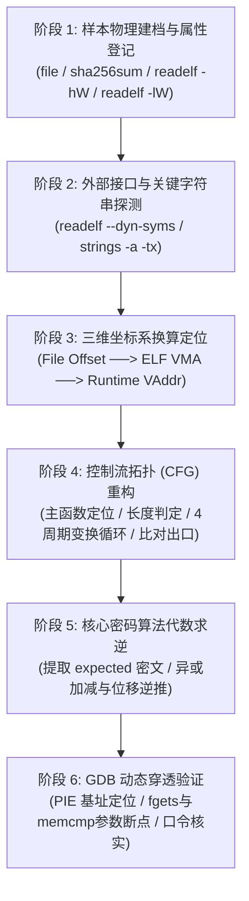
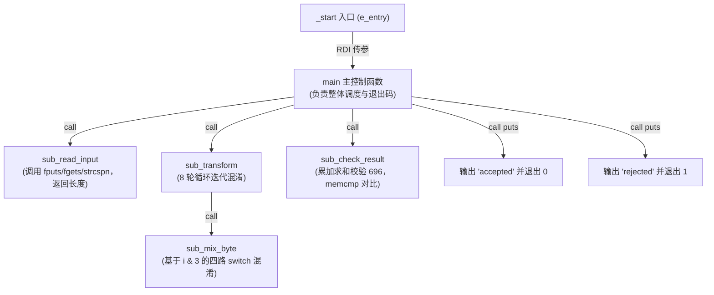

# 第 33 天：综合无源码 ELF 逆向实战大作业

> **核心目标**：作为阶段三（逆向工程、静态分析与动态调试）的终极综合大复盘与考核，本章通过构建一个完全剥离符号（Stripped）、开启位置无关可执行（PIE）与栈保护的黑盒密码验证程序（Crackme 靶标），实施**纯黑盒全流程逆向工程**。打通从样本元数据登记、动态符号与字符串交叉引用定位、三维坐标换算（文件偏移 $\to$ ELF VMA $\to$ 运行时地址）、控制流图（CFG）重构，到 4 周期算法逆向数学还原与 GDB 动态断点验证的完整闭环。

---

## 【📌 一句话核心概括】
**无源码 ELF 逆向是一套通过静态元数据勘查（ELF 头与段表）、动态符号与字符串交叉引用、控制流图（CFG）重构、代数求逆还原变换算法，并结合 GDB 动态断点完成运行时闭环验证的标准化工程方法体系。**

## 【📖 通俗原理解释】
- **黑盒样本建档与关键线索定位**：面对完全剥离符号的 PIE 样本，首先通过 `readelf` 检查 ELF 架构属性与可执行段（`PT_LOAD`），从保留的 `.dynsym` 检索输入输出 API（如 `fgets`、`memcmp`），通过 `strings -a -tx` 提取提示词并配合反汇编中的 RIP 相对寻址交叉引用，迅速圈定核心校验函数边界。
- **三维坐标系换算基准**：严格区分磁盘文件偏移（File Offset）、静态反汇编虚拟地址（ELF VMA）与进程内存真实地址（Runtime VA）。在 PIE 模式下，静态地址即为相对基址偏移，通过 `Runtime_Addr = Load_Base + ELF_VMA` 公式实现 GDB 断点精准投放。
- **控制流重构与循环混淆识别**：从 `_start` 传给 `__libc_start_main` 的第一个参数确定 `main` 函数真实入口；分析条件分支确定输入长度校验门槛；追踪循环体内基于索引取模（`i & 3`）的分派逻辑，识别不同周期的字符算术/位移变换操作（异或、加减、循环移位）。
- **算法求逆与动态断点验证**：从只读数据段提取比对的目标标准密文数组，利用各数学运算的逆操作（异或自反、减法逆加法、循环左移逆循环右移）编写逆向求解脚本还原原始明文口令，最后在 GDB 中拦截输入和比对断点单步验证通过。

---

## 一、无源码黑盒逆向工程六步作战总图



---

## 二、教学靶标完整构建与黑盒环境准备

为了让读者在完全真实的工业级环境下练习，我们编写包含完整输入验证、字符变换、校验和判定与密文比对的靶标源码 `target.c`：

```c
#include <errno.h>
#include <stdint.h>
#include <stdio.h>
#include <string.h>
#include <stdlib.h>

enum { REQUIRED_LENGTH = 8, INPUT_CAPACITY = 64 };

static int read_input(char *buffer, size_t capacity) {
    fputs("input: ", stdout);
    if (fgets(buffer, (int)capacity, stdin) == NULL) return -1;
    size_t length = strcspn(buffer, "\n");
    if (buffer[length] == '\n') buffer[length] = '\0';
    return (int)length;
}

__attribute__((noinline))
static uint8_t mix_byte(uint8_t value, unsigned mode) {
    switch (mode) {
    case 0: return (uint8_t)(value ^ UINT8_C(0x21));                     // 异或 0x21
    case 1: return (uint8_t)(value + UINT8_C(3));                        // 加 3
    case 2: return (uint8_t)((value << 1) | (value >> 7));               // 8位循环左移 1 位
    case 3: return (uint8_t)(value - UINT8_C(5));                        // 减 5
    default: return 0;
    }
}

__attribute__((noinline))
static void transform(const char input[static 8], uint8_t output[static 8]) {
    for (size_t i = 0; i < REQUIRED_LENGTH; ++i) {
        output[i] = mix_byte((uint8_t)input[i], (unsigned)(i & 3U));
    }
}

__attribute__((noinline))
static int check_result(const uint8_t data[static 8]) {
    static const uint8_t expected[8] = {
        0x75, 0x55, 0x82, 0x3e, 0x64, 0x36, 0x66, 0x2e
    };
    uint32_t checksum = 0;
    for (size_t i = 0; i < REQUIRED_LENGTH; ++i) checksum += data[i];
    return (checksum == 696) && (memcmp(data, expected, 8) == 0);
}

int main(void) {
    char input[INPUT_CAPACITY];
    uint8_t transformed[REQUIRED_LENGTH];
    int length = read_input(input, sizeof(input));
    if (length != REQUIRED_LENGTH) {
        puts("rejected");
        return 1;
    }
    transform(input, transformed);
    if (check_result(transformed)) {
        puts("accepted");
        return 0;
    }
    puts("rejected");
    return 1;
}
```

### 制作工业级黑盒靶标
```bash
# 1. 采用生产级激进优化编译，并杜绝内置内联 memcmp
gcc -std=c17 -O2 -fPIE -pie -fno-builtin-memcmp -Wall target.c -o target.unstripped

# 2. 彻底抹除所有本地符号表、静态函数名与 DWARF 调试信息
cp target.unstripped target
strip --strip-all target

# 3. 此时 target 即为纯黑盒逆向对象！
```

---

## 三、三维坐标系换算：从磁盘偏移到运行时内存

逆向分析必须在三个物理地址维度间游刃有余地穿梭：

```text
  [维度 1: 磁盘文件偏移 File Offset]  strings 扫描出的物理文件偏移 F (例如 0x2004)
                     │
                     │  依同余定理查对应 PT_LOAD: VMA = p_vaddr + (F - p_offset)
                     ▼
  [维度 2: ELF 虚拟内存地址 ELF VMA]  静态反汇编 objdump 展现的代码/数据基准地址 V (例如 0x2004)
                     │
                     │  运行时进程装载加上 ASLR 基址: R = load_bias + V
                     ▼
  [维度 3: 运行期绝对地址 Runtime VAddr] GDB 调试下断点的实际物理虚拟地址 (例如 0x555555556004)
```

### 坐标变换黄金推演
在 `readelf -lW target` 中检索包含目标文件偏移的只读数据段：
```text
Type   Offset   VirtAddr   PhysAddr   FileSiz  MemSiz   Flg Align
LOAD   0x002000 0x00002000 0x00002000 0x000500 0x000500 R   0x1000
```
- 若 `strings -a -tx target` 发现字符串 `"accepted"` 位于磁盘文件偏移 `0x2015`：
  - **ELF 静态 VMA**：$0x2000 + (0x2015 - 0x2000) = 0x2015$。
  - **GDB 运行时地址**：若调试时通过 `info proc mappings` 查得该模块基址为 `0x555555554000`，则运行期字符串真实地址为：
    $$\text{RAddr} = 0x555555554000 + 0x2015 = 0x555555556015$$

---

## 四、静态反汇编逆向：函数拓扑与算法解密

在没有函数名的 Stripped 反汇编中，我们依据直接调用关系与字符串交叉引用构建高置信度函数地图：



### 1. 核心循环混淆分析（`sub_transform`）
反汇编中呈现的经典循环结构：
```asm
.loop_body:
    movzx  edi, byte ptr [r12 + rbx]   # 提取 input[i] 作为第一参数
    mov    esi, ebx                     # 提取当前下标 i
    and    esi, 0x3                     # 计算 mode = i & 3 作为第二参数
    call   sub_mix_byte                 # 调用单字节混淆
    mov    byte ptr [r13 + rbx], al     # output[i] = 返回值
    inc    rbx                          # 下标自增
    cmp    rbx, 0x8                     # 是否处理完 8 字节？
    jne    .loop_body                   # 循环回边
```

### 2. 4 模式周期混淆器（`sub_mix_byte`）的汇编逻辑
基于 `mode = i & 3`（取值 $0, 1, 2, 3$）的分派：
- **Mode 0（$i = 0, 4$）**：`xor eax, 0x21` $\rightarrow$ 字符与 `0x21` 异或。
- **Mode 1（$i = 1, 5$）**：`add eax, 0x3` $\rightarrow$ 字符数值加 3。
- **Mode 2（$i = 2, 6$）**：`rol al, 1`（或 `(x << 1) | (x >> 7)`） $\rightarrow$ 8 位无符号数循环左移 1 位。
- **Mode 3（$i = 3, 7$）**：`sub eax, 0x5` $\rightarrow$ 字符数值减 5。

---

## 五、数学代数求逆：破译终极口令

在静态 `.rodata` 段中，我们从 `sub_check_result` 引用的地址提取出预期的 8 字节目标密文：
$$\text{Expected} = [0x75, \ 0x55, \ 0x82, \ 0x3e, \ 0x64, \ 0x36, \ 0x66, \ 0x2e]$$
目标校验和验证：
$$\sum = 0x75 + 0x55 + 0x82 + 0x3e + 0x64 + 0x36 + 0x66 + 0x2e = 696 \ (\text{完全吻合！})$$

### 逐字节代数逆运算推导表

| 索引 $i$ | 预期密文 (Hex) | 混淆模式 ($i \& 3$) | 正向加密操作 | **逆向解密数学公式** | 计算推演过程 | 还原明文 ASCII |
| :---: | :---: | :---: | :--- | :--- | :--- | :---: |
| **0** | `0x75` | **0** | $x \oplus 0x21$ | $x = \text{密文} \oplus 0x21$ | `0x75 ^ 0x21 = 0x54` | **`'T'`** |
| **1** | `0x55` | **1** | $x + 3$ | $x = \text{密文} - 3$ | `0x55 - 0x03 = 0x52` | **`'R'`** |
| **2** | `0x82` | **2** | $\text{ROL}_8(x, 1)$ | $x = \text{ROR}_8(\text{密文}, 1)$ | `0x82 (10000010b) >> 1 = 01000001b (0x41)` | **`'A'`** |
| **3** | `0x3e` | **3** | $x - 5$ | $x = \text{密文} + 5$ | `0x3e + 0x05 = 0x43` | **`'C'`** |
| **4** | `0x64` | **0** | $x \oplus 0x21$ | $x = \text{密文} \oplus 0x21$ | `0x64 ^ 0x21 = 0x45` | **`'E'`** |
| **5** | `0x36` | **1** | $x + 3$ | $x = \text{密文} - 3$ | `0x36 - 0x03 = 0x33` | **`'3'`** |
| **6** | `0x66` | **2** | $\text{ROL}_8(x, 1)$ | $x = \text{ROR}_8(\text{密文}, 1)$ | `0x66 (01100110b) >> 1 = 00110011b (0x33)` | **`'3'`** |
| **7** | `0x2e` | **3** | $x - 5$ | $x = \text{密文} + 5$ | `0x2e + 0x05 = 0x33` | **`'3'`** |

$$\text{终极通关口令推导结果} \Longrightarrow \mathbf{"TRACE333"}$$

---

## 六、GDB 动态断点伏击与验证全流程

```bash
# 启动 GDB 并加载无符号目标
gdb -q ./target

(gdb) set disassembly-flavor intel
(gdb) set pagination off

# 1. 采用 starti 安全挂起于第一条物理指令，规避 main 符号缺失
(gdb) starti

# 2. 提取当前真实进程加载基址
(gdb) info proc mappings
# 假设查得可执行代码段基址 Base = 0x555555554000

# 3. 在 memcmp 库函数入口处设置动态断点
(gdb) break memcmp
(gdb) continue

# 4. 终端输入待验证口令: TRACE333
input: TRACE333

# 5. 断点精准命中！根据 System V AMD64 ABI 检查 memcmp 传参:
#    RDI: 第一参数 (我方实时加密出的 8 字节结果)
#    RSI: 第二参数 (程序内部只读预期的 8 字节基准)
#    RDX: 第三参数 (对比长度，必须为 8)
(gdb) x/8bx $rdi
# 输出: 0x75 0x55 0x82 0x3e 0x64 0x36 0x66 0x2e (与预期完全一致！)

(gdb) x/8bx $rsi
# 输出: 0x75 0x55 0x82 0x3e 0x64 0x36 0x66 0x2e

(gdb) p/d $rdx
# $1 = 8

# 6. 单步跨出 memcmp 检查返回值 RAX
(gdb) finish
# Value returned is $2 = 0 (对比完全一致，返回 0 代表成功！)

(gdb) continue
# 终端最终高亮打印: accepted
# 逆向验证大获全胜！
```

---

## 七、业务逻辑 vs 编译器机制横向辨析清单

在撰写工业级逆向分析报告时，严谨的工程师必须清晰剥离“编译器附赠产物”与“真实业务逻辑”：

| 汇编代码与现象 | 真实技术归属 | 底层原因与作用 | 是否属于原作者业务逻辑 |
| :--- | :---: | :--- | :---: |
| **`endbr64` 指令** | 编译器安全扩展 | Intel CET（间接分支追踪）防 ROP/COP 硬件着陆标记。 | **否（安全加固）** |
| **`sub rsp, 0x58`** | 编译器栈帧管理 | 满足 System V ABI 的 16 字节栈对齐要求，分配局部数组空间。 | **否（调用约定）** |
| **`fgets` 读入并限制 8 字节** | **核心业务逻辑** | 限制用户输入的合法格式，作为第一道边界校验守卫。 | **是（核心业务）** |
| **`i & 3` 轮转位移与异或** | **核心业务逻辑** | 4 周期可逆单表代数加密算法。 | **是（核心业务）** |
| **`test eax, eax; jne ...`** | 编译器条件生成 | 替代 `cmp eax, 0`，以更短的操作码字节快速测试是否为零。 | **否（指令优化）** |
| **`puts("accepted")`** | **核心业务逻辑** | 最终判定成功与失败的人机交互提示。 | **是（核心业务）** |

---

## 八、口头验收与面试高频题

1. **面对一个完全剥离符号（Stripped）的 PIE 二进制，如何在没有函数名的情况下在 GDB 中准确给内部关键逻辑下断点？**
   - 先通过 `objdump -d -Mintel` 静态反汇编分析代码逻辑，锁定目标指令相对于 ELF 模块的静态偏移量 $\text{Offset}$；使用 GDB 的 `starti` 命令在程序第一条指令暂停，执行 `info proc mappings` 查看当前进程的虚拟内存映射表，提取出该 ELF 模块的物理加载基址 $\text{Base}$；随后使用地址断点语法 `break *(Base + Offset)` 即可精确在目标位置下断。
2. **在静态反汇编中，看到 `lea rdi, [rip + 0xd0d]`，如何手工推导它到底引用了只读数据段（`.rodata`）中的哪个物理字符串？**
   - 采用 RIP 相对寻址计算公式：以**该指令的下一条指令地址** $\text{RIP}_{\text{next}}$ 为基准，加上有符号偏移量 $0x0D0D$，得到目标静态虚拟内存地址（ELF VMA）；随后在 `readelf -lW` 的 `PT_LOAD` 段表中匹配该 VMA 所属的段，换算出在磁盘文件中的偏移量 $\text{File\_Offset}$，在 `.rodata` 十六进制转储中即可读出对应的 ASCII 文本。
3. **解释为什么在逆向工程中，异或操作（`xor`）是构造可逆加密算法的最常见手段？其数学本质是什么？**
   - 异或操作（$\oplus$）具有代数自反性（Involution）：$(A \oplus B) \oplus B = A$。加密过程将明文 $A$ 与密钥 $B$ 异或得到密文 $C$；解密过程无需构造复杂的逆变换，直接将密文 $C$ 与相同的密钥 $B$ 再次异或即可 100% 还原明文，算法对称且在硬件上执行速度极快。
4. **如何从反汇编指令快速区分某段代码是业务循环，还是编译器生成的尾调用或函数跳转？**
   - 检查控制流图（CFG）是否存在由支配节点形成的有向环（Loop Backedge）。真正的循环具有明确的初始化块（如 `xor ebx, ebx`）、步长自增指令（如 `inc rbx`）、边界判定与跳回循环头的条件跳转（如 `cmp rbx, 8; jne .loop`）；而尾调用优化（TCO）直接通过无条件 `jmp` 转移到另一个函数，被调用函数执行完毕直接返回外层调用者，控制流绝不回跳形成闭环。
5. **在分析无源码 ELF 时，为什么盲目使用 `objdump -D` 会对分析人员造成严重误导？正确的命令组合是什么？**
   - `-D` 会强行将 ELF 的所有节（包括放数据的 `.rodata`、`.data`）全部当成机器码反汇编，由于 x86-64 变长指令集的稠密性，数据字节极其容易被误解码为虚假的合法控制流；正确的组合是使用 `objdump -d -Mintel` 仅反汇编经过 ELF 规范标记的代码段，配合 `readelf -SW` 查看节属性与 `strings -a -tx` 提取字符串，相互印证。