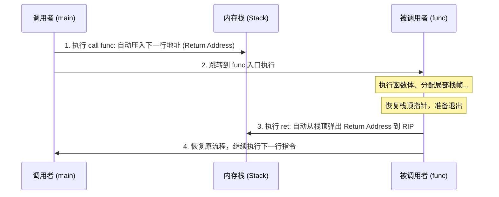

# 第 4 天：栈、函数调用与栈帧

> **学习目标**：彻底打通 Linux x86-64 架构下**函数调用的底层物理运行机理**。
> 今天你必须掌握的底层核心能力是：
> * 理解栈向低地址增长的物理本相与 `push` / `pop` 的硬件微操作；
> * 彻底搞懂 `call`（压入返回地址）与 `ret`（弹出返回地址）如何驱动控制流流转，洞悉栈缓冲区溢出（Stack Overflow）攻防的物理命门；
> * 手工推导经典栈帧序言（`push rbp; mov rbp, rsp; sub rsp, N`）与尾声（`leave; ret`）；
> * 深刻辨析 Caller-Saved 与 Callee-Saved 寄存器的责任划分；
> * 掌握 System V AMD64 ABI 严苛的 **16 字节栈对齐规则** 与 **128 字节 Red Zone（红区）** 机制。

---

## 【📌 一句话核心概括】
**硬件调用栈是进程内存中由高向低增长的后进先出（LIFO）动态存储区，其物理状态由栈顶指针 `RSP` 与帧基指针 `RBP` 协同维护；`call` 指令自动压入返回地址，`ret` 指令弹出并装载该地址至 `RIP`，二者构成了现代程序控制流嵌套与状态复原的物理基石。**

## 【📖 通俗原理解释】
- **栈的向下生长与指针变动**：内存栈底位于高地址，栈顶位于低地址。数据压栈（`push`）时，`RSP` 数值减小；数据出栈（`pop`）时，`RSP` 数值增大。局部变量分配仅需一条减法指令 `sub rsp, N` 即可极速完成。
- **`call` 与 `ret` 的微操作对接**：执行 `call target` 时，硬件自动将紧随其后的下一条指令地址（返回地址）压入栈顶，然后跳往目标函数；函数退出执行 `ret` 时，硬件直接将栈顶保存的 8 字节弹出赋予 `RIP` 恢复现场执行。若此返回地址被溢出篡改，控制流即被劫持。
- **基址指针 `RBP` 的锚定作用**：在执行期间 `RSP` 可能因临时计算频繁变动，函数在 Prologue 中通过 `push rbp; mov rbp, rsp` 固定当前帧基地址，使局部变量寻址（`[rbp - offset]`）和入栈参数寻址（`[rbp + offset]`）拥有稳定的绝对参考点。
- **寄存器保存责任划分**：调用者保存（Caller-Saved）寄存器由调用方按需备份，被调用方可任意涂改；被调用者保存（Callee-Saved）寄存器若被子函数使用，必须在入口压栈并在退出前原样还原。

---

# 一、栈的物理本质与 `rsp` 寄存器

## 1. 什么是栈？

在进程的虚拟内存空间中，栈是一块由操作系统和 CPU 硬件共同支持的内存区域：
* **增长方向**：**向下增长（向低地址延伸）**。
* **基本原则**：后进先出（LIFO: Last In, First Out）。
* **管理指针**：`RSP`（Stack Pointer Register 栈顶指针寄存器），它时刻保存着当前栈顶的最低有效内存字节地址。

```text
高地址 0x7ffffffff000 ┌────────────────────────┐  栈底 (Stack Bottom)
                      │    父函数的栈帧数据     │
                      ├────────────────────────┤
                      │       返回地址         │  (call 指令压入)
                      ├────────────────────────┤
                      │     保存的旧 RBP       │  (push rbp 压入)
                      ├────────────────────────┤
                      │      当前局部变量      │  (sub rsp, N 分配)
当前 RSP ───────────> └────────────────────────┘  栈顶 (Stack Top，最低地址)
低地址 0x7fffffffe000   (下方是未分配的空闲区域)
```

---

## 2. 硬件微操作：`push` 与 `pop` 到底做了什么？

很多初学者以为 `push` 是一条不可分割的原子操作，其实在 CPU 微架构层面，它包含两步清晰的物理动作：

### `push Reg`（压栈）
1. 先把栈顶指针向低地址推进 8 字节：`RSP = RSP - 8`
2. 将数据写入新栈顶：`*(uint64_t *)RSP = Reg`

### `pop Reg`（出栈）
1. 从当前栈顶读取 8 字节数据：`Reg = *(uint64_t *)RSP`
2. 将栈顶指针向高地址收回 8 字节：`RSP = RSP + 8`

> [!NOTE]
> `pop` 之后，旧栈顶内存里的数据**并不会被自动抹零**！它依然静静躺在内存里，直到下一次 `push` 或写入将其覆盖。这就是未初始化局部变量常常读出上一个函数残留垃圾数据的根源。

---

# 二、控制流流转核心：`call` 与 `ret` 的硬件契约

`call` 和 `ret` 是现代计算机实现结构化程序调用（子函数）的硬件基石：



## 1. `call Target` 的本质
1. 将 `call` 指令**紧挨着的下一条指令地址**（返回地址）压入栈中：
   $$\text{RSP} = \text{RSP} - 8;\quad *\text{RSP} = \text{RIP}_{\text{next}}$$
2. 将 `RIP` 设置为 `Target` 的入口地址，实现无条件跳转。

## 2. `ret` 的本质
1. 从当前 `RSP` 所指的内存中弹出一个 8 字节地址装入程序计数器 `RIP`：
   $$\text{RIP} = *\text{RSP};\quad \text{RSP} = \text{RSP} + 8$$
2. CPU 从新的 `RIP` 处继续取指令执行。

> [!CAUTION]
> **二进制安全第一定律**：
> `ret` 指令没有任何鉴权能力！它只盲目信任当前 `RSP` 指向的 8 个字节。一旦发生栈缓冲区溢出覆盖了这个槽位，控制流就立刻被黑客劫持！

---

# 三、经典栈帧结构：序言与尾声

在没有开启极端优化的标准 C 代码中，每个函数都遵循一套标准的**序言 (Prologue)** 和 **尾声 (Epilogue)** 模板：

```asm
func:
    ; === 1. 函数序言 (Prologue) ===
    push    rbp             ; 保存调用者的旧 RBP (8字节)
    mov     rbp, rsp        ; 将当前栈顶固定为本函数的基准锚点 RBP
    sub     rsp, 32         ; 向低地址开辟 32 字节的局部变量空间

    ; === 2. 函数体执行 ===
    mov     [rbp - 4], edi  ; 存放第 1 个局部变量

    ; === 3. 函数尾声 (Epilogue) ===
    leave                   ; 拆除栈帧 (等价于: mov rsp, rbp; pop rbp)
    ret                     ; 弹出返回地址，重归调用者
```

### 经典栈帧拓扑透视图：

```text
地址高低       物理地址       栈中存放内容                      说明
高地址        0x2018        [ 调用者父函数的栈帧内容... ]
             0x2010        [ 返回地址 Return Address ]    <--- call 压入
             0x2008        [ 旧 RBP (Saved RBP)      ]    <--- push rbp 压入, 此时 RBP 钉在这里!
             0x2004        [ 局部变量 a (4 字节)     ]    <--- 位于 [rbp - 4]
             0x2000        [ 局部变量 b (4 字节)     ]    <--- 位于 [rbp - 8]
低地址        0x1fe8        [ 对齐填充 Padding        ]    <--- 此时 RSP 停在 0x1FE8 (满足16字节对齐)
```

---

# 四、System V AMD64 ABI 调用约定全景

Linux x86-64 遵循严格的 **System V AMD64 ABI** 工业规范，它对寄存器的分工做出了法律般的严密约束：

### 1. 传参寄存器顺序（前 6 个整型/指针参数）

$$\mathbf{RDI} \longrightarrow \mathbf{RSI} \longrightarrow \mathbf{RDX} \longrightarrow \mathbf{RCX} \longrightarrow \mathbf{R8} \longrightarrow \mathbf{R9}$$

* 超过 6 个的后续参数，按**从右向左**的顺序依次压入栈中。
* 浮点数参数使用专门的 `XMM0` ~ `XMM7` 寄存器。
* **函数返回值**：整型/指针存放在 **`RAX`** 中（若为 128 位则使用 `RAX:RDX`）。

---

### 2. 寄存器保存责任：谁负责洗碗？

| 寄存器类别 | 包含的具体寄存器 | 约定职责（谁负责保护） | 开发者与编译器行为准则 |
| :--- | :--- | :--- | :--- |
| **Caller-Saved**<br>(调用者保存) | **`RAX`, `RCX`, `RDX`, `RSI`, `RDI`, `R8`, `R9`, `R10`, `R11`** | **调用者自行保护** | 子函数可以肆意修改这 9 个寄存器而无需恢复。若调用者在 call 之后还想用，必须自己在 call 之前 push 存好。 |
| **Callee-Saved**<br>(被调用者保存) | **`RBX`, `RBP`, `RSP`, `R12`, `R13`, `R14`, `R15`** | **被调函数负责保护** | 如果子函数想要借用这 7 个寄存器，**必须在函数开头 push 保存，并在退出前 pop 恢复原状**！否则视为违背 ABI。 |

---

# 五、两大进阶物理机制：16 字节对齐与 Red Zone

## 1. 为什么在 `call` 的边界上必须 16 字节对齐？

现代 CPU 大量使用 128 位甚至 256 位的 SSE / AVX 向量指令（例如 `movaps` 操作 XMM 寄存器）。**这些硬件指令强制要求目标栈内存必须以 16 字节对齐，否则立刻触发硬件段错误！**

为此，System V ABI 制定了一条铁律：
> **在准备执行 `call` 指令的那一瞬间，栈指针寄存器 `RSP` 的数值必须能被 16 整除（即 `RSP % 16 == 0`）！**

### 对齐状态的奇妙演进链：
1. **在 `call` 发生前一刻**：`RSP = 0x...0`（16 的倍数，余数为 0）。
2. **`call` 执行时**：硬件自动压入 8 字节的返回地址，`RSP` 减少 8，进入被调函数第一行时：
   $$\text{RSP} \pmod{16} == 8 \quad \text{（此时不对齐！）}$$
3. **执行序言 `push rbp` 时**：又压入 8 字节，`RSP` 再减 8：
   $$\text{RSP} \pmod{16} == 0 \quad \text{（奇迹般再次恢复 16 字节对齐！）}$$
4. **后续分配局部变量 `sub rsp, N` 时**：$N$ **必须是 16 的倍数（如 16, 32, 48...）**，以确保调用下一个下属函数时，栈依然维持 16 字节对齐！

---

## 2. Red Zone（红区）：用户态专享的 128 字节无人区

在 x86-64 体系中，`RSP` 指向的栈顶下方预留了 **128 字节** 的保留空间，称为 **Red Zone**（区间为 `[rsp - 1]` 到 `[rsp - 128]`）。

```text
当前 RSP ───────────> ┌────────────────────────┐
                      │    当前函数的合法栈帧    │
                      ├────────────────────────┤
                      │                        │
                      │   Red Zone (128 字节)  │ <--- 叶子函数可直接读写，无需修改 RSP！
                      │   [rsp-1] ~ [rsp-128]  │      操作系统信号处理和中断绝不踩踏！
                      │                        │
                      └────────────────────────┘
```

* **使用条件**：仅适用于**叶子函数 (Leaf Function)**（即内部不再调用任何其他子函数的终极末梢函数）。
* **收益**：叶子函数可以直接利用 `[rsp - 8]`, `[rsp - 16]` 存放局部临时变量，**彻底省去了 `sub rsp, N` 和 `add rsp, N` 两次指针开销**！
* **致命陷阱**：一旦叶子函数调用了别的人（不再是叶子函数），新的 `call` 会立刻在当前 `RSP` 下方压入返回地址，瞬间把 Red Zone 内部的数据彻底碾碎毁灭！

---

# 六、双函数实战工程：带栈帧 vs 纯寄存器优化

编写两个各具代表性的底层汇编函数：
1. `add3`：遵循传统栈帧序言，在栈上保存参数并计算累加；
2. `max3`：无栈帧优化叶子函数，纯寄存器操作 + 条件传送指令 (`cmovg`)。

### 1. 汇编源文件 `funcs.S` (Intel 语法)

```asm
.intel_syntax noprefix
.text
.globl add3
.globl max3

# int64_t add3(int64_t a, int64_t b, int64_t c)
# 参数传递: RDI=a, RSI=b, RDX=c
add3:
    # 1. 经典栈帧序言
    push    rbp
    mov     rbp, rsp
    sub     rsp, 32                 # 分配 32 字节栈帧 (满足 16 字节对齐)

    # 2. 将三个入参保存到局部栈帧中
    mov     qword ptr [rbp - 8], rdi
    mov     qword ptr [rbp - 16], rsi
    mov     qword ptr [rbp - 24], rdx

    # 3. 从栈中捞出并求和
    mov     rax, qword ptr [rbp - 8]
    add     rax, qword ptr [rbp - 16]
    add     rax, qword ptr [rbp - 24]

    # 4. 栈帧尾声与返回
    leave                           # 等价于: mov rsp, rbp; pop rbp
    ret                             # 返回值在 RAX

# int64_t max3(int64_t a, int64_t b, int64_t c)
# 纯寄存器叶子函数，无需任何栈帧开销！
max3:
    mov     rax, rdi                # 假设 a 最大: rax = a
    cmp     rsi, rax                # 比较 b 与 当前最大值
    cmovg   rax, rsi                # 若 b > rax, 则条件传送到 rax = b
    cmp     rdx, rax                # 比较 c 与 当前最大值
    cmovg   rax, rdx                # 若 c > rax, 则条件传送到 rax = c
    ret                             # 直接返回结果
```

---

### 2. C 语言调用驱动 `main.c`

```c
#include <stdio.h>
#include <stdint.h>
#include <assert.h>

// 声明外部手写汇编函数
int64_t add3(int64_t a, int64_t b, int64_t c);
int64_t max3(int64_t a, int64_t b, int64_t c);

int main(void) {
    int64_t sum = add3(10, 20, 30);
    printf("add3(10, 20, 30) = %ld (预期 60)\n", sum);
    assert(sum == 60);

    int64_t m = max3(15, 88, 42);
    printf("max3(15, 88, 42)  = %ld (预期 88)\n", m);
    assert(m == 88);

    printf("恭喜！手写汇编与栈帧验证完全成功！\n");
    return 0;
}
```

### 3. 编译与调试命令

```bash
# 联合编译汇编与 C
gcc -std=c17 -Wall -Wextra -O0 -g funcs.S main.c -o stack_lab
./stack_lab
```

---

# 七、GDB 显微镜：单步跟踪 `add3` 栈帧与返回地址

启动调试器深入硬件底层：

```bash
gdb ./stack_lab
```

在 GDB 命令行中执行：

```gdb
(gdb) break add3             # 在 add3 入口打断点
(gdb) run                    # 启动运行
(gdb) layout asm             # 开启汇编单步窗口
(gdb) layout regs            # 开启寄存器实时监控窗口
```

### 关键检查步骤：
1. **查看刚进函数时的对齐状态**：
   ```gdb
   (gdb) print/x $rsp
   $1 = 0x7fffffffe028       # 注意末位是 8！说明此时 RSP % 16 == 8，完美符合 ABI 规范！
   ```
2. **查看栈顶存放的秘密（返回地址）**：
   ```gdb
   (gdb) x/1gx $rsp
   0x7fffffffe028: 0x000055555555518b   # 这就是 main 函数调用 call add3 之后的下一行指令地址！
   ```
3. **单步执行序言 `stepi`**：
   ```gdb
   (gdb) stepi               # 执行 push rbp
   (gdb) print/x $rsp
   $2 = 0x7fffffffe020       # RSP 减了 8，末位变成 0，恢复 16 字节对齐！
   (gdb) stepi               # 执行 mov rbp, rsp
   (gdb) stepi               # 执行 sub rsp, 32
   (gdb) print/x $rsp
   $3 = 0x7fffffffe000       # 栈空间开辟完毕！
   ```
4. **观察 `leave` 的原子恢复**：
   当执行到 `leave` 时，它会瞬间把 `RSP` 拉回 `RBP` 的位置，并把旧 `RBP` 弹回给调用者，栈顶再次精准停在返回地址上方，等待 `ret` 腾空跃回！

---

# 八、第四天通关八大避坑红线

在逆向分析和手写汇编中，以下 8 大失误极其普遍：

1. **RSP 栈指针失衡 (Stack Misalignment)**：`push` 之后忘记 `pop`，导致函数返回时 `ret` 弹出了错误的脏数据，直接导致程序原地崩溃；
2. **返回地址被无意破坏**：在局部缓冲区写越界，直接改写了紧挨在 `Saved RBP` 上方的返回地址；
3. **把未分配栈空间误认为初值是 0**：`sub rsp, 32` 开辟出的内存是未初始化的随机值；
4. **随意破坏 Callee-Saved 寄存器**：使用了 `RBX`, `R12~R15` 却忘记在函数头尾予以保存和恢复，导致父函数的局部状态被彻底毁灭；
5. **在非叶子函数中误用 Red Zone**：以为 `[rsp-8]` 永远安全，结果一个 `call` 瞬间冲毁了数据；
6. **调用外部函数前未做 16 字节对齐**：栈未对齐时调用 `printf`，直接触发 SSE 向量指令 `movaps` 段错误崩溃；
7. **有符号与无符号跳转混淆**：有符号数比较使用了 `ja/jb`（无符号），导致负数被当成海量大正数；
8. **返回栈上局部变量的指针**：函数一旦 `ret`，其栈帧物理生命期终结，返回的指针直接沦为致命的悬空指针。

---

# 九、第四天通关核心口试自测（闭卷大通关）

### 题 1：`call` 指令和 `ret` 指令在底层分别做了什么微操作？
* **满分回答**：
  * `call Target`：首先将 `call` 指令紧邻的下一条指令物理地址（即返回地址 Return Address）压入栈中（等价于 `push rip_next`），然后将 `RIP` 跳转到 `Target` 入口；
  * `ret`：从当前 `RSP` 指向的栈顶弹出 8 字节数据装入 `RIP`（等价于 `pop rip`），控制流返回调用者。

### 题 2：为什么函数序言中常用 `push rbp; mov rbp, rsp; sub rsp, N`？
* **满分回答**：
  1. `push rbp`：保护调用者父函数的栈帧基址；
  2. `mov rbp, rsp`：在当前栈顶打下新锚点，将当前栈帧的基准固定在 `RBP` 上，后续通过稳定的固定负偏移 `[rbp - X]` 访问各局部变量，不受局部动态 push 影响；
  3. `sub rsp, N`：向低地址延伸栈顶，为本函数所有局部变量预先开辟出足够的安全物理存储空间。

### 题 3：System V AMD64 ABI 规定的前 6 个整型传参寄存器分别是什么？返回值放在哪里？
* **满分回答**：
  传参顺序：`RDI` $\rightarrow$ `RSI` $\rightarrow$ `RDX` $\rightarrow$ `RCX` $\rightarrow$ `R8` $\rightarrow$ `R9`；普通整型与指针返回值存放在 `RAX` 中。

### 题 4：什么是 Caller-Saved 和 Callee-Saved 寄存器？它们的责任划分是什么？
* **满分回答**：
  * **Caller-Saved（调用者保存）**：包括 `RAX, RCX, RDX, RSI, RDI, R8~R11`。被调函数无需保护这些寄存器即可自由写入；若调用者希望在跨函数调用后继续使用它们的值，必须在 `call` 之前自行保存到栈中；
  * **Callee-Saved（被调用者保存）**：包括 `RBX, RBP, RSP, R12~R15`。这些寄存器的内容归调用者所有，被调函数若要使用，必须在函数序言中 `push` 备份，并在退出前 `pop` 恢复原样。

### 题 5：什么是 Red Zone？为什么普通非叶子函数不能使用它？
* **满分回答**：
  Red Zone 是 Linux x86-64 用户态体系下栈顶 `RSP` 下方的 128 字节区域（`[rsp-1]` 到 `[rsp-128]`）。操作系统保证信号和硬件中断不会破坏这 128 字节，允许叶子函数无需移动 `RSP` 即可直接读写它作为临时空间。
  但非叶子函数绝不能依赖 Red Zone，因为一旦它调用了子函数，子函数的 `call` 动作以及子函数自身的执行会直接将新的返回地址和栈数据压入该区域，瞬间将其覆盖践踏。