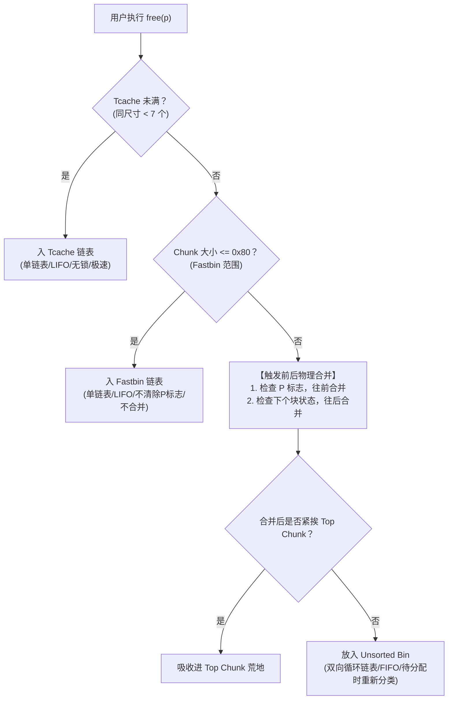

# 第 40 天：ptmalloc 与堆块状态机——从 Chunk 结构到内存回收生命周期

---

## 【📌 一句话核心概括】
**ptmalloc 是通过在用户缓冲区前置 16 字节头部（`mchunk_size` 与 AMP 标志位）将虚拟堆内存组织为连续 Chunk，并在 `free` 时借用用户数据区作为链表指针（`fd`/`bk`）在 Tcache、Fastbin、Unsorted Bin 及 Small/Large Bin 四级容器与状态机间实现高速流转复用的用户态内存管理器。**

## 【📖 通俗原理解释】
- **Chunk 头部的空间复用设计**：用户通过 `malloc(size)` 获得的指针 `P` 实际位于 Chunk 起始偏移 16 字节处（`P = Chunk + 16`）。前 16 字节作为元数据头记录 `prev_size` 与 `size`。由于 x86-64 堆块按 16 字节对齐，`size` 字段的最低 3 位天然为 0，被用于复用存储状态标志位：`A`（非主分配区）、`M`（`mmap` 独立映射）、`P`（`PREV_INUSE`，物理前块是否在使用中）。
- **已分配 vs 空闲状态的内存重叠**：堆块在被分配（In-Use）时，用户数据区全部归用户写入；一旦被释放（Freed），ptmalloc 立即复用原用户数据区的前 16 字节作为链表指针：单向链表复用 `fd`，双向链表复用 `fd` 和 `bk`，无需额外浪费物理内存分配节点结构体。
- **多级回收仓（Bins）与分级流转**：
  - *Tcache（线程专属缓存）*：线程独立无锁单链表（LIFO），最多容纳 7 个同尺寸 Chunk，分配/释放极速响应。
  - *Fastbin*：小尺寸全局单链表（LIFO），释放时不清除 `PREV_INUSE` 标志位，不触发物理相邻块合并。
  - *Unsorted Bin*：释放的中大尺寸块暂存的双向环形队列，在下一次分配时进行全局整理与拆分。
  - *Top Chunk*：堆顶未划分的连续物理内存边界，所有 Bin 无法满足请求时由其按需切割产生新 Chunk。
- **物理相邻块的边界合并（Coalescing）**：释放非 fast 块时，分配器通过当前块的 `size` 计算物理后块地址，并检查其使用标志位；通过 `prev_size` 查找物理前块地址。若相邻块为空闲状态，立即通过双向链表脱钩操作（Unlink）将碎片缝合成大块，从物理源头遏制堆碎片化。

---

## 【🎯 为什么需要它与设计动机】

1. **摆脱低效的系统调用泥潭**
   操作系统内核提供的内存接口（`brk` / `mmap`）非常昂贵（涉及特权级切换、TLB 刷新与内核锁竞争）。如果程序员每次 `malloc(16)` 都向内核要内存，程序性能会直接归零。`ptmalloc` 充当了“批发零售商”：一次性找内核批发几十兆内存，然后在用户态以纳秒级速度极速切分、周转和复用。
2. **多核多线程无锁高并发（Per-Thread Cache & Arena）**
   在现代高并发服务器中，成百上千个线程同时调用 `malloc`。早期分配器因全局锁成为最大瓶颈。glibc 2.26 引入 **Tcache（Thread Local Cache）**，让每个线程拥有专属的局部缓存链表，95% 以上的小内存分配无需任何线程锁。
3. **安全攻防的核心舞台**
   堆漏洞（UAF、堆溢出、双重释放 Double Free、Off-by-One）占据了高价值漏洞（浏览器、内核、移动端提权）的半壁江山。而要理解所有堆利用，其绝对前提是**彻底洞悉 `malloc_chunk` 的内存拓扑与状态机迁移规律**。

---

## 【🔬 核心概念深度剖析】

### 1. `malloc_chunk` 结构体物理拓扑

在 glibc 的实现源码中，堆上的每一个基本单元都是一个 `malloc_chunk`：

```c
struct malloc_chunk {
    size_t      mchunk_prev_size;  // 前一个相邻空闲 Chunk 的大小 (前块空闲时有效)
    size_t      mchunk_size;       // 当前 Chunk 大小 + 3 个状态标志位 (A|M|P)
    /* 仅在 Chunk 处于空闲状态 (Freed) 时才存在的双向/单向链表指针: */
    struct malloc_chunk* fd;       // Forward 指针: 指向同 Bin 中下一个空闲 Chunk
    struct malloc_chunk* bk;       // Backward 指针: 指向同 Bin 中上一个空闲 Chunk
    /* 仅在 Large Bin 中才存在的跳表指针: */
    struct malloc_chunk* fd_nextsize;
    struct malloc_chunk* bk_nextsize;
};
```

#### 关键内存边界：用户指针与空间借用（Space Stealing）
```text
【已分配状态 (Allocated Chunk)】
低地址
+-----------------------------------+
| prev_size (若前块被占用，此处充当   |
|            前块用户数据的末尾 8B) |  <- [C + 0x00]
+-----------------------------------+
| Chunk Size | A | M | P 标志位     |  <- [C + 0x08]
+-----------------------------------+ <--- 用户指针 P (malloc 返回值 = C + 16)
|                                   |
|        用户数据区 (User Data)      |  <- [P + 0x00]
|                                   |
+-----------------------------------+ <--- 下一个 Chunk 的起点 (C + Chunk Size)
高地址

【已释放空闲状态 (Free Chunk - 如 Unsorted Bin 中)】
+-----------------------------------+
| prev_size                         |  <- [C + 0x00]
+-----------------------------------+
| Chunk Size | A | M | P 标志位     |  <- [C + 0x08]
+-----------------------------------+ <--- 这里的用户空间被复用为链表指针！
| fd (Forward Pointer)              |  <- [C + 0x10] (原用户数据前 8 字节)
+-----------------------------------+
| bk (Backward Pointer)             |  <- [C + 0x18] (原用户数据次 8 字节)
+-----------------------------------+
| 剩余空闲空间填充 (Padding)         |
+-----------------------------------+
```

---

### 2. Chunk Size 的末 3 位标志位（A | M | P）

因为 64 位系统下堆块以 16 字节对齐（最低 4 个二进制位恒为 0），glibc 巧妙利用最低的 3 个 bit 作为状态标志，节约内存：

| 标志位 | 权值 | 名称 | 核心含义与状态判定 |
| :---: | :---: | :--- | :--- |
| **`A`** | `0x04` | `NON_MAIN_ARENA` | `0`：来自主线程堆区（Main Arena）；`1`：来自子线程从分配区（Thread Arena）。 |
| **`M`** | `0x02` | `IS_MMAPPED` | `1`：表示该超大内存块直接通过系统调用 `mmap()` 映射，不归属堆堆顶，释放时直接 `munmap`。 |
| **`P`** | `0x01` | **`PREV_INUSE`** | **最核心标志位！**<br>`1`：表示物理相邻的前一个 Chunk 正在被使用中。<br>`0`：表示前一个 Chunk 处于空闲状态，**此时当前的 `prev_size` 字段才真实有效**！ |

> [!IMPORTANT]
> **真实大小计算法则**：
> 提取真实 Chunk 大小必须抹去末 3 位标志位：`real_size = chunk->size & ~0x07`。
> 例如：如果 `size` 字段为 `0x31`，则真实大小为 `0x30`（48 字节），且 `P=1`（前块被占用）。

---

### 3. 请求大小与规格化 Chunk 大小精确换算（x86-64）

分配器遵循 **16 字节严格对齐** 原则，且最小 Chunk 大小 `MINSIZE = 0x20`（32 字节）。

#### 换算数学公式：
$$\text{Chunk Size} = \max\left(32, \; \operatorname{align\_up}(\text{Request Size} + 8, \; 16)\right)$$

> **为什么只加 8（`SIZE_SZ`），而不是加 16 字节头部？**
> 空间借用机制：当前 Chunk 的最后 8 字节可以借用给“下一个物理相邻 Chunk”充当其 `prev_size`。因此只需要容纳当前 Chunk 的 `size` 字段（8 字节）加上用户请求大小即可！

#### 经典尺寸映射表：
| 用户请求 `malloc(N)` | 增加 8B 头部 | 向上取整 16 的倍数 | 实际分配 Chunk 大小 | 用户可用上限（`malloc_usable_size`） |
| :--- | :--- | :--- | :--- | :--- |
| `1 ~ 24 字节` | `9 ~ 32` | 32 | **`0x20`（32 字节）** | 24 字节 |
| `25 ~ 40 字节` | `33 ~ 48` | 48 | **`0x30`（48 字节）** | 40 字节 |
| `41 ~ 56 字节` | `49 ~ 64` | 64 | **`0x40`（64 字节）** | 56 字节 |
| `100 字节` | 108 | 112 | **`0x70`（112 字节）** | 104 字节 |

---

### 4. 堆块状态机：四级 Bin 回收池的分级治理

当用户调用 `free(p)` 时，ptmalloc 并不会立即把内存还给操作系统，而是将其纳入多级缓存桶链表（Bins）：



1. **Tcache（glibc 2.26+ 引入）**：
   - 每线程独立，最大容纳 64 个 size 桶，每个桶最多存 7 个 chunk。
   - 插入与取出均为单链表头插/头取（LIFO），零原子锁竞争。
2. **Fastbin**：
   - 单链表，分配时不清除 `PREV_INUSE`，绝不与前后空闲块合并，追求极速复用。
3. **Unsorted Bin**：
   - 释放的大块首先落入此处。下次 `malloc` 时，分配器会优先遍历该链表，尝试“精准命中”或“切片（Split）”，未命中的块会被分流整理至 Small Bin 或 Large Bin。
4. **Top Chunk**：
   - 堆区最顶端的一整块连续未被切分的虚拟内存。当所有 Bin 都无法满足请求时，直接从 Top Chunk 的底部切下一块分给用户；若 Top Chunk 空间不足，则触发 `sys_brk` 向内核扩大堆边界。

---

## 【🛠️ 工业实操与反汇编/调试验证】

### 1. 验证堆状态机与内存拓扑的 C 源码（`heap_trace.c`）

```c
#include <stdio.h>
#include <stdlib.h>
#include <stdint.h>

int main(void) {
    printf("[*] Process PID: %d\n", getpid());

    // 1. 分配两个连续小块 (请求 24 字节 -> 规格化为 0x20)
    uint64_t *a = (uint64_t *)malloc(24);
    uint64_t *b = (uint64_t *)malloc(24);

    printf("[+] a (User ptr): %p (Chunk ptr: %p)\n", a, (void*)((uintptr_t)a - 16));
    printf("[+] b (User ptr): %p (Chunk ptr: %p)\n", b, (void*)((uintptr_t)b - 16));

    // 查看 Chunk a 与 Chunk b 的头部元数据
    uint64_t *chunk_a = a - 2;
    uint64_t *chunk_b = b - 2;

    printf("[*] Chunk a -> Size: 0x%lx (Real: 0x%lx, P=%lu)\n", 
           chunk_a[1], chunk_a[1] & ~7UL, chunk_a[1] & 1UL);
    printf("[*] Chunk b -> Size: 0x%lx (Real: 0x%lx, P=%lu)\n", 
           chunk_b[1], chunk_b[1] & ~7UL, chunk_b[1] & 1UL);

    // 2. 释放 a (进入 Tcache)
    puts("\n[*] Freeing a...");
    free(a);

    // 释放后，观察用户数据区前 8 字节是否变成了 fd 指针
    printf("[*] After free, a[0] (fd pointer / safe-link): 0x%lx\n", a[0]);

    return 0;
}
```

### 2. 编译与 GDB 堆状态深入检视

```bash
gcc -O0 -g heap_trace.c -o heap_trace
gdb -q ./heap_trace
```

在 GDB（加载 pwndbg/GEF 插件）中单步运行，观察堆块的物理原貌：

```text
(gdb) b main
(gdb) r
(gdb) n (单步执行至两个 malloc 完成)

(gdb) x/10gx (void*)((uintptr_t)a - 16)
0x555555559290: 0x0000000000000000   0x0000000000000021  <-- Chunk a: size=0x20, P=1
0x5555555592a0: 0x0000000000000000   0x0000000000000000  <-- a 的用户数据区 (24B)
0x5555555592b0: 0x0000000000000000   0x0000000000000021  <-- Chunk b: size=0x20, P=1
0x5555555592c0: 0x0000000000000000   0x0000000000000000  <-- b 的用户数据区
0x5555555592d0: 0x0000000000000000   0x0000000000020d31  <-- Top Chunk: 剩余 0x20d30 字节!
```

**实验核验点**：
- `Chunk a` 的起始地址是 `0x555555559290`，`malloc` 返回的用户指针是 `0x5555555592a0`（差值恰好为 16 字节！）。
- `Size` 字段值为 `0x21`：实际 Chunk 长度为 `0x20`（32 字节），末位 `1` 代表前一个 Chunk（这里是堆初始化结构）正在使用。
- `Chunk b` 的起始地址恰好是 `0x555555559290 + 0x20 = 0x5555555592b0`！两个堆块在物理上丝丝入扣、严密相邻！

---

## 【⚠️ 常见陷阱与避坑指南】

| 陷阱与盲区 | 深度机理与表象 | 正确解法与工程底线 |
| :--- | :--- | :--- |
| **误以为 `malloc(0)` 返回 NULL** | C 标准允许 `malloc(0)` 返回 NULL 或一个可安全传给 `free()` 的非空独一指针。在 glibc 中，`malloc(0)` 会分配一个 `MINSIZE`（0x20）的最小堆块并返回有效指针！ | 严禁用 `p == NULL` 来判断用户是否请求了 0 字节。 |
| **Off-by-One 溢出破坏 P 标志** | 向 `buf` 写入时刚好超出一字节（常见于 `for(i=0; i<=len; i++)`），把后一个 Chunk 的 `size` 最低位由 `0x31` 踩成了 `0x30`（`PREV_INUSE = 0`）。在随后 `free` 时触发错误的向后合并，引发崩溃或形成重叠堆块（Chunk Overlapping）。 | 严密校对循环边界；字符串拷贝确保 `\0` 算在合法容量内。 |
| **忽略 glibc 2.32+ Safe-Linking 异或混淆** | 试图直接读取 Tcache/Fastbin 的 `fd` 指针获取堆地址。现代 glibc 对单链表 `fd` 进行了 `fd = (L >> 12) ^ P` 掩码加密。 | 必须先通过未加密结构或特定算法反解算（`Heap Leak`）还原指针掩码。 |

---

## 【💼 经典面试与工程实操自测】

### Q1：为什么 `ptmalloc` 中用户指针与 Chunk 起点之间总存在 16 字节的偏移？这两项 8 字节字段分别是什么？
> **参考答案**：
> - `malloc` 返回给用户的是可以直接读写的数据区起始地址。
> - 在用户数据区之前，必须预留 16 字节存放 `struct malloc_chunk` 的核心元数据：
>   1. **`prev_size`（8 字节）**：当物理相邻的前一个 Chunk 处于释放空闲状态时，该字段记录前块的真实大小，用于向后合并（Backward Coalesce）；若前块正在使用中，该字段空间被前块借用存放其末尾数据；
>   2. **`size`（8 字节）**：记录当前 Chunk 的总大小（包括这 16 字节头部），其最低 3 个 bit 用作标志位（A、M、P），用于标示堆区归属、是否 mmap 以及前块是否使用。

### Q2：glibc 堆管理器在执行 `free(p)` 时，是怎样通过“向前合并”和“向后合并”把碎内存融合成大块的？
> **参考答案**：
> 1. **向后合并（Backward Coalesce，向低地址合并）**：
>    - 检查当前 Chunk 的 `PREV_INUSE`（P 标志位）。若 `P == 0`，说明前一个物理相邻块是空闲的。
>    - 通过当前指针减去 `prev_size` 找到前块的头部，将前块从其所在的 Bin 链表中脱链（`unlink`），并将两块的大小合并。
> 2. **向前合并（Forward Coalesce，向高地址合并）**：
>    - 通过当前 Chunk 起点加上其自身 `size`，直接计算出物理相邻的“后一个 Chunk”的内存地址。
>    - 检查后一个块的“后后块”的 `PREV_INUSE` 标志。若后块为空闲状态，同样将其脱链并吞并合并。
>    - 若后块恰好是 Top Chunk，则直接将合并后的大块融合进 Top Chunk。

### Q3：为什么说 Tcache（线程本地缓存）的引入极大提升了堆分配性能，却在早期引入了严重的安全隐患（如 Double Free 极易被利用）？
> **参考答案**：
> - **性能提升**：Tcache 是每个线程私有的单链表结构，申请和释放小内存时完全绕过了全局或从分配区的互斥锁（Mutex Lock），无锁操作使得小堆块的周转达到极致性能。
> - **安全弱点**：
>   1. 早期（glibc 2.26 ~ 2.28）的 Tcache 为了追求速度，**完全去除了任何完整性校验**（没有检查 double free，没有检查链表成环，没有检查指针合法性）；
>   2. 攻击者只需连续两次 `free(p)`，Tcache 就会形成自我引用的死循环链表，紧接着下一次 `malloc` 就能实现任意内存重叠分配。直到 glibc 2.29 才引入了 `tcache_entry.key` 字段用来防御初级的 Double Free。