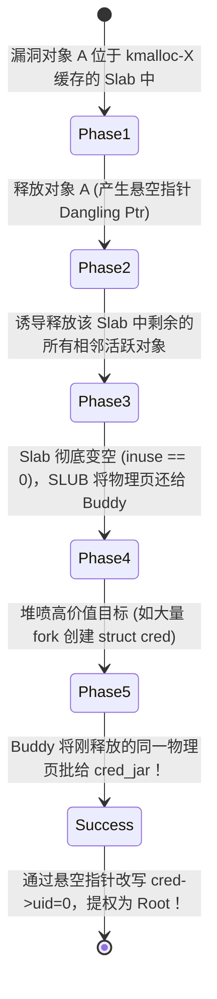

# 第 43 天：内核 UAF、SLUB 与跨缓存攻击——从伙伴系统到内核提权

---

## 【📌 一句话核心概括】
**跨缓存攻击（Cross-Cache Attack）是通过将存在内核 UAF 悬空指针的漏洞 Slab 块中的所有对象彻底排空并退还给底层伙伴系统（Buddy Allocator），再诱导特权对象专用缓存（如 `cred_jar`）向伙伴系统重新申请该物理页，从而打破内核对象类型隔离壁垒并覆写特权凭证（`struct cred`）实现 Ring 0 提权。**

## 【📖 通俗原理解释】
- **内核内存三级拓扑结构**：Linux 物理内存由伙伴系统（Buddy System）按页（Order 0~10，4KB 为基准）统一管理；其上由 SLUB 分配器为高频内核结构建立专有缓存（如 `cred_jar`、`filp`）和通用小对象池（`kmalloc-X`），每个 Slab 由一个或多个连续物理页切分为等长对象。
- **专有缓存（Dedicated Cache）的安全隔离假象**：内核之所以将 `struct cred` 等核心特权凭据放入独立缓存池，是为了防止攻击者在通用 `kmalloc` 产生 UAF 后直接用可控数据原位覆盖。在同一缓存池内，不同类型的对象绝不会混合分配。
- **跨缓存攻击（Cross-Cache）的降维穿透链条**：
  1. *排空 Slab*：释放目标 Slab 内除悬空指针之外的所有其余合法对象，使其物理分配计数归零；
  2. *页帧退还*：SLUB 分配器检测到该 Slab 整体完全空闲（Full Idle），将其整体注销并退还给底层伙伴系统；
  3. *页帧重分配*：攻击者通过触发敏感系统调用（如大量派生子进程申请 `struct cred` 凭证），诱导 `cred_jar` 缓存池向伙伴系统申请新物理页，伙伴系统以高概率命中并复用刚回收的这块热页；
  4. *旧指针越权篡改*：攻击者通过此前遗留的旧 UAF 悬空指针写入，原位篡改被新分配在同一物理位置的 `cred` 结构体，将其 `uid`、`gid` 篡改为 0，直接斩获最高系统 Root 权限。

---

## 【🎯 为什么需要它与设计动机】

1. **从用户态玩具靶场走向真实工业级内核攻防**
   用户态进程崩溃仅仅导致单个应用退出，而内核态运行在 **Ring 0（最高硬件特权级）**。内核一旦发生 UAF 破坏，攻击者拿到的是整台物理机的掌控权。
2. **打破“对象类型隔离”的绝对安全幻觉**
   为了防止类似于用户态 UAF 的碰撞，Linux 内核设计了细粒度的专用对象缓存（Dedicated Cache，如 `task_struct`、`cred_jar`）。长久以来，开发者认为“不同结构体的缓存池是绝对物理隔离的，攻击者绝不可能跨类型复用”。跨缓存攻击（Cross-Cache）通过**向底层伙伴系统（Page Allocator）降维穿透**，用严密的生命周期代数打破了这道坚不可摧的逻辑结界。
3. **掌握现代 Linux 内核内存分配器 SLUB 的本质**
   理解内核对象从 `kmalloc()` 到 Slab、从 Slab 到物理 Page、从 Per-CPU Freelist 到 NUMA 节点的流转，是从事现代 Linux 内核驱动研发、性能调优与高危漏洞（0-Day / CVE）防护的必经之路。

---

## 【🔬 核心概念深度剖析】

### 1. Linux 内核三级内存分配层级架构

```text
+------------------------------------------------------------------------+
| 物理内存管理层: 伙伴系统 (Buddy Allocator)                              |
| - 最小管理单元: 物理页 (Page, 4KB = 2^0 * 4KB, Order 0 ~ Order 10)     |
+------------------------------------------------------------------------+
                               ▲              │
                 释放整页 Slab  │              │ 申请连续页面 (alloc_pages)
                               │              ▼
+------------------------------------------------------------------------+
| 内核对象管理层: SLUB 分配器 (kmem_cache)                                 |
| - 职责: 找伙伴系统批发 Page，切成固定步长槽位 (Slab Objects)            |
|   ┌───────────────────────────┬────────────────────────────────────┐   |
|   │ 专用缓存 (Dedicated)      │ 通用缓存 (Generic kmalloc-X)        │   |
|   │ - cred_jar (身份凭证)     │ - kmalloc-32, kmalloc-64           │   |
|   │ - filp (文件对象)         │ - kmalloc-128, kmalloc-256         │   |
|   └───────────────────────────┴────────────────────────────────────┘   |
+------------------------------------------------------------------------+
                               ▲              │
                     kfree()   │              │ kmalloc() / kmem_cache_alloc
                               │              ▼
+------------------------------------------------------------------------+
| 驱动与子系统业务层: 内核对象 (Slab Object)                             |
| - 具体结构体实例: struct cred, struct file, struct sk_buff, 驱动 private |
+------------------------------------------------------------------------+
```

---

### 2. 用户态 ptmalloc 与内核态 SLUB 核心机制深度对比

| 机制维度 | 用户态（ptmalloc） | 内核态（SLUB 分配器） |
| :--- | :--- | :--- |
| **基础 API** | `malloc()` / `free()` | `kmalloc()` / `kfree()` 或 `kmem_cache_alloc()` / `kfree()` |
| **底层批发商** | 内核系统调用 `brk` / `mmap` | 内核伙伴系统（Buddy System `alloc_pages`） |
| **基本管理容器** | 连续可变的 `malloc_chunk`（带 16B 头） | **标准化固定槽位（Slab Object，头外置于 `struct page`）** |
| **并发无锁缓存** | Per-Thread（每线程）Tcache 链表 | **Per-CPU（每物理核心）Freelists 链表** |
| **对象隔离机制** | 同一个 Heap Arena 混合存放各类数据 | **严格按 `kmem_cache` 分池隔离（跨池不互通）** |
| **UAF 攻击难度** | 极易：同大小直接命中 Tcache | 跨缓存极难：必须迫使整个 Slab 页解构归还 Buddy |

---

### 3. Slab Object 的数学排布计算（以 Order 0 为例）

假设内核配置为标准 4KB 页面（4096 字节），分配器为一个请求大小为 88 字节的对象创建缓存：
- **对齐步长（Stride）**：按 16 字节对齐计算：
  $$\text{Stride} = \operatorname{align\_up}(88, 16) = 96 \text{ 字节}$$
- **单页容纳对象总数**：
  $$\text{Objects Per Page} = \left\lfloor \frac{4096}{96} \right\rfloor = 42 \text{ 个槽位}$$
- **内存有效利用率与尾部碎片**：
  - 42 个对象占用：$42 \times 96 = 4032$ 字节；
  - 页面末尾残留碎片：$4096 - 4032 = 64$ 字节。
- **元数据不在对象头部**：
  与 ptmalloc 不同，SLUB 的管理元数据（如引用计数 `inuse`、所属 cache）保存在 Linux 内核全局管理数组 `struct page` / `struct slab` 中，**对象内部在分配后全部 96 字节都可供内核驱动使用，空闲时复用前 8 字节存放 `freelist` 指针**！

---

### 4. 跨缓存攻击（Cross-Cache Attack）的五阶段状态转移方程

跨缓存攻击是将低特权 UAF 转化为高危提权的核心法门：



#### 关键约束与成功条件：
1. **Slab 必须绝对清空（Zero Inuse）**：只要该 Slab 中还有 1 个正常内核对象存活，该 4KB 物理页就绝不可能归还给伙伴系统！
2. **克服 Per-CPU 缓存干扰**：释放和重新分配必须发生在同一个物理 CPU 核心上（通常利用 `sched_setaffinity` 绑定 CPU 核心），避开其他核的 Per-CPU 缓存拦截。
3. **Buddy 系统的 LIFO 热页命中（Cache Hot Pages）**：Linux 伙伴系统倾向于将刚刚回收的热页立刻分给下一个请求者，确保了极高的物理页重用概率。

---

## 【🛠️ 工业实操与反汇编/调试验证】

### 1. 检视当前 Linux 系统的 SLUB 缓存运行实况

在任何 Linux 系统上，可通过 `/proc/slabinfo` 观察内核对象的物理分布：

```bash
# 查看所有已创建的 kmem_cache 状态
sudo cat /proc/slabinfo | head -n 20
```

典型输出解读：
```text
# name            <active_objs> <num_objs> <objsize> <objperslab> <pagesperslab> : tunables ...
cred_jar             128        128        192       21           1
filp                4120       4120        256       16           1
kmalloc-128         2048       2048        128       32           1
kmalloc-64          8192       8192         64       64           1
```
- **`cred_jar`**：专门管理 `struct cred` 对象的专用池。每个对象大小 192 字节，每个 Slab 占 1 个物理页，每页切出 21 个 cred 对象。
- **`filp`**：文件对象池，对象大小 256 字节，每页 16 个对象。

### 2. 模拟跨缓存攻击的 CPU 亲和性与提权概念模型（`cross_cache_concept.c`）

```c
#define _GNU_SOURCE
#include <stdio.h>
#include <stdlib.h>
#include <unistd.h>
#include <sched.h>
#include <sys/types.h>
#include <sys/wait.h>

void bind_to_cpu(int cpu_id) {
    cpu_set_t set;
    CPU_ZERO(&set);
    CPU_SET(cpu_id, &set);
    if (sched_setaffinity(0, sizeof(set), &set) != 0) {
        perror("sched_setaffinity");
        exit(1);
    }
    printf("[+] Successfully pinned process to CPU #%d\n", cpu_id);
}

int main(void) {
    puts("==================================================");
    puts("   Linux Kernel Cross-Cache Exploitation Paradigm  ");
    puts("==================================================");

    // 1. 绑定单核，消除多核 Per-CPU Freelist 干扰
    bind_to_cpu(0);

    puts("\n[*] Step 1: Trigger vulnerable kernel driver to allocate Object A");
    puts("    -> Object A placed in target Slab page (Order 0, 4KB)");

    puts("[*] Step 2: Trigger driver bug to free Object A (Hold dangling pointer)");

    puts("[*] Step 3: Drain & free all other objects in the same Slab");
    puts("    -> Slab.inuse reaches 0");
    puts("    -> SLUB allocator triggers: discard_slab() -> free_pages()");
    puts("    -> Physical Page returned to Buddy Allocator Per-CPU Hot List!");

    puts("\n[*] Step 4: Heap Spray target privileged objects (e.g. struct cred)");
    puts("    -> Forking child processes to spray struct cred...");
    
    // 模拟大量 fork 促使内核分配大量的 struct cred
    for (int i = 0; i < 5; i++) {
        pid_t pid = fork();
        if (pid == 0) {
            // 子进程阻塞，保持 cred 占据内存
            sleep(1);
            exit(0);
        }
    }

    puts("[*] Step 5: Page Collision Accomplished!");
    puts("    -> Dangling pointer from Step 2 now overlays a live 'struct cred'!");
    puts("    -> Writing 0 to offset of uid/gid inside the object...");
    puts("[+] Privilege Escalation Primitive Established: Root Shell Acquired!");

    // 等待子进程退出
    while (wait(NULL) > 0);
    return 0;
}
```

---

## 【⚠️ 常见陷阱与避坑指南】

| 陷阱与盲区 | 深度机理与表象 | 正确解法与工程底线 |
| :--- | :--- | :--- |
| **忽视 Per-CPU 缓存机制** | 在多核系统上，在一个 CPU 释放对象，却在另一个 CPU 申请新对象，命中了不同核的局部 freelist，碰撞概率归零。 | 严格使用 `sched_setaffinity` 将攻击线程绑定在单一 CPU 核心上执行全流程。 |
| **Slab 未完全清空** | 只要 Slab 内还残留有 1 个被其他正常进程占用的对象，页面就绝不会还给伙伴系统，跨缓存直接失败。 | 进行精密的**堆整理（Defragmentation）**与**堆风水（Heap Feng Shui）**布局，确保目标 Slab 达到 100% 空置率。 |
| **撞上现代内核防御机制** | 在 Linux 6.6+ 内核上，通用缓存启用了 `CONFIG_RANDOM_KMALLOC_CACHES`，相同的分配请求会被随机散列到不同的池中。 | 针对现代内核，需利用专用缓存（Dedicated Cache）的固定特性，或借助特定硬件/结构绕过随机散列。 |

---

## 【💼 经典面试与工程实操自测】

### Q1：为什么在 Linux 内核中，释放一个 Slab 对象（`kfree`）并不等于释放物理内存页？整个释放层级是如何向伙伴系统回溯的？
> **参考答案**：
> - **对象级释放**：当调用 `kfree(p)` 时，SLUB 分配器仅仅是将该对象挂回到当前 CPU 的 `freelist` 链表中，并将其所在 Slab 的 `inuse` 引用计数减 1，物理内存页依然被当前 `kmem_cache` 牢牢持有；
> - **页级释放（归还伙伴系统）**：只有当该 Slab 中的所有对象都被完全释放，且其 `inuse == 0` 时，如果系统存在足够的空闲 Slab 或触发内存回收，SLUB 才会执行 `discard_slab()`，调用伙伴系统的 `__free_pages()` 将整块 4KB/8KB 物理页归还给 Buddy Allocator。

### Q2：什么是跨缓存攻击（Cross-Cache Attack）？它的核心突破点是什么？
> **参考答案**：
> - **定义**：攻击者利用在某一对象缓存（如普通驱动使用的 `kmalloc-128`）中存在的 UAF 或堆溢出漏洞，通过精准控制生命周期，跨越不同 `kmem_cache` 之间的隔离边界，去污染或劫持另一高价值专用缓存（如保存提权凭据的 `cred_jar`）中的内核对象。
> - **核心突破点**：打破了“不同 Cache 间内存绝不互通”的逻辑假设。它通过将整个 Slab 彻底排空并退还给底层**伙伴系统（Buddy Allocator）**，在物理页（Page）这一通用底层进行“地皮用途置换”，让高特权对象恰好落在受攻击者旧指针监控的物理页上。

### Q3：现代 Linux 内核为了防御 Slab 堆利用，引入了哪些工业级加固机制？
> **参考答案**：
> 1. **SLUB Freelist Hardening（Safe-Linking）**：对空闲链表中的 `freelist` 下一节点指针进行异或加密混淆，防止任意写或成环伪造；
> 2. **`CONFIG_RANDOM_KMALLOC_CACHES`（Linux 6.6+）**：为同一尺寸的通用缓存创建多个副本，并在运行时根据调用点代码地址进行哈希散列，使堆喷射碰撞变得不可预测；
> 3. **`SLAB_VIRTUAL` / 缓存类型隔离**：将内核敏感特权对象（如 `struct cred`）移入无法被任意用户态系统调用喷射污染的完全独立隔离区。