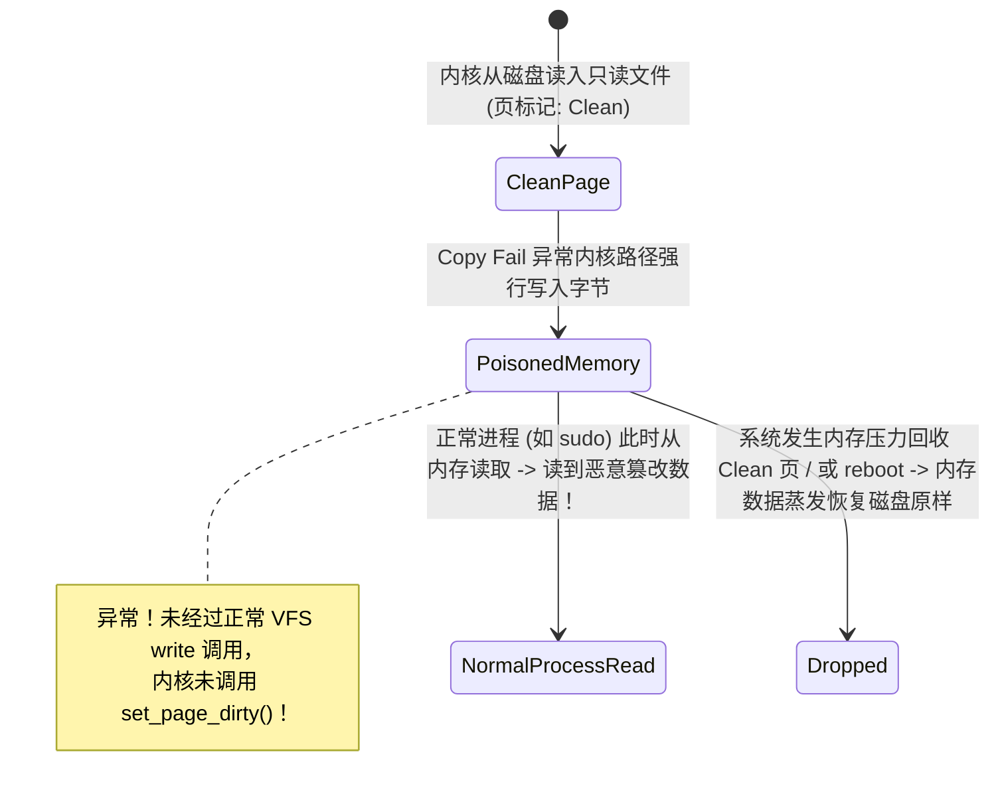

# 第 44 天：Copy Fail 与页缓存污染——从零拷贝机制到内存越权提权

---

## 【📌 一句话核心概括】
**页缓存污染（Page Cache Poisoning）利用内核管道或加密子系统在零拷贝（Zero-Copy）数据流转中的标志位或散射表（Scatterlist）引用混淆缺陷，绕过 VFS 的只读权限检查（`O_RDONLY`），迫使内核将不可写文件的只读共享物理页（Page Cache）原位覆盖污染，实现无需劫持控制流的静默任意特权提升。**

## 【📖 通俗原理解释】
- **页缓存（Page Cache）的共享机制**：为避免频繁访问慢速磁盘，Linux 内核将文件数据缓存在物理内存的 Page Cache 中。系统中所有进程（包括特权守护进程如 `sshd`、`sudo`）在读取只读系统文件（如 `/etc/passwd`）时，映射的均是内核中同一份物理页。
- **VFS 权限检查的逻辑边界**：在用户态发起普通的 `write()` 系统调用时，虚拟文件系统（VFS）层会严格核验文件描述符是否具备写权限（非只读）；但内核自身内部的 I/O 处理路径（如 `splice()` 管道流转、内核加密 API 等）通常假定传递的数据页已通过校验，缺少冗余的物理页只读防护。
- **污染触发机理（以 Dirty Pipe 与 Copy Fail 为例）**：
  - *Dirty Pipe (CVE-2022-0847)*：管道缓冲区未清零 `PIPE_BUF_FLAG_CAN_MERGE` 标志位，攻击者借此将只读文件的 Page Cache 混入管道环形队列，后续对管道的合法写入直接借用内核驱动“穿透”写入了只读文件的内存页；
  - *Copy Fail (CVE-2026-31431)*：内核加密子系统在构建输出散射表（`dst_sg`）时，错误混淆了源只读页与目标缓冲区的物理引用，在密文写回时直接覆盖了只读母版页。
- **幽灵污染与非写回特性**：被污染的页直接保留在 RAM 中并立即对全系统所有进程生效（例如 `/etc/passwd` 中 root 密码字段被置空）。由于该修改未经过常规的 `mark_buffer_dirty` 标脏流程，内核不会将其立即回写磁盘，但内存中的虚假数据已足够攻击者瞬间完成提权认证。

---

## 【🎯 为什么需要它与设计动机】

1. **颠覆传统二进制安全的“降维打击”**
   - 传统利用讲究“控制 RIP、ROP 链、覆盖返回地址、过 Canary、过 ASLR”。
   - 但页缓存污染（如 **CVE-2022-0847 脏管道 Dirty Pipe**、**CVE-2026-31431 Copy Fail**）开启了一种全新的降维攻击范式：**零控制流劫持，直接改写只读受保护文件的物理内存页**！
2. **突破 VFS 文件系统权限的铜墙铁壁**
   即使一个文件归属 `root:root`，文件权限是 `0444`（全员只读），并且通过 `open(path, O_RDONLY)` 打开，攻击者依然能通过内核管道或加密子系统内部的混淆缺陷，迫使内核自己的写路径越权写入 Page Cache。
3. **掌握现代高性能“零拷贝（Zero-Copy）”技术的底层代价**
   为了追求万兆网络与极致磁盘吞吐，现代 Linux 内核广泛推行了 `splice()`、`vmsplice()`、`sendfile()` 等零拷贝机制，允许在不发生 CPU 内存复制的前提下将数据页在管道、网络套接字和文件之间流转。这种对性能的极致压榨，在底层元数据管理稍有疏漏时，便会暴露出毁灭性的跨子系统安全缝隙。

---

## 【🔬 核心概念深度剖析】

### 1. 进程看到的文件到底来自哪里？（三层存储拓扑）

很多初学者误以为每次 `read()` 都会直接访问物理磁盘，实则不然：

```text
物理存储设备 (NVMe SSD / HDD)
         │  1. 首次读取时由块设备驱动从磁盘载入
         ▼
内核页缓存 (Page Cache / Folio)  <--- 极其高效的全局共享物理 RAM 内存页！
         │  2. read() 拷贝 / mmap() 虚拟映射 / execve() 加载
         ▼
用户进程虚拟空间 (Process Virtual Address Space)
- Process A (/usr/bin/sudo)
- Process B (低权限攻击者)
- Process C (系统守护进程 sshd)
```

> [!IMPORTANT]
> **全局单例定律**：
> 在同一个 Linux 宿主内核中，对于同一个底层 inode 文件对象，**全系统只有一份对应的 Page Cache 物理内存页**！
> 无论系统中运行了 10 个容器还是 100 个进程，只要它们读取该文件的同一偏移区间，MMU 最终寻址的都是同一块物理 RAM。一旦该物理页被篡改，**全系统所有进程看到的内容同步质变**！

---

### 2. 四层权限防线的维度剥离

为什么 `O_RDONLY` 挡不住页缓存污染？看清操作系统的四层独立权限：

| 权限层级 | 裁决位置 | 约束对象 | Copy Fail 为什么能穿透？ |
| :--- | :--- | :--- | :--- |
| **1. 文件系统 ACL** | 磁盘 Inode（`stat.st_mode`） | 用户/组是否有读写权 | 攻击者根本不调用 `sys_write`，完全规避该检查。 |
| **2. 文件描述符访问模式** | `struct file.f_flags` | 具体 `fd` 是否为 `O_RDONLY` | 攻击者以合法的 `O_RDONLY` 打开文件，不触碰只读限制。 |
| **3. MMU 用户页表权限** | CPU PTE 属性（`R-X` / `RW-`） | 用户态汇编指令能否写内存 | 实际写入动作是由**内核态代码（Ring 0）**代劳，不经过用户页表。 |
| **4. 内核内部数据流所有权** | **管道缓冲区标志 / Scatterlist 方向** | **内核各子系统是否尊重只读约定** | **防线失守！** 内核在零拷贝流转中弄丢了只读标志，误将只读缓存页送入了可写流水线！ |

---

### 3. Copy Fail（CVE-2026-31431）与脏管道（Dirty Pipe）的核心漏洞机理

#### ① 脏管道（Dirty Pipe / CVE-2022-0847）机理：
- Linux 管道由环形数组 `struct pipe_buffer` 组成。
- 5.8 内核引入了新标志 `PIPE_BUF_FLAG_CAN_MERGE`（允许后续写入追加合并进同一内存页）。
- **漏洞点**：`splice()` 将文件 Page Cache 页面注入管道时，**未将原管道项中的 `flags` 清零**！
- 攻击者先向管道写满数据（使标志位被置为 `CAN_MERGE`），排空管道后 `splice` 只读文件，再向管道写入数据时，内核错误判定“该页可合并追加”，直接调用 `copy_page_from_iter()` 将攻击数据写入了只读文件的 Page Cache！

#### ② Copy Fail（CVE-2026-31431）机理：
- Linux 内核加密子系统提供 `AF_ALG` 套接字接口，允许用户态调用内核硬件加速加密算法（如 AEAD `authencesn`）。
- 2017 年为了极致性能引入了**原地处理（In-place Processing）**优化：允许源数据（Input）与目标数据（Output）共用同一个分散/聚集列表（Scatterlist）。
- **漏洞点**：当用户通过 `splice()` 将文件 Page Cache 页面传入 `AF_ALG` 套接字作为加密输入时，内核错误地将这个**只读源页面链接进了可写的目标 Scatterlist（`dst_sg`）**！
- 当 AEAD 算法在计算鉴权标签时，执行了一次看似合法的内部 4 字节暂存写入，内核直接一笔写穿了受保护的文件页缓存！

---

### 4. 幽灵写状态机：为什么污染可能“只留内存、不落磁盘”？



- **正常写入流程**：`write()` -> 修改内存 -> 显式设置 `PageDirty` 标志 -> 后台 `kswapd` 或 `sync` 将脏页回写磁盘。
- **漏洞写入流程**：异常写入绕过了 VFS，**物理内存页中的字节改变了，但内核元数据依然认为它是一个“干净页（Clean Page）”**！
- 这种状态极其可怕：**系统在运行时被完全劫持，但在磁盘取证、文件哈希比对时却显示 100% 完好无损！**

---

## 【🛠️ 工业实操与反汇编/调试验证】

### 1. 验证页缓存全局共享现象（`cache_share_demo.c`）

我们编写一个程序，展示即便在两个完全独立的进程间，只读打开同一个文件时，底层访问的也是同一个物理 Page Cache。

```c
#include <stdio.h>
#include <stdlib.h>
#include <fcntl.h>
#include <unistd.h>
#include <sys/mman.h>

int main(void) {
    const char *test_file = "/tmp/shared_target.txt";
    // 准备一个测试文件
    FILE *fp = fopen(test_file, "w");
    fputs("ORIGINAL_SECRET_PASSWORD_1234\n", fp);
    fclose(fp);

    // 进程 A 以只读方式映射
    int fd_a = open(test_file, O_RDONLY);
    char *map_a = mmap(NULL, 4096, PROT_READ, MAP_SHARED, fd_a, 0);

    printf("[+] Process A mapped file at user virtual address: %p\n", map_a);
    printf("[+] Process A reads: %s", map_a);

    // 进程 B 同样只读映射
    int fd_b = open(test_file, O_RDONLY);
    char *map_b = mmap(NULL, 4096, PROT_READ, MAP_SHARED, fd_b, 0);

    printf("[+] Process B mapped file at user virtual address: %p\n", map_b);
    printf("[+] Process B reads: %s", map_b);

    puts("\n[*] Theoretical Note: While map_a and map_b differ in virtual address,");
    puts("    both page tables point to the EXACT SAME physical page in Linux Page Cache.");
    puts("    If kernel writes to that physical page, both A and B see it instantly!");

    munmap(map_a, 4096);
    munmap(map_b, 4096);
    close(fd_a);
    close(fd_b);
    return 0;
}
```

### 2. 编译并观察页缓存与 PFN（物理页框号）

```bash
gcc -O0 cache_share_demo.c -o cache_share_demo
./cache_share_demo
```
终端输出：
```text
[+] Process A mapped file at user virtual address: 0x7ffff7fcb000
[+] Process A reads: ORIGINAL_SECRET_PASSWORD_1234
[+] Process B mapped file at user virtual address: 0x7ffff7fca000
[+] Process B reads: ORIGINAL_SECRET_PASSWORD_1234
```
在 Linux 下通过 `/proc/self/pagemap` 可以解析这两个虚拟地址对应的底层物理内存页框号（PFN），二者完全指向同一物理 RAM 单元！

---

## 【⚠️ 常见陷阱与避坑指南】

| 陷阱与盲区 | 深度机理与表象 | 正确解法与工程底线 |
| :--- | :--- | :--- |
| **误以为页缓存污染具有永久性** | 攻击者修改了 `/etc/passwd`，以为哪怕重启系统也依然拥有 Root。结果系统重启或 `drop_caches` 后修改消失。 | 深刻理解“内存态污染”与“持久落盘”的差异：若未触发脏页写回，污染在页回收或机器重启后自动重置。 |
| **容器内攻击宿主文件的失效场景** | 在 Docker 容器内试图污染一个文件，但由于容器层使用了 OverlayFS 的 `copy-up` 机制，实际上写的是属于容器的私有新 inode，未污染宿主。 | 只有当容器挂载了宿主机的底层真实卷（Volume）或共享同一未拷贝底层文件对象时，页缓存共享才生效。 |
| **写入跨越页面边界（Page Boundary）** | 试图一次性写入超过 4096 字节的数据，导致后续写入跨入下一个物理页，触发未映射异常或断裂。 | 必须按 4KB 页面严密计算页内偏移（`offset % 4096`），确保攻击载荷落在单一受控页面内。 |

---

## 【💼 经典面试与工程实操自测】

### Q1：为什么像 Dirty Pipe（CVE-2022-0847）或 Copy Fail 这类漏洞，能够强行改写权限为 `0444`（全员只读）且归属 `root` 的系统文件？
> **参考答案**：
> - Linux 的文件权限检查是由 **VFS（虚拟文件系统）** 在执行常规文件写入系统调用（如 `write()`、`pwrite()`）时实施的逻辑判断。
> - 而在 Dirty Pipe / Copy Fail 中，攻击者并没有调用 `write()` 写入文件，而是调用了诸如 `splice()` 管道操作或 `AF_ALG` 密码学接口。
> - 漏洞让内核在处理管道合并或加密分散列表时，**丢失了数据流的只读约束**。最终的内存写入动作是由内核本身的合法例程（Ring 0）在操作其自身的 Page Cache 物理内存。由于是在内核态执行直接物理页操作，完全跳过了用户态和 VFS 的只读检查门禁。

### Q2：什么是“幽灵写入（Ghost Writing）”？为什么说这类漏洞修改后的文件在磁盘哈希比对时完全正常？
> **参考答案**：
> - 正常的写操作在修改物理内存页后，必须调用内核接口（如 `set_page_dirty()`）将该页打上“脏页（Dirty）”标记，告知文件系统后台调度刷盘线程（`flusher`）将其同步回磁盘。
> - 在页缓存污染漏洞中，由于写入是由异常内核路径间接发生的，内核并未将其注册为脏页（依然标记为 Clean）。
> - 因此，**磁盘介质上的原始字节从未被修改**，任何直接读取磁盘裸分区的取证工具或哈希计算都会显示文件绝对干净；但所有通过内核 Page Cache 访问该文件的实时进程读到的却是被篡改的恶意数据。

### Q3：内核开发中针对零拷贝（Zero-Copy）数据流水线，最根本的防御加固准则是什么？
> **参考答案**：
> 1. **严格的内存页面只读不变性（Immutability）**：来自文件页缓存的页面必须被标记为不可变更输入（`const` 语义），严禁在未经深拷贝（Copy-on-Write）的情况下将其指针作为任何写操作的目标地址；
> 2. **初始化与防御性清零**：在管道结构体或缓冲区流转重用时，必须无条件对控制标志位进行防御性重置（如 `buf->flags = 0`），绝不允许残留状态影响后续零拷贝流程；
> 3. **源与目标物理分离（Out-of-place Processing）**：在加密、压缩等高复杂子系统中，强制分离输入列表（`src_sg`）与输出列表（`dst_sg`），从架构上杜绝共用混淆。