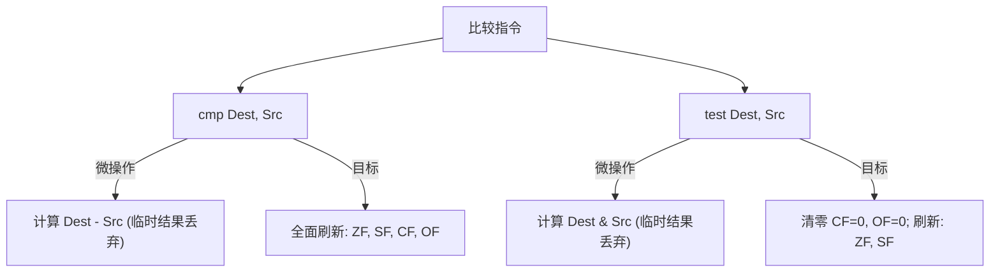

# 第 5 天：比较、条件跳转与控制流

> **学习目标**：彻底理解计算机底层**如何实现“做决定”与“走循环”**。
> 今天你必须掌握的底层核心能力是：
> * 理解 `cmp`（假减法）与 `test`（假与运算）如何通过 RFLAGS 标志位向 CPU 汇报状态；
> * 彻底搞懂 4 大核心标志位（`ZF`, `SF`, `CF`, `OF`）的物理意义，理解为什么有符号比较必须满足 `SF != OF`；
> * 深刻辨析有符号跳转（`jg / jl`）与无符号跳转（`ja / jb`）的本质边界，杜绝安全漏洞；
> * 掌握 `if-else`、`for`、`while` 循环在反汇编中的控制流图 (CFG) 特征；
> * 剖析 `switch` 稠密跳转表（Jump Table）与无符号越界检查技巧；
> * 理解 `-O2` 优化下消除分支预测惩罚的条件传送指令 `cmov`。

---

## 【📌 一句话核心概括】
**计算机底层通过丢弃计算结果仅保留标志位的指令（`cmp` 做假减法、`test` 做假与运算）更新 RFLAGS 寄存器，由随后的条件跳转（`jcc`）或条件传送（`cmovcc`）根据标志位组合决定控制流分支走向。**

## 【📖 通俗原理解释】
- **比较指令的硬件本质**：CPU 无法直接“理解条件”，它只做算术。`cmp a, b` 内部计算 $a - b$，`test a, b` 内部计算 $a \& b$，计算结果直接丢弃，仅用运算过程中的进位、溢出、符号和零状态去更新 RFLAGS 寄存器的对应比特位。
- **有符号与无符号的双轨判定**：无符号跳转（`ja`/`jb`，高于/低于）仅依据进位标志 `CF` 与零标志 `ZF` 裁决；有符号跳转（`jg`/`jl`，大于/小于）则依据符号标志 `SF` 与溢出标志 `OF` 的异或关系（`SF != OF` 代表小于）判定。混淆二者会导致严重的整型溢出或负数越界漏洞。
- **分支与循环的汇编结构**：`if-else` 在汇编中表现为“条件跳转跳向 else 分支，主干执行完毕后接无条件 `jmp` 跳过 else”；循环则表现为闭环回跳，现代编译器倾向于优化为“循环底部做条件跳转向上回跳”，减少循环内部指令开销。
- **跳转表（Jump Table）与条件传送（`cmov`）**：分支密集且跨度小（如稠密 `switch`）时，编译器在数据段构建跳转地址数组直接索引跳转；而在 `-O2` 优化下，对于简单赋值分支，编译器使用 `cmov` 条件传送替代跳转指令，避免分支预测失败带来的流水线清空惩罚。

---

# 一、比较的底层物理本相：`cmp` 与 `test`



## 1. `cmp Dest, Src`（做减法，但不留结果）

```asm
cmp eax, ebx
```
* **执行动作**：内部执行暂时的无符号与有符号减法：$\text{temp} = \text{EAX} - \text{EBX}$；
* **关键特质**：`EAX` 和 `EBX` 的寄存器数值**完全保持不变**！
* **产物**：仅根据 `temp` 的计算状态更新 RFLAGS 寄存器中的标志位。

---

## 2. `test Dest, Src`（按位与，用于探测状态）

```asm
test eax, eax
```
* **执行动作**：内部执行 $\text{temp} = \text{EAX} \ \& \ \text{EAX}$；
* **工业级最佳实践**：
  * 若 `EAX == 0`：与出来的结果也是 0，硬件置 **`ZF = 1`**；
  * 若 `EAX` 的最高位是 1（负数）：硬件置 **`SF = 1`**；
  * **优势**：比 `cmp eax, 0` 机器码更短（2 字节 vs 3 字节），且硬件固定清零 `CF=0, OF=0`，是编译器检测“指针是否为 NULL”或“整数是否为 0”的绝对首选。

---

# 二、四大核心标志位 (RFLAGS) 深度剖析

RFLAGS 寄存器中的每一个标志位，都是由算术逻辑单元 (ALU) 的物理门电路直接输出的：

| 标志位 | 全称与中文 | 物理置 1 条件 | 典型关注场景 |
| :---: | :--- | :--- | :--- |
| **`ZF`** | **Zero Flag (零标志)** | 运算结果的**所有位全部为 0** | 检查相等 (`A == B`)、检查 NULL |
| **`SF`** | **Sign Flag (符号标志)** | 运算结果的**最高位 (MSB) 为 1** | 判断有符号数是正是负 |
| **`CF`** | **Carry Flag (进位/借位标志)** | 无符号数加法**最高位产生进位**，或减法**产生借位** | **无符号数大小比较** (`ja / jb`) |
| **`OF`** | **Overflow Flag (溢出标志)** | 有符号数补码运算结果**超出了该宽度的表示范围** | **有符号数大小比较** (`jg / jl`) |

---

## 深刻剖析：为什么有符号比较必须同时看 `SF` 和 `OF`？

这是汇编语言中最具智慧的硬件逻辑设计之一！

很多初学者天真地认为：“判断 $A < B$，做减法 $A - B$，只要看符号位 `SF == 1`（结果是负数）不就知道谁小了吗？”
**错！因为有符号减法可能会发生溢出（OF=1）！**

### 经典翻车案例（以 8 位有符号整数为例，范围 $-128 \sim +127$）：
比较 $A = 127$ 与 $B = -1$（显然 $127 > -1$）：
1. CPU 内部执行减法：$127 - (-1) = 128$；
2. 在 8 位有符号体系中，$128$ 的二进制是 `1000 0000`，这在补码中代表 **$-128$**！
3. 此时 ALU 发现结果变成了负数，于是点亮了 **`SF = 1`**！
4. **如果只看 `SF`，CPU 就会荒唐地得出：“$127 < -1$”！**

### 硬件的救命解法：异或校验！
* 在上述计算中，两个符号相反的数相减产生了破防溢出，硬件同时点亮了溢出标志 **`OF = 1`**！
* 计算机科学家给出的真理公式：
  $$\text{有符号小于 } (A < B) \iff \mathbf{SF \neq OF}$$
* 在上述例子中：$\text{SF} = 1, \text{OF} = 1$，二者相等（$\text{SF} == \text{OF}$），因此条件判定为**假**！成功逆转了误判，保护了数学真理！

---

# 三、条件跳转指令大全：严防混淆矩阵

在 `cmp A, B` 之后，CPU 提供了两套完全平行的跳转指令集：

```text
               ┌──────────────── cmp A, B ────────────────┐
               │                                          │
       【无符号数比较法典】                        【有符号数比较法典】
  (以 Above / Below 命名)                     (以 Greater / Less 命名)
  --------------------------                 --------------------------
   ja   高于跳转 (A > B, CF=0&ZF=0)           jg   大于跳转 (A > B, ZF=0&SF=OF)
   jae  高于等于 (A >= B, CF=0)               jge  大于等于 (A >= B, SF=OF)
   jb   低于跳转 (A < B, CF=1)                jl   小于跳转 (A < B, SF!=OF)
   jbe  低于等于 (A <= B, CF=1|ZF=1)          jle  小于等于 (A <= B, ZF=1|SF!=OF)
```

### 通用等价跳转指令（无/有符号通用）：
* **`je / jz`**：相等 / 为零则跳（判断条件：`ZF == 1`）
* **`jne / jnz`**：不相等 / 非零则跳（判断条件：`ZF == 0`）

> [!WARNING]
> **CVE 漏洞重灾区：有符号比较与无符号比较混用**
> 在 C 代码中：
> ```c
> int len = read_input();
> if (len > 100) return -1; // 程序员以为防护得很严密
> memcpy(buf, src, len);    // 致命破防！
> ```
> 若攻击者传入 `len = -1`：
> * `if (len > 100)` 编译为 `jle`（有符号），$-1 \le 100$ 通过检查！
> * 传给 `memcpy` 时，第三个参数是无符号 `size_t`，$-1$ 瞬间变成 `0xFFFFFFFFFFFFFFFF`（1800 亿亿字节），瞬间击穿整个堆栈！

---

# 四、三大控制流的高级语言到汇编映射

## 1. `if-else` 分支结构

```c
if (a > b) {
    do_something();
} else {
    do_other();
}
```

编译器通常采用**“条件不满足则跳过”**的反向跳转逻辑：

```asm
    cmp     rdi, rsi        ; 比较 a 和 b
    jle     .L_else         ; 若 a <= b (反向条件)，跳到 else 分支
    call    do_something
    jmp     .L_end          ; 执行完跳出
.L_else:
    call    do_other
.L_end:
```

---

## 2. `for` 循环与 `while` 循环

```c
for (int i = 0; i < n; i++) {
    sum += i;
}
```

在未优化的 `-O0` 汇编中，编译器普遍采用经典的 **“先跳到底部做初检 (Jump-to-Middle)”** 结构：

```asm
    mov     dword ptr [rbp - 4], 0     ; i = 0
    jmp     .L_loop_check              ; 一进门先跳到底部检查条件！

.L_loop_body:
    mov     eax, dword ptr [rbp - 4]
    add     dword ptr [rbp - 8], eax   ; sum += i
    add     dword ptr [rbp - 4], 1     ; i++

.L_loop_check:
    mov     eax, dword ptr [rbp - 4]
    cmp     eax, dword ptr [rbp - 12]  ; 比较 i 与 n
    jl      .L_loop_body               ; 若 i < n，循环跳回主体
```

---

## 3. `switch` 稠密跳转表（Jump Table）

当 `case` 分支数量较多且取值密集时（如 `case 0, 1, 2, 3, 4`），编译器会构建跳转表：

```text
数据段 (.rodata) 跳转表:
.L_JUMPTABLE:
    .quad .L_case_0
    .quad .L_case_1
    .quad .L_case_2
    .quad .L_case_3
```

### 跳转表核心汇编三步走：

```asm
    ; 假设 RDI 传入用户选项 index
    cmp     rdi, 3                      ; 1. 范围越界检查
    ja      .L_default                  ; 【神技】：用无符号 ja 一举两得！若 rdi 是负数，
                                        ; 强转为无符号会变成海量大数，同时拦截 <0 与 >3！

    lea     rdx, [.L_JUMPTABLE]         ; 2. 取得跳转表首地址
    jmp     [rdx + rdi*8]               ; 3. 间接长跳转！一步直达目标 case！
```

---

# 五、编译器 `-O2` 优化黑科技：条件传送 `cmov`

看最简单的取最大值函数：

```c
int max(int a, int b) {
    return (a > b) ? a : b;
}
```

* **`-O0` 朴素生成（带分支跳转，存在预测失败风险）**：
  ```asm
      cmp     edi, esi
      jle     .L_b_is_max
      mov     eax, edi
      ret
  .L_b_is_max:
      mov     eax, esi
      ret
  ```
* **`-O2` 极致优化（彻底消灭分支）**：
  ```asm
      cmp     edi, esi
      mov     eax, esi        ; 先盲猜 b 是最大值
      cmovg   eax, edi        ; 条件传送！若 a > b (ZF=0 且 SF==OF)，硬件自动覆盖 eax = a
      ret                     ; 全程一条跳转指令都没有！CPU 流水线畅通无阻！
  ```

---

# 六、第 5 天完整可编译综合实验源码

将以下代码保存为 `day5_lab.c`，完整验证标志位、跳转表与有符号陷阱：

```c
#include <stdio.h>
#include <stdint.h>

// 1. 有符号比较
int test_signed(int32_t a, int32_t b) {
    if (a < b) return 1;
    return 0;
}

// 2. 无符号比较
int test_unsigned(uint32_t a, uint32_t b) {
    if (a < b) return 1;
    return 0;
}

// 3. 稠密 switch (诱导跳转表生成)
const char *test_switch(int val) {
    switch (val) {
        case 0: return "Zero";
        case 1: return "One";
        case 2: return "Two";
        case 3: return "Three";
        case 4: return "Four";
        default: return "Other";
    }
}

int main(void) {
    int32_t s_a = -1;
    int32_t s_b = 100;
    printf("有符号比较: -1 < 100 ? %d (预期 1)\n", test_signed(s_a, s_b));

    uint32_t u_a = (uint32_t)-1; // 0xFFFFFFFF (42 亿)
    uint32_t u_b = 100;
    printf("无符号比较: (uint)-1 < 100 ? %d (预期 0)\n", test_unsigned(u_a, u_b));

    printf("Switch(2): %s (预期 Two)\n", test_switch(2));
    printf("Switch(9): %s (预期 Other)\n", test_switch(9));
    return 0;
}
```

编译与观察反汇编：
```bash
gcc -std=c17 -O2 -g day5_lab.c -o day5_lab
./day5_lab

# 查看生成的跳转表与无分支汇编
objdump -d -M intel --no-show-raw-insn day5_lab | grep -A 15 "<test_switch>:"
```

---

# 七、第五天通关核心口试自测（闭卷大通关）

### 题 1：`cmp eax, ebx` 执行后，`EAX` 的值改变了吗？它到底改变了什么？
* **满分回答**：
  `EAX` 自身的值完全没有被修改。`cmp` 只在 CPU 内部暂存减法结果，用来刷新 RFLAGS 状态寄存器中的 `ZF`, `SF`, `CF`, `OF` 四大核心标志位。

### 题 2：为什么有符号数的小于跳转（`jl`）不能只看符号标志 `SF`？
* **满分回答**：
  因为有符号数减法可能发生正负溢出（即结果超出了当前位宽能表达的补码范围）。一旦溢出（`OF = 1`），符号位就会出现逻辑颠倒（例如极大的正数减负数反而变成了负数）。因此必须依靠 $\mathbf{SF \neq OF}$ 这一充要条件，才能在溢出发生时精准矫正判断。

### 题 3：`test eax, eax` 与 `cmp eax, 0` 在功能和指令上有何不同？
* **满分回答**：
  两者在设置 `ZF`（是否为零）和 `SF`（是否为负）上逻辑完全一致。但底层微操作不同：`cmp` 执行减法，而 `test` 执行按位与（且强制清零 `CF` 和 `OF`）。在机器码层面，`test eax, eax` 仅需 2 个字节，比 `cmp eax, 0` 更短，且执行效率更高，是编译器判断 0 与 NULL 的首选用法语义。

### 题 4：为什么编译器在处理 `switch` 跳转表边界检查时，喜欢用 `ja` 而不是 `jg`？
* **满分回答**：
  这是一种极其精妙的优化技巧。通过使用无符号的 `ja`（高于跳转），如果传入的索引是负数，负数的补码在无符号视角下会被解释为一个极大的正数（例如 $-1$ 解释为 $2^{32}-1$），从而同时大于上限值。这样仅需一条 `cmp` + 一条 `ja` 指令，就同时把“小于 0”和“超过最大分支数”的两种异常情况一次性全部拦截！