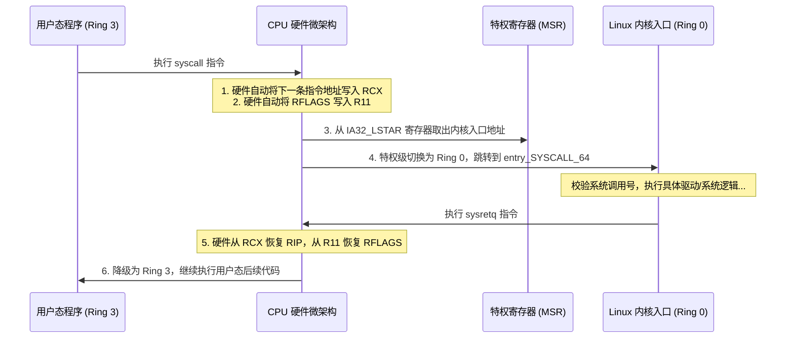

# 第 6 天：Linux x86-64 系统调用

> **学习目标**：打破高级语言的封装，**肉眼直视操作系统内核边界与用户态/内核态切换**。
> 今天你必须掌握的底层核心能力是：
> * 理解用户态（Ring 3）向内核态（Ring 0）切换的物理微操作与硬件特权级跃迁；
> * 深刻辨析普通函数 ABI 与内核系统调用 ABI 的本质差异，彻底搞懂**为什么第 4 个参数绝对不能放在 `RCX` 而是移到了 `R10`**；
> * 掌握 Raw Syscall 返回值的 `-4095` 边界判定与 `errno` 映射机制；
> * 理解程序真正入口 `_start` 的栈布局，搞懂**为什么 `_start` 结尾执行 `ret` 必死无疑**；
> * 摆脱 libc 依赖，纯手工手写裸汇编程序，实现底层 I/O、`strace` 系统调用追踪与精准错误处理。

---

## 【📌 一句话核心概括】
**Linux x86-64 系统调用是用户态（Ring 3）跨越硬件特权级屏障向内核态（Ring 0）请求系统服务的标准通道；它通过 `RAX` 传递调用号、经由 `syscall` 触发硬件状态跃迁，并因硬件覆盖机制强制使用 `R10` 替代普通函数约定的 `RCX` 传递第 4 个参数。**

## 【📖 通俗原理解释】
- **特权级切换与 `syscall` 硬件行为**：普通应用程序受硬件限制无法直接访问物理设备与内核空间。执行 `syscall` 指令时，CPU 硬件瞬间将特权级提升为 Ring 0，自动将下一条用户态指令地址保存进 `RCX`、当前标志位保存进 `R11`，随后跳转至内核预设的系统调用入口（`entry_SYSCALL_64`）。
- **第 4 参数寄存器变动根因**：普通 C 函数调用约定使用 `RCX` 传递第 4 个参数。但因 `syscall` 指令在硬件执行瞬间会无条件覆写 `RCX`（存入 Return RIP），若仍用 `RCX` 传参会被硬件直接冲毁。因此 Linux 内核 ABI 强制将系统调用第 4 参数改由 `R10` 承载。
- **原始返回值与 `-4095` 错误判定**：内核系统调用返回时，成功则返回非负值或正数；失败则返回负数错误码（如 `-1` 到 `-4095`，对应 `-EPERM` 等）。在底层汇编中，通常利用无符号比较 `cmp rax, -4095; jae .error` 高效识别所有错误分支（因为补码负数在无符号下位于极高地址区间）。
- **`_start` 入口与无退路约束**：ELF 文件的物理入口是 `_start` 而非 `main`。`_start` 是内核装载后直接跳转的起点，其栈顶保存的是 `argc` 而非 `call` 压入的返回地址。因此 `_start` 末尾执行 `ret` 会把整数误当地址跳转导致崩溃，必须显式触发 `sys_exit` 系统调用让内核终结进程。

---

# 一、两套平行的寄存器调用约定 (ABI 对比)

在 Linux x86-64 体系下，存在两套完全不可混淆的寄存器规范：

| 传参顺序 / 作用 | 普通函数调用约定 (System V ABI) | Linux 内核系统调用约定 (Kernel Syscall) | 为什么存在差异？ |
| :---: | :---: | :---: | :--- |
| **系统调用号** | 无 | **`RAX`** | 告诉内核具体办什么业务（如 0:read, 1:write, 60:exit） |
| **第 1 个参数** | `RDI` | `RDI` | 一致 |
| **第 2 个参数** | `RSI` | `RSI` | 一致 |
| **第 3 个参数** | `RDX` | `RDX` | 一致 |
| **第 4 个参数** | **`RCX`** | **`R10`** | **核心冲突点！硬件 syscall 指令强制摧毁 `RCX`！** |
| **第 5 个参数** | `R8` | `R8` | 一致 |
| **第 6 个参数** | `R9` | `R9` | 一致 |
| **返回值** | `RAX` | `RAX` | 成功返回正数/字节数；失败返回负数错误码 |
| **破坏的临时寄存器**| 调用者保存寄存器 | **`RCX` 与 `R11` 被硬件无情改写** | 内核用它们保存用户态恢复现场 |

---

# 二、硬件机制：`syscall` 指令微操作

当 CPU 在用户态执行 `syscall` 时，硬件电路在几纳秒内完成了如下特权级跃迁：



> [!IMPORTANT]
> 这就是为什么你在反汇编中看到 libc 包装函数（如 `syscall(SYS_write, ...)`）时，第一件事总是：
> ```asm
> mov r10, rcx ; 将第 4 个参数从 RCX 转移到 R10，为硬件让路！
> ```

---

# 三、Raw Syscall 返回值与 `-4095` 错误检查黑科技

## 1. libc 包装函数 vs 原始系统调用

* **在 libc 封装层**：失败返回 `-1`，并将正数错误码藏在线程局部变量 `errno` 中（例如 `errno = 9` 代表 `EBADF`）。
* **在裸汇编系统调用层 (Raw Syscall)**：**根本没有 `errno`！** 内核把“负的错误码”直接原样放在 `RAX` 中返回（例如返回 `-9`）。

Linux 内核标准规定：**所有合法的 `errno` 取值范围在 $1 \sim 4095$ 之间**。
因此，若系统调用失败，`RAX` 的取值必定落在 $[-4095, -1]$ 区间内！

---

## 2. 一行汇编搞定错误判定的数学推导

```asm
cmp rax, -4095
jae .syscall_failed
```

### 为什么必须用无符号高于等于 `jae`？
在 64 位补码体系中：
* 成功返回值（如写入 100 字节）：`RAX = 100`（无符号即 100）；
* 错误返回值（如 `-EBADF`，即 `-9`）：
  $$-9 \implies \text{十六进制: } \mathbf{0xFFFFFFFFFFFFFFF7}$$
* 边界值 $-4095$：
  $$-4095 \implies \text{十六进制: } \mathbf{0xFFFFFFFFFFFFF001}$$

当执行 `cmp rax, -4095` 后紧跟 **无符号比较 `jae`** 时：
* 如果发生错误，`RAX` 介于 `0xFFFFFFFFFFFFF001` 到 `0xFFFFFFFFFFFFFFFF` 之间，在无符号数值上**极其庞大**，必然满足 `jae`（无符号高于等于），瞬间跳入错误分支！
* 如果成功，`RAX` 是正数（如 100），在无符号数值上远远小于 `0xFFFFF001`，判定为假，顺畅通过！

---

# 四、`_start` 入口处的真实世界

当操作系统 `execve` 启动一个 ELF 可执行文件时，内核完成虚拟内存映射后，直接把控制流交给了 **`_start`**（而不是 `main`）。

### `_start` 入口时栈顶布局全景：

```text
地址高低       栈指针位置           内容                               类型
高地址        [RSP + 8 + 8*argc + 8] [ 环境变量 envp[0] 指针 ]           char *
             ...                    [ ... ]
             [RSP + 16]             [ argv[1] 命令行参数指针 ]         char *
             [RSP + 8]              [ argv[0] 程序名字符串指针 ]        char *
低地址  RSP -> [RSP]                  [ argc 参数个数 (例如 1) ]         uint64_t
```

> [!CAUTION]
> **为什么 `_start` 绝不能 `ret`？**
> 普通函数是被 `call` 调用的，栈顶存着返回地址；而 `_start` 是内核启动的起点，此时当前栈顶 `[RSP]` 上装载的是整数 **`argc`**（比如 1）！
> 如果你在 `_start` 结尾执行 `ret`，CPU 会把数字 `1` 弹出装入 `RIP`，并试图去物理地址 `0x00000001` 取指令执行，立刻被操作系统以 **`SIGSEGV`（段错误）** 当场击杀！
> **唯一合法的离场方式：调用 `sys_exit` (系统调用号 60)。**

---

# 五、实战工程一：零 libc 依赖纯裸汇编 Hello World

新建文件 `day6_minimal.S`：

```asm
.intel_syntax noprefix
.text
.globl _start

# 常用系统调用号宏定义
.set SYS_write, 1
.set SYS_exit,  60
.set STDOUT,    1

_start:
    # 1. 调用 write(STDOUT, message, message_len)
    mov     eax, SYS_write              # 系统调用号 1
    mov     edi, STDOUT                 # 参数 1: 文件描述符 (stdout)
    lea     rsi, [rip + message]        # 参数 2: 字符串物理基址 (RIP 相对寻址)
    mov     edx, message_len            # 参数 3: 写入长度
    syscall                             # 发起特权调用！

    # 2. 检查返回值是否发生错误
    cmp     rax, -4095
    jae     .write_failed               # 错误则跳转

    # 3. 正常退出 exit(0)
    mov     eax, SYS_exit               # 系统调用号 60
    xor     edi, edi                    # 退出码 0
    syscall

.write_failed:
    # 4. 异常退出 exit(1)
    mov     eax, SYS_exit
    mov     edi, 1                      # 退出码 1
    syscall
    ud2                                 # 永远不应该执行到这里，触发非法指令安全防线

.section .rodata
message:
    .ascii "Hello, Raw Linux Syscall!\n"
    .set message_len, . - message       # 计算当前点与起始点的距离作为长度
```

### 编译与验证命令（脱离任何 libc 链接）：

```bash
# -nostdlib：不链接任何标准库与默认启动代码 crt1.o
gcc -nostdlib -no-pie day6_minimal.S -o day6_minimal
./day6_minimal
```

### 使用 `strace` 透视系统调用真相：

```bash
strace ./day6_minimal
```
输出清晰明了，没有任何动态链接器的杂质：
```text
execve("./day6_minimal", ["./day6_minimal"], 0x7ffd...) = 0
write(1, "Hello, Raw Linux Syscall!\n", 26) = 26
exit(0)                                 = ?
+++ exited with 0 +++
```

---

# 六、实战工程二：工业级健壮回显器 (处理 EINTR 与部分写)

系统调用不仅要会发起，更要能防范工业界两大经典边界异常：
1. **`EINTR`（被操作系统信号中断）**：必须自动重新发起；
2. **部分写入 (Partial Write)**：一次 `write` 没写完，必须推进指针循环补写。

新建文件 `day6_echo.S`：

```asm
.intel_syntax noprefix
.text
.globl _start

.set SYS_read,  0
.set SYS_write, 1
.set SYS_exit,  60
.set STDIN,     0
.set STDOUT,    1
.set EINTR,     4
.set BUF_SIZE,  1024

_start:
.read_loop:
    # 1. 发起 read(STDIN, buffer, BUF_SIZE)
    mov     eax, SYS_read
    mov     edi, STDIN
    lea     rsi, [rip + buffer]
    mov     edx, BUF_SIZE
    syscall

    # 检查 read 错误
    cmp     rax, -4095
    jae     .check_read_error

    # 检查 EOF (读取到 0 字节，用户按 Ctrl+D)
    test    rax, rax
    jz      .normal_exit

    # 2. 准备输出已读到的字节数
    mov     r12, rax                    # r12 = 剩余待写字节数 (callee-saved 安全)
    lea     r13, [rip + buffer]         # r13 = 当前缓冲区写入游标

.write_chunk:
    mov     eax, SYS_write
    mov     edi, STDOUT
    mov     rsi, r13                    # 当前写入起点
    mov     rdx, r12                    # 写入剩余长度
    syscall

    cmp     rax, -4095
    jae     .check_write_error

    # 推进游标并计算剩余
    add     r13, rax
    sub     r12, rax
    jnz     .write_chunk                # 没写完则继续推进循环写！

    jmp     .read_loop                  # 当前批次写完，继续读下一批

.check_read_error:
    neg     rax                         # 将负的 -EINTR 翻转为正
    cmp     rax, EINTR
    je      .read_loop                  # 信号打断，无罪重试
    jmp     .error_exit

.check_write_error:
    neg     rax
    cmp     rax, EINTR
    je      .write_chunk                # 信号打断，重试当前写
    jmp     .error_exit

.normal_exit:
    mov     eax, SYS_exit
    xor     edi, edi
    syscall

.error_exit:
    mov     eax, SYS_exit
    mov     edi, 1
    syscall

.section .bss
.align 16
buffer:
    .skip BUF_SIZE                      # 在 BSS 段分配 1024 字节未初始化空间
```

---

# 七、第六天通关核心口试自测（闭卷大通关）

### 题 1：普通 x86-64 函数调用和 Linux 系统调用的前 6 个传参寄存器有何不同？
* **满分回答**：
  普通函数传参顺序为：`RDI, RSI, RDX, RCX, R8, R9`；
  Linux 系统调用传参顺序为：`RDI, RSI, RDX, R10, R8, R9`（同时 `RAX` 用于存放系统调用号）。
  核心差异在于**第 4 个参数由 `RCX` 替换为了 `R10`**。

### 题 2：为什么系统调用绝对不能把第 4 个参数放在 `RCX` 中？
* **满分回答**：
  因为在 x86-64 体系下，CPU 硬件执行 `syscall` 指令进入内核的一瞬间，微架构会自动抢占 `RCX` 保存当前的程序计数器 `RIP`（用于在 `sysret` 返回时知道回哪里），同时抢占 `R11` 保存 `RFLAGS`。如果在 `RCX` 传参，该参数尚未进入内核就被 CPU 硬件本身覆盖碾碎了。

### 题 3：为什么不能用 `rax == -1` 来判断裸系统调用 (Raw Syscall) 是否出错？
* **满分回答**：
  只有高级语言的 libc 封装函数才会把所有错误统一折叠为 `-1` 并设置 `errno`；而底层的原始系统调用若发生错误，内核会直接在 `RAX` 中返回具体的负错误码（范围为 $[-4095, -1]$）。如果只判断 `RAX == -1`，就只能抓到 `-EPERM (1)` 这一种错误，其余几百种内核错误码全部会被误判为成功，造成灾难性逻辑漏洞。

### 题 4：为什么纯裸汇编程序的 `_start` 入口绝对不能执行 `ret`？
* **满分回答**：
  因为 `_start` 是进程启动的第一条用户态指令，它是由内核直接跳入的，而不是被其他函数通过 `call` 指令调用的。此时栈顶存放的不是返回地址，而是命令行参数总数 `argc`。执行 `ret` 会把整数 `argc` 强行弹出到 `RIP` 去执行，导致由于访问非法的极低内存地址而立即崩溃。程序必须通过 `sys_exit` 系统调用让内核终止进程。