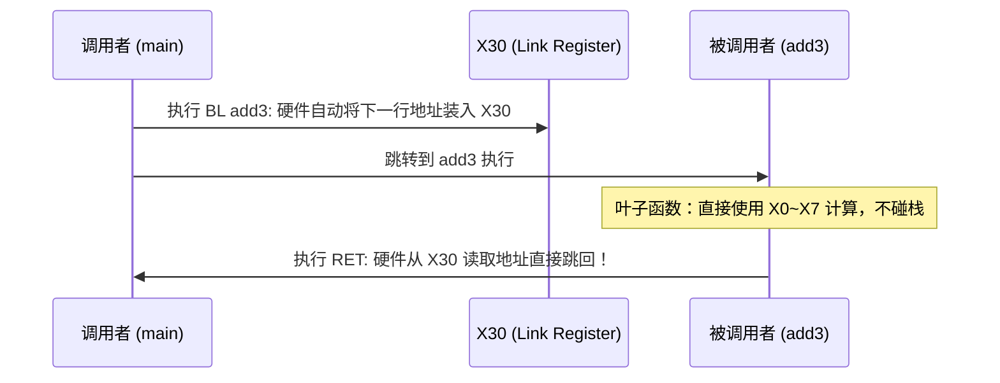

# 第 7 天：ARM64 架构和寄存器——系统解析

> **学习目标**：从 x86-64 跨入当今移动端、服务器与 Apple Silicon 的绝对霸主——**ARM64 (AArch64)** 架构。
> 今天你必须掌握的底层核心能力是：
> * 彻底理清 ARM64、AArch64、A64、ARMv8-A 四大规范的层级关系；
> * 掌握 31 个通用寄存器（`X0`~`X30`）分工、`W` 寄存器 32 位清零律与 `XZR` 零寄存器；
> * 深刻理解 ARM64 的 **Load/Store 纯粹架构**（算术绝不碰内存，碰内存绝不算术）；
> * 洞悉 `BL` 与 `X30`（链接寄存器 LR）的物理微操作，搞懂**为什么非叶子函数必须用 `stp x29, x30` 保护栈帧**；
> * 理解 PSTATE 与 NZCV 标志位，以及为什么只有带 `S` 后缀（如 `ADDS`）才允许更新标志位；
> * 掌握无分支利器 `CSEL` 条件选择指令与 QEMU 跨架构调试实战。

---

## 【📌 一句话核心概括】
**ARM64（AArch64）是采用定长 32 位指令编码的精简指令集（RISC）架构，遵循严格的 Load/Store 内存访问模型，提供 31 个通用寄存器（`X0`~`X30`）并通过专用链接寄存器 `X30`（LR）在硬件层面高速保管函数返回地址。**

## 【📖 通俗原理解释】
- **定长指令与 Load/Store 纯粹分工**：与 x86-64 指令变长且可直接对内存操作不同，ARM64 每条指令固定为 4 字节。算术指令（如 `ADD`）绝对无法直接操作内存，所有数据必须先经 `LDR` 加载到寄存器运算，再经 `STR` 存储回内存。
- **寄存器与传参扩容优势**：提供 31 个 64 位通用寄存器，前 8 个（`X0`~`X7`）用于传递参数与返回值，使更多函数调用无需压栈传参即可在硬件寄存器内高速闭环。`W0`~`W30` 为其低 32 位视图，写入时同样触发高 32 位清零。
- **`BL` 与 `X30`（LR）返回机制**：执行函数跳转 `BL target` 时，硬件不碰内存栈，而是直接把返回地址写入 `X30` 寄存器；退出时执行 `RET` 即跳回 `X30` 指向的地址。因此，若当前函数还会调用其他子函数（非叶子函数），必须在开头用 `stp x29, x30, [sp, -N]!` 将其备份至栈，防止新调用的 `BL` 覆写原返回地址。
- **零寄存器（`XZR`）与显式标志位更新**：`XZR`/`WZR` 为只读为 0、写入即丢弃的特殊寄存器，用于无需保存结果的计算（如 `CMP` 本质就是向 `XZR` 执行 `SUBS`）；普通算术指令默认不更改 PSTATE（NZCV 标志位），唯有带 `S` 后缀（如 `ADDS`）时才更新标志位。

---

# 一、四大概念严谨定性

| 概念术语 | 严格标准属性 | 工业界通俗定位 |
| :--- | :--- | :--- |
| **ARM64** | 统称 / 别名 | Linux 内核目录、Apple 开发者生态中对 64 位 ARM 体系的通俗商业称谓 |
| **AArch64** | **架构执行状态 (Execution State)** | ARMv8-A / ARMv9-A 规范中定义的 **64 位硬件运行环境**（支持 64 位寄存器与虚拟地址） |
| **A64** | **指令集 (Instruction Set)** | AArch64 状态下运行的**固定 32 位宽指令集**（区别于 32 位的 A32 与 Thumb T32） |
| **AAPCS64** | **ABI 调用约定规范** | ARM 官方颁布的 64 位寄存器传参、栈对齐与生命周期标准法典 |

> **为什么 64 位的处理器，指令长度必须是 32 位？**
> “64 位”指的是寄存器位宽和内存寻址能力是 64 位；而指令本身固定为 32 位长，是为了保证 CPU 取指译码单元能像流水线切豆腐一样高速对齐并行解码，彻底消除 CISC 指令长度不一带来的译码级联延迟。

---

# 二、AArch64 通用寄存器模型全景

ARM64 拥有 31 个 64 位通用寄存器，其 32 位截断分身以 `W` 命名（`W0` ~ `W30`）：

```text
64 位寄存器: X0 (0 ~ 63 位)
┌───────────────────────────────┬───────────────────────────────┐
│          高 32 位              │        低 32 位: W0           │
└───────────────────────────────┴───────────────────────────────┘
```

> [!WARNING]
> **硬件铁律（与 x86-64 完全相同）**：
> **写入任何 `W` 寄存器（如 `mov w0, 1`），硬件强制将该寄存器的高 32 位自动抹零清零！**

### AAPCS64 通用寄存器分配职责大表

| 寄存器 | 32位分身 | AAPCS64 权威规范职责 | 保存者属性 |
| :--- | :--- | :--- | :---: |
| **`X0` ~ `X7`** | `W0` ~ `W7` | **前 8 个函数入参**；`X0`（及 `X1`）兼任**函数返回值** | **Caller-Saved** (调用者保存) |
| **`X8`** | `W8` | 间接结果寄存器（用于存放返回大结构体的内存地址） | Caller-Saved |
| **`X9` ~ `X15`** | `W9` ~ `W15` | 通用临时寄存器（可随意乱涂乱写） | Caller-Saved |
| **`X16`, `X17`** | `W16`, `W17` | IP0, IP1（过程间调用临时寄存器，PLT 动态链接蹦床专享） | Caller-Saved |
| **`X18`** | `W18` | 平台专用寄存器（iOS 禁用，Android 用于 ShadowCallStack） | 保留 |
| **`X19` ~ `X28`** | `W19` ~ `W28`| **被调用者保护寄存器**（用之前必须压栈备份，退出前恢复） | **Callee-Saved** (被调者保存) |
| **`X29`** | `W29` | **FP (Frame Pointer 栈帧基指针)**，相当于 x86 的 RBP | Callee-Saved |
| **`X30`** | `W30` | **LR (Link Register 链接寄存器)**，存放函数返回地址！ | 特殊 |
| **`SP`** | `WSP` | **Stack Pointer 栈顶指针**（硬件绑定 16 字节对齐） | 独立特权 |
| **`XZR`** | `WZR` | **Zero Register 零寄存器**（读恒为 0，写则直接丢弃） | 虚拟恒定 |

---

# 三、函数调用核心：`BL` 与 `X30 (LR)` 的物理微操作

在 x86 架构中，`call` 指令直接向内存栈压入 8 字节；而在 ARM64 中，**内存访问被视为高昂开销，函数跳转优先使用寄存器！**



## 1. 叶子函数极速返回
如果一个函数不再调用任何人（叶子函数），它**从头到尾根本不需要建立栈帧，连内存都不用碰一下**！
`BL` 将返回地址记在 `X30`，函数算完执行一条 **`RET`**（等价于 `BR X30`），瞬间光速返回！

## 2. 非叶子函数的“车票存根”机制 (`STP / LDP`)
如果函数内部还要调用别的子函数，第二次 `BL` 会直接冲毁 `X30`！
因此，**非叶子函数进门必须将 `X29 (FP)` 和 `X30 (LR)` 成对打包压栈**：

```asm
my_function:
    ; === 1. 经典 ARM64 序言 ===
    stp     x29, x30, [sp, -16]!    ; 预变基寻址: SP 先减 16, 然后将 x29 和 x30 存入栈顶
    mov     x29, sp                 ; 建立栈帧锚点 (FP = SP)

    bl      child_function          ; 调用别人，此时 X30 被安全覆盖也无妨

    ; === 2. 经典 ARM64 尾声 ===
    ldp     x29, x30, [sp], 16      ; 后变基寻址: 从栈顶恢复 x29 和 x30, SP 再收回 16 字节
    ret                             ; 拿着完好无损的 X30 原路返回！
```

---

# 四、纯粹 RISC 的灵魂：Load / Store 架构

在 x86-64 中，你可以写 `add dword ptr [rdi], 1`（一条指令直接修改内存）；
**在 ARM64 中，这被绝对严令禁止！算术指令只能发生在寄存器之间！**

```asm
; ARM64 修改内存数值的三部曲:
ldr     w1, [x0]        ; 1. Load: 将 x0 门牌号里的 4 字节数据捞入寄存器 w1
add     w1, w1, 1       ; 2. Math: 寄存器内部做加法运算
str     w1, [x0]        ; 3. Store: 将算好的新数据写回 x0 门牌号中
```

### 寻址模式的三大绝技：
1. **普通基址偏移**：`ldr x1, [x0, 8]`（读取地址为 $X0 + 8$ 的 8 字节）
2. **预变基 (Pre-Index，带 `!`)**：`ldr x1, [x0, 16]!`（**先**将 $X0 = X0 + 16$，**再**读取新地址）
3. **后变基 (Post-Index)**：`ldr x1, [x0], 16`（**先**读取旧 $X0$ 地址，**读完后**自动推进 $X0 = X0 + 16$）

---

# 五、PSTATE 与 NZCV 标志位状态机

ARM64 的程序状态寄存器提供 4 颗核心指示灯：
* **`N` (Negative)**：结果为负数（最高位是 1）；
* **`Z` (Zero)**：结果为全零；
* **`C` (Carry)**：无符号加法进位，或无符号减法**无借位 (No Borrow)**；
* **`V` (oVerflow)**：有符号数溢出。

> **核心法则**：
> 普通 `ADD`, `SUB`, `AND` 指令**绝不修改 NZCV**！
> 只有指令末尾带 **`S`** 的版本（如 `ADDS`, `SUBS`, `ANDS`）或专门的 `CMP`（底层是 `SUBS XZR, Xn, Xm`）才会点亮指示灯！

---

# 六、消灭分支的利器：`CSEL` 条件选择指令

ARM64 拥有强大的条件选择指令集，完全免除了分支跳转和流水线预测失效惩罚：

```asm
csel    w0, w1, w2, ge
```
> **大白话语义**：
> 如果满足 `ge`（大于等于，即 $N == V$），则选择将 `W1` 写入 `W0`；否则将 `W2` 写入 `W0`！相当于单指令完成：
> `w0 = (flags == ge) ? w1 : w2;`

---

# 七、完整可编译实战工程：手写 ARM64 汇编与 QEMU 模拟

编写三个函数：
1. `arm_add3`：纯寄存器运算；
2. `arm_max3`：使用 `CMP` + `CSEL` 实现无分支求最大值；
3. `arm_wrapper`：演示非叶子函数使用 `STP/LDP` 保护 `X29/X30`。

### 1. 汇编源文件 `test.S`

```asm
.text
.globl arm_add3
.globl arm_max3
.globl arm_wrapper

# int64_t arm_add3(int64_t a, int64_t b, int64_t c)
# 入参: X0=a, X1=b, X2=c; 返回值: X0
arm_add3:
    add     x0, x0, x1          # x0 = a + b
    add     x0, x0, x2          # x0 = (a + b) + c
    ret                         # 纯叶子函数，直接拿 X30 返回！

# int64_t arm_max3(int64_t a, int64_t b, int64_t c)
arm_max3:
    cmp     x0, x1              # 比较 a 与 b
    csel    x3, x0, x1, ge      # x3 = (a >= b) ? a : b

    cmp     x3, x2              # 比较 当前最大值 与 c
    csel    x0, x3, x2, ge      # x0 = (x3 >= c) ? x3 : c
    ret

# int64_t arm_wrapper(int64_t a, int64_t b, int64_t c)
arm_wrapper:
    stp     x29, x30, [sp, -16]! # 预变基压栈：保护调用者的 FP 和返程车票 LR
    mov     x29, sp             # 建立栈帧

    bl      arm_add3            # 嵌套调用子函数，X30 被覆写为下一行地址
    lsl     x0, x0, 1           # 将结果乘 2 (逻辑左移 1 位)

    ldp     x29, x30, [sp], 16  # 后变基弹栈：恢复原调用者的 FP 和返程车票 LR
    ret                         # 安全重归调用者！
```

---

### 2. C 驱动程序 `main.c`

```c
#include <stdio.h>
#include <stdint.h>
#include <assert.h>

extern int64_t arm_add3(int64_t a, int64_t b, int64_t c);
extern int64_t arm_max3(int64_t a, int64_t b, int64_t c);
extern int64_t arm_wrapper(int64_t a, int64_t b, int64_t c);

int main(void) {
    int64_t sum = arm_add3(10, 20, 30);
    printf("[ARM64] arm_add3 = %ld (预期 60)\n", sum);
    assert(sum == 60);

    int64_t m = arm_max3(-5, 88, 42);
    printf("[ARM64] arm_max3 = %ld (预期 88)\n", m);
    assert(m == 88);

    int64_t wrap = arm_wrapper(10, 20, 30);
    printf("[ARM64] arm_wrapper = %ld (预期 120)\n", wrap);
    assert(wrap == 120);

    printf("恭喜！ARM64 纯手写汇编与嵌套栈帧调用完全成功！\n");
    return 0;
}
```

---

### 3. 交叉编译与 QEMU 模拟运行命令

在 Linux 或 WSL 环境下：

```bash
# 安装交叉编译器与 QEMU 用户态模拟器
sudo apt-get install -y gcc-aarch64-linux-gnu qemu-user

# 交叉编译链接为 ARM64 ELF
aarch64-linux-gnu-gcc -O2 -g test.S main.c -o arm_lab -static

# 验证架构
file arm_lab # 输出: ELF 64-bit LSB executable, ARM aarch64...

# 通过 QEMU 用户态直接执行 ARM64 二进制！
qemu-aarch64 ./arm_lab
```

---

# 八、第七天通关核心口试自测（闭卷大通关）

### 题 1：x86-64 与 ARM64 在函数返回地址的物理保存方式上有何本质区别？
* **满分回答**：
  * **x86-64** 的 `call` 指令强制将返回地址压入**内存中的栈顶**；
  * **ARM64** 的 `BL` 指令默认将返回地址保存在硬件的 **`X30` (Link Register 链接寄存器)** 中，完全不访问内存栈。
  * 只有在非叶子函数需要嵌套调用他人时，才由程序员在序言中通过 `stp x29, x30, [sp, -16]!` 手动将 `X30` 备份到栈中。

### 题 2：为什么写入 32 位寄存器 `w0` 会影响 64 位寄存器 `x0` 的高 32 位？
* **满分回答**：
  ARM64 架构规范硬性规定：对任何 32 位 `W` 寄存器的写操作，硬件会自动对其进行**零扩展 (Zero-Extension)**，即将对应的 64 位 `X` 寄存器的高 32 位无条件强制清零。这与 x86-64 写入 `EAX` 清零 `RAX` 高位的设计初衷完全一致，用于切断乱序执行流水线的数据伪依赖。

### 题 3：ARM64 架构的 Load/Store 思想是什么？能否直接写 `add [x0], 1`？
* **满分回答**：
  绝对不能。ARM64 是纯粹的精简指令集 (RISC) 架构，算术逻辑运算指令（如 `ADD`, `SUB`, `AND`）的操作数必须全部是寄存器或立即数，绝对不能直接访问内存。所有内存数据必须通过专用的 `LDR` 加载到通用寄存器中，在寄存器内部完成计算后，再通过 `STR` 存储指令写回内存。

### 题 4：ARM64 中 `XZR` 寄存器有什么特殊用途？
* **满分回答**：
  `XZR` 是 64 位的零寄存器（Zero Register）。当作为源操作数读取时，其值永远恒等于纯零；当作为目的操作数写入时，写入的数据会被硬件直接丢弃（吞噬）。这使得 CPU 无需分配额外的临时寄存器，例如 `CMP Xn, Xm` 指令底层实际上就是执行 `SUBS XZR, Xn, Xm`，将减法结果扔进 `XZR`，仅保留更新的 NZCV 标志位。