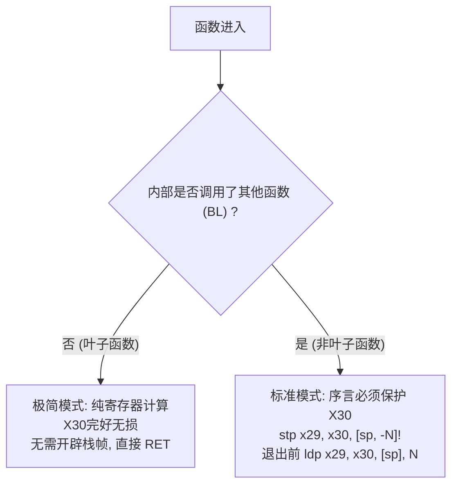

# 第 8 天：ARM64 的 Load／Store、BL 和 x30

> **学习目标**：彻底掌握 ARM64 最具工业实战价值的**内存访问身法与函数链接体系**。
> 今天你必须掌握的底层核心能力是：
> * 闭着眼写出 ARM64 的四大寻址模式（基址、偏移、预变基 `!`、后变基）；
> * 掌握双黄蛋打包指令 `STP` 与 `LDP`，推导标准的 16/32 字节函数栈帧拓扑；
> * 彻底搞懂 `ADRP + ADD` 配合定位全局符号的“两步大页寻址”数学原理；
> * 熟练运用轻量级判断跳转 `CBZ / CBNZ`（不污染标志位）；
> * 深入剖析叶子函数与非叶子函数在 `X30 (LR)` 保护上的本质差异，完成手写汇编工程实战。

---

## 【📌 一句话核心概括】
**ARM64 通过预变基（`!`）与后变基寻址实现访存与指针自动步进的单指令合并，利用成对存取指令（`STP`/`LDP`）高效构建 16 字节对齐的栈帧，并借助 `ADRP + ADD` 经典两步法在定长 32 位指令空间内优雅解析 64 位全局符号地址。**

## 【📖 通俗原理解释】
- **内存寻址的自动步进（变基身法）**：普通偏移 `[x0, 8]` 仅以此刻计算出的地址访存而不改动 `X0`；预变基 `[x0, 8]!` 先将 `X0 += 8` 再以此新地址访存（常用作入栈压栈）；后变基 `[x0], 8` 则先以当前 `X0` 访存随后自动 `X0 += 8`（遍历连续数组利器，无需额外自增指令）。
- **成对存取（`STP` / `LDP`）与栈对齐**：ARM64 硬件强制要求栈指针 `SP` 必须 16 字节对齐。通过 `stp x29, x30, [sp, -16]!` 可在单条指令内打包保存帧指针 `X29`（FP）与返回地址 `X30`（LR），同时完成 16 字节空间开辟，效率远超单寄存器压栈。
- **全局地址拆解（`ADRP + ADD`）**：由于 ARM64 指令定长 32 位，无法容纳 64 位的绝对全局地址。编译器将其分为两步：`ADRP` 以 PC 为基准定位目标所属的 4KB 页面基地址（清除低 12 位），紧接着一条 `ADD` 指令加上目标在页内的 12 位偏移量，两者拼出完整 64 位地址。
- **免标志位跳转（`CBZ` / `CBNZ`）**：传统分支需先经 `CMP` 改变 NZCV 标志位再跳转；`CBZ Rn, label`（为0跳转）直接以目标寄存器内容为判断源，不污染标志位寄存器，使分支决策更为紧凑。

---

# 一、ARM64 四大寻址模式全面拆解

ARM64 提供了极其强大的地址发生器，四大寻址模式对比矩阵：

| 寻址模式名称 | 汇编标准语法 | 底层物理访存地址 | 执行后基址寄存器 `X0` 的值 | 核心工业应用场景 |
| :--- | :--- | :---: | :---: | :--- |
| **1. 简单基址寻址** | `ldr x1, [x0]` | `x0` | `x0` (不变) | 读取指针所指目标 (`*p`) |
| **2. 普通偏移寻址** | `ldr x1, [x0, 8]` | `x0 + 8` | `x0` (不变) | 访问结构体成员 (`s->field`) |
| **3. 预变基寻址 (Pre-Index)** | `ldr x1, [x0, 8]!` | `x0 + 8` | **`x0 = x0 + 8`** (被修改!) | **函数序言压栈开辟空间** |
| **4. 后变基寻址 (Post-Index)** | `ldr x1, [x0], 8` | **`x0`** (先访存) | **`x0 = x0 + 8`** (后推进!) | **循环遍历连续数组** |

---

## 1. 预变基与后变基的指令时序动画

### 预变基 `stp x29, x30, [sp, -16]!`（先变后存）
```text
时序 1 (推进指针) : SP = SP - 16
时序 2 (打包存入) : Mem[SP] = x29;  Mem[SP + 8] = x30
```

### 后变基 `ldp x29, x30, [sp], 16`（先取后退）
```text
时序 1 (打包取出) : x29 = Mem[SP];  x30 = Mem[SP + 8]
时序 2 (恢复指针) : SP = SP + 16
```

---

# 二、双寄存器打包存取：`STP` 与 `LDP`

```asm
stp Xa, Xb, [Base, Offset]
ldp Xa, Xb, [Base, Offset]
```

* **原子硬件发射**：在现代高性能超标量内核（如 Cortex-X 系列或 Apple M 系列）中，`STP/LDP` 会被单个微操作发射到 Load/Store 单元，吞吐翻倍。
* **16 字节对齐契约**：在 AAPCS64 规定中，`SP` 必须时刻保持 16 字节对齐。由于两个 64 位寄存器恰好占据 $8 + 8 = 16$ 字节，`stp` 与 `ldp` 天生就是为 16 字节对齐而生的黄金搭档！

---

# 三、跨 4GB 远距离寻址：`ADRP + ADD` 物理数学推导

假设我们要访问一个定义在全局数据段的字符串 `my_string`：

```asm
adrp    x0, my_string           ; 步骤 1: 加载目标所在的 4KB 页面基址
add     x0, x0, :lo12:my_string ; 步骤 2: 加上低 12 位页内偏移量
```

```text
 目标 64 位全局物理地址:
 ┌──────────────────────────────────────────────┬────────────┐
 │       高 52 位 (4KB 页对齐基址)               │ 低 12 位   │
 └──────────────────────┬───────────────────────┴─────┬──────┘
                        │ ADRP 装入 X0                │ :lo12: 加法补齐
                        ▼                             ▼
                 [ 目标 4KB 页面基址 ]         +  [ 页内偏移量 ]
```

### 为什么必须分两步？
1. **`ADRP` (Address of Page)**：
   * 将当前指令的 `PC` 地址低 12 位清零（对齐到 4KB 页首）；
   * 加上指令编码中内嵌的有符号 21 位页偏移量（乘以 4KB）；
   * 寻址范围可覆盖当前 PC 前后 **$\pm 4\text{ GB}$** 的庞大虚存范围！
2. **`:lo12:` 汇编属性指示符**：
   * 提取链接期符号地址的最低 12 位（取值范围 $0 \sim 4095$）；
   * 一条普通的立即数加法 `ADD` 恰好能容纳 12 位立即数！两相结合，完美合体。

---

# 四、控制流跳转利器：`B`、`CBZ`、`BL`、`RET`

## 1. 条件分支家族对比

| 指令 | 中文名称 | 是否依赖 NZCV 标志位 | 典型使用场景 |
| :--- | :--- | :---: | :--- |
| **`B`** | 无条件跳转 | 否 | `goto`、跳过 else 分支 |
| **`B.EQ / B.NE`** | 条件跳转 | **是**（检查 Z 标志） | 配套 `CMP` 使用 |
| **`B.GT / B.LT`** | 有符号大小跳转 | **是**（检查 N 和 V） | 有符号大小分支 |
| **`CBZ Rn, label`** | **为零则跳转** | **否！不碰标志位** | 检查指针 NULL、检查循环计数到 0 |
| **`CBNZ Rn, label`**| **非零则跳转** | **否！不碰标志位** | 检查非空、快速循环继续 |

---

## 2. 函数链接两件套：`BL` 与 `RET`

* **`BL label` (Branch with Link)**：
  硬件微操作：
  1. 将紧挨其后的下一条指令地址写入 **`X30` (LR)**：`X30 = PC + 4`
  2. 跳转到 `label`。
* **`RET`**：
  硬件微操作：
  1. 无条件跳转到 `X30` 记录的地址（等价于 `BR X30`）。

---

# 五、叶子函数 vs 非叶子函数的栈帧分水岭



### 32 字节非叶子函数栈帧拓扑（同时保存局部临时 Callee 寄存器）：

```text
栈底 (高地址)
            ┌──────────────────────────────────────────────┐
  SP + 24   │ 保存的 Callee-Saved 寄存器 X20                 │
            ├──────────────────────────────────────────────┤
  SP + 16   │ 保存的 Callee-Saved 寄存器 X19                 │
            ├──────────────────────────────────────────────┤
  SP + 8    │ 保存的返回地址 X30 (LR)                        │
            ├──────────────────────────────────────────────┤
  SP + 0    │ 保存的旧栈帧指针 X29 (FP)                      │ <--- 此时 X29 (FP) 固定在此
栈顶 (低地址)└──────────────────────────────────────────────┘ <--- 当前 SP 停在此处 (32字节满足16字节对齐)
```

---

# 六、第 8 天完整跨平台可编译实战工程

编写完整的底层模块 `day8.S` 与驱动 `main.c`：
1. `sum_u64_array`：利用**后变基 `[x0], 8`** 和 **`CBNZ`** 实现极致紧凑的数组求和；
2. `call_twice`：标准非叶子函数，使用 `STP/LDP` 分配 32 字节栈帧并安全嵌套调用。

### 1. 汇编源文件 `day8.S`

```asm
.text
.globl sum_u64_array
.globl call_twice
.globl get_message_addr

# uint64_t sum_u64_array(const uint64_t *arr, size_t n)
# 入参: X0 = arr 指针, X1 = n 元素个数
# 返回值: X0 = 总和
sum_u64_array:
    mov     x2, x0              # x2 = 移动的数组游标
    mov     x0, 0               # x0 作为累加和累加器，先清零

.loop_check:
    cbz     x1, .sum_done       # 若剩余元素 n == 0，立即退出循环 (不碰 NZCV)

    ldr     x3, [x2], 8         # 【后变基核心】：先读取 [x2] 到 x3，再自动将 x2 增加 8 字节！
    add     x0, x0, x3          # 累加
    sub     x1, x1, 1           # 计数器减 1
    cbnz    x1, .loop_check     # 若还有剩余，继续循环！

.sum_done:
    ret                         # 纯叶子函数，直接拿 X30 返回

# uint64_t call_twice(uint64_t (*fn)(uint64_t), uint64_t val)
# 非叶子函数：必须开辟 32 字节栈帧保护现场
call_twice:
    # === 1. 函数序言 (开辟 32 字节) ===
    stp     x29, x30, [sp, -32]! # 保护调用者 FP 和 LR
    mov     x29, sp              # 建立当前栈帧基准
    stp     x19, x20, [sp, 16]   # 保护 Callee-Saved 寄存器 x19 和 x20

    mov     x19, x0              # x19 = 保存函数指针 fn
    mov     x0, x1               # x0 = 入参 val
    blr     x19                  # 间接调用第 1 次: fn(val)，返回结果在 x0

    blr     x19                  # 间接调用第 2 次: fn(x0)，再次嵌套！

    # === 2. 函数尾声 (拆除 32 字节) ===
    ldp     x19, x20, [sp, 16]   # 先恢复 x19 和 x20
    ldp     x29, x30, [sp], 32   # 恢复 FP 和 LR，并将 SP 退栈 32 字节
    ret

# const char *get_message_addr(void)
# 演示 ADRP + ADD 两步全局符号寻址
get_message_addr:
    adrp    x0, global_msg
    add     x0, x0, :lo12:global_msg
    ret

.section .rodata
global_msg:
    .string "Hello from ARM64 ADRP+ADD!\n"
```

---

### 2. C 语言驱动 `main.c`

```c
#include <stdio.h>
#include <stdint.h>
#include <assert.h>

extern uint64_t sum_u64_array(const uint64_t *arr, size_t n);
extern uint64_t call_twice(uint64_t (*fn)(uint64_t), uint64_t val);
extern const char *get_message_addr(void);

// 回调函数
uint64_t add_ten(uint64_t x) {
    return x + 10;
}

int main(void) {
    // 1. 验证后变基遍历
    uint64_t arr[4] = {10, 20, 30, 40};
    uint64_t sum = sum_u64_array(arr, 4);
    printf("[1] sum_u64_array = %lu (预期 100)\n", sum);
    assert(sum == 100);

    // 2. 验证非叶子函数两次嵌套调用
    // add_ten(5) = 15; add_ten(15) = 25
    uint64_t res = call_twice(add_ten, 5);
    printf("[2] call_twice(add_ten, 5) = %lu (预期 25)\n", res);
    assert(res == 25);

    // 3. 验证 ADRP + ADD 符号定位
    const char *msg = get_message_addr();
    printf("[3] get_message_addr = %s", msg);

    printf("恭喜！ARM64 高级寻址、双寄存器打包与链接实战全线通过！\n");
    return 0;
}
```

---

### 3. 交叉编译与 QEMU 执行验证

```bash
# 交叉编译为 ARM64 ELF 静态可执行文件
aarch64-linux-gnu-gcc -O2 -g day8.S main.c -o day8_lab -static

# 通过 QEMU 模拟器直接执行
qemu-aarch64 ./day8_lab
```

---

# 七、第八天通关核心口试自测（闭卷大通关）

### 题 1：`ldr x1, [x0, 8]!` 与 `ldr x1, [x0], 8` 有什么本质区别？
* **满分回答**：
  * `[x0, 8]!` 是**预变基寻址 (Pre-Index)**：基址寄存器 `X0` 先自增 8，然后从新地址 `X0 + 8` 处加载数据写入 `X1`（常用于开辟栈帧空间）；
  * `[x0], 8` 是**后变基寻址 (Post-Index)**：先从原始 `X0` 地址处加载数据写入 `X1`，读取完毕后 `X0` 自身再自动推进 8 字节（常用于在循环中连续向前遍历数组元素）。

### 题 2：为什么 `stp x29, x30, [sp, -16]!` 是 ARM64 最标准的函数序言？
* **满分回答**：
  1. `X29 (FP)` 负责锚定调用者的栈帧基准，`X30 (LR)` 负责保存原路返回的返程车票；
  2. AAPCS64 规定栈指针 `SP` 必须严格保持 16 字节对齐，两个 64 位寄存器正好占 16 字节；
  3. `stp ... [sp, -16]!` 一条指令同时完成了“推进栈顶 16 字节”与“原子写入 FP 和 LR”两件事，效率最高且绝不破坏对齐契约。

### 题 3：ARM64 为什么不能用一条指令直接把一个 64 位全局变量的绝对地址装入寄存器？它是如何解决的？
* **满分回答**：
  因为 ARM64 的 A64 指令集固定每条指令只有 32 位长，扣除操作码字段后，根本不可能塞得下一个 64 位的绝对地址数值。
  ARM64 采用 **`ADRP + ADD` 组合机制** 解决：
  * 第一步用 `ADRP` 基于 PC 相对寻址计算出目标符号所在的 4KB 虚拟内存页基地址；
  * 第二步用 `ADD` 加上目标符号在该页内的 12 位偏移量（`:lo12:`），两步拼装即可在 $\pm 4\text{ GB}$ 范围内定位任意全局地址。

### 题 4：`cbz x0, label` 和 `cmp x0, 0; b.eq label` 相比有什么优势？
* **满分回答**：
  1. 指令体积更小：`cbz` 是单条 32 位指令，而 `cmp + b.eq` 是两条指令（共 64 位）；
  2. 执行更快：避免了多余的状态依赖；
  3. **最关键优势是不影响标志位**：`cbz` 执行判定时绝对不会修改 PSTATE 寄存器中的 NZCV 标志位，使得它可以在多重条件判断链中作为“零开销守门员”使用。